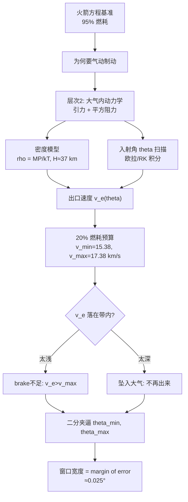

# 2010 题A：海王星飞船气动制动（Aerobraking a Space Probe at Neptune）

## 1. 题目原文与关键数据

> 原题（压缩）：In order to enter a circular orbit around another planet, a spacecraft must change its trajectory upon arrival... Consider a 2,500 kg spacecraft to be sent to the planet Neptune, arriving at a speed of 30 km/s. **How much margin of error would be allowed in designing a trajectory through the outer atmosphere of Neptune which would save a significant amount of fuel?**

中文：进入环行星圆轨道必须在到达时改变轨迹，否则将飞掠而过。纯火箭反推的燃料代价高昂；若轨迹恰巧穿过行星大气，阻力可大幅省燃料。考虑一个 2,500 kg 的探测器以 30 km/s 到达海王星，问：为"显著省燃料"而穿越海王星外层大气的轨迹设计，允许多大的误差裕度？

题面只给了两个数，其余全部要靠自查与自设：

| 参数 | 数值 | 来源 |
|---|---|---|
| 飞船质量 $m_0$ | 2,500 kg | 题面 |
| 到达速度 | 30 km/s | 题面（在哪个半径处？见 §2） |
| 海王星引力参数 $\mu=GM$ | $6.84\times10^{15}\ \mathrm{m^3/s^2}$（$M=1.024\times10^{26}$ kg） | 自查 |
| 海王星半径 $R_N$（1 bar 层） | 24,764 km | 自查 |
| "外层大气"边界 $R_{\rm atm}$ | $R_N+600$ km，该处 $P\approx10^{-4}$ mbar $=0.01$ Pa | 金牌队取用并有文献锚点 |
| 大气成分 | 80% H₂ + 19% He | 自查 |
| 比冲/排气速度 $v_{\rm ex}$ | 4.5 km/s | 金牌队假设（需声明） |

## 2. 题目到底在问什么（去模糊化）

本题有三个必须自己钉死的模糊点，每一个都是评分点：

1. **"arriving at a speed of 30 km/s"在哪个半径？** 无穷远处的 $v_\infty$、大气顶速度、还是近心点速度，差着好几 km/s。金牌队取**大气边界 $R_{\rm atm}$ 处速度 = 30 km/s**，并在摘要开头就定义 $R_N, R_{\rm atm}$。你必须声明取法。
2. **"save a significant amount of fuel"** 是纯定语，不可计算。金牌队把它操作化为：圆化燃耗**不超过初质量的 20%**（$m_f=0.8m_0$）。由火箭方程立刻反解出允许的"出大气速度带"：需要 $\Delta v = |v_e - v_f| \le v_{\rm ex}\ln(1/0.8)\approx 1.00$ km/s，即
$$15.38\ \mathrm{km/s} = v_{\min} \le v_e \le v_{\max} = 17.38\ \mathrm{km/s}.$$
3. **"margin of error"** 是最终交付物：可操作化为**大气入射掠射角 $\theta$ 的可行窗口** $\Delta\theta=\theta_{\max}-\theta_{\min}$（也可补充近地点高度窗）。金牌队答案：$\Delta\theta\approx 0.0253^\circ$，并据此给出"不建议采用"的工程结论。

判据链：燃耗预算 → 出口速度带 → 入射角窗口。先把链搭出来，再逐环计算。

## 3. 物理建模路线图

**层次 1（理想基准，解析）**：无大气二体轨道 + 火箭方程。比机械能 $E=\tfrac12 v_0^2-\mu/R_{\rm atm}\approx1.8\times10^8\ \mathrm{J/kg}>0$，轨道为双曲线；圆轨道速度 $v_f=\sqrt{\mu/R_{\rm atm}}\approx16.4$ km/s；纯火箭捕获需 $\Delta v\approx13.6$ km/s，$m_f/m_0=e^{-13.6/4.5}\approx0.048$，即 **95% 燃耗**——这就是气动制动的"性价比基准"，先算它，后文一切讨论才有参照。

**层次 2（大气内受力模型，数值）**：万有引力 + 平方阻力，
$$m\ddot{\vec r}=-\frac{GMm}{r^3}\vec r-\frac12 C_d \rho(h) A\, v\,\vec v .$$
密度不拍脑袋：由理想气体定律 $\rho=\frac{M_{H_2}P}{k_BT}$ 合成，压强用两锚点（1 bar 于 $h=0$、0.01 Pa 于 600 km）拟合指数 $P=\alpha e^{-h/\beta}$，$\beta=H\approx37$ km；温度 50→260 K 线性。金牌队把常数打包成 $\sigma=\frac{C_dM_{H_2}A}{2k_B}$，使阻力写成 $F_d=-\sigma v^2 P(h)/T(h)$。取 $A\approx7.07\ \mathrm{m^2}$（Voyager 2 尺度）、$C_d\approx0.4$。以入射角 $\theta$（低于当地水平方向）为唯一扫描参数积分。

**层次 3（决策与扩展）**：出口速度带 ↔ 角度窗口二分夹逼；扩展项：多次浅掠（真正的 aerobraking 是几十圈逐次降轨）、海王星 600 m/s 风与自转、热防护、更真实的热层标高。

## 4. 关键物理效应量级表

每条都给出算法，供读者复算：

| 效应/量 | 估算 | 是否必须建模 | 估算依据 |
|---|---|---|---|
| 圆化所需 $\Delta v$ | 13.6 km/s | 必须（基准） | $30-\sqrt{6.84\times10^{15}/2.536\times10^7}=30-16.4$ |
| 纯火箭燃耗 | 95% | 必须 | $e^{-13.6/4.5}=e^{-3.03}$ |
| 大气标高 $H$ | 37 km（金牌队拟合）；真实热层 40–80 km | 必须 | $\beta=600\,\mathrm{km}/\ln(10^7)$；真实值见 NASA GRAM（§7） |
| 大气顶密度 | $\sim1\times10^{-8}\ \mathrm{kg/m^3}$ | 必须 | $\rho=3.3\times10^{-27}\times0.01/(1.38\times10^{-23}\times230)$ |
| 弹道系数 $m/(C_dA)$ | $\approx880\ \mathrm{kg/m^2}$ | 必须 | $2500/(0.4\times7.07)$ |
| 需扫过气柱质量 | $\int\rho\,\mathrm{d}s\approx1.8\times10^3\ \mathrm{kg/m^2}$（路径积分） | 必须 | $\ln(v_i/v_f)=\frac{C_dA}{2m}\int\rho\,\mathrm{d}s$；对比地球整层仅 $10^4\ \mathrm{kg/m^2}$ |
| 掠射角→近地点深度 | $\delta h_p\approx r\tan\gamma\,\delta\gamma\approx-4\ \mathrm{km/mrad}$，即 $0.001^\circ\leftrightarrow0.1$ km | 必须 | 角动量 $L=rv\cos\gamma$ 微扰；金牌全窗 $0.0253^\circ$ 对应近地点差约 3 km $\approx0.08H$ |
| 指数放大 | 全窗内出口速度摆动 $\sim1.4$ km/s，即 $\approx55\ (\mathrm{m/s})/0.001^\circ$ | 必须（本题灵魂） | 阻力 $\propto\int\rho\,\mathrm{d}s\propto e^{h/H}$，深度差 3 km 已使制动量改写整个可行带；$\theta=7^\circ$ 时仅减速 0.5%（29.88 km/s 出场），$\theta\ge8.855^\circ$ 则再也出不来 |
| 过载与气动热 | 穿越 $\sim100$ s（路径 $\sim\sqrt{2\pi r_pH}\approx2400$ km），平均减速 $\sim14g$，峰值更高 | 扩展（决定单掠 vs 多掠） | $136\ \mathrm{m/s^2}\approx13.6\ \mathrm{km/s}\div100\ \mathrm{s}$ |
| 海王星风/自转 | 风速可达 ~600 m/s | 扩展 | 相对风速改变动压，直接吃掉 0.025° 窗口的一部分 |

**核心直觉**：窗口窄不是因为模型娇气，而是因为**指数大气 + 掠射几何的二次放大**——入射角每偏 0.001°，近地点深约 0.1 km，而每深入一个标高（37 km）峰值密度乘 $e$。0.025° 的窗口是物理结果，不是数值噪声。

## 5. 求解算法与数值要点

- **积分器**：RK4 足够；金牌队用 $\Delta t=0.001$ s 的欧拉法也能拿金牌，因为配了规范误差分析。大气内外阻力突变造成轻度刚性，建议自适应步长（入大气后加密）。
- **事件判定**：以 $r$ 与 $R_{\rm atm}$ 比较判"出大气"，用 $r$ 的单调性（径向速度变号）判转折点，不要用速度方向；另设"不再上升"判坠入。
- **临界角夹逼**：用一对相邻角度夹出 $\theta_{\min}$（如 8.8295°/8.8296°）与 $\theta_{\max}$（8.8549°/8.8550°），结果自带误差界——比扫出一条曲线更省机时、更可信。
- **收敛检验（低成本高收益）**：同一初条件、步长减半重跑，取共同有效数字作为精度声明。金牌队对 $\theta=8.84^\circ$ 给出出口速度前 5 位一致（16876.86 与 16876.53 m/s），并指出最长（临界）轨迹只有 4 位有效。
- **常见陷阱**：单位（km vs m）；把 30 km/s 当 $v_\infty$ 却用大气顶密度；只报"最优角"不报窗口；忘记 $\theta_{\max}$ 由"坠入"约束而非"减过头"约束（出口速度还高于 $v_{\min}$ 时轨迹就可能再也爬不出大气）。

## 6. 常见错误与陷阱

1. 不声明"30 km/s"取在哪个半径，或前后不一致。
2. 用地球大气直觉套海王星：标高取 8 km、或忘了主要成分是 H₂（分子量小 14 倍，同压同温下密度低一个量级）。
3. 只回答"哪个角度最好"，不回答"允许多大误差"——题目问的是 margin，交付物是一个**区间宽度**。
4. 密度模型无锚点、无出处，或指数外推到 0 km 以下仍继续使用。
5. 无收敛性/精度声明，报出 6 位有效数字的临界角。

## 7. 全网参考与延伸

1. **NASA NTRS：Justus et al., "Atmospheric Models for Aerocapture" (2004)** — https://ntrs.nasa.gov/api/citations/20040085958/downloads/20040085958.pdf 。给出海王星 aerocapture 高度的密度标高（约 30–50 km）与 GRAM 大气模型用法，可直接对照/替换金牌队的两锚点指数拟合。
2. **Universe Today: "Aerocapture is a Free Lunch in Space Exploration" (2023)** — https://www.universetoday.com/articles/aerocapture-is-a-free-lunch-in-space-exploration 。指出 GRAM 预测天王星/海王星相关高度有 ~30% 密度偏差——对 0.025° 窗口是致命输入，可用来支撑"不建议采用"或"需在轨密度估计"的讨论。
3. **Georgia Tech (Munk et al.): "Aerocapture Mission Concepts for Venus, Titan and Neptune" (2008)** — https://repository.gatech.edu/bitstreams/f1d2f73c-5776-4f77-9c3b-89263d7d72d5/download 。真实海王星 aerocapture 任务设计：气动壳、g 过载、入轨质量增益（比纯推进多 ~1.8 倍有效载荷），给你的模型一个"真实工程对照"。
4. **LPI/OPAG: "Aerocapture: Summary and Risk Discussion" (2008)** — https://www.lpi.usra.edu/opag/archive_documents/aerocaptureRisks03_08.pdf 。讲如何用测量过载在线估计密度偏差、实时修正走廊——正是"窄窗口怎么用"的工程答案。

## 8. 金牌论文思路对比

本题仅一支金牌队：**Team 160（William & Mary，"Voyage to Neptune"）**。路线：火箭方程算出 95% 燃耗立基准 → 理想气体定律 + 双锚点拟合构造 $\rho(h)$（$H\approx37$ km）→ 平方阻力 + 万有引力欧拉积分（$\Delta t=0.001$ s）→ 20% 燃耗上限翻译出 $v_{\min}/v_{\max}$ → 相邻角度对夹逼出 $8.8296^\circ<\theta<8.8549^\circ$ → 结论"窗口过窄，不建议采用"。亮点是步长减半误差分析与极限轨迹检验（$\theta=7^\circ$ 几乎不减速）。详见 [05_论文赏析/2010/2010-GM-A-160.md](../05_论文赏析/2010/2010-GM-A-160.md)。

## 9. 评分要点：评委想看什么

- [ ] 模糊词全部操作化：30 km/s 的取用半径、"显著省燃料"的量化阈值（如 20%）、margin 的定义（角度窗或近地点高度窗）。
- [ ] 有一个解析基准（纯火箭方案燃耗 95%）作为对照，气动制动的价值才可量化。
- [ ] 大气密度模型有文献锚点，且说明标高取值的不确定性如何传入窗口宽度。
- [ ] 给出窗口区间的**夹逼过程**与数值精度声明（步长减半对比）。
- [ ] 讨论两个方向的失败模式：太浅（省不够）与太深（坠入），并说明 $\theta_{\max}$ 由哪个约束。
- [ ] 敢下工程结论并列出未计入因素（风、自转、热载荷、多圈方案）——负结论 + 边界讨论比"可行"更见功力。
