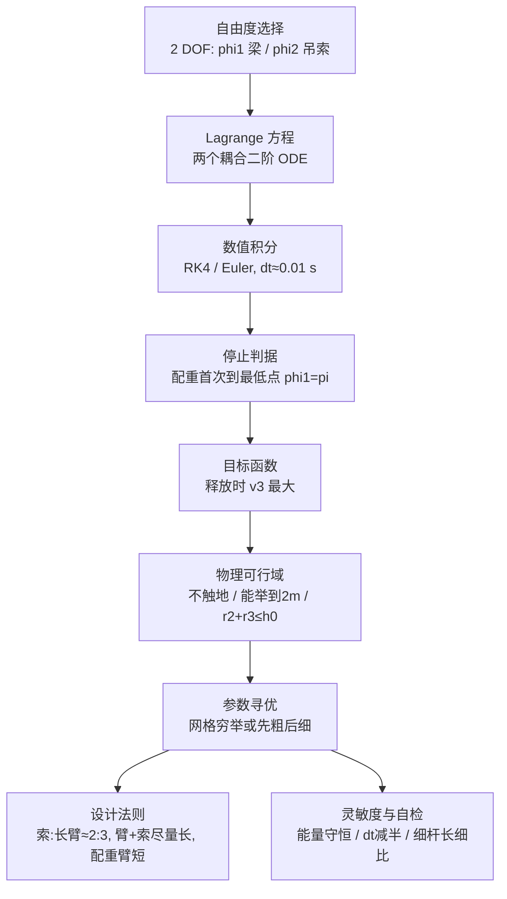

# 2010 题B：中世纪投石机动力学（Trebuchet: The Dynamics of a Medieval Siege Engine）

## 1. 题目原文与关键数据

> 原题（压缩）：The trebuchet was a type of catapult which used a sinking counterweight to throw a projectile. The counterweight was fixed to a short arm, which extended through a fulcrum to a long arm, where a projectile was attached at the end of a sling. Consider a trebuchet, powered by a counterweight with a mass of 5,000 kg which is raised 2 meters above the ground. **What would be the best arm lengths and sling length, in order to maximize the damage done by the projectiles?**

中文：投石机用下坠配重抛射弹丸。配重固定在短臂一端，短臂穿过支点延成长臂，长臂末端经吊索挂弹丸。配重质量 5,000 kg、举高地面以上 2 m。求使弹丸"破坏力最大"的最优臂长与吊索长度。

题面给定与必须自设的参数：

| 参数 | 数值 | 来源 |
|---|---|---|
| 配重质量 $m_1$ | 5,000 kg | 题面 |
| 配重初始高度 $h$ | 2 m | 题面 |
| 短臂 $r_1$、长臂 $r_2$、吊索 $r_3$ | 待优化 | — |
| **弹丸质量 $m_3$** | **题面未给，必须自定**（金牌队取 100 kg 石球） | 自设 |
| 支点高 $h_0$、梁质量/材料 | 未给（金牌队取 $h_0=1.5$ m，钢梁 0.10 m 方截面，$\rho=7850\ \mathrm{kg/m^3}$） | 自设 |
| 释放判据、初始条件 | 未给（金牌队：静止释放、配重首次到达最低点 $\varphi_1=\pi$ 时释放） | 自设 |

## 2. 题目到底在问什么（去模糊化）

- **"maximize the damage"** 是本题最大的模糊词。必须先翻译成可计算的代理量：金牌队取"**释放瞬间弹丸平动动能最大**"即 $v_3$ 最大（点质量模型下破坏力 ∝ $v^2$）；也可以选"最大射程"，但那需要额外优化释放角。两种转译都合法，**文中必须明说这是定义选择**，并说明含义差别（动能毁伤 vs 覆盖范围）。
- **"best arm lengths"** 必须定义在物理可行域内：配重摆到底不触地、长臂+吊索不穿地（$r_2+r_3\le h_0$）、配重要能被举到题给的 2 m 高度（对固定 $h_0$ 这给出 $r_1\ge h-h_0$ 的下限）。最优解往往顶在约束边界上——这本身就是一个重要发现（见 §4）。
- 弹丸质量、支点高、梁材料都是**题面故意留白的自由度**：自设 + 论证 + （理想情况下）做参数讨论，是拿分动作。

## 3. 物理建模路线图

**层次 1（理想模型）**：配重与弹丸为质点，梁为均质细杆（质量 $m_2=\rho A(r_1+r_2)$），吊索无质量、定长。二自由度系统：梁与竖直方向夹角 $\varphi_1$、吊索与竖直方向夹角 $\varphi_2$。因只有保守重力做功，用 Lagrange 力学最自然：写出动能（含耦合项 $\cos(\varphi_1-\varphi_2)$）与势能，得到两个耦合非线性二阶方程（金牌论文式 33、36），无解析解 → 数值积分。弹丸速度由吊索端点速度给出；释放时刻规定为 $\varphi_1=\pi$。

**层次 2（必要修正）**：
- **梁的质量与转动惯量**：推导时保留 $I_{zz}$ 符号最后代入（金牌队做法），换任意截面/材料零成本；
- **吊索质量与弹性**：轻索近似自洽性可用"索质量/弹丸质量 <1%"检查；
- **铰接配重**（真实中世纪晚期设计的 hinged counterweight）：增加一个自由度，让配重更接近自由下落，效率可从 ~30% 提到 ~50% 以上——作为扩展模型或至少在讨论中定性指出；
- **弹丸空气阻力**：对 100 kg 石球（$A\approx0.13\ \mathrm{m^2}$）在 17 m/s 下 $a_d\approx0.1\ \mathrm{m/s^2}$，占重力 1%，飞行段可忽略但要写明估算；
- **释放机构**：销钉/指爪的脱扣相位决定实际射角——若目标函数改为射程，这是必须进入模型的自由度。

**层次 3（可选扩展）**：参数灵敏度（哪个尺寸误差最伤性能）、结构强度校核（梁内弯矩、轴销剪力）、与历史巨型投石机（Warwolf）对比标度律。

## 4. 关键物理效应量级表

| 效应/量 | 估算 | 是否必须建模 | 估算依据 |
|---|---|---|---|
| 能量预算 | $\Delta U\approx m_1g\Delta h\approx50$ kJ（金牌构型） | 必须 | 配重从 2.0 m 落到 $h_0-r_1=0.99$ m，$\Delta h=1.01$ m；$5000\times9.81\times1.01$。**注意不是"下落 2 m"=98 kJ**——下降量由 $r_1$ 与 $h_0$ 决定 |
| 弹速上限（100% 转移） | $v_{\max}=\sqrt{2\Delta U/m_3}\approx31.5$ m/s | 必须给出上界 | 金牌队 $v_3=17.48$ m/s ↔ **效率 $\eta\approx15.3/49.5\approx31\%$**，对固定配重构型合理（铰接配重可再高） |
| 转动惯量构成 | $m_1r_1^2\approx1.3\times10^3$；$m_3(r_2+r_3)^2\approx2.2\times10^2$；梁 $\sim8\times10^1\ \mathrm{kg\,m^2}$（~4%） | 必须 | $5000\times0.51^2$ vs $100\times1.49^2$ vs $\tfrac13\times111\times1.42^2$。配重项主导 → 配重臂短一点，省的是"白转的惯量" |
| 摆动时间尺度 | $\sim0.6$–1 s | 必须 | $\alpha_0\approx m_1gr_1/I_{\rm tot}\approx5000\times9.81\times0.51/1600\approx15\ \mathrm{rad/s^2}$，摆过 $\pi$ 弧度 |
| 质量比 | $m_1:m_3=50:1$ | 必须（自设依据） | 复现者/工匠经验 80–133:1，同量级；弹丸质量的选取应在此讨论 |
| 最优解贴边 | $r_2+r_3=1.49$ m $\approx h_0=1.5$ m | 重要发现 | "臂+吊索尽量长"的法则是"抛掷端恰好擦地"这条约束的影子；同时 $r_1=0.51$ m 紧贴"配重要够到 2 m"的下限 $h-h_0=0.5$ m |
| 射程参照 | $v^2/g\approx31$ m（45° 平射） | 讨论 | 与动能毁伤口径不同，需说明你选了哪个 |
| 阻力（弹丸飞行段） | ~1% 重力 | 可忽略（写明即可） | $a_d=\tfrac12\rho C_dAv^2/m_3\approx0.1\ \mathrm{m/s^2}$ |

## 5. 求解算法与数值要点

- **推荐**：RK4 + 步长 1e-4~1e-3 s（金牌队用一阶 Taylor/Euler、$dt=0.01$ s，配停止容差 $|\pi-\varphi_1|<0.05$ rad 与 $t_{\max}=10$ s 防发散；没有做步长收敛检验是其自认短板，你应当做）。
- **能量守恒自检**：无摩擦模型中 $T+U$ 漂移应 <0.1%，一行代码就能抓住积分器 bug。
- **寻优策略**：先从可行域（§2）出发做粗网格（0.05 m），再在最优点邻域细网格（0.01 m）；三维穷举 × 每点一次积分完全可行（数万次 × 毫秒级）。若有余力用梯度/坐标下降对比，可暴露目标函数的多峰性。
- **释放瞬间**：弹丸速度 = 吊索端点速度 $\sqrt{(\dot x_3)^2+(\dot y_3)^2}$，注意释放后弹丸作抛体、吊索约束消失，别把释放后的吊索张力算进弹丸。
- **数值陷阱**：$\varphi_2$ 高频摆动时 $dt$ 过大会漏掉释放时刻的速度峰值；角度接近 $\pm\pi$ 时三角耦合项的符号；网格步长 0.01 m 决定了"最优值"本身只有 ~2 位有效数字，别报更多。

## 6. 常见错误与陷阱

1. 忘了弹丸质量是题面留白：不声明自设值（及理由）就给出"最优臂长"——优化结果强烈依赖 $m_3$。
2. 把"配重举高 2 m"直接当"下落 2 m"用 $E=mgh=98$ kJ：实际下降量由 $r_1,h_0$ 决定，金牌构型只有约 1 m。
3. 用固定配重模型却声称高效率，或把铰接配重的文献效率（>50%）与自己模型的效率混为一谈。
4. 优化无物理约束：搜出 $r_2+r_3>h_0$（穿地）或配重触地的解；或允许释放角任意指定（真实释放角由吊索相位决定，不能独立调）。
5. 把单一构型的"2:3 法则"外推成普适定律而不做灵敏度讨论（金牌队自己都声明了这一点）。

## 7. 全网参考与延伸

1. **arXiv:2303.01306 "The swinging counterweight trebuchet: On scaling and solution branches" (2023)** — https://arxiv.org/html/2303.01306v1 。现代学术视角的摆动配重投石机动力学与标度律，可直接支撑你的"铰接/摆动配重扩展模型"与效率讨论。
2. **COMSOL Blog: "What Is the Physics Behind a Counterweight Trebuchet?" (2017)** — https://www.comsol.com/blogs/what-is-the-physics-behind-a-counterweight-trebuchet 。多体动力学建模思路（含配重摆动与释放相位），适合对照你的 Lagrange 推导。
3. **Wolfram Demonstrations: "Optimizing the Counterweight Trebuchet"** — https://demonstrations.wolfram.com/OptimizingTheCounterweightTrebuchet/ 。可交互扫吊索长度/配重质量看射程变化，用于快速核对你的扫描结果量级。
4. **AIAA 2006-775 "Trebuchet Energy Efficiency – Experimental Results"** — 实验测量的投石机能量效率，为你的 $\eta\approx30\%$（固定配重）提供实验锚点。

## 8. 金牌论文思路对比

本题唯一金牌：**Team 210（圣路易斯大学，单人队伍 John Sanders）**。路线：全符号 Lagrange 推导（$I_{zz}$ 保留不代入，保持一般性）→ 自设 $m_3=100$ kg、$h_0=1.5$ m、钢梁 0.10 m 方截面 → 一阶 Taylor 步进的 C++ 积分 + 0.01 m 网格三维穷举 → 最优 $r_1=0.51$ m、$r_2=0.91$ m、$r_3=0.58$ m、$v_3=17.48$ m/s → 总结"吊索:长臂≈2:3、臂+索尽量长、配重臂更短"，并诚实声明该法则只对所选参数成立。亮点是"一般性优先"的符号化推导与全套代码/数据入附录；短板是图表朴素、无收敛性检验。详见 [05_论文赏析/2010/2010-GM-B-210.md](../05_论文赏析/2010/2010-GM-B-210.md)。

## 9. 评分要点：评委想看什么

- [ ] "maximize damage" 被翻译成明确的可计算目标（释放动能/射程），并声明这是定义选择及其含义差异。
- [ ] 题面留白参数（弹丸质量、支点高、材料）逐项给出取值与理由，最好附参数讨论。
- [ ] 优化在物理可行域内进行，且能指出最优解是否贴在约束边界上（贴边 = 约束主导，值得展开一句）。
- [ ] 动力学推导保留符号、最后代入数值；给出能量守恒或步长收敛的自检。
- [ ] 效率 $\eta$ 被明确定义并与真实投石机（或文献）对照，而不是只报一个末速度。
- [ ] 结论边界清晰：设计法则的适用范围、未建模效应（吊索弹性、结构强度、铰接配重）逐条列出。
