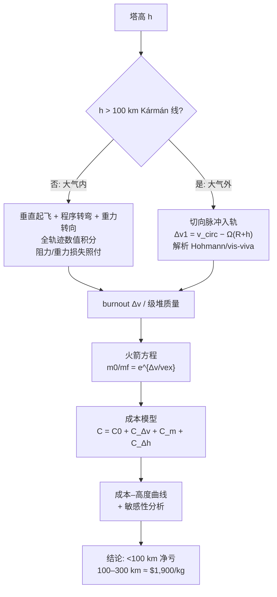

# 2011 题A：太空塔发射成本（Space Tower Launch Costs）

## 1. 题目原文与关键数据

> 原题（压缩）：Sending payloads into low earth orbit on traditional rockets is very expensive, with current costs running approximately $15,000 US Dollars per kilogram. If a tower could be built tall enough, rockets might be launched from the top of this tower and reduce the cost... **How much would it cost to launch a payload of 10,000 kg from towers of different heights?**

中文：传统火箭把载荷送入近地轨道约 $15,000/kg。若能建起足够高的塔，从塔顶发射火箭可降低入轨成本。问：从**不同高度**的塔顶发射 10,000 kg 载荷各需多少钱？

题面给定与必须自设的参数：

| 参数 | 数值 | 来源 |
|---|---|---|
| 基准成本 | \$15,000/kg（→ 10,000 kg = \$1.5×10⁸） | 题面 |
| 载荷 | 10,000 kg | 题面 |
| 塔高 | "different heights"，需扫描（0–300 km 量级） | 自定 |
| 目标轨道 | 未给（金牌队：300 km 圆轨道） | 自设 |
| 载具 | 未给（金牌队：对标 Falcon 9 的两级"surrogate"：一级满/空 342,859/20,000 kg，二级满/空 54,000/3,000 kg，$A_f=\pi(2.3)^2$ m²，$C_D=0.3$） | 自设，参数取真实手册 |
| 大气 | 指数模型 $\rho=\rho_0e^{-(r-R_E)/H}$，$H=8$ km，100 km 截断 | 自设 |

## 2. 题目到底在问什么（去模糊化）

1. **"cost"怎么算？** 这是本题的核心模糊点：物理 $\Delta v$ 必须折成美元。金牌队的成本模型 $C_T=C_0+C_{\Delta v}+C_m+C_{\Delta h}$，锚点两条：$\Delta v$ 边际价 **\$1,500/(m/s)**（由公开的 LEO 与 GEO 发射差价 \$6.1M、$\Delta v$ 差约 4 km/s 反推）；提升能价 **\$4.4×10⁻⁶/J**（引自太空电梯文献，\$220/kg 对应 ~50 MJ/kg）。任何经济参数都必须有出处或推算——这是本题与纯物理题最大的不同。
2. **"different heights"** 不只是扫一个数：塔高跨过 **Kármán 线（100 km）时物理机制切换**（大气内垂直起飞 vs 大气外切向脉冲入轨），低塔与高塔要用不同的发射方案与数学工具——regime 划分本身就是答案的一部分。
3. **隐含问题**：塔到底值不值得建？低于 100 km 可能"净亏"（负结果也要写），100–300 km 才有数量级优势。只报"省了多少"不报"哪一段不值得"是不完整的答案。

## 3. 物理建模路线图

**层次 1（Δv 预算，解析）**：
- 地面发射：理想圆轨道速度 $v_{\rm circ}=\sqrt{\mu/(R_E+h)}\approx7.79$ km/s（200 km）+ 重力损失 ~1.2–1.6 km/s + 阻力/转向损失 ~0.3–0.5 km/s ≈ **实际 $\Delta v\approx9.3$–9.6 km/s**；
- 塔顶（$h>100$ km）切向发射：该点已在轨道高度，只需补足圆化速度差
$$\Delta v_1=\sqrt{\frac{\mu}{R_E+h}}-\Omega_E(R_E+h),$$
其中 $\Omega_E(R_E+h)$ 是塔随地球自转的"白送"线速度。若 $v<v_{\rm circ}$，塔顶是转移椭圆的**远地点**，近地点扎回大气——所以必须一次脉冲补足圆化（或两脉冲 Hohmann），不能"飘"过去。
- 火箭方程的杠杆：$m_0/m_f=e^{\Delta v/v_{\rm ex}}$，$\Delta v$ 少 2 km/s 在 $v_{\rm ex}\approx3$ km/s 下相当于级堆质量减半以上。

**层次 2（必要修正）**：大气段不能只用脉冲近似——垂直起飞、程序转弯（~0.5°/s）、重力转向、随大气共转的相对速度阻力项 $\vec v_{rel}=\big(v_r,\ v_\theta-r\Omega_E\big)$、变质量火箭方程，都要进数值积分；二级在真空中可理想化为脉冲。关机用状态判据（能量与角动量使远地点 = 300 km）比固定时间更稳健，也是真实制导逻辑。

**层次 3（成本与扩展）**：把每条轨迹的 $\Delta v$、级堆质量、提升能耗折成美元；扫描塔高得成本-高度曲线；敏感性分析（边际价 ±50% 时结论是否翻转）；扩展项：塔的建造/维护成本、纬度（发射场不在赤道损失自转分量）、载荷随塔高的最优火箭缩放。

## 4. 关键物理效应量级表

| 效应/量 | 估算 | 是否必须建模 | 估算依据 |
|---|---|---|---|
| 地面实际 $\Delta v$ | ~9.4 km/s | 必须 | $7.79+1.4+0.3$；与真实 Falcon 9 一致，可作 $h=0$ 校验点 |
| 塔顶理想 $\Delta v$（300 km） | 7.73−0.49 = **7.24 km/s** | 必须 | $\sqrt{3.986\times10^{14}/6.671\times10^6}=7{,}730$；$\Omega_E(R+h)=7.292\times10^{-5}\times6.671\times10^6=487$ m/s |
| 有效节省 | ~2.2 km/s | 必须 | 不只是理想差 0.55 km/s：规避了重力损失 1.4+ 与阻力/转向 0.4，这才是"塔的红利"大头 |
| 火箭方程杠杆 | 载荷分数 $e^{-9.5/3.0}=4.2\%$ → $e^{-7.24/3.0}=9.0\%$，翻倍以上 | 必须 | $v_{\rm ex}\approx3$ km/s；金牌队级堆总质量 407 t → 51 t（约 12%），方向一致、更激进（其二级脉冲化、无重力损失） |
| 自转红利 | 465 m/s（地面）→ 487 m/s（300 km） | 必须 | 容易漏项；注意别在地心惯性系里把它丢掉，也别在共转系里算两遍 |
| 大气指数衰减 | $H=8$ km，100 km 处 $\rho\sim3\times10^{-7}\ \mathrm{kg/m^3}$（12.5 个标高） | 必须 | 阻力归零，是"100 km 切 regime"的物理根据 |
| 每公里高度的 Δv 节省（<100 km） | ~3 (m/s)/km ↔ \$5,000/km | 必须（低塔结论） | $\mathrm{d}v_{\rm circ}/\mathrm{d}h\approx-0.6$ (m/s)/km + 损失随高度下降；\$5,000 ÷ \$1,500/(m/s) ≈ 3.3 (m/s)/km，两套账自洽 |
| 提升能耗 mgh | 10 t × 9.8 × 1 km = 9.8×10⁷ J = 27 kWh ≈ **几美元电费** | 必须算出来再说 | 纯电费可忽略；金牌队的 \$17,000/km 显然含 power-system 摊销等（太空电梯文献口径）——**成本结论对该定标极其敏感，务必交代出处**：这正是"经济模糊词"的陷阱所在 |
| 塔本身 | 未给造价/维保 | 扩展 | 题面只问"发射成本"，但讨论里应指出建造摊销可能吞掉全部节省 |

## 5. 求解算法与数值要点

- **两分支分工**：大气段六维常微分方程数值积分（$\Delta t=0.1$ s 量级）；轨道段全部解析（vis-viva、Hohmann），只在圆化脉冲处衔接。连续段数值、脉冲段解析，是这类混合问题的标准省时结构。
- **验证**：$h=0$ 的结果对照真实数据（Falcon 9 载荷分数、实际 $\Delta v\approx9.3$–9.6 km/s）；burnout 理想 $\Delta v$ 与实际末速之差应等于重力+阻力损耗，画在一张图上（金牌队 Figure 5 的做法）。
- **俯仰程序**：转弯率与转弯门限是"人工调参"就直说，别包装成优化算法（金牌队的诚实反而加分）。
- **常见数值陷阱**：共转系与惯性系速度混用（阻力用相对速度、轨道判据用惯性速度）；塔顶切向发射若不补足 $\Delta v$，近地点回扎大气，轨迹积分会"莫名其妙再入"；步长过大时远地点判据（$v_r$ 变号）漏检。

## 6. 常见错误与陷阱

1. 漏掉或重复计算地球自转红利（0.5 km/s 上下）。
2. 塔顶仍按地面流程垂直起飞——浪费 regime 切换的核心物理（大气外应切向/水平发射）。
3. 只回答"省多少 $\Delta v$"不折算美元：题目问的是 **cost**，必须建立有出处的成本模型。
4. 经济参数（$/\mathrm{m/s}$、$/\mathrm{J}$）无来源、无敏感性讨论，结论随假设任意摆动。
5. 忽略载荷与载具的耦合：塔越高火箭可以造得越小（金牌队自列为 weakness——固定 400 t 级火箭去接 2 km/s 的便宜，本身是保守假设）。
6. 只报正面结果：其实"低于 100 km 净亏 \$12,000/km"这类**负结果**同样是完整答案。

## 7. 全网参考与延伸

1. **Wikipedia: "Non-rocket spacelaunch"** — https://en.wikipedia.org/wiki/Non-rocket_spacelaunch 。系统梳理发射塔/太空电梯/发射环等方案的 Δv 动机与成本逻辑，是"塔为什么可能省钱"的一页式综述。
2. **NASA NTRS: H. Jones, "The Recent Large Reduction in Space Launch Cost" (2018)** — https://ntrs.nasa.gov/api/citations/20200001093/downloads/20200001093.pdf 。历史发射成本数据（早期 $100k–$1M/kg → 现代 ~$3k/kg），可用来讨论题面 \$15,000/kg 的年代语境与现代对照。
3. **OrbitalRadar: "Rocket Launch Cost Trends"** — https://orbitalradar.com/space-economy/launch-cost-trends 。\$54,000/kg（航天飞机）→ \$3,000/kg（Falcon 9）的趋势图表，做成本模型敏感性时的现实锚点。
4. **SpaceX Falcon 9 User Guide** — 金牌队 surrogate 载具参数（直径、级质量）的直接出处；自己复现时应取同源数据，保证"成本结论可与公开报价对照"。

## 8. 金牌论文思路对比

本题金牌：**Team 352（中佛罗里达大学，"Space Tower Launch Costs"）**。路线：以 \$15,000/kg 锚定成本模型 → Kármán 线两侧分 regime（大气内：Falcon 9 surrogate 全轨迹数值积分 + 重力转向程序；大气外：切向脉冲 + Hohmann 解析）→ 每升高 1 km 省 ~3 m/s 的拟合 → 成本闭环（\$1,500/(m/s) 反推边际价、\$4.4×10⁻⁶/J 提升能价）→ 结论：低塔净亏 \$12,000/km；100–300 km 塔顶发射级堆仅 51 t（地面的 12%），总成本 ~\$19M 即 **\$1,900/kg**，比基准省 ~87%。亮点是 regime 划分的物理判断与"负结果照写"。详见 [05_论文赏析/2011/2011-GM-A-352.md](../05_论文赏析/2011/2011-GM-A-352.md)。

## 9. 评分要点：评委想看什么

- [ ] "cost"被翻译为有出处、可复算的成本模型（$\Delta v$ 边际价、提升能价各注明来源或反推过程）。
- [ ] 识别 Kármán 线两侧的 regime 切换，并给两侧各自匹配的发射方案与数学工具。
- [ ] 塔顶发射的几何正确：切向脉冲、自转红利、近地点回扎大气的处理。
- [ ] $h=0$ 情形与真实火箭对照校验，损耗（重力+阻力）被显式分离展示。
- [ ] 成本–高度曲线 + 敏感性分析；结论包含"哪段塔高不值得"的负结果。
- [ ] 自评 weaknesses（二维、固定载具、二级脉冲化等）与改进方向。
