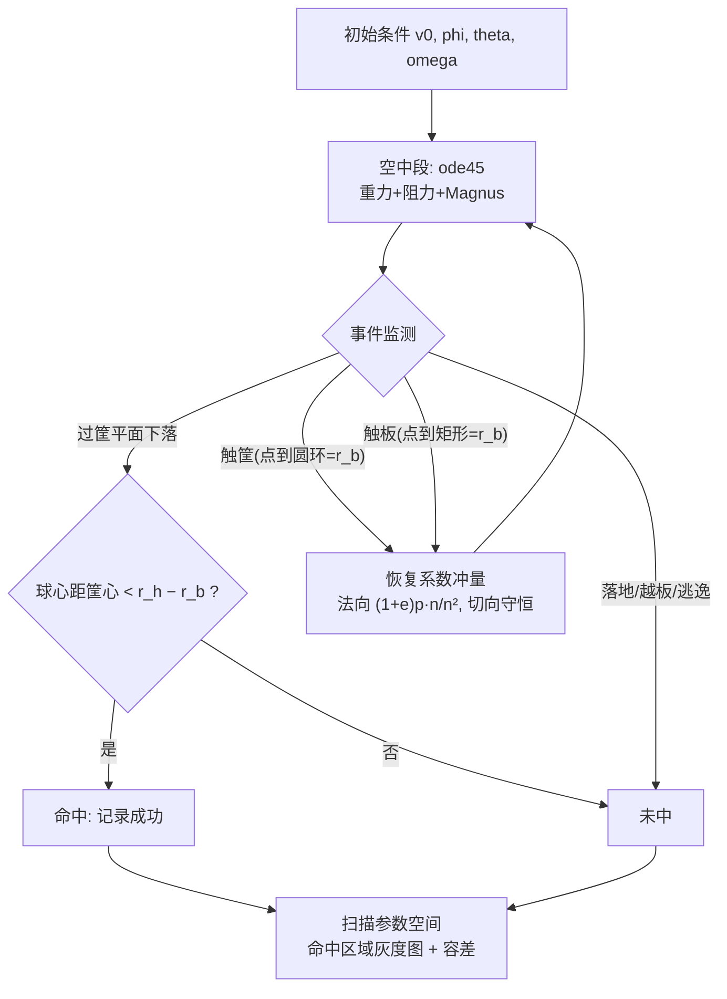

# 2011 题B：三分球投篮物理（Shooting a Basketball for Three Points）

## 1. 题目原文与关键数据

> 原题（压缩）：In the game of basketball, a player scores three points by successfully making a shot from beyond the three point line, which is 6.2 meters away from the basket in international games... Suppose a player in an Olympic basketball game is at the three point line standing at a point making an angle 45 degrees to the principal axes of the court. **What initial ball velocities and spins will result in a successful shot from this point?**

中文：国际比赛（如奥运会）三分线距篮筐 6.2 m。设奥运比赛中一名球员站在三分线上、其站位与场地主轴成 45°。问：从该点出手，哪些初速度与自旋组合能投篮命中？

题面给定与必须自设/查证的参数：

| 参数 | 数值 | 来源 |
|---|---|---|
| 出手点到篮筐水平距离 | 6.2 m | 题面 |
| 站位角（与场地主轴） | 45° | 题面（是**站位**，不是出手仰角！） |
| 篮筐高 / 筐内径 | 3.050 m / 0.45 m | FIBA 规则 2010 |
| 篮球周长 / 质量 | 0.75 m（→ 半径 0.119 m）/ 0.600 kg | FIBA |
| 筐-板最小水平距 | 0.151 m | FIBA |
| 恢复系数 | 篮板 ≥0.5；篮筐 0.5–0.65 | FIBA 强制规定 |
| 阻力系数 $C_d$ | 0.54 | 文献 |
| 出手高度、自旋轴/速率 | 未给（出手高 ~2.0–2.3 m；纯后旋 0–2+ 转/s 为扫描变量） | 自设 |

## 2. 题目到底在问什么（去模糊化）

1. **"What initial velocities and spins will result in a successful shot"** 问的不是一条轨迹，而是**解集合**：初始条件空间 $(v_0,\ \varphi_{\rm 仰角},\ \theta_{\rm 方位},\ \vec\omega)$ 中哪些点命中。正确交付物是参数空间的"命中区域图"及其边界/厚度（容差），而不是一两个"最优数"。
2. **"successful shot"** 必须定义：空心入筐、擦筐弹入、打板入筐都算进球。金牌队用干净几何判据：球心最终落在距筐心 $r_{\rm hoop}-r_{\rm ball}=0.225-0.119\approx0.106$ m 以内（含反弹后）。这个 0.106 m 的目标圆是一切容差的源头。
3. **45° 是站位角**（决定篮板相对出手视线的取向，从而决定打板球可行性），**不是 45° 射角**——把它当射角是本题最经典的误读。金牌队还发现：出手方位角恰为 $\pi/4$ 时**没有任何打板球成功**（碰板点在筐正上方、横向弹出），而把出手方位扫到 ~0.825 rad 附近时出现大片打板成功区。
4. 自旋维度必须处理：题面点名 spins。把 6 维解空间降维的合法方式是假设**纯后旋**（转轴水平、垂直于轨迹）——金牌队明确说明这是绝大多数球员的实际投篮方式，既省算力又贴合情境。

## 3. 物理建模路线图

**层次 1（真空抛体 + 几何窗，解析）**：以出手高 $h_0=2.0$ m、$\Delta y=1.05$ m、$R=6.2$ m，最小速度抛体
$$v_{\min}=\sqrt{g\left(\Delta y+\sqrt{\Delta y^2+R^2}\right)}\approx8.5\ \mathrm{m/s},\qquad \alpha\approx\arctan\frac{\Delta y+\sqrt{\Delta y^2+R^2}}{R}\approx49.8^\circ,$$
入筐角约 40°。这给"9 m/s @ 0.85 rad（48.7°）"的最优工作点提供了无旋真空参照。

**层次 2（必要修正）**：空中段
$$\ddot{\vec r}=\vec g+\frac1m\Big(\underbrace{F_L\,\hat{(\vec\omega\times\vec v)}}_{\text{Magnus}}-\tfrac12 C_d\rho A|\vec v|\vec v\Big),\qquad F_L=\tfrac12 C_L\rho Av^2,\ \ C_L\approx\frac{1}{2+v/\omega r};$$
碰撞段：恢复系数冲量法 $\Delta\vec p=(1+\epsilon)\frac{\vec p\cdot\vec n}{\|\vec n\|^2}\vec n$（法向非弹性、切向动量守恒——即无摩擦，旋量不参与），篮筐/篮板静止。多次"空中–碰撞–空中"循环至球入网或出局。

**层次 3（可选扩展）**：碰撞摩擦（后旋与板/筐的旋量耦合——金牌队自认这可能对打板球结果有可测影响）、自旋衰减、篮板振动、出手点/出手高度的统计分布（真实球员出手高 2.0–2.3 m 且有跳投延迟）、防守干扰。

## 4. 关键物理效应量级表

| 效应/量 | 估算 | 是否必须建模 | 估算依据 |
|---|---|---|---|
| 目标几何容差 | 目标圆半径 0.106 m ↔ 出手速度容差 ~±0.3–0.5 m/s、仰角容差 ~±2–4° | 必须 | $r_h-r_b$；容差随仰角增大（高弧线容错高，见金牌区域图上厚下薄） |
| 重力抛体 | $v_{\min}\approx8.5$ m/s @ 49.8°（真空、$h_0=2.0$ m） | 必须 | 层次 1 公式；金牌最优 9 m/s @ 0.85 rad 与"阻力修正 + 出手更高"自洽 |
| 空气阻力 | 末端阻力 ~20–25% 重力；$v_0$ 需上调 ~3–5%、入筐角变陡 | 必须 | $v_t=\sqrt{2mg/C_d\rho A}=\sqrt{2\times0.6\times9.81/(0.54\times1.225\times0.0452)}\approx19.8$ m/s；$(v/v_t)^2$ 即阻力/重力比 |
| Magnus（后旋 2 转/s） | $F_L\approx0.3$ N ≈ 5% 重力；命中带整体向低速低角平移 | 必须（题面点名 spin） | $C_L\approx1/(2+v/\omega r)$，$\omega r=1.51$ m/s、$v=9$ → $C_L\approx0.13$ |
| Magnus 系数的量级核验 | 金牌论文式 (1) 的 $\tfrac{16}{3}\pi^2r^3\rho\,\omega v$ 按 SI 直代 ≈ **12.6 N ≈ 2 倍重力** | 复现者必须自检 | 与其 Figure 4 的"温和平移"不符——打印式疑似有排版/单位问题；复现第一步应做量级检验并用经验关联式定标 |
| 筐/板非弹性碰撞 | $\epsilon_{\rm rim}=0.5$–0.65、$\epsilon_{\rm board}\ge0.5$（FIBA） | 必须（打板必答） | 无此环节就没有擦筐/打板解集 |
| 后旋对反弹的作用 | 后旋"减震"擦筐球、打板后卸速 | 扩展（但值得讨论） | 需碰撞摩擦模型；金牌队无摩擦假设下打板仍占优，含摩擦后打板优势的定量会变 |
| 自旋衰减 / 科氏力等 | <5%/s；≈0 | 可忽略 | 角动量守恒 + 1.2 s 飞行时间 |

## 5. 求解算法与数值要点

- **事件驱动分段仿真**（金牌队范式，可直接迁移到任何"飞行体碰框"类题）：ode45（`RelTol=1e-5`）+ 事件函数监测六类事件（下落过筐平面、越板、横向逃逸、触板、触筐、落地兜底）；碰撞用冲量重置速度后续算。触筐判定用"点到圆环距离 = $r_b$"，触板用"点到矩形距离 = $r_b$"。
- **事件点插值**：ode45 的事件定位必须打开（默认Within step 求根），否则碰撞位置误差 ~$v\Delta t$，擦筐结果全错。
- **参数扫描**：固定方位扫 $(v_0,\varphi)$ 得命中带（无旋/有旋各一张）；固定速度扫 $(\theta,\varphi)$ 找打板方位窗；固定方位扫 $(v_0,\varphi)$ 验证打板带的"边缘不混沌"。灰度图是呈现解集合的最佳载体。
- **验证**：无旋结果与已发表罚球仿真（Silverberg 等）对照；极端检查——正对筐、$v_0$ 很小时应全失。
- **陷阱**：rad/deg 混用（0.85 rad = 48.7°）；"混沌边缘"（擦筐蹦出）区域要局部加密网格，否则命中带边界是网格噪声；判分判据别写成"球心过筐心"（过严，漏掉擦筐入网）。

## 6. 常见错误与陷阱

1. 只算空心入筐，丢掉擦筐与打板解集——而 45° 站位恰恰让打板成为**更大的**解集，漏掉等于丢掉本题一半答案。
2. 把 45° 站位角当成出手仰角或出手方位角，几何 setup 从第一页就错。
3. 把自旋当装饰：要么不计 Magnus，要么算了 Magnus 却不讨论后旋对反弹的作用——题面明确问 spins，两处至少各处理一处并说明取舍。
4. 单条"最优轨迹"替代解集合：不给命中区域与容差，就没回答"哪些速度与旋转会命中"。
5. 单位与参数来源混乱：筐径、恢复系数随手拍（FIBA 规则可查、恢复系数有强制区间），常数表不注出处。

## 7. 全网参考与延伸

1. **arXiv:1702.07234 "The Physics of an Optimal Basketball Free Throw" (2017)** — https://ar5iv.labs.arxiv.org/html/1702.07234 。含阻力、Magnus 与后旋的罚球最优解模型，可直接对照你空中段力项的写法与系数取值。
2. **Brancazio, "Physics of Basketball" (Am. J. Phys., 1981)** — https://www.semanticscholar.org/paper/Physics-of-basketball-Brancazio/262c9aa1c569b7d12aec6d637f6ba1a43f2dab4c 。经典文献：出手角-速度敏感性折中、最小速度解、后旋作用，是层次 1 解析与"高弧容错"论证的出处级支撑。
3. **NC State: Silverberg 等 "Nothing But Net: The Physics of Free-Throw Shooting" (2009)** — https://engr.ncsu.edu/news/2009/11/06/nothing-but-net-the-physics-of-free-throw-shooting 。百万轨迹仿真：最优入筐角 ~52°、~3 转/s 后旋使球在碰筐前自旋约 3 圈并"减震"——金牌队正是用 Silverberg 的罚球结果做了独立交叉验证。
4. **FIBA Official Basketball Rules 2010 / Basketball Equipment** — 金牌队全部几何与恢复系数的出处。自己复现时先建"官方参数表"，实现零自由常数建模。

## 8. 金牌论文思路对比

本题金牌：**Team 379（欧林工学院，"The Physics of a Three Point Shot"）**。路线：FIBA 官方参数全表（几何 + 恢复系数，零自由常数）→ "空中（重力+阻力+Magnus，ode45）+ 碰撞（恢复系数冲量、无摩擦）+ 空中"事件驱动框架 → $(v_0,\varphi)$、$(\theta,\varphi)$ 灰度命中区域图 → 结论：无旋最优 ~9 m/s @ 0.85 rad；2 转/s 后旋使命中带整体向低速低角平移；45° 站位下出手方位 ~0.825 rad 的打板球成功区显著大于直接瞄准区、且没有擦筐"混沌"边缘，故**打板更稳**；与 Silverberg 罚球研究交叉验证。亮点是参数官方化与解集合呈现；短板是碰撞无摩擦、正文拼写错误多（"Figure ??"断链）。详见 [05_论文赏析/2011/2011-GM-B-379.md](../05_论文赏析/2011/2011-GM-B-379.md)。

## 9. 评分要点：评委想看什么

- [ ] 45° 正确理解为站位约束（影响打板几何），出手仰角/方位角是独立扫描变量。
- [ ] "命中"定义为可判定几何判据，且覆盖空心、擦筐、打板三类进球方式。
- [ ] 解集合呈现：参数空间命中区域图 + 容差/厚度讨论（高弧容错、后旋平移），而非单条轨迹。
- [ ] 自旋进入模型两处之一：Magnus（空中）或反弹行为（碰撞），并说明降维假设（纯后旋）的理由。
- [ ] 参数全部有出处（FIBA 规则、文献 $C_d$），假设清单与数据清单分列。
- [ ] 结论可执行（"打板更稳、后旋降速、高弧容错高"），并交代模型局限（碰撞摩擦、旋量耦合）。
