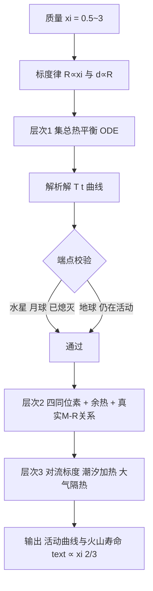

# 2012 题A：超级地球上的火山活动（Volcanism on Super-Earths）

> 赛题来源：UPC 2012 Problem A（当年 81 队中 24 队选题 A，金奖 1 队：上海交通大学 449 队）

## 1. 题目原文与关键数据

**原文压缩引用**：
> Mercury and the Moon do not currently have active volcanoes, while the Earth and Venus do. This is largely because the Earth and Venus are bigger planets and so their interiors have not cooled off as much since the formation of the solar system. Astronomers have recently discovered a population of extrasolar planets called super-earths, worlds with masses several times larger than the Earth. **How would the level of volcanic activity vary over time for Earth-like planets with masses ranging from 0.5 to 3 times the mass of the Earth?**

**中文翻译**：水星和月球现在没有活火山，而地球和金星有——这主要因为地球与金星是更大的行星，其内部自太阳系形成以来冷却得较少。天文学家最近发现了一类称为"超级地球"的系外行星，质量为地球的数倍。对于质量在地球 0.5–3 倍之间的类地行星，其火山活动水平如何随时间变化？

**题面给定参数表**：

| 参数 | 数值 | 备注 |
|---|---|---|
| 行星质量 $M$ | $0.5\,M_\oplus \sim 3\,M_\oplus$ | 唯一的自变量 |
| 成分 | "Earth-like"（类地：岩石幔、铁核、放射性元素丰度同地球） | 隐含约定 |
| 输出量 | "level of volcanic activity" vs time | 未定义，需自行操作化 |

注意这是 UPC 典型的**零数值题**：除质量区间外没有任何给定数字，热导率、放射性丰度、固相线温度、地球基准热流全部要自取并注明出处。

## 2. 题目到底在问什么（去模糊化）

本题的模糊词有两个：

- **"level of volcanic activity"（活动水平）**：不是问"有没有火山"，而是要一条随时间变化的强度曲线。必须把它操作化为可计算的代理量，例如：幔-岩浆层的释热功率 $P_{\rm vol}(t)$（W）、单位喷发能量换算的喷发频率 $\eta = P_{\rm vol}/Q$（次/年）、或最浓缩的标量——**火山寿命** $t_{\rm ext}$（幔温跌至喷发阈值/固相线以下所历时）。
- **"vary over time"（随时间演化）**：要求解的是行星热演化 ODE，而非静态快照；时间零点（行星形成时刻）与时间跨度（百亿年）都要显式声明。

操作化之后，题目变成：对 $\xi = M/M_\oplus \in [0.5,3]$ 的每个值，解热平衡方程得到 $T_{\rm mantle}(t)$，给出活动曲线并比较 $t_{\rm ext}(\xi)$。**隐藏子问题**是标度律：质量变了，半径、壳厚、放射性元素总量、热容都要跟着变——先立标度律，才能谈演化。

## 3. 物理建模路线图

**层次 1：集总热平衡理想模型（解析可解）**

把行星看成"热源（放射性衰变）+ 热容（幔）+ 热阻（壳/岩石圈傅里叶导热）"：

$$C M \frac{dT}{dt} = P_0 e^{-t/\tau} - B\,(T-T_0), \qquad B = \frac{4\pi R^2 k}{d}$$

等密度假设下 $R \propto \xi^{1/3}$、壳厚 $d \propto R$、$P_0 \propto \xi$、$CM \propto \xi$（**相消**），于是冷却速率 $B/(CM) \propto \xi^{1/3}/\xi = \xi^{-2/3}$。一阶线性 ODE 有闭式解；令 $P_{\rm rad}(t) = B(T_{\rm act}-T_0)$ 即得熄灭时刻，**火山寿命标度 $t_{\rm ext} \propto \xi^{2/3}$**。

自检（自己算给读者看）：取 $k=2.5\ {\rm W/(m\,K)}$、$\Delta T \approx 1000\ {\rm K}$、$d=30\ {\rm km}$，得热流 $q = k\Delta T/d \approx 0.083\ {\rm W/m^2}$——与实测地球平均热流 $0.087\ {\rm W/m^2}$ 吻合；乘 $4\pi R_\oplus^2$ 得 $43\ {\rm TW}$，对照实测 $47\ {\rm TW}$。再用这个标度律复现金奖论文的数值解：$50.7\times 0.5^{2/3}=31.9$ 亿年 vs 论文 $\xi=0.5$ 的 33.3 亿年；$50.7\times 3^{2/3}=105$ 亿年 vs 论文 $\xi=3$ 的 98.3 亿年——偏差 $<8\%$，说明其数值曲线本质上就走着 $\xi^{2/3}$ 律。

**层次 2：必要修正**

- 四种放射性同位素叠加（$^{238}$U 4.47 Gyr、$^{235}$U 0.704 Gyr、$^{232}$Th 14.0 Gyr、$^{40}$K 1.25 Gyr 半衰期）：早期 $^{235}$U、$^{40}$K 主导，产热约为今天的数倍 → 复现"先升温后降温"的热史转折，而不是单调下降。
- 吸积/分异余热 $\propto GM^2/R$：大行星初始更热。
- 真实 $M$–$R$ 关系 $R \propto M^{0.27}$（压缩变密）替代等密度 $M^{1/3}$，修正 $B$ 的标度。

**层次 3：可选扩展**：幔对流标度（$Nu\propto Ra^{1/3}$，热流 $\propto g^{1/3}$，大行星冷却更慢）；板块构造/静止盖层两种散热 regime；近轨道行星的潮汐加热（Io 类比）；大气温室隔热（金星教训）。

## 4. 关键物理效应量级表

| 效应 | 估算量级 | 是否必须建模 | 估算依据 |
|---|---|---|---|
| 放射性产热（今地球） | $\approx 20\ {\rm TW}$，比产率 $\sim 3\times10^{-12}$ W/kg | 必须 | KamLAND 地中微子 / 元素丰度估算；占地表总热流 47 TW 的一半 |
| 傅里叶壳层散热 | $q\approx 0.083\ {\rm W/m^2}$，全局 $\approx 43\ {\rm TW}$ | 必须 | $k=2.5$ W/(m·K)、$\Delta T\approx1000$ K、$d\approx30$ km |
| 余热（长期冷却）贡献 | $\approx 27\ {\rm TW}$；冷却时标 $\sim 10\ {\rm Gyr}$ | 建议 | $47-20$ TW；热储量 $\sim CM\Delta T\approx 9\times10^{30}$ J |
| 早期同位素产热增强 | 形成初期约为今天的 3–5 倍 | 建议（决定曲线早期形状） | $^{235}$U、$^{40}$K 半衰期短 |
| 质量-半径偏离等密度 | $R\propto M^{0.27}$ vs $M^{1/3}$，$3M_\oplus$ 处差约 2% | 可忽略 | Valencia 等超地球模型 |
| 幔对流 vs 纯传导 | 地幔 $Ra\gg10^3$，实际热流高于传导估算 | 扩展（至少讨论） | 对流标度 $q\propto g^{1/3}$ |
| 潮汐加热 | 轨道类地球时 $\approx 0$；近距可超 $10^{14}$ W | 视题设 | Io 约 $10^{14}$ W 的对照 |

## 5. 求解算法与数值要点

- **解析优先**：层次 1 的 ODE 是一阶线性方程，含 $e^{-t/\tau}$ 逼迫项有标准闭式解；四同位素只是四条指数的叠加，仍可半解析。数值只用于作图。
- **若数值积分**：步长应 $\le 10^{11}$ s（约 3 千年）；金奖队用了 $10^{13}$ s（约 30 万年）并自承可能引入误差。检验手段：关闭衰变项后能量守恒残差应为零。
- **验证三板斧**：(a) 水星/月球（$0.055$–$0.06\,M_\oplus$）端点应"已熄灭"；(b) 地球应"仍活跃且接近临界"；(c) 金星（$0.82\,M_\oplus$ 但大气隔热）作为"为何它还活着"的讨论题。
- **常见数值陷阱**：时间零点混用（"形成后 $t$" vs "距今天 $t$"）；Gyr 与 s 混算；温度阈值取喷发温度（~700 °C）还是幔固相线（~1200–1400 K）——两者差出的寿命可达十亿年量级，必须声明选择。

## 6. 常见错误与陷阱

1. **把"活动水平"当离散喷发事件计数**：$10^8$ 年尺度上根本无法逐次建模，必须先连续化为功率/频率代理量并显式定义。
2. **只写 $\dot T = -B(T-T_0)$ 而漏掉 $M$ 同时出现在供热与热容两端**：会得出"火山寿命与质量无关"的错误结论；正确标度来自 $B/(CM)\propto\xi^{-2/3}$。
3. **用地表实测热流常数直接乘面积**：等于隐含壳厚 $d$ 不随质量变；应显式给出 $d(M)$ 标度，并像金奖论文那样对最不确定的 $(k,d)$ 做灵敏度扰动。
4. **不做端点校验**：外推 $0.5$–$3\,M_\oplus$ 却不用水星/地球锚定，评委无从判断可信度。
5. **默认所有质量都有板块构造**：散热 regime 是否随质量切换在真实文献中尚有争议，至少要写一句讨论，否则是未声明的强假设。

## 7. 全网参考与延伸

1. **ASU/Princeton 2024：超级地球可维持更久的火山活动与磁场**（[news.asu.edu](https://news.asu.edu/20240912-science-and-technology-superearth-exoplanets-may-sustain-volcanism-and-magnetic-fields)）——主流研究支持"行星越大、火山期越长"的方向，可与模型结论互证。
2. **Physics World：Slow-cooling super Earths could lack life**（[physicsworld.com](https://physicsworld.com/a/slow-cooling-super-earths-could-lack-life)）——反方观点：大行星冷却慢可能导致火山期反而不利于宜居。写进 Discussion 能显著提升讨论深度。
3. **Nature Astronomy：L 98-59 d 的富挥发分熔融超地球**（[nature.com](https://www.nature.com/articles/s41550-026-02815-8)）——"永久岩浆海"的极端案例，可用作层次 3 扩展的素材。

## 8. 金牌论文思路对比

本题金奖唯一一队（上海交通大学 449 队，17 页）：五层行星结构 + 能量守恒主线，把火山活动**定义为岩浆层释能功率** $P_{vol}=B(T-700)$，单同位素基本模型解析求解、四同位素扩展模型复现地球热史转折，用水星（余寿 15 亿年）与地球（50.7 亿年）双锚点校验，并罕见地专设参数灵敏度小节扰动 $B$ 的两个估计参数。详细拆解见 `05_论文赏析\2012\2012-GM-A-449.md`。

## 9. 评分要点：评委想看什么

- [ ] 是否在建模前**显式定义"火山活动水平"的可计算代理量**（功率/频率/寿命）。
- [ ] 是否给出**质量标度律**（$R$、$d$、$P_0$、$C M$ 随 $\xi$ 的缩放），而不是只算一个行星再口算。
- [ ] 是否用**水星/地球端点校验**外推的合理性。
- [ ] 是否对最不确定的参数（热导率、壳厚、阈值温度）做**灵敏度分析**。
- [ ] 是否有一条明确的**结论曲线族**：不同质量的 $T(t)$ 与活动率曲线 + 一句话答案（越大越持久）。
- [ ] 是否讨论了未建模效应（对流、板块体制、潮汐、大气）及其方向性影响。
