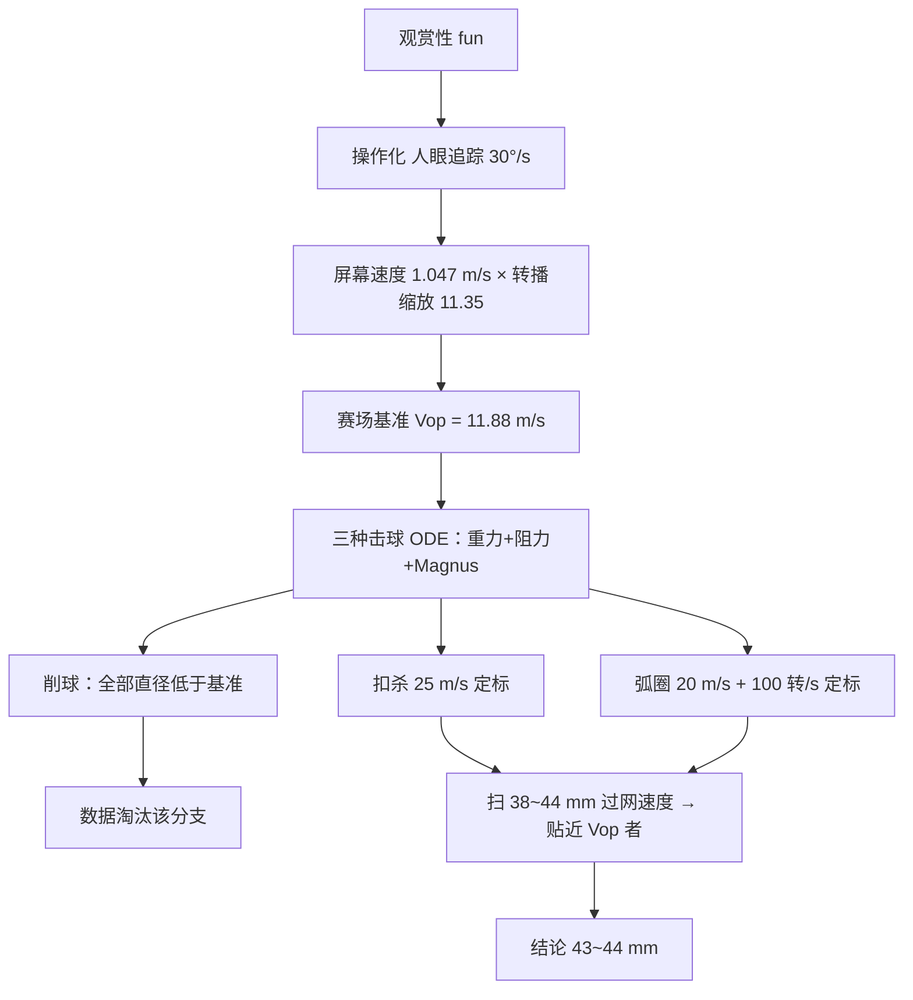

# 2012 题B：乒乓球尺寸（Table Tennis Ball Sizes）

> 赛题来源：UPC 2012 Problem B（当年 81 队中 57 队选题 B，为热门题；金奖 1 队：新加坡国立大学 414 队）

## 1. 题目原文与关键数据

**原文压缩引用**：
> In the year 2000, the International Table Tennis Federation changed the official ball diameters from 38mm to 40mm. The purpose of this was to increase the effects of air resistance, and slow down the game, in order to make it more fun to watch as a televised spectator sport. If the diameter was increased further, would this make the game an even better spectator sport? **What would be the best ball diameter, in order to make the game as fun to watch as possible?**

**中文翻译**：2000 年国际乒联把官方球直径从 38 mm 改为 40 mm，目的是增大空气阻力的影响、放慢比赛，使电视转播更有观赏性。若直径继续增大，比赛会更好看吗？**为使比赛尽可能好看，最佳直径是多少？**

**题面给定参数表**：

| 参数 | 数值 | 来源/备注 |
|---|---|---|
| 历史直径 | 38 mm → 40 mm（2000 年改） | 题面给出 |
| 球质量 | 改制时 2.5 g → 2.7 g（题面未给，需查证） | ITTF 规则；金奖论文正文提及 |
| 球台 | 长 2.74 m、网高 15.25 cm、台面 1.525 m 宽 | 标准器材 |
| 空气 | $\rho\approx1.2\ {\rm kg/m^3}$、$\nu\approx1.5\times10^{-5}\ {\rm m^2/s}$ | 自取 |
| $C_d$、Magnus 系数 | $\approx0.5$、$\approx0.29$ | 自取（有文献） |
| 初始条件 | 扣杀 ~25 m/s；弧圈 ~20 m/s、~100 转/s；削球更慢 | 需引赛事/实验数据 |

## 2. 题目到底在问什么（去模糊化）

本题的致命模糊词是 **"fun to watch"（好看）**。它不可计算，必须翻译成一个物理判据，这是全文 60% 的分数所在。可行路线有两条：

- **回合数/球速慢 = 好看**：粗糙且自相矛盾（无限慢的球并不好看，牺牲了速度美学）。
- **观众可追踪性**（金奖路线）：电视观众靠眼睛平滑追踪球，人眼平滑追踪角速度上限约 $30^\circ/{\rm s}$；观众距 32 英寸电视约 2 m，得屏幕上最小可追踪速度 $0.524\times2 = 1.047$ m/s；再按 ITTF 转播取景（球台对角线占屏幕对角线 34%）换算到赛场：缩放系数 $= 3.136\ {\rm m}/(0.34\times0.813\ {\rm m}) = 11.35$，故**赛场基准速度 $V_{op} = 1.047\times11.35 = 11.88$ m/s**。"最佳直径"= 使典型击球在过网点最贴近 11.88 m/s 的直径。

第二条路线把"越大越好吗"变成可判定的"谁最贴近基准"，并把题面限定词 **televised**（转播几何）的每个词都用上。此外还有一个隐含操作化：**在哪里比较速度**——观众无法追踪拍触球瞬间，应取球过网正上方（水平位移 ~1.56 m 处），这是评价几何的一部分。

## 3. 物理建模路线图

**层次 1：定质量、无旋、纯阻力弹道**

$$m\frac{dv}{dt} = -\tfrac12\rho C_d A v^2\ \hat v - mg\hat z,\qquad A=\frac{\pi d^2}{4}$$

阻力段有近似解 $v(x)\approx v_0 e^{-x/L}$，**衰减长度** $L = m/(\rho C_d A)\propto m/d^2$。自己算一遍（$m=2.7$ g、$C_d=0.5$）：

| 直径 | $L$ (m) | 25 m/s 扣杀在过网点（$x=1.56$ m）速度 |
|---|---|---|
| 38 mm | 3.89 | 16.8 m/s |
| 40 mm | 3.51 | 16.0 m/s |
| 44 mm | 2.90 | 14.6 m/s |

即每加大 2 mm，过网速度约损失 4–5%——**"加大球会减速"有了定量骨架**，且 40 mm 已接近基准 11.88 m/s 的方向（完整模型含 Magnus 与竖直分量后交点移到 43–44 mm）。

**层次 2：必要修正**

- **Magnus 力**（上旋/下旋）：$F_M\propto\rho C_L A v^2$，$C_L\approx0.29$，与阻力同量级，上旋球的弧线与落台行为由它决定，**不可省**。
- **尺寸-转速耦合**：直径加大时转速不能照抄——按角动量守恒 $I\propto md^2$，$L_{\rm ang}$ 守恒给 $\omega\propto d^{-2}$（金奖做法），于是大球阻力更大、旋转效果更弱，两条效应**同向压低球速**。
- 三种典型击球分支：扣杀（$\omega_0=0$、25 m/s）、上旋弧圈（20 m/s、100 转/s）、下旋削球（速度普遍低于基准）。

**层次 3：可选扩展**：质量-直径标度的现实选择（ITTF 实际 $m\propto d^{1.35}$ 而非定质量）；初值包络扫描（各击球类型取速度/转速分布而非单点）；回合数统计模拟；$C_d(Re)$ 的精细取值。

## 4. 关键物理效应量级表

| 效应 | 估算量级 | 是否必须建模 | 估算依据 |
|---|---|---|---|
| 空气阻力减速 | $a=v^2/L\approx 625/3.5\approx180\ {\rm m/s^2}\approx18\,g$ | 必须（主导效应） | 40 mm、2.7 g、$C_d=0.5$ |
| 重力 | $9.8\ {\rm m/s^2}$ | 必须（当然） | — |
| Magnus 加速度（上旋） | $a_M\approx C_L v^2/L\approx0.3\times400/3.5\approx34\ {\rm m/s^2}\approx3.5\,g$ | 必须 | 上旋球竖向力约 1/3 来自旋转 |
| 阻力危机（drag crisis） | $Re=vd/\nu\approx(6$–$70)\times10^3\ll Re_{\rm crit}\approx2\times10^5$ | 可忽略（但要论证） | 全程亚临界，$C_d\approx0.5$ 常数合理 |
| 浮力 | $\rho_{\rm air}/\rho_{\rm ball}\approx1.2/81\approx1.5\%$ | 可忽略 | 球密度 ~81 kg/m³ |
| 转速随直径的重新标度 | $\omega\propto d^{-2}$（角动量守恒） | 必须 | 大球 Magnus 与阻力同向减弱 |
| 尾流湍流/球形缺陷 | 修正 $<10\%$ | 可忽略 | 亚临界光滑球 |

## 5. 求解算法与数值要点

- **数值方法**：耦合非线性 ODE 用四阶 Runge-Kutta（步长 0.001 s，飞行约 0.5 s，每条轨迹几百步）；金奖论文自写 C++ 并用 Scilab `ode` 交叉验证——48 小时内成本极低、可信度大增。
- **结果呈现技巧**：在"过网水平速度–水平位移"图上叠加 $V_{op}=11.88$ m/s 目标横线与 $x=1.56$ m 过网竖线，让"哪条曲线最贴近基准"一眼可读。
- **验证手段**：极限自检（$d\to38$ mm 应快于 40 mm）；终端速度自检 $v_t=\sqrt{4mg/(\rho C_d\pi d^2)}\approx5.9$ m/s（下落球速上界，量级正确）。
- **陷阱**：弧线的弧长比水平位移长（上旋球竖直分量大），按弧长积分而非水平投影；$\omega$ 用转/s 还是 rad/s；把转速写成 100 rev/s 时注意 Magnus 系数定义是否含自旋参数 $S=\omega d/(2v)$。

## 6. 常见错误与陷阱

1. **指标泛泛而谈**：写"回合更长更好看"却不给可计算判据；或给出基准却解释不了每个数字（30°/s、2 m、34% 取景）的出处。
2. **忽略 Magnus**：只算"重力+阻力"会完全丢掉上旋弧圈这一最具观赏性的分支。
3. **扫描直径时转速照抄**：直径变了，$\omega$ 必须按守恒律或击球力学重新标度，否则大球的旋转衰减被低估。
4. **质量处理不声明**：定质量（隔离纯直径效应）、定密度、还是 ITTF 实际 $m\propto d^{1.35}$，三种选择结果不同——必须写明并给理由（金奖论文附录 2.3 g 与正文 2.5/2.7 g 不一致是前车之鉴，交稿前核对参数表）。
5. **在出拍点比较速度**：观众看不到触球瞬间；比较点应取过网点或中段，并把这一选择论证成文。
6. **图表编号错乱**（金奖论文出现两个 Graph 5）：开放题论文的分被打在细节上，交稿前专检编号。

## 7. 全网参考与延伸

1. **Tang et al.《Speed and Spin Characteristics of the 40mm Table Tennis Ball》（IJTTS）**（[PDF](https://sasportssience.blob.core.windows.net/ijtts/IJTTS_4-5_pdf%20files/IJTTS_5_278_284_Tang%20et%20al_Speed%20and%20spin%20characteristics%20of%20the%2040mm.pdf)）——40 mm 球实测比 38 mm 慢约 13%、旋转少约 21%，可直接用来校验模型的减速幅度与转速标度。
2. **Lu et al. 2024《Effect of table tennis balls with different materials…》**（[PMC11025803](https://pmc.ncbi.nlm.nih.gov/articles/PMC11025803)）——综述并扩展了 38→40 mm 与赛璐珞→塑料球的速度/旋转对比，提供现代数据与文献线索。
3. **金奖论文原文**（[uphysicsc.com/2012-GM-B-414.PDF](http://www.uphysicsc.com/2012-GM-B-414.PDF)）——其中的转播取景实测（Fig. 2）与三种击球初值来源值得精读。

## 8. 金牌论文思路对比

本题金奖唯一一队（新加坡国立大学 414 队，10 页，Word 双栏）：把"fun"操作化为视觉追踪速度 → 转播几何缩放 → 11.88 m/s 基准；对扣杀/弧圈/削球三种击球建立含阻力与 Magnus 的 RK4 轨道模型，扫描 38–44 mm，削球因数据上"全直径皆慢"被明确淘汰；扣杀与弧圈均为 44 mm 最贴近基准（弧圈最优解在 43–44 mm 之间），结论**最佳直径 44 mm**。其中"大球按角动量守恒降转速"让阻力与 Magnus 双重衰减自洽。详细拆解见 `05_论文赏析\2012\2012-GM-B-414.md`。

## 9. 评分要点：评委想看什么

- [ ] **"好看"的可计算定义**：判据链（生理学角速度 → 屏幕速度 → 转播几何 → 赛场基准）每环有出处。
- [ ] **比较点论证**：为什么在过网点取值，而不是出拍点或落台点。
- [ ] **物理完备性**：阻力 + Magnus + 尺寸-转速耦合三件套，且 $C_d$ 的 $Re$ 范围经过检验。
- [ ] **多击球分支与边界处理**：至少扣杀与上旋两类，弱分支用数据淘汰而非含糊带过。
- [ ] **参数有出处**：初速度、转速、$C_d$、$C_L$ 全部引用实测/赛事数据，零编造。
- [ ] **收敛与交叉验证**：步长选择 + 双工具互检 + 目标线可视化结果图。
