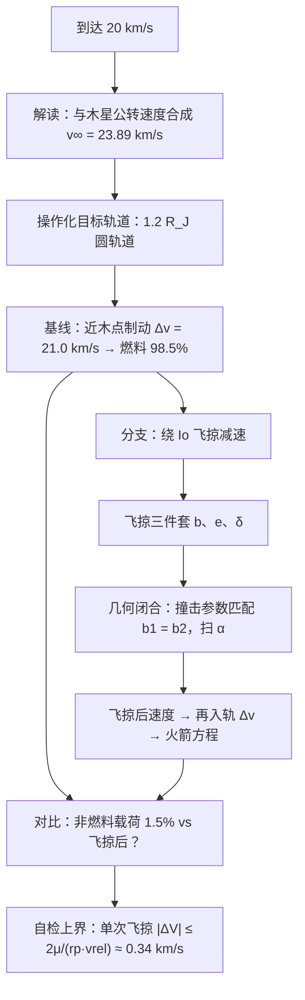

# 2013 题A：木星卫星引力辅助减速入轨（Gravitationally Assisted Jupiter Orbital Entry）

> 赛题来源：UPC 2013 Problem A（当年 121 队中 52 队选题 A，金奖 1 队：滑铁卢大学 538 队）

## 1. 题目原文与关键数据

**原文压缩引用**：
> Space probes to the outer solar system will often use a gravity assist maneuver, flying past a planet like Venus to gain speed. When a probe reaches an outer planet, like Jupiter, it must slow down, in order to enter orbit, and this can consume a substantial amount of fuel. It has been suggested that a spacecraft arriving at Jupiter could use Jupiter's moons to perform a gravity assist maneuver to slow down the spacecraft, thus saving fuel. **Evaluate whether this is a realistic strategy to produce significant fuel savings for a spacecraft arriving at Jupiter (approaching Jupiter's system) at a speed of 20 km/s.**

**中文翻译**：外太阳系探测器常用引力辅助（如飞掠金星）加速。到达外行星（如木星）时必须减速入轨，这会消耗大量燃料。有人建议：抵达木星系统的探测器可借木星卫星做引力辅助减速以省燃料。**请评估：对以 20 km/s 速度抵达木星（进入木星系统）的探测器，这是否是能带来显著燃料节省的现实策略？**

**题面给定参数表**：

| 参数 | 数值 | 备注 |
|---|---|---|
| 到达速度 | 20 km/s | **语义多义**：相对木星的 $v_\infty$？还是日心系到达速度（需与木星公转 13.07 km/s 矢量合成）？ |
| 卫星 | 木星伽利略卫星（Io/Europa/Ganymede/Callisto）自选 | 需自行比较 |
| 目标轨道 | **未指定** | 最大的隐藏自由度，必须操作化 |
| 发动机 | 未指定 | 喷气速度 $u$ 需自取（化学推进 ~3.1 km/s） |

常用常数（自取，注明出处）：$\mu_J = 1.266\times10^{17}\ {\rm m^3/s^2}$，$R_J = 71{,}492$ km，Io：轨道半径 421,700 km $=5.9\,R_J$、轨道速度 17.33 km/s、半径 1821 km、$\mu_{Io}=5.96\times10^{12}\ {\rm m^3/s^2}$、轨道倾角 2.21°。

## 2. 题目到底在问什么（去模糊化）

题面给了三个必须自己定义的东西，每个都直接改变答案数量级：

1. **"arriving at 20 km/s" 怎么解读**：金奖论文取"日心系到达速度 20 km/s 与木星公转 13.07 km/s 垂直合成"，得木星系双曲超速 $v_\infty=\sqrt{20^2+13.07^2}=23.89$ km/s。若直接取 $v_\infty=20$ km/s，结果又不同。**必须显式声明选择**。
2. **"enter orbit" 入轨到什么轨道**：这是最大的隐藏分水岭。同样从近木点 $1.2\,R_J$ 出发：(a) 刹成**圆轨道**需 $\Delta v = v_{\rm peri} - v_{\rm circ} = 59.9-38.9 \approx 21.0$ km/s；(b) 只需**捕获成大椭圆**（刹到逃逸速度以下）需 $59.9-54.9\approx 5.0$ km/s。真实任务走的是后者：Galileo 1995 年木星入轨仅消耗 $\Delta v\approx643$ m/s（377 kg 推进剂）进入大椭圆轨道，Juno 2016 年为 542 m/s。不定义目标轨道，"significant fuel savings" 无从谈起。
3. **"realistic / significant" 的判据**：应换算成任务语言——火箭方程 $m_f/m_0 = e^{-\Delta v/u}$ 是指数敏感的，省 1 km/s 的 $\Delta v$ 等于剩余载荷乘 $e^{1/u({\rm km/s})}$。建议以"同任务下非燃料载荷倍数"作为显著性的可计算判据。

## 3. 物理建模路线图

**层次 1：直接入轨基线（无辅助）**

- 火箭方程从动量守恒现场重推：$\Delta v = u\ln(m_0/m_f)$。
- **最优制动点要证明而非假设**：同样 $\Delta v$ 在速度最大处带走的轨道能量最多（$\Delta\varepsilon = \vec v\cdot\Delta\vec v \approx v\,\Delta v$），速度最大点即近木点，故应瞄准"近木点 = 目标轨道半径"的轨迹并在该点一次制动。
- $v_{\rm peri}=\sqrt{v_\infty^2+2\mu_J/r}$，$v_{\rm circ}=\sqrt{\mu_J/r}$，相减得 $\Delta v$；取 $u=5$ km/s、$r=1.2\,R_J$：$\Delta v\approx21.0$ km/s $\Rightarrow$ 燃料占 98.5%（剩余质量仅 1.5%）。

**层次 2：单卫星飞掠减速（patched conics）**

飞掠三件套（对任意引力源通用，建议收进赛前模板）：

$$b=\sqrt{r_p^2+\frac{2\mu r_p}{v_\infty^2}},\qquad e=\sqrt{1+\Big(\frac{b v_\infty^2}{\mu}\Big)^2},\qquad \delta=2\arcsin\frac{1}{e}$$

机制：卫星参考系中速率不变、方向偏转 $\delta$；回到木星系后与卫星轨道速度（Io 为 17.33 km/s）矢量合成，速度可增可减。**减速 = 从卫星前方通过**（经典棒球-火车类比），能量实为探测器与卫星交换动量。

**自检上界（本解读独立补充，务必掌握）**：一次飞掠能改变多少木星系速度？在卫星系中速度不变，木星系速度改变量 $|\Delta V| = 2v_{\rm rel}\sin(\delta/2) = \dfrac{2v_{\rm rel}}{1+r_p v_{\rm rel}^2/\mu}$。对 $r_p\ge R_{\rm moon}$：

- 快速接近 regime（本场景，$v_{\rm rel}\ge 17$ km/s $\gg \sqrt{\mu/r_p}$）：$|\Delta V|_{\max}\approx \dfrac{2\mu}{r_p v_{\rm rel}}$。代入金奖参数（$v_{\rm rel}=16$ km/s、$r_p=2186$ km）得 **Io 单次飞掠上界仅 ~0.34 km/s**（偏转角 $\delta\approx1.2°$）。
- 绝对上界：$v_{\rm rel}=\sqrt{\mu/r_p}$ 时取最大 $|\Delta V|_{\max}=\sqrt{\mu/r_p}=v_{\rm esc}/\sqrt2$，Io 约 **1.8 km/s**——但那要求探测器几乎与 Io 同轨共速，20 km/s 到达场景根本不满足。

**任何飞掠模型给出的单次减速若超过此界，几何或公式必有错。**

**层次 3：可选扩展**：链式多星飞掠（Io→Ganymede→Callisto 多次借力累加）；三维几何与轨道倾角；捕获椭圆 + 后续降轨的两脉冲方案；用真实 $I_{sp}$（$u\approx3.1$ km/s）重算。

## 4. 关键物理效应量级表

| 效应 | 估算量级 | 是否必须建模 | 估算依据 |
|---|---|---|---|
| 直接入轨 $\Delta v$（1.2 $R_J$ 圆轨道） | 21.0 km/s → 燃料 98.5% | 必须（基线） | $v_{\rm peri}=59.9$、$v_{\rm circ}=38.9$ km/s 相减 |
| 捕获大椭圆所需 $\Delta v$ | 仅 ~5.0 km/s → 燃料 63% | 必须（操作化对照） | $v_{\rm peri}-v_{\rm esc}=59.9-54.9$ km/s |
| 单次 Io 飞掠最大交换速度 | 本场景 ~0.34 km/s；绝对上界 1.8 km/s | 必须（自检） | $2\mu/(r_p v_{\rm rel})$；$v_{\rm esc}/\sqrt2$ |
| Io 轨道半径/速度 | $5.9\,R_J$ / 17.33 km/s | 必须 | NASA fact sheet（金奖论文误作 ~15 $R_J$，疑混入 Ganymede 数据，引用常数需交叉核对） |
| Io 引力影响域（Hill 半径） | $\approx1.05\times10^4$ km $\ll$ 日木距离 | 支撑"飞掠与再减速两段拆分"合法 | $r_H=a(m/3M)^{1/3}$ |
| 火箭方程指数敏感性 | 省 1 km/s → 剩余载荷 $\times e^{0.2}\approx1.22$ 倍 | 必须（结论换算） | $m_f/m_0=e^{-\Delta v/u}$ |
| 木星辐射带/工程约束 | — | 扩展讨论 | 现实任务在 1.2 $R_J$ 长期驻留不可行 |

## 5. 求解算法与数值要点

- **解析为主、一维搜索为辅**：全部闭式公式手推；唯一数值环节是把全部几何自由度压缩为**发射时机（相位角）$\alpha$** 做扫描，配合撞击参数匹配条件 $b_1=b_2$（飞掠出口轨迹恰好接上目标轨道的进动双曲线）。
- **对拍验证**：有/无飞掠两种情形必须用**同一套公式链**计算，唯一差异是飞掠——这是对比实验的公平性所在。
- **量级自检清单**：$\delta$ 是否在物理范围（本场景 Io 只有 1°–2°）；$r_p$ 是否在卫星表面之外；$|\Delta V|$ 是否超过 $2\mu/(r_p v_{\rm rel})$；单位（km vs m、rad vs deg）三轮排查。
- **陷阱**：把 $v_\infty$ 当作飞掠点的实际速度（飞掠点真速度是 $\sqrt{v_\infty^2+v_{\rm esc}^2(r)}$，在 Io 轨道处还要再大 10 km/s 量级，使偏转更小）；$\mu$ 用错天体（木星 vs 卫星差 4–5 个量级）；火箭方程的 $u$ 与 $\Delta v$ 单位不一致。

## 6. 常见错误与陷阱

1. **不定义目标轨道**："入轨"泛化导致 $\Delta v$ 从 3.5 到 21 km/s 都"对"，结论失去意义——先操作化，再计算。
2. **跳过"在哪里刹车"的论证**：$\Delta\varepsilon = v\,\Delta v$ 的近木点最优性是评委眼中的隐藏分题，只会套公式会丢过程分。
3. **把飞掠当免费减速**：忽略撞击参数/方向匹配（$b_1=b_2$），或给出的单次减速超过量级上界。值得警惕的实例：把金奖论文印刷的公式链代入题面常数，单次 Io 飞掠偏转角仅 ~1.2°、剩余速度 ~23.6 km/s，而论文报告的 11.15 km/s 需要约 50° 偏转（对应近心距 ~50 km，深藏在 Io 内部）——其附录代码未公开无法复核。**教训不是否定引力辅助（见第 7 节，链式借力确有节省），而是"超过上界的结果必须回头查几何"。**
4. **忘记火箭方程的指数性**：0.3–1 km/s 级的节省看似渺小，换算成载荷百分比才是回答 "significant" 的正确语言。
5. **常数张冠李戴**：轨道半径、轨道速度、半径、GM 必须取自同一颗卫星（金奖论文把 ~15 $R_J$ ≈ Ganymede 的轨道距离与 Io 的其余参数混用即是教训）；建议每个常数旁注来源。

## 7. 全网参考与延伸

1. **JPL：Critical Galileo Engine Firing Scheduled（1995）**（[jpl.nasa.gov](https://www.jpl.nasa.gov/news/critical-galileo-engine-firing-scheduled)）——Galileo 木星入轨实烧 377 kg 推进剂、$\Delta v\approx643$ m/s，是把"目标轨道操作化"锚定到现实的最好数据。
2. **Juno 木星入轨 Press Kit（2016）**（[jpl.nasa.gov](https://www.jpl.nasa.gov/news/press_kits/juno/overview/)）——$\Delta v=542$ m/s 捕获入 53.5 天大椭圆轨道再降轨，展示真实任务如何用"先捕获后调整"省燃料。
3. **Lynam 2011《Multiple-satellite-aided capture trajectories at Jupiter》**（[ADS 摘要](https://ui.adsabs.harvard.edu/abs/2011CeMDA.109...59L/abstract)）——严谨的任务设计研究表明：单/双伽利略卫星借力捕获确实能可观测地削减入轨 $\Delta v$（数百 m/s 到 km/s 量级），但依赖**链式多次飞掠**——与本解读的"单次飞掠上界"自洽，可作结论显著性的真实参照。

## 8. 金牌论文思路对比

本题金奖唯一一队（滑铁卢大学 538 队，13 页，LaTeX）：从动量守恒重推火箭方程 → 能量论证"近木点制动最优" → 直接入轨算得燃料 98.5% → 用飞掠三件套与 $b_1=b_2$ 匹配把发射时机 $\alpha$ 压成一维扫描 → 报告最优 $\alpha=0.8366$ rad、剩余速度 11.15 km/s、燃料 96.8%，并表述为"同任务非燃料载荷翻倍"。其框架（火箭方程 + 最优制动点 + 飞掠三件套 + 同框架对照）是完全值得继承的赛前模板；但其单次飞掠数值结果超出本解读第 3 节给出的量级上界，且附录代码未公开，复现时请以自检上界把关。详细拆解见 [05_论文赏析/2013/2013-GM-A-538.md](../05_论文赏析/2013/2013-GM-A-538.md)。

## 9. 评分要点：评委想看什么

- [ ] **三个操作化声明**：20 km/s 的参考系、目标轨道、喷气速度 $u$，一个都不能含糊。
- [ ] **最优制动点的能量证明**（$\Delta\varepsilon=v\,\Delta v$），而非直接假设在近木点。
- [ ] **火箭方程现场推导** + 把结论换算成载荷/燃料百分比回答 "significant"。
- [ ] **飞掠几何闭合**：偏转角、撞击参数匹配、发射相位角扫描，缺一不可。
- [ ] **量级自检**：单次飞掠 $|\Delta V|$ 上界、$r_p$ 在星体之外、单位一致性。
- [ ] **与真实任务对照**（Galileo/Juno 的 0.5–0.6 km/s 入轨），把理论放回工程语境。
