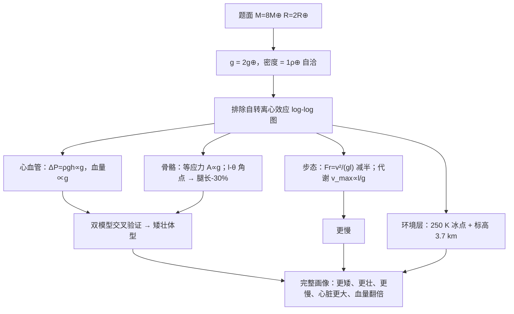

# 2013 题B：超重力环境下的生物结构（Extraterrestrial Life）

> 赛题来源：UPC 2013 Problem B（当年 121 队中 69 队选题 B，为热门题；金奖 1 队：华盛顿大学圣路易斯分校 611 队，官方公开两个版本 PDF）

## 1. 题目原文与关键数据

**原文压缩引用**：
> Recently, astronomers have discovered earth-like planets orbiting other stars. Many planets have been found in the habitable zones… **Assume such a planet exists, and that its mass is eight times that of earth while its radius is twice that of earth. The average surface temperature on the planet is 250 K. A four legged animal has evolved to live on the equator of this planet. Produce a physics-based analysis on how life on this planet might be similar to, or different from, creatures that evolved on earth. For example consider questions such as: Relative to a similar creature on earth, how large would such an animal be? What shape would it be? How fast would it move?**

**中文翻译**：天文学家已发现位于宜居带的类地行星。设存在这样一颗行星：质量为地球 8 倍、半径为地球 2 倍、平均表面温度 250 K。一种四足动物演化生存于其赤道。请给出基于物理的分析：该行星上的生命与地球生物可能有何异同？例如：相对地球上的类似动物，它**多大？什么形状？运动多快？**

**题面给定参数表**：

| 参数 | 数值 | 推论（自行算出） |
|---|---|---|
| 质量 $M$ | $8\,M_\oplus$ | 表面重力 $g = GM/R^2 = 8/4 = 2g_\oplus$ |
| 半径 $R$ | $2\,R_\oplus$ | 平均密度 $\rho = M/R^3 = 1\,\rho_\oplus$（**自洽检查，题面数字是精心设计的**） |
| 平均表面温度 | 250 K（$-23°$C） | 低于冰点！必须讨论液态水来源（温室/海洋冰盖） |
| 生物 | 四足、赤道 | 四足站立每腿载荷为双足的 1/2；赤道温度高于均值 |

## 2. 题目到底在问什么（去模糊化）

这是典型的"科幻皮、生物物理芯"开放题。模糊词是 **"similar or different"**——不可计算，必须拆成可定量的形态学代理量，并**逐项回应题面列出的每个示例问题**（评委按示例逐项找答案）：

- **多大**：体长/体重标度——由骨应力与骨骼自重占比约束。
- **什么形状**：腿长、骨截面积、肌肉附着角——由等应力设计与力矩平衡约束。
- **多快**：步态与极速——由 Froude 数（步态转换）与代谢功率（极速）约束。
- 题面没说但 250 K 暗示的：保温（毛发/脂肪）、大气标高（呼吸与飞行）。

金奖论文的开局动作值得照抄：先算 $g=2g_\oplus$，再用一张 log-log 图把**自转离心效应**正式排除（需自转快 10 倍以上离心项才显著），然后声明"重力是唯一决定性变量"——先排除干扰变量，评委就无从追问"为什么不考虑 X"。

## 3. 物理建模路线图

**层次 1：2g 静力标度（三条独立主线）**

- **骨骼应力**：站立/运动中骨应力 $\sigma = F/A \sim mg/A$。等应力设计（地球动物跨物种骨强度近似恒定，人股骨剪切强度实测 ~51.6 MPa）要求 $A \propto g$——**2g 下骨截面积翻倍**。
- **心血管**：把血液泵到高度 $h$ 需压差 $\Delta P = \rho_b g h \propto g$。自检：长颈鹿头部高于心脏 ~2 m，$\rho_b g h = 1060\times9.8\times2\approx2.1\times10^4$ Pa $\approx155$ mmHg，与长颈鹿实测血压量级吻合——2g 下同身高血压翻倍，或身高/附肢减半，或心脏壁增厚（Laplace 定律 $\Delta P = 2\sigma t/r$）。血容量按 Dawson 异速律 $V\propto g$，**2g 下约翻倍**。
- **步态**：肢体是倒摆，Froude 数 $Fr = v^2/(gl)$（特征长度取腿长）控制步态转换（走-跑阈值 $Fr\approx0.3$–0.8，跑-飞奔 $Fr\approx2$–3，Alexander 实测）。同一速度下 2g 使 $Fr$ 减半："地球上在飞奔、系外行星上只是小跑"。

**层次 2：必要修正（从标度到结构优化）**

- 静力标度只给 $A\propto g$，没说 $l$（腿长）与 $\theta$（肌腱附着角）怎么变。把骨长 $l$ 与附着角 $\theta$ 画成**等应力曲线族**（力矩平衡：肌肉力矩 $= A_m\sigma_m r_m$ 对抗关节力矩 $mg\,l/2$），再引入一条生态假设——**演化最小化肌应力**——取曲线"角点"为最优解：金奖代码给出 1g/2g 角点 $\theta\approx0.107/0.0756$ rad（比值 $1/\sqrt2$），对应**骨长缩短约 30%、骨截面翻倍**。抽象假设就此落成可测数字。
- **代谢功率极限（本解读补充的"多快"硬约束）**：移动每米克服重力做功 $\sim c\,mg$（地球Cost of transport ~10–20 J/(kg·m)），动物比功率恒定，故极速 $v_{\max}\propto l/g$——2g 下即便腿不变也约减半，腿再短 30% 则仅剩 ~35%。这比 Froude 论证（只管步态转换速度）更直接地回答"多快"。
- **体型上限的真正来源**：骨截面积加粗的代价是骨骼自重，$f_{\rm bone}\propto g\,l$（同密度下），平方-立方律由此重新进场——体型上限由"骨骼占重比不失控"决定，而非简单的 $l\propto1/g$。

**层次 3：可选扩展（环境层）**

- 250 K 均温按 Lambert 余弦律摊到球面：赤道 $\bar T\times(2/\sqrt{\pi})$… 简化取 $T_{\rm eq}\approx285$ K、两极 $\approx190$ K：赤道勉强在冰点上方，两极必然冰盖——类北极熊的保温与从食物取水策略。
- 大气标高 $\lambda = k_BT/(mg)$：$T=250$ K、$m=29\,{\rm amu}$、$g=19.6$ m/s² 得 $\lambda\approx3.7$ km（地球 8.4 km）——分"同表面气压/同大气柱"两案讨论飞行生物与血氧分压。
- 跳跃高度 $h=v^2/(2g)$ 减半（肌肉能量密度不变）；树木高度 $\propto 1/g$，食物链随之变矮。

## 4. 关键物理效应量级表

| 效应 | 估算量级 | 是否必须建模 | 估算依据 |
|---|---|---|---|
| 表面重力 | $g=GM/R^2=2g_\oplus$ | 必须（题眼） | 直接计算 |
| 行星密度自洽 | $\rho = 8/8 = 1\,\rho_\oplus$ | 必须（合法性检查） | $M/R^3$ |
| 自转离心项 | 地球式自转 $0.35\%g$；需 10 倍自转才达 ~3% | 排除（一张图） | $\omega^2R/g$；解体周期下限 ~1.4 h |
| 骨截面积 | $+100\%$ | 必须 | 等应力 $\sigma=mg/A$ |
| 腿长/附着角 | $l$ 缩 ~30%、$\theta\times1/\sqrt2$ | 建议（核心定量结论） | l–θ 等应力曲线角点 |
| 血压梯度 | $\times2$ | 必须 | $\Delta P=\rho_b g h$，长颈鹿对照 |
| 血容量 | $\approx\times2$ | 建议 | Dawson 异速律 $V\propto g$（注意高 $g$ 发散，仅限小幅变化） |
| Froude 数 | 同速下减半 | 必须 | $Fr=v^2/(gl)$，Alexander 阈值 |
| 极速（代谢限制） | $\sim\times0.35$–0.5 | 建议 | $v_{\max}\propto l/g$ |
| 大气标高 | $3.7$ km（地球 8.4） | 建议 | $\lambda=k_BT/(mg)$ |
| 250 K 冰点问题 | 均温低于 0°C | 必须讨论 | 温室效应/冰盖、赤道 285 K |

## 5. 求解算法与数值要点

- **解析与标度论证为主**：本题几乎不需要数值模拟（金奖论文也坦承 N-S 方程数值不可解，只能做定性推论）；全部定量结论来自守恒/平衡方程与异速标度律。
- **"等值线图 + 选点规则"技法**：把两个待定量（$l$、$\theta$）画成约束曲线族，用一条演化/经济性假设选角点，即可输出具体数字（本文 30%）。附录代码可用任意绘图工具复现（金奖队用了 CERN ROOT）。
- **验证手段**：(a) 双独立模型收敛——心血管（血压限制身高）与骨骼（应力限制身高）两条路径指向同一"矮壮"结论，交叉印证；(b) 真实生理常数锚定（股骨剪切强度 51.6 MPa、人体参数、Fr 阈值）；(c) 极限自检——$V\propto g$ 律在高 $g$ 发散，标注失效域。
- **陷阱**：Froude 数特征长度必须取腿长；$Fr$ 只是步态转换判据，不能当极速公式；动载荷（奔跑时地面反力为体重 2–3 倍、四足分担）才是应力的正确工况，站立工况会低估。

## 6. 常见错误与陷阱

1. **忘做密度自洽检查**：$8M_\oplus/8V_\oplus$ 恰好同密度——题面数字是精心设计的，指出这一点本身就是得分点，也为"岩石成分可行"背书。
2. **平方-立方律当全部答案**：直接说"生物缩小一半"既忽略了演化可加粗骨骼（正异速生长），也没指出真正上限来自骨骼自重占比 $f_{\rm bone}\propto g\,l$。
3. **漏答示例子问题**：题面明确列了 size/shape/speed 三问，评委逐项对照；只算体型会整段丢分。
4. **忽略 250 K**：均温低于冰点却不讨论液态水从何而来，整个"生命"前提悬空。
5. **Froude 数误用**：特征长度取身高而非腿长、或把 $Fr$ 阈值当成极速判据；极速应诉诸功率/代谢论证。
6. **生物参数零出处**：骨强度、步态阈值、人体质量必须引实验文献——超重力题最容易被批"编故事"，数据地基决定可信度。

## 7. 全网参考与延伸

1. **Tominari et al. 2019：2G 超重力对小鼠骨与肌肉量的反向效应**（[PMC6488638](https://pmc.ncbi.nlm.nih.gov/articles/PMC6488638)）——离心机 2g 实验显示骨骼与肌肉质量增加（与微重力相反），为"更壮"的预测提供实验参照。
2. **Gnyubkin et al. 2015：慢性 2g 离心对大鼠骨骼的适应与极限**（[J Appl Physiol](https://journals.physiology.org/doi/full/10.1152/japplphysiol.00364.2015)）——2g 下股骨小梁体积 +18%、椎骨 +13%，可用来校验"骨截面翻倍"量级是否夸张。
3. **NASA NTRS 2017：慢性 2G 离心对生长大鼠的合成代谢效应**（[ntrs.nasa.gov](https://ntrs.nasa.gov/citations/20170011058)）——官方实验报告，适合作为"真实超重力生物学"的权威出处写进参考列表。

## 8. 金牌论文思路对比

本题金奖唯一一队（华盛顿大学圣路易斯 611 队，23 页；官方公开 611 与 611a 两个版本，赏析针对 611a）：入口先排除自转效应 → 心血管（N-S 方程简化 + Poiseuille 论证血压梯度 ∝ g，结合 Dawson 异速律得血量 ∝ g）与肌肉骨骼（应力分解 + 力矩平衡的 l–θ 等应力曲线，"演化最小化肌应力"取角点得腿长 -30%、截面 ×2）**双模型交叉收敛**于矮壮体型 → Froude 数论步态（同速 Fr 减半）→ 环境层补 250 K 温度分布与 3.7 km 标高，最终拼出"更矮、更壮、更慢、心脏与器官更大、血量翻倍"的完整画像。详细拆解见 [05_论文赏析/2013/2013-GM-B-611a.md](../05_论文赏析/2013/2013-GM-B-611a.md)（另一版本文本在 `04_论文文本\2013\2013-GM-B-611.txt`）。

## 9. 评分要点：评委想看什么

- [ ] **g 与密度的自洽检查**开局（$2g_\oplus$、$1\rho_\oplus$），并排除自转等干扰变量。
- [ ] **逐项回答示例问题**：多大、什么形状、多快，一个不落。
- [ ] **双独立模型收敛**：心血管与骨骼两条路径指向同一形态学结论，并在文中点明。
- [ ] **真实生理常数锚定**：骨剪切强度、步态阈值、人体参数全部有文献；附录附参数表。
- [ ] **标度律清单**：$A\propto g$、$V\propto g$、$Fr\propto1/g$、$\lambda\propto1/g$ 一张表覆盖多子系统，并标注失效域。
- [ ] **收尾"一句话画像"**：Results Summary 把各模型拼成完整生物画像，让评委最后一页带走答案。
