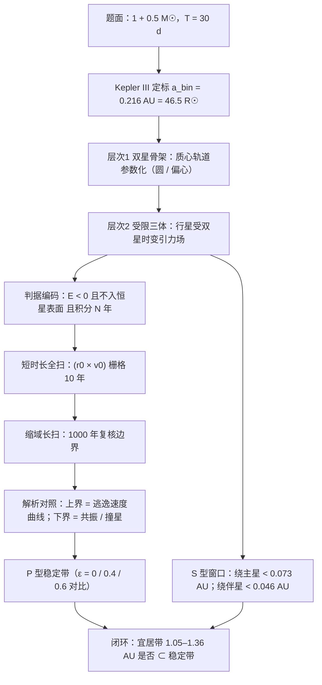

# 2014 题A：环双星行星（Circumbinary Planets）

> 赛题来源：UPC 2014 Problem A（131 队中 93 队选题 A，金奖 1 队：Jacobs University Bremen 726 队）

## 1. 题目原文与关键数据

**原文压缩引用**：
> Consider two stars, one with 50% of the mass of our Sun and one equal in mass to our Sun. This binary star system has an orbital period of 30 Earth days. **Where could a planet have a stable orbit in this system? Describe the possible stable planetary orbits.**

**中文翻译**：两颗恒星，一为太阳质量的 50%，一与太阳等质量；双星轨道周期为 30 个地球日。**行星在此系统中何处可能拥有稳定轨道？请描述可能的稳定行星轨道。**

**题面给定参数表**：

| 参数 | 数值 | 备注 |
|---|---|---|
| 主星质量 $M_1$ | $1.0\,M_\odot$ | 主序星，半径 $\approx1\,R_\odot$ |
| 伴星质量 $M_2$ | $0.5\,M_\odot$ | 主序星，半径 $\approx0.45\,R_\odot$ |
| 双星周期 $T_{bin}$ | 30 天 | 题面唯一动力学数据，定标间距的钥匙 |
| 双星偏心率 $\varepsilon$ | **未给定** | 隐藏自由度，金奖论文扫了 0 / 0.4 / 0.6 |
| 行星质量与初条件 | **未给定** | "Where could" 要求给相空间区域而非单点 |

由开普勒第三定律反推（本解读独立计算）：$a_{bin}=\left[\dfrac{G(M_1+M_2)T_{bin}^2}{4\pi^2}\right]^{1/3}=0.216\ {\rm AU}\approx46.5\,R_\odot$；两星到质心距离 $a_1=\frac{M_2}{M_1+M_2}a_{bin}=0.072$ AU（15.5 $R_\odot$）、$a_2=0.144$ AU（31 $R_\odot$）。间距 46.5 $R_\odot$ 远大于两星半径之和，是分离双星——行星活动空间完全敞开。

## 2. 题目到底在问什么（去模糊化）

本题是典型的"零判据开放题"，三个模糊词必须先操作化：

1. **"stable" 怎么编码**：三体问题无解析解，"稳定"必须写成可判定的数值判据。建议三要素：(i) 能量束缚——行星相对双星的能量 $\frac12\dot r^2-\frac{GM_1}{|\vec r-\vec r_1(t)|}-\frac{GM_2}{|\vec r-\vec r_2(t)|}<0$；(ii) 生存——从未进入恒星表面（处理 $r\to0$ 奇点）；(iii) 时长——积分多久才算数（10 年远远不够，见第 5 节反例）。
2. **"Where could" 的答案形态**：不是一条圆轨道，而是 $(r_0,v_0)$ 二维初值平面上的稳定带状区域（椭圆轨道也算），且带边要有物理解释。此外题目没有限定绕双星：**绕双星的 P 型轨道与绕单星的 S 型轨道**两类拓扑都应覆盖——绝大多数队伍只答了前者。
3. **"Describe the possible orbits"**：描述 = 稳定带 + 边界成因（上界是逃逸速度曲线、下界是共振与撞星）+ 隐藏参数（偏心率）的敏感性 + 可选的宜居带闭环。

## 3. 物理建模路线图

**层次 1：双星解析骨架**。开普勒第三定律 $T_{bin}^2=4\pi^2a_{bin}^3/[G(M_1+M_2)]$ 定间距；质心加权分配 $a_1,a_2$；圆轨道参数化 $\vec r_i(t)=a_i(\cos\omega t,\sin\omega t)$，偏心轨道加 $\sqrt{1-\varepsilon^2}$ 压缩与质心回位修正。此层产出随时间运动的"引力源坐标"。

**层次 2：受限三体数值实验**。行星取 test particle：$\ddot{\vec r}=-GM_1\dfrac{\vec r-\vec r_1(t)}{|\vec r-\vec r_1|^3}-GM_2\dfrac{\vec r-\vec r_2(t)}{|\vec r-\vec r_2|^3}$；在 $(r_0,v_0)$ 平面栅格化扫参，按第 2 节判据标稳定/不稳定。

**层次 3：可选扩展**。双星偏心率扫描；S 型稳定窗口（与 Holman–Wiegert 经验式对照）；宜居带闭环——质光关系 $L\propto M^4$ 给总光度 $1+0.5^4\approx1.06\,L_\odot$，宜居带约 1.05–1.36 AU，检查其是否落在稳定带内。

## 4. 关键物理效应量级表

| 效应 | 估算量级 | 是否必须建模 | 估算依据 |
|---|---|---|---|
| 双星间距定标 | $a_{bin}=0.216$ AU $=46.5\,R_\odot$ | 必须（第一步） | 开普勒 III，30 天代入 $GM=1.99\times10^{20}$ m³/s² |
| 双星场偏离点质量 | $(a_{bin}/r)^2$：0.6 AU 处 13%、1 AU 处 4.7% | 必须（两星分别算，这正是题眼） | 四极展开第二项 |
| P 型稳定下界 | $\varepsilon=0$ 时 $\approx0.52$ AU（金奖数值扫描 $\approx0.6$ AU） | 必须 | Holman–Wiegert 式 $a_c/a_b=1.60+4.12\mu-5.09\mu^2$，$\mu=1/3$ |
| 偏心率敏感性 | $\varepsilon=0.4\to0.78$ AU；$\varepsilon=0.6\to0.86$ AU | 建议扫描 | 同式全项代入 |
| S 型窗口 | 绕主星 $a\lesssim0.073$ AU、绕伴星 $a\lesssim0.046$ AU | 应含（最常漏的半边题） | HW S 型式 $0.464-0.380\mu$，$\mu=1/3$ 与 $2/3$ |
| 逃逸速度上界 | 0.6 AU 处 $v_{esc}\approx14.0$ AU/yr，$v_{circ}\approx9.9$ AU/yr | 必须（稳定带上界的解析对照） | $\sqrt{2GM_{tot}/r}$ 点质量近似 |
| 与双星共振 | 边界 0.52 AU $\approx2.4\,a_{bin}$，紧贴 4:1 外共振（$T_p=120$ d → 0.55 AU）内侧 | 讨论（解释边界成因） | $T_p=4T_{bin}$ 换算半长轴 |
| test particle 假设 | 木星质量行星 $GM_p/GM_{bin}\approx6\times10^{-4}$ | 陆地行星可忽略，需书面声明 | 质量比 |
| 相对论进动 | $4.6\times10^{-7}$ rad/圈（0.6 AU） | 不需要 | $6\pi GM/[c^2a(1-e^2)]$ |
| 积分时长 vs 混沌泄漏 | 10 年仅 ~122 个双星周期；边缘轨道扩散需 $10^3$–$10^4$ 圈 | 必须（1000 年量级） | 金奖反例：10 年判稳、326 年坠星 |

## 5. 求解算法与数值要点

- **两级扫参**：短时长全扫（如 50 个半径 × 150 个初速，积分 10 年）→ 把稳定域缩窗后做 1000 年长积分复核边界。算力与结论强度兼得。
- **积分器**：自适应 RK45 或辛积分器（leapfrog 能量长期漂移小）；步长 $\le T_{bin}/100\approx7$ 小时；全程监测能量相对漂移。
- **解析先行框窗口**：以 $v_{circ}(r)=\sqrt{GM_{tot}/r}$ 为初速中心、$v_{esc}=\sqrt2\,v_{circ}$ 为上界撒点，避免盲目扫描；扫完后稳定带上边界应与逃逸速度曲线重合——这是最强的自检。
- **撞星处理**：事件停止（$r<R_\star$ 即判死）或金奖的 sigmoid 排斥场连续化，切勿让 $1/r^2$ 奇点炸掉积分器。
- **验证**：负对照——把双星退化为单点质量应复现开普勒椭圆；反例搜索——对边缘"稳定"样本加长积分抓晚期坠星。

## 6. 常见错误与陷阱

1. **不定标 $a_{bin}$**：不用 30 天反推 0.216 AU 就开始撒点，全部结论失去锚点。
2. **只扫半径不扫初速**：稳定区是 $(r_0,v_0)$ 二维带，上边界是逃逸速度曲线；只报一个"最小稳定半径"丢掉一半信息。
3. **把"10 年不发散"当稳定**：边缘轨道可晚至数百年才坠星，必须做时长递进并承认判据的时长敏感性。
4. **判据漏"不撞星"或撞星奇点未处理**：$E<0$ 但穿入恒星内部的"束缚"轨迹必须排除。
5. **只答 P 型**：绕单星 S 型窗口（0.05–0.07 AU 量级）是题目复数表述明示的另一半答案。
6. **宜居带与稳定性两张皮**：算出宜居带却不检查其是否落在稳定带内，闭环断裂、白送的分不要。

## 7. 全网参考与延伸

1. **Holman & Wiegert 1999**（[ADS](http://ui.adsabs.harvard.edu/abs/1999AJ....117..621H/abstract)）——环双星（P 型）与绕单星（S 型）临界稳定半径的经典经验公式，是给自主数值扫描"对答案"的基准线。
2. **Kepler-16 系统**（[Wikipedia](https://en.wikipedia.org/wiki/Kepler-16)、[NASA 系外行星目录](https://science.nasa.gov/exoplanet-catalog/kepler-16b)）——首个真实环双星行星：0.69+0.20 $M_\odot$、双星周期 41 天、行星在 0.704 AU，恰好压在 HW 判据（0.645 AU）之外——说明本题 0.5–0.6 AU 量级的答案与真实宇宙自洽，写进论文极有说服力。
3. **Lam & Kipping 2018**（[MNRAS](https://academic.oup.com/mnras/article/476/4/5692/4795319)）——用深度神经网络拟合环双星稳定边界，可作"经验判据 vs 自主数值实验"的方法论对照。

## 8. 金奖论文思路对比

本题金奖唯一一队（Jacobs University Bremen 726 队，25 页）：开普勒 III 定 $a_{bin}$ → $(r_0,v_0)$ 相空间 50×150 扫参、Mathematica NDSolve 积分 10 年 → 缩域积分 1000 年 → 判据"能量束缚 + 不入恒星半径"（附录用 sigmoid 排斥场把撞星连续化）→ 给出 $\varepsilon=0/0.4/0.6$ 三组稳定带，最小稳定半径约 0.6 AU → 附加宜居带分析（$L\propto M^4$、通量判据 1.05–1.36 AU，落在稳定带内闭环）。最大亮点是"短全扫 + 长缩域"的两级实验设计，以及图 15 主动展示"10 年判稳、326 年坠星"的反例——把判据的时长敏感性自己捅破，评委最吃这一套。详细拆解见 `05_论文赏析\2014\2014-GM-A-726.md`。

## 9. 评分要点：评委想看什么

- [ ] 用 30 天周期定标 $a_{bin}$，并画出双星几何（$a_1,a_2$、分离系统判定）。
- [ ] "稳定"判据书面化、可编码：束缚 + 不撞星 + 积分时长三要素缺一不可。
- [ ] 二维相空间扫描图 + 与解析边界（逃逸速度曲线）的对照解释。
- [ ] 多时长递进验证，最好主动展示边缘轨道反例。
- [ ] 对题面未给的偏心率 $\varepsilon$ 做显式声明与敏感性扫描。
- [ ] 超出最低要求的闭环层：S 型窗口或"宜居带 ∩ 稳定带"。
