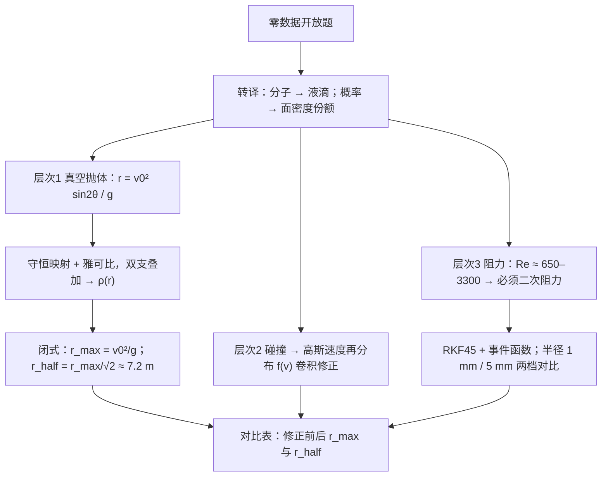

# 2014 题B：喷泉落点概率分布与中位圆（A Water Fountain）

> 赛题来源：UPC 2014 Problem B（131 队中 38 队选题 B，金奖 1 队：南方科技大学 807 队）

## 1. 题目原文与关键数据

**原文压缩引用**：
> A water fountain located at the middle of a circular pond ejects water straight up, and the water spreads out into a cone shape with the axis of the cone being vertical. As the water moves, its molecules collide with each other. Determine the probability that any molecule of the ejected water hits the pond at the point (x, y). Assume that the fountain's ejection point is at (0, 0). From your model, determine the most probable place where the water lands and also the median circle, that is, that circle around the fountain inside which exactly half of the water lands.

**中文翻译**：圆形池塘中央的喷泉竖直上喷，水呈圆锥形散开（锥轴竖直）。水运动时分子彼此碰撞。求任一分子落在池塘 $(x,y)$ 处的概率；喷射点取 $(0,0)$。由模型给出最概然落点，以及中位圆——恰好有一半水落在其中的圆。

**题面给定 vs 必须自设**（本题特点：除喷射点外几乎零数据）：

| 量 | 题面 | 必须自设（参考取值） |
|---|---|---|
| 喷射点 | $(0,0)$，锥轴竖直 | 喷口高度取池面（声明即可） |
| 出射速度 $v_0$ | 未给 | 8–12 m/s（喷高 $v_0^2/2g\approx3$–7 m，与景观喷泉相符） |
| 锥半角 $\theta_0$ | 未给 | 全锥/半球作基线，再扫描 |
| 角分布 $E(\theta,\varphi)$、速度分布 $f(v)$ | 未给 | 均匀 + $\delta(v)$ 作基线，再升级 |
| "分子" | 字面 | **必须转译**为毫米级液滴 |
| 池面 | 隐含 $z=0$ 平面 | — |

## 2. 题目到底在问什么（去模糊化）

1. **"any molecule"**：真分子（$10^{-26}$ kg）在宏观流场里没有独立弹道，"分子概率"无从谈起。正确转译是把水流离散为液滴，"任一分子落在 $(x,y)$ 处的概率" = 单位落水面积的份额 $\rho(r)\,dA$（等质量液滴下也是液滴数份额）。这一步转译是全文的分水岭。
2. **"molecules collide with each other"**：题面碰撞提示是开放度所在。可操作化为：(a) 用数密度估算论证出喷嘴后液滴稀疏、两两碰撞可忽略，把相互作用的宏观后果归并为出射速度的再分布；(b) 硬写玻尔兹曼碰撞积分（吃力不讨好）。金奖取 (a)，用高斯速度分布承载"碰撞"效应。
3. **众数 ≠ 中位数**："most probable place" 是密度 $\rho(r)$ 的众数，"median circle" 由 $\int_0^{r_h}2\pi r'\rho(r')\,dr'=\frac12\int\rho\,dA$ 定义（注意 $r$ 权重）。对均匀角分布，$\rho\propto1/[r\sqrt{1-(r/r_{max})^2}]$ 在 $r\to0$ 与 $r\to r_{max}$ 双双可积发散——**众数答案是"圆心与边缘圆"两个**，能否给出这一形状是是否真算出密度的试金石。
4. **零数据题的元要求**：每个自设参数都要显式声明并做敏感性分析；答案（尤其中位圆）本质上是分布依赖的，"从模型决定"意味着给出参数化的闭式结果。

## 3. 物理建模路线图

**层次 1：真空抛体 + 概率映射（全解析）**。核心是守恒映射：喷射立体角元内的液滴数 = 落点面元内的液滴数，$E(\theta,\varphi)\,d\theta\,d\varphi=\rho(r,\varphi)\,r\,dr\,d\varphi$。抛物线升降对称给出角-径映射 $r=\dfrac{v_0^2\sin2\theta}{g}$，雅可比 $\left|\dfrac{dr}{d\theta}\right|=\dfrac{2}{g}\sqrt{v_0^4-r^2g^2}$；$\theta$ 与 $\pi/2-\theta$ 双支同落点，须叠加。闭式结果 $\rho(r,\varphi)=\dfrac{g\,[E(\theta_1)+E(\theta_2)]}{2r\sqrt{v_0^4-r^2g^2}}$ 对**任意** $E$、$f(v)$ 成立——保持符号形式推到底，最后才代入具体分布。由 $\delta(v)$ 基线得 $r_{max}=v_0^2/g\approx10.2$ m（$v_0=10$ m/s）；均匀分布半球情形中位圆 $r_{half}=r_{max}/\sqrt2\approx7.2$ m，一般锥角按 $\theta_0$ 与 $\pi/4$ 的关系分三种情形闭式。

**层次 2：相互作用修正**。多体碰撞等价为出射速度的高斯再分布 $f(v)$（窄分布），经 $\bar\beta(r)=\int\beta(v,r)f(v)\,dv$ 卷积传播进中位圆；$\delta$ 分布是 $a\to\infty$ 极限，自检闭环。

**层次 3：空气阻力**。先算 $Re=\rho_a v d/\eta$ 再选型（见第 4 节），采用二次阻力 $F_d=\tfrac12C_D\rho_aAv^2$（$C_D\approx0.5$），RKF45 数值积分 + 事件函数捕捉穿池时刻，按滴径分档对比。

## 4. 关键物理效应量级表

| 效应 | 估算量级 | 是否必须建模 | 估算依据 |
|---|---|---|---|
| 无阻力基准 | $r_{max}=v_0^2/g\approx10.2$ m，$r_{half}\approx7.2$ m（$v_0=10$ m/s） | 必须（解析基线） | 角-径映射闭式解 |
| 出射瞬间阻力/重力比 | 直径 1 mm 滴 $\approx4.5$ 倍、2 mm $\approx2.3$ 倍、5 mm $\approx0.9$ 倍 | **必须**（小滴被阻力主导） | $\tfrac12C_D\rho_aAv^2/mg$，$C_D=0.5$ |
| Reynolds 数选型 | $Re\approx650$（$d=1$ mm、10 m/s）–3300（$d=5$ mm） | 必须（论证线性阻力出局） | $\rho_a vd/\eta$，$\eta=1.8\times10^{-5}$ Pa·s；Stokes 区要求 $Re\ll1$ |
| 终端落速 | 4.7 m/s（$d=1$ mm）、10.5 m/s（$d=5$ mm） | 必须（重塑落点分布与撞池速度） | $v_t=\sqrt{2mg/(C_D\rho_aA)}$ |
| 阻力对结论的修正 | 金奖：$r_{max}$ 10→4 m / 8 m；$r_{half}$ 7.2→3.30 m（半径 1 mm）/ 5.68 m（半径 5 mm） | 必须（量化回答"可否忽略"） | RKF45 数值结果 |
| 液滴气动破碎上限 | 自然雨滴直径 ≳6 mm 即破碎 | 滴径假设封顶：直径 ≤5–6 mm（金奖上限档半径 10 mm 偏大，宜斟酌） | Weber 数 / 雨滴观测 |
| 碰撞相互作用 | 出口后液滴间距 ≫ 滴径，密集碰撞仅集中于喷嘴附近 | 可等价为速度再分布 | 数密度估算 |
| 微风横移 | 2 m/s × 飞行 ~2 s $\approx4$ m，与 $r_{half}$ 同量级 | 扩展讨论 | 均匀横流估计 |

## 5. 求解算法与数值要点

- **解析为主**：$E(\theta,\varphi)$、$f(v)$ 全程保持符号形式，得到通用密度与中位圆三分情形通解；均匀/$\delta$ 只是最后代入的特例——结论的通用性就是竞争力。
- **数值为辅**：ode45/RKF45 配事件函数（$z$ 穿越 0 且方向为负）精确捕捉落点；把 $\theta$ 均分数千点积分轨迹族，直方图按大数定律重建密度，与解析 CDF 对拍。
- **验证三件套**：归一化 $\int\rho\,dA=1$；$\delta$ 分布作为高斯的 $a\to\infty$ 极限复核；阻力模型退化为零阻力时复现 $r_{max}=v_0^2/g$。
- **数值陷阱**：$\rho$ 在 $r\to0$（$1/r$）与 $r\to r_{max}$（$1/\sqrt{\cdot}$）可积发散，直接数值积分会爆——改用累积分布或解析分母；双支叠加漏一支则边缘峰矮一半；中位圆积分忘乘 $2\pi r$ 是最常见低级错。

## 6. 常见错误与陷阱

1. **把"分子"当真分子**：套平均自由程、麦克斯韦速度分布，模型自缚且与宏观喷泉无关——先做量级判断再选对象。
2. **没有概率映射**：只积分几条代表性轨迹就画"概率"，缺雅可比与双支叠加，密度形状整个错。
3. **众数与中位数混淆**：或只报数值不给密度形状，无法解释"为什么最概然落点有两个"。
4. **无 Re 论证就处理阻力**：直径 1 mm 滴出射时阻力是重力的 ~4.5 倍，忽略即错一个量级；反之直接上阻力却不给真空解析基线，评委看不到修正的贡献。
5. **零数据却不声明假设**：$v_0$、$\theta_0$、滴径、分布形式全部要显式设定并做敏感性，否则中位圆的 7.2 m 无从谈起。
6. **只答半球特例**：中位圆随锥角分段（$\theta_0$ 与 $\pi/4$ 的三种情形），只给一个特例公式算不上"从模型决定"。

## 7. 全网参考与延伸

1. **喷嘴类型与喷泉造型工程指南**（[fountains.com](https://fountains.com/fountain-nozzle-types-explained-jet-head-selection-water-display/)）——真实喷嘴如何决定锥角、喷高与形态，为自设的 $v_0$、$\theta_0$ 提供工程锚点。
2. **池塘漂浮喷泉喷型与流量匹配**（[fountaintechpumps.com](https://www.fountaintechpumps.com/blog/floating-pond-fountain-styles-nozzle-patterns)）——池塘漂浮喷泉典型喷高与流量区间，支持 $v_0\approx5$–8 m/s 的合理假设。
3. **TeeJet《A User's Guide to Droplet Size》**（[PDF](https://www.teejet.com/-/media/dam/agricultural/usa/technical-documentation/product-market-bulletin/droplet-size-user-guide.pdf)）——压力–流量–液滴尺寸谱的工程数据，支撑"离散为液滴"假设中滴径取值的量级。

## 8. 金奖论文思路对比

本题金奖唯一一队（南方科技大学 807 队，17 页）：把分子转译为半径 1–5 mm 的近球形液滴 → 真空情形用"通量守恒 + 雅可比"推得对任意角/速度分布成立的落点密度闭式（式 3.17–3.18）→ $\delta$ 分布给最概然落点（$r=0$ 与 $r=r_{max}$ 双答案）与中位圆三分情形通解（半球情形 $r_{half}\approx7.215$ m）→ 碰撞以高斯速度再分布作卷积修正 → 由 Reynolds 数论证二次阻力，MATLAB RKF45 + 事件函数数值积分得中位圆 3.30 m（半径 1 mm）/ 5.68 m（半径 5 mm），并明确量化"阻力不可忽略"。最大亮点是"先一般后特例"的通用密度公式与"真空解析 → 相互作用 → 阻力"三段递进叙事。详细拆解见 [05_论文赏析/2014/2014-GM-B-807.md](../05_论文赏析/2014/2014-GM-B-807.md)。

## 9. 评分要点：评委想看什么

- [ ] "分子 → 液滴"的转译 + 全部自设参数（$v_0$、$\theta_0$、分布、滴径）显式声明。
- [ ] 概率密度严格推导：守恒映射 + 雅可比 + 双支叠加，而非直方图了事。
- [ ] 众数与中位圆区分清晰；对均匀分布给出"圆心与边缘双发散"的形状讨论。
- [ ] 阻力建模有 Reynolds 数选型论证，并给修正前后 $r_{max}$、$r_{half}$ 对比表。
- [ ] 解析与数值互相验证（归一化、极限退化、对拍）。
- [ ] 敏感性分析：锥角、$v_0$、滴径对中位圆的影响，体现"零数据题"的自觉。
