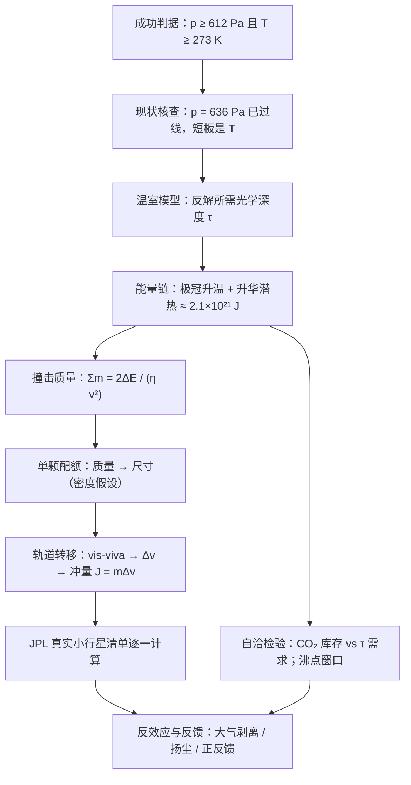

# 2015 题A：改造火星——彗星/小行星定向撞击（Terraforming Mars）

> 赛题来源：UPC 2015 Problem A（150 队中 77 队选题 A，金奖 1 队：多伦多大学 190 队）

## 1. 题目原文与关键数据

**原文压缩引用**：
> It has been proposed that we could begin the process of terraforming Mars by directing comets or asteroids into trajectories that will impact on the planet. The energy imparted by these bodies might warm the atmosphere of Mars sufficiently to sublimate gas frozen at the polar ice caps, thus giving Mars a thicker and warmer atmosphere. Suppose that we want to subject Mars to a series of 10 impacts that would together carry enough energy to give Mars an atmosphere which would allow pure liquid water could exist in a stable form on the Martian surface. **How large would these impactors have to be and how much impulse would need to be given to each impactor in order to put it into a Mars intersecting orbit?**

**中文翻译**：有人提议通过定向操控彗星/小行星撞击火星来启动地球化改造：撞击能量加热火星大气，足以使极区冰冠中冻结的气体升华，给火星更厚、更暖的大气。设对火星实施 10 次撞击，共同提供足够能量，使火星大气允许纯液态水在其表面稳定存在。**这些撞击体必须多大？每个撞击体需被施加多少冲量才能进入与火星相交的轨道？**

**题面给定 vs 必须自建**（火星参数全靠自带，每个数都要注来源）：

| 量 | 题面 | 自设参考值 |
|---|---|---|
| 撞击次数 | 10 | 总需求平摊 |
| 成功判据 | "液态水稳定存在" | $p\ge611.7$ Pa（三相点）且 $T\ge273.15$ K（严格版再加沸点上限，见第 2 节） |
| 火星现状 | — | $R=3389.5$ km、$g=3.71$ m/s²、$p_0=636$ Pa（95.3% CO₂）、$T_0\approx210$ K、大气质量 $2.5\times10^{16}$ kg（NASA fact sheet） |
| 极冠几何 | — | 北：直径 1100 km × 厚 1 m；南：350 km × 8 m → 共 $\approx1.7\times10^{12}$ m³（金奖近似） |
| 干冰物性 | — | 密度 $\approx1560$ kg/m³；升华潜热 $\approx5.9\times10^5$ J/kg（26.3 kJ/mol） |
| 撞击速度 $v_{imp}$ | — | 24 km/s（须做敏感性分析） |
| 撞击热效率 $\eta$ | — | 60%（引 Maindl et al. 2015 SPH 模拟，不可拍脑袋） |
| 撞击体密度 | — | 岩质 $\approx3000$ kg/m³（改用彗星 ~500 kg/m³ 则尺寸翻 1.8 倍） |

## 2. 题目到底在问什么（去模糊化）

1. **"allow pure liquid water to exist in a stable form"**：三相点判据 $p\ge611.7$ Pa、$T\ge273.15$ K 只是**下限**；"稳定存在"严格说要 $T<T_{boil}(p)$。火星现压 636 Pa 勉强过线，短板只在温度（+60 K）。但注意本解读的独立估算：升华**全部**极冠干冰 $2.7\times10^{15}$ kg 只增压 $\Delta p=mg/A\approx70$ Pa（$A=4\pi R^2=1.45\times10^{14}$ m²）——700 Pa 下水的沸点仅比冰点高几 K，液态窗口极窄。**"能量够不够"之外还有"CO₂ 库存够不够"这道隐藏闸门**，把它摆上台面就是超出平均水平的洞察（也直接呼应第 7 节 Jakosky & Edwards 的权威反方结论）。
2. **"How large"**：质量与尺寸都要答：$r=(3m/4\pi\rho)^{1/3}$，密度假设必须显式——同一质量下彗星与岩质小行星直径差 1.8 倍。
3. **"how much impulse"**：二义词——**推进冲量** $J_{prop}=m\,\Delta v$（把小行星从主带推入火星交会轨道）还是**撞击动量** $m\,v_{rel}$？两者差近一个量级，必须声明选择并给理由。
4. **"a series of 10"**：总能量的 1/10 是单颗配额；同时要回答"两次撞击之间热量会不会辐射散掉"——这决定撞击序列的方案合法性。

## 3. 物理建模路线图

**层次 1：目标态定义**。水相图定判据（612 Pa、273 K）→ 现状核查后问题单变量化（温度）。黑体平衡温度 $T_{eff}=T_\odot(1-A)^{1/4}\sqrt{R_\odot/2D}\approx215$ K；灰温室 $T_s=T_{eff}\,(1+\tfrac34\tau)^{1/4}$（或金奖采用的 Ramanathan 半灰模型）反解所需光学深度 $\tau$。

**层次 2：能量因果链**。极冠升温（123→150 K，$mc\,\Delta T\approx5\times10^{20}$ J）+ 升华潜热（$mL_s\approx1.6\times10^{21}$ J）→ 总需 $\Delta E\approx2.1\times10^{21}$ J → 撞击体总质量 $\sum m=2\Delta E/(\eta v_{imp}^2)$（动能一半进热、效率 $\eta$ 再折算，故因子 2）。

**层次 3：轨道转移与冲量**。活力公式：小行星（如 $a_{Ast}\approx3$ AU 圆轨道）降近日点到火星轨道所需 $\Delta v=|v_{circ}-v_{aphelion}|\approx3$ km/s；$J=m\,\Delta v$；更进一步从 JPL 小天体库挑**真实**目标逐一列表计算。

**层次 4：自洽与反效应**。库存核算（$\tau$ 需求对应的 CO₂ 质量 vs 极冠实有）；撞击大气剥离（$v_{imp}\gg v_{esc}=5$ km/s）；扬尘反温室；升温→升华→增温的**正反馈回路**（Zubrin–McKay）；Jeans 逃逸时标收尾。

## 4. 关键物理效应量级表

| 效应 | 估算量级 | 是否必须建模 | 估算依据 |
|---|---|---|---|
| 温度短板 | ~210 K → 273 K（+60 K） | 必须（问题主轴） | 三相点判据 + 现状表 |
| 升华潜热 vs 大气升温 | $1.6\times10^{21}$ J vs $5\times10^{20}$ J（约 3:1） | 必须 | $mL_s$ vs $mc\,\Delta T$ |
| 直接加热不可持续 | $2\times10^{21}$ J 以 $\sigma T^4\approx110$ W/m² 全球辐射，~天级散尽 | 必须（论证必须走温室路线） | $\sigma T^4\cdot4\pi R^2$ |
| 极冠 CO₂ 库存 | $1.7\times10^{12}$ m³ × 1560 ≈ $2.7\times10^{15}$ kg → $\Delta p\approx+70$ Pa | 必须（方案瓶颈） | $mg/A$ |
| 单颗撞击能量 | $\tfrac12mv^2\approx3.5\times10^{20}$ J ≈ 8 万 Mt TNT（约 1700 颗沙皇炸弹） | 必须 | $\tfrac12\times1.2\times10^{12}\times(2.4\times10^4)^2$ |
| 单颗尺寸 | 总 $1.2\times10^{13}$ kg → 单颗半径 $\approx460$ m（岩质） | 必须 | 球体积公式 |
| 冲量 | 推进 $J\sim10^{15}$–$10^{16}$ N·s（$\Delta v$ 3–30 km/s 视定义） | 必须 | $m\,\Delta v$ |
| 大气剥离（反向效应） | $v_{imp}=24$ km/s ≫ $v_{esc}=5$ km/s，每次撞击可能剥走部分大气 | 至少讨论 | 撞击侵蚀判据 |
| 扬尘反温室 | 撞击注入尘埃抬升反照率，部分抵消增温 | 扩展讨论 | "撞击冬天"类比 |
| 正反馈回路 | 升温→更多升华→$\tau$↑（文献称工程需求降 ~2 个量级） | 加分 | Zubrin & McKay 1993 |
| Jeans 逃逸时标 | ≫ 宇宙年龄（金奖算得 $3\times10^{94}$ 年） | 收尾自检 | 扩散流公式 |

## 5. 求解算法与数值要点

- **本题几乎纯解析**：核心功力在"反向因果链"记账——目标态 → 状态量（$\tau$、CO₂ 密度）→ 触发能量（升温 + 潜热）→ 撞击质量 → 冲量，每一环正反都可推。
- **可审计参数表**：每个物理量给数值 + 来源 + 单位；唯一的"计算活"是画一条 $\tau$–$T_s$ 曲线（numpy/matplotlib，代码进附录）读出 273 K 所需 $\tau$。
- **敏感性三参数**：$v_{imp}$（10–50 km/s 使质量拉开 25 倍）、$\eta$（0.3–0.7）、$\tau$–CO₂ 标定（借地球工业革命前标定的线性外推，忽略压强增宽差异，是最大的系统误差源，须声明）。
- **自洽检查清单**：能量账与库存账对表（升华出的 CO₂ 质量 ↔ $\tau$ 需求质量是否同一笔账）；单位审计（J/mol vs J/kg、km vs m）；与参照事件对表（TNT 当量、Chicxulub ~$10^{23}$ J）建立直觉。

## 6. 常见错误与陷阱

1. **把能量全砸在"直接加热大气"**：无温室倍增，热量数天辐射散尽，方案不可持续——必须转化为光学深度。
2. **只查三相点下限**：液态水窗口是 $[273\ {\rm K},\ T_{boil}(p)]$；不讨论沸点上限，"稳定"二字就没吃透。
3. **库存与能量两张皮**：升华极冠得到的 CO₂ 质量（~$2.7\times10^{15}$ kg）与 $\tau$ 需求对应的 CO₂ 列质量不自洽——两本账要当面对。
4. **冲量定义含糊**：推进冲量与撞击动量差近一个量级，不声明则答案无法被检验。
5. **关键系数无出处**：$\eta$、$v_{imp}$、$\tau$ 标定全是"拍的"，评委一票否决级扣分。
6. **单向叙事**：不提撞击剥离、扬尘等负效应，也不提正反馈——方案论证不完整。

## 7. 全网参考与延伸

1. **Zubrin & McKay 1993《Technological Requirements for Terraforming Mars》**（[全文 PDF](https://marspapers.org/paper/Zubrin_1993_3.pdf)）——本题的"原始文献"：用撞击/轨道镜蒸发极冠 + CO₂ 正反馈回路，论证反馈可把工程需求降低约两个量级，直接支撑第 3 节层次 4。
2. **Jakosky & Edwards 2018《Inventory of CO2 available for terraforming Mars》**（[LASP 全文](https://lasp.colorado.edu/maven/files/2018/08/Inventory-of-CO2-available-for-terraforming-Mars.pdf)、[LPI 摘要](https://www.lpi.usra.edu/nuggets/2018/181217_MAVENTerraformingCO2.pdf)）——MAVEN/MRO 观测表明火星可获取 CO₂ 总量仅够加压到 ~20 mbar，远低于强温室需求；是检验"升华极冠方案"上限的权威反方证据，与本解读"极冠仅 +70 Pa"的估算相互印证。
3. **NASA Mars Fact Sheet**（[nssdc.gsfc.nasa.gov](https://nssdc.gsfc.nasa.gov/planetary/factsheet/marsfact.html)）——半径、重力、气压、轨道半长轴等全部基础常数的一站式出处。

## 8. 金奖论文思路对比

本题金奖唯一一队（多伦多大学 190 队，仅 10 页）：目标态（相图判据，先核查气压已过线）→ Ramanathan 半灰模型 + 地球工业革命前 CO₂ 标定反解 273 K 需 $\tau=12.7$ → 火星现状清单（大气/极冠/热容，每个数带文献）→ 极冠升温 27 K（$4.96\times10^{20}$ J）+ 升华潜热（$1.64\times10^{21}$ J）→ 总能量 $2.14\times10^{21}$ J、撞击体总质量 $1.225\times10^{13}$ kg（$\eta=60\%$ 引 Maindl SPH、$v=24$ km/s）→ 单颗冲量 $10^{16}$ N·s 量级 → Table 1 从 JPL 库选 10 颗真实小行星逐一算 $\Delta E$ 与 $J$ → 8.2 节 Jeans 逃逸时标（$3\times10^{94}$ 年）自证方案鲁棒，8.3 节坦承角动量法未完成。亮点是"每个系数有出处 + 真实目标清单 + 诚实边界"三件套，10 页说完全部逻辑。详细拆解见 `05_论文赏析\2015\2015-GM-A-190.md`。

## 9. 评分要点：评委想看什么

- [ ] 成功判据操作化：三相点 + 温度；最好再加沸点窗口讨论。
- [ ] 能量链每一环可反推、可审计（数值 + 来源 + 单位的参数表）。
- [ ] "How large" 与 "how much impulse" 都显式回答，密度与冲量定义的假设有声明。
- [ ] 关键效率系数有文献出处，做过 $v_{imp}$、$\eta$ 敏感性。
- [ ] 自洽检验至少一条：库存核算、辐射散失时标、大气逃逸时标。
- [ ] 讨论反效应（剥离、扬尘）与正反馈，并给缓解策略（撞击间隔、瞄准极区）。
