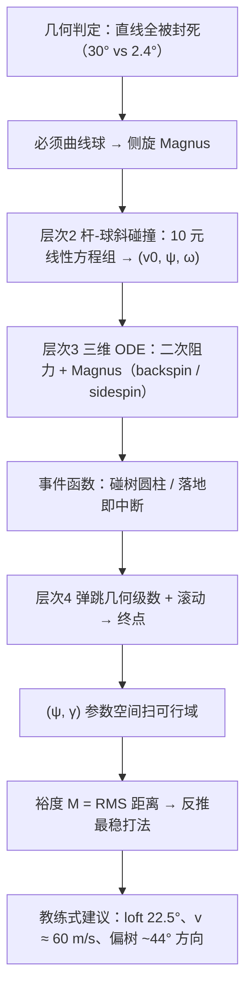

# 2015 题B：绕树高尔夫——马格努斯曲线球（Golfing Around a Tree）

> 赛题来源：UPC 2015 Problem B（150 队中 73 队选题 B，金奖 1 队：南京大学 108 队）

## 1. 题目原文与关键数据

**原文压缩引用**：
> A golfer hits an errant shot and finds the ball directly behind a tree, 120 meters from the green. The tree is too close and too tall to hit the ball over the tree, so the golfer is forced to hit the ball either to the left or to the right of the tree. Let us model the tree as a cylinder, with its center 10.0 meters from the ball, with branches extending in all directions to give our cylinder a radius of 5.0 meters. **Describe the ball/club interaction that will result in a shot that will go around the tree and end up on the green.** Assume the green is circular, 10.0 meters in diameter, and the center of the green is directly behind the center of the tree, as seen from the location of the ball.

**中文翻译**：球手一杆失误，球停在树的正后方，距果岭 120 m。树太近太高，无法从树顶打过，只能从左/右绕过。把树建模为圆柱：中心距球 10.0 m，枝叶向四周伸展使圆柱半径 5.0 m。**描述球/杆的相互作用，使球绕过树并停上果岭。**果岭为直径 10.0 m 的圆，圆心在树中心正后方（从球的位置看）。

**题面给定参数表**：

| 参数 | 数值 | 备注 |
|---|---|---|
| 球–树轴距离 | 10.0 m | 圆柱竖直，半径 5.0 m |
| 树半径 | 5.0 m | "too tall" → 越顶被排除，必须水平绕行 |
| 球–果岭距离 | 120 m | 果岭圆心与树轴、球三者共线 |
| 果岭半径 | 5.0 m | 落点判据 |
| 球参数 | 未给 | R&A/USGA 标准：$R=21.35$ mm、$m=45.93$ g |
| 风 / 标高 | 未给 | 基线无风平地；扩展侧风 5 m/s |
| 杆 | 未给 | 需给出杆头速度、loft、瞄准角 → 初条件的完整映射 |

## 2. 题目到底在问什么（去模糊化）

1. **先证明"直线不可能"**——这是题目的几何陷阱，也是全部建模的出发点。设球在原点、飞行方向为 $x$ 轴：任何终于果岭盘内的直线满足 $y(120)=y_L,\ |y_L|\le5$ m，在 $x=10$ 处 $|y(10)|=|y_L|/12\le0.42$ m $<5$ m——**全部直线都穿树**。换算成张角：树半张角 $\arcsin(5/10)=30°$ ≫ 果岭半张角 $\arcsin(5/120)\approx2.4°$。10 m 处要躲开、120 m 处要回中，轨迹必须弯——**需要一个持续的侧向力，唯一可控的物理机制就是侧旋的马格努斯力**。
2. **"Describe the ball/club interaction"**：题眼不是"给出一条轨迹"，而是"杆面参数 → 球初条件"的映射：杆头速度、loft（产生 backspin）、瞄准/杆面角（产生 sidespin），经斜碰撞模型输出 $(\vec v_0,\vec\omega)$，再经飞行/弹跳映射到落点。
3. **"end up on the green"**：落点判据必须含弹跳与滚动——第一次弹跳就滚出 5 m 圈的方案是假方案。
4. **开放题的完整交付物**：不是单条魔法轨迹，而是可行域（哪些杆法能上果岭）+ 容差量化（裕度）+ 教练式建议（具体角度与速度）。

## 3. 物理建模路线图

**层次 1：几何可行性**。侧偏约束 $y(10)\gtrsim5.1$ m（留球半径余量）、回中约束 $|y(120)|\le5$ m。取常数侧向加速度 $a_M$ 的两点估计：$y(x)=x\tan\psi+\dfrac{a_Mx^2}{2v_0^2\cos^2\psi}$，联立两式得瞄准偏角 $\psi\approx30°$、$a_M\approx26$ m/s²（$v_0=60$ m/s）→ 所需 $C_L\approx0.39$、自旋 $\omega\sim10^4$ rpm（自旋参数 $S=R\omega/v\approx0.35$）——与实验可达范围自洽，量级估算先行定盘。

**层次 2：杆–球斜碰撞（<0.5 ms 冲击近似）**。法向/切向动量守恒 + 角动量守恒 $mRV+I\omega=0$（$I=\tfrac25mR^2$）+ 无滑动/共速约束，联立为 10 元线性方程组 $\mathbf b=P\mathbf v$，由杆面几何（loft $\theta$、drift $\psi$）解出碰后 $\vec v_0,\vec\omega$。

**层次 3：自由飞行**。三维 ODE：二次阻力 $f_d=\tfrac12C_D\rho_{air}Sv^2$（凹坑球 $C_D\sim0.25$）+ 马格努斯力 $f_M=C_M(\vec\omega\times\vec v)$；backspin 轴水平提供竖直升力延长滞空，sidespin 轴近竖直提供水平侧力绕树。

**层次 4：落地与滚动**。Penner 恢复系数 $e(v_\perp)$（$|v_\perp|>20$ m/s 取 0.12）+ Daish 反弹 $v'_\parallel=\tfrac57v_\parallel-\tfrac27R\omega_r$；弹跳总长为公比 $e$ 的几何级数，滚动 $L_r=v'^2_\parallel/2\mu g$；注意 backspin 过大时 $v'_\parallel<0$ 球会回滚。扩展：侧风进入相对速度项。

## 4. 关键物理效应量级表

| 效应 | 估算量级 | 是否必须建模 | 估算依据 |
|---|---|---|---|
| 直线被封死 | 树半张角 30° vs 果岭半张角 2.4° | 必须（论证起点） | $\arcsin(5/10)$、$\arcsin(5/120)$ |
| 侧向 Magnus 加速度需求 | ~15–26 m/s²（1.5–2.6 g） | 必须（题眼） | 两点几何估计 + $C_L=2ma/(\rho Av^2)$ |
| 自旋速率需求 | ~$10^4$ rpm（$S\approx0.35$） | 必须 | $S=R\omega/v$；挖坑球 $C_L$–$S$ 实验曲线 |
| 二次阻力 | 凹坑 $C_D\sim0.25$（光滑 ~0.5）；真空射程 260 m → 实际 ~150–200 m | 必须 | $\tfrac12\rho C_DAv^2$ |
| backspin 升力 | 滞空延至 5–7 s；无升力则 120 m 需更大 $v_0$ | 必须 | 滞空观测与实验 |
| 反向 Magnus | 落段 $Re\approx7\times10^4$ 临界（实验阈值 $Re<7\times10^4$ 时升力行为反转） | 扩展讨论 | $Re=vd/\nu$，$v$ 从 60 衰减到 ~25 m/s |
| 侧风 5 m/s | 5–6 s 滞空 → 横移可达 ~20–30 m（果岭半径才 5 m） | 扩展（真实比赛必须） | 相对速度修正 |
| 弹跳 + 滚动 | 首弹 $e\approx0.12$–0.5（随撞速），弹跳总长 $\approx2L_{b1}$，滚动数 m | 必须（落点判据） | Penner / Daish 公式 |
| 避树净空 | 树缘 5 m − 球半径 0.021 m → 余量 ~5.07 m；参数误差吃掉米级 | 裕度量化 | 几何 + 误差传播 |

## 5. 求解算法与数值要点

- **阶段划分定工具**：碰撞 = 线性代数（矩阵 $\mathbf b=P\mathbf v$ 逐行注物理含义）、飞行 = 事件驱动 ODE、弹跳 = 几何级数解析——每段用最合适的数学工具。
- **事件函数**：积分到"与树圆柱相交"或"$z=0$"即中断并记录状态（Mathematica EventLocator / MATLAB ode45 Events），避免定步长过冲穿树。
- **扫参可行域**：在（瞄准角 $\psi$、侧旋 $\gamma$）平面栅格化（步长 0.01–0.02），落进果岭记可行；再算裕度 $M=\sqrt{\frac1S\int[(\psi-\bar\psi)^2+(\gamma-\bar\gamma)^2]\,d\tau}$，把"容不容得失误"变成一个标量并反推最优杆速。
- **验证**：负对照——去掉侧旋后轨迹必须撞树（几何判据的数值复核）；碰撞矩阵用能量/角动量守恒核对；步长收敛检验；$C_D,C_L$ 引实验曲线并区分光滑/凹坑球。
- **陷阱**：$\vec\omega\times\vec v$ 的轴向与符号（sidespin 轴近竖直、力水平；backspin 轴水平、力竖直）；把 $a_M$ 当常数外推会高估远端弯曲（力 $\propto v^2$ 且随 $v$ 衰减）；恢复系数 $e$ 随撞速变化，不能取常数。

## 6. 常见错误与陷阱

1. **不证明直线不可能、不解释为何必须侧旋**：直接"数值试出"一条弯轨迹，物理归因缺失——本题最大的区分度就在这一步。
2. **只答轨迹不答杆**：题眼是 ball/club interaction，缺"杆面参数 → 初条件"映射等于答非所问。
3. **Magnus 力用错**：轴向/符号错，或忘记力随速度平方衰减，用恒定 $a_M$ 外推全程。
4. **气动系数拍脑袋**：$C_D/C_L$ 必须引文献并区分凹坑/光滑与 Re 区间，还要留意低速反向 Magnus 的适用边界。
5. **落地即停**：忽略弹跳与滚动（或忽略 backspin 过大导致回滚 $v'_\parallel<0$ 的情形），落点判据失真。
6. **单点答案无容差**：真实球手需要"偏几度、慢几米每秒还能上果岭"的鲁棒性结论。

## 7. 全网参考与延伸

1. **Lyu et al. 2020《The reverse Magnus effect in golf balls》**（[Sports Engineering](https://link.springer.com/article/10.1007/s12283-020-0318-1)）——$Re>7\times10^4$ 时 $C_L$ 随转速稳定上升，更低 Re 出现反向 Magnus：为落段升力行为与模型适用区间提供文献依据。
2. **Li et al. 2017《Numerical Investigation of the Flow Past a Rotating Golf Ball》**（[PMC 全文](https://pmc.ncbi.nlm.nih.gov/articles/PMC6044256)）——CFD 给出挖坑球更高升力、更低阻力的定量数据，可用于标定 $C_D(Re,S)$、$C_L(Re,S)$。
3. **Lyu et al. 2018《Aerodynamics of Golf Balls in Still Air》**（[MDPI](https://www.mdpi.com/2504-3900/2/6/238)）——实测 $C_D$ 从低速 ~0.5 降至高速 ~0.2、$C_L$ 与转速正相关，是"系数不拍脑袋"的直接出处。

## 8. 金奖论文思路对比

本题金奖唯一一队（南京大学 108 队，24 页）：两阶段拆分（Free-flight / Bouncing）→ 杆–球斜碰撞写成 10 元线性方程组矩阵 $\mathbf b=P\mathbf v$（附录逐行标注物理含义）→ 飞行段为带二次阻力与 Magnus 力的三维 ODE，用事件定位器在碰树/落地时中断衔接 → 弹跳用 Penner 恢复系数 + Daish 反弹公式解析处理、几何级数求弹跳总长 → 在 $(\psi,\gamma)$ 平面扫可行域，并原创定义"系统裕度 $M$"反推最优打法，最终建议 loft 22.5°、drift ~17°、偏树 ~44° 方向、速度 ~60 m/s → 附录扩展 5 m/s 侧风。亮点是"可行域 + 裕度"把解题升级为设计建议，三种相互作用（杆–球、球–空气、球–地）各有专属模型与文献系数。详细拆解见 `05_论文赏析\2015\2015-GM-B-108.md`。

## 9. 评分要点：评委想看什么

- [ ] 几何必然性论证：直线全被封死、必须侧向持续力（30° vs 2.4° 的张角对比）。
- [ ] ball/club interaction 正面回答：杆面参数 → 初条件的斜碰撞模型。
- [ ] Magnus 力轴向/符号正确；$C_D,C_L$ 有文献出处与凹坑说明。
- [ ] 落点判据含弹跳 + 滚动（恢复系数随撞速变化、回滚情形）。
- [ ] 可行域图 + 容差/裕度量化，而非单条轨迹。
- [ ] 三阶段用事件函数精确衔接，并做负对照与收敛性检验。
