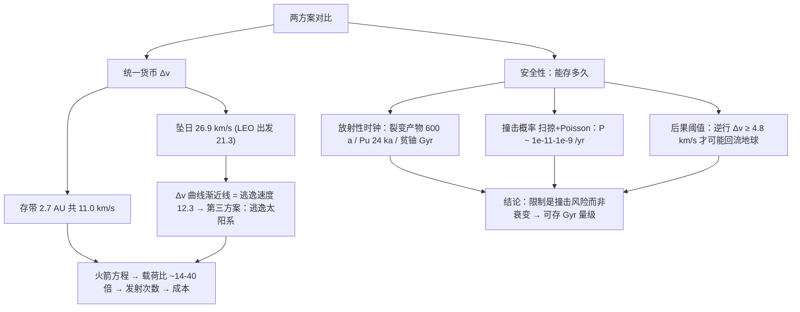

# 2016 题A：核废料太空处置（Reactor Waste Disposal）

> 赛题来源：UPC 2016 Problem A（当年 197 队中 146 队选题 A，金奖 2 队：多伦多大学 331 队、巴塞罗那自治大学 412 队）

## 1. 题目原文与关键数据

**原文压缩引用**：
> The disposal of radioactive waste is a serious problem... One solution proposed is to launch the waste into space, with the idea of either destroying the waste by allowing it to fall into the sun, or simply having it take up an orbit in the asteroid belt where the radioactive waste products would eventually decay. **Make a comparison of these two methods. Which method would be easier to implement? How long could the waste be safely stored in the asteroid belt?**

**中文翻译**：放射性废料处置是核电工业的难题。一种提议是把废料发射到太空：要么让它坠入太阳"销毁"，要么让它进入小行星带轨道、让放射性产物在那里自然衰变。**比较这两种方法，哪种更容易实现？废料在小行星带能安全存放多久？**

**题面给定参数**：**零**。这是本题第一个特征——所有常数必须自取并注明来源：

| 参数 | 取值 | 备注 |
|---|---|---|
| 地球公转速度 | $v_E=29.78$ km/s | 量纲分析必用 |
| 太阳引力参数 | $GM_\odot=1.327\times10^{20}\ {\rm m^3/s^2}$ | 1 AU 处 $v_{circ}=29.78$、$v_{esc}=42.1$ km/s |
| 小行星主带 | 2.2–3.2 AU | 存放目标区，代表值取 2.7 AU |
| 全球乏燃料存量 | $\sim4.5\times10^5$ tHM（IAEA 2026），年增 $\sim9\times10^3$ t | 决定发射次数与总成本 |
| 关键半衰期 | Cs-137/Sr-90 ≈ 30 a；Pu-239 24.1 ka；U-238 4.47 Ga | 回答"存放多久"的物理前提 |

## 2. 题目到底在问什么（去模糊化）

1. **"easier to implement" 的判据链**：开放式比较必须先选"统一货币"。标准译法是 $\Delta v\to$ 火箭方程 $\to$ 单枚有效载荷 $\to$ 发射次数 $\to$ 总成本，五级贯通——只停在 $\Delta v$ 层会丢掉"工程实现"的分。
2. **"safely stored how long" 的时钟是什么**：题面暗示"等放射性衰变完"，但贫铀半衰期是十亿年量级——**衰变不是限制，轨道稳定性与撞击风险才是**。把这个问题翻译成：主带轨道能否稳定存放到"放射性已无关紧要"的时标（$\gtrsim10^5$ a）？被撞击、被弹回地球的概率多小？安全论证必须给"危险阈值"变成不等式判断。
3. **隐藏的第三问**：坠日方案的"销毁"价值本身就是伪命题——裂变产物在任何地方都会衰变，太阳不提供额外销毁价值，只提供 $\Delta v$ 账单。点破这一点是评委眼中的物理成熟度标志。
4. **隐藏方案空间**：由 $\Delta v(d)$ 曲线的渐近线（=太阳系逃逸速度）会自然发现"直接逃逸出太阳系比坠日更省"——比较题里从数据形态反哺出第三方案是高分动作。

## 3. 物理建模路线图

**层次 1：轨道力学基线（Vis-Viva 一把梭）**

$v(r,a)=\sqrt{GM_\odot(2/r-1/a)}$ 是全文发动机。全部自 1 AU 圆轨道（借用地球公转速度）起算：

- **坠日**（Hohmann 至近日点 = 太阳表面）：$a_t\approx0.5$ AU，远日点速度 $v_a=2.85$ km/s，故 $\Delta v=v_E-v_a=\mathbf{26.9}$ km/s（逆行）；若从 LEO 出发借 Oberth 效应，$\sqrt{26.9^2+11.0^2}-7.78=\mathbf{21.3}$ km/s。
- **存带**（Hohmann 至 2.7 AU 并圆化）：$\Delta v_1=35.98-29.78=6.2$ km/s，圆化 $\Delta v_2=18.13-13.33=4.8$ km/s，共 $\mathbf{11.0}$ km/s（与金奖 331 队的 10977 m/s 吻合）；若存放在近日点 1 AU 的椭圆轨道上可只花 6.2。
- **逃逸太阳系**：$42.1-29.8=\mathbf{12.3}$ km/s。排序：椭圆存带 6.2 < 圆存带 11.0 < **逃逸 12.3 < 坠日 26.9**——"把垃圾扔出太阳系比扔进太阳还便宜"，这是本题最反直觉、最值得写的结论。

**层次 2：火箭方程与容器工程**：Tsiolkovsky $\Delta v=u\ln(m_0/m_f)$（化学推进 $u\approx4.4$ km/s）把 $\Delta v$ 差换成载荷差：坠日与存带（含圆化）总 $\Delta v$ 约 30.7 vs 19 km/s，同样火箭载荷比 $e^{11.7/4.4}\approx14$ 倍（椭圆存带则 $\sim40$ 倍）。屏蔽容器用半值层估算：废料近场剂量率 $\sim$ Sv/日、工人年限 50 mSv $\Rightarrow$ 需 $\sim$15 个半值层铅 $\approx$ 15–20 cm，容器自身质量吃掉大半载荷。

**层次 3：长期安全概率模型**：(a) 撞击概率——扫描体积/主带体积 + Poisson 过程：$P=\sum A_k v_k/V$，注意截面要用**小行星自己的** $\pi r^2$（大天体撞小包裹），取 $N\sim10^6$ 颗 km 级、$v_{rel}\sim5$ km/s、主带体积 $\sim20\ {\rm AU^3}$，得 $P\sim10^{-11}$ /yr 量级；(b) 撞击后果阈值——从 2.7 AU 圆轨道把碎片送到地球穿越轨道需 $\sim4.8$ km/s 逆行分量（与金奖队取的 $\ge4$ km/s 同量级），5 km/s 的随机撞击中只有小部分碎片满足，且地球是小目标；(c) 选址要避开 Kirkwood 空隙与共振区，主带普通轨道稳定性有 4.5 Ga 的"天然实验"背书。

## 4. 关键物理效应量级表

| 效应 | 估算量级 | 是否必须建模 | 估算依据 |
|---|---|---|---|
| 坠日 $\Delta v$ | 26.9 km/s（日心）/ 21.3（LEO） | 必须（基线） | $v_E-v_a$，$v_a=2.85$ km/s |
| 存带 2.7 AU $\Delta v$ | 11.0 km/s（圆）/ 6.2（椭圆） | 必须（基线） | Vis-Viva 两脉冲 |
| 逃逸太阳系 | 12.3 km/s | 应有（第三方案） | $v_{esc}-v_E$ |
| 载荷比 | 14–40 倍/枚 | 必须（回答"easier"） | $e^{\Delta\Delta v/u}$，$u=4.4$ km/s |
| 裂变产物衰减 | $\sim600$ a 降 $10^{-6}$ | 必须（前提） | $t_{1/2}\approx30$ a，$20$ 个半衰期 |
| 主带撞击概率 | $10^{-11}$–$10^{-9}$ /yr | 必须（回答"how long"） | $\sum A_k v_k/V$ + Poisson |
| 撞击回流阈值 | 逆行 $\gtrsim4.8$ km/s | 必须（闭环） | 2.7 AU→1 AU 的 Hohmann 减速量 |
| 屏蔽容器 | 铅 15–20 cm，$\sim2.3$ t/m² | 必须（工程闭环） | 15 个半值层 |
| Yarkovsky 漂移 | $\lesssim10^{-5}$ AU/Myr（10 m 级物体） | 可不做 | $da/dt\propto1/D$ 反比于尺寸 |

## 5. 求解算法与数值要点

- **解析为主**：全部轨道量有闭式（Vis-Viva/Hohmann），唯一必须"算给评委看"的曲线是 $\Delta v$ 随二次点火距离 $d$ 的单调下降曲线——**务必标注其渐近线 = 12.3 km/s**，它是自检也是亮点。
- **概率部分**：优先用真实小行星数据库（JPL Small-Body Database，数万条）逐条算 $\sum A_kv_k/V$，再按 Poisson/指数分布外推到题目时标；没有数据时用"数量-尺寸幂律"合成，并声明保守性。
- **验证手段**：① Hohmann 数值与已知基准对拍（1→2.7 AU 圆化 ≈ 11 km/s）；② 撞击累积 $\Delta v$ 与回流阈值的不等式闭环；③ 火箭方程简化（忽略级间损失）对两方案的偏置相同 → 相对结论不变。
- **陷阱**：单位（AU vs m）混算；截面用包裹尺寸而非小行星尺寸（差 5 个量级）；椭圆存放轨道忘记它会周期性穿越火星轨道；发射失败率是两方案共同项应显式约掉而不是选择性使用。

## 6. 常见错误与陷阱

1. **忘了抵消地球公转速度**：直接说"掉向太阳只要松手"——坠日的本质是消灭 29.8 km/s 切向速度，漏掉这一步结论直接反转。
2. **把"能存多久"答成半衰期**：只算放射性不管轨道力学（或反之），两头都不闭环；正确结构是"衰变前提 → 撞击时钟 → 阈值不等式"。
3. **安全论证没有"后果"半边**：只算撞不上，不算"万一撞了会不会回地球"——两个方案应各配一个失败模式（坠日=发射失败坠落散布；存带=撞击改道）才公平。
4. **只算单次发射**：不清运全球 $\sim4.5\times10^5$ 吨存量，"easier to implement"没有工程落点；给出总发射次数与成本（百万亿美元量级）才有冲击力。
5. **忽略容器质量**：无屏蔽的废料"载荷"毫无意义，铅屏蔽是载荷的大头。

## 7. 全网参考与延伸

1. **NASA 1974 年《Extraterrestrial Disposal of Radioactive Wastes》可行性研究**（[NTRS](https://ntrs.nasa.gov/api/citations/19740014663/downloads/19740014663.pdf)）——AEC 委托 NASA 的官方空间处置研究，可作"该问题被严肃研究过"的引用锚点。
2. **美国能源部《3 reasons why we don't launch nuclear waste into space》**（[energy.gov](https://www.energy.gov/ne/articles/3-reasons-why-we-dont-launch-nuclear-waste-space)）——官方给出的三理由（成本、发射失败散布风险、瞄准精度），可直接对照自己的结论。
3. **IAEA 全球乏燃料地图（2026）**（[iaea.org](http://www.iaea.org/newscenter/news/iaea-releases-first-public-tool-to-map-the-worlds-spent-nuclear-fuel)）——全球存量 $\approx44.8$ 万吨重金属、年增 $\approx9$ 千吨，是把"清运多久/多少发射"落到真实数字的最佳来源。
4. **The Space Review 2005《Launching the dead：space disposal of nuclear waste》**（[thespacereview.com](https://www.thespacereview.com/article/437/1)）——从政策与安全角度论证空间处置"可行但不划算"，可作讨论节素材。

## 8. 金牌论文思路对比

- **331 队（多伦多，16 页）**：以 $\Delta v$ 为统一货币做全链路对比，从 $\Delta v(d)$ 渐近线挖出"逃逸更省"的第三方案；用 JPL 数据库 5 万+ 真实小行星建 Poisson 撞击模型（千年撞击概率 $10^{-6}$、十亿年累积 $\Delta v=2115$ m/s < 4000 m/s 阈值）回答存放时长；最后用 Saturn V + 铅容器算出 4.5×10⁵ 次发射、超 500 万亿美元。详见 [05_论文赏析/2016/2016-GM-A-331.md](../05_论文赏析/2016/2016-GM-A-331.md)。
- **412 队（巴塞罗那，23 页）**：先横向筛选六种目的地再收敛到"日心轨道最优"；确定性部分用自适应 RKF45 在太阳+木星+地球多体场中真实打靶（含 L4/L5 拉格朗日点方案与相位旋转矩阵）；随机性部分建四套风险模型并以"有效污染面积 $S_{eff}$"统一量纲，结论存带可安全存放 Pu-239 衰减所需 25 万年。详见 [05_论文赏析/2016/2016-GM-A-412.md](../05_论文赏析/2016/2016-GM-A-412.md)。

## 9. 评分要点：评委想看什么

- [ ] 坠日 $\Delta v$ 正确包含"抵消地球公转速度"（26.9 km/s 日心口径），并明示与存带方案（≈11 km/s）的对比。
- [ ] 有一张 $\Delta v$–距离曲线并解读其渐近线（=逃逸速度），引出逃逸第三方案。
- [ ] "存放多久"三件套：衰变时标（不是限制）→ 撞击概率（Poisson+真实数据更佳）→ 回流地球的 $\Delta v$ 阈值不等式。
- [ ] 火箭方程 + 屏蔽容器质量 → 单枚载荷 → 总发射次数/成本，回答"easier to implement"的工程含义。
- [ ] 两方案的失败模式对称建模（发射失败散布 vs 撞击改道），并声明共同项（发射可靠性）不影响相对排序。
- [ ] 所有自取常数注明来源，结论附"对简化假设不敏感"的论证。
