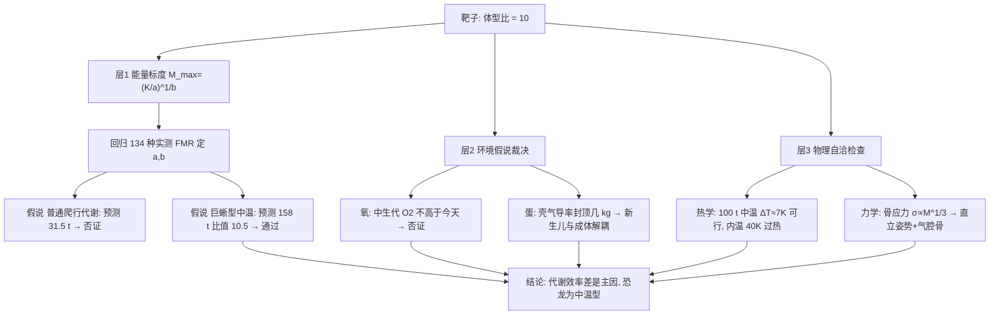

# 2016 题B：恐龙 vs 哺乳动物体型上限（Dinosaurs versus Mammals）

> 赛题来源：UPC 2016 Problem B（当年 197 队中 51 队选题 B，金奖 1 队：巴塞罗那自治大学 441 队）

## 1. 题目原文与关键数据

**原文压缩引用**：
> The largest dinosaurs were approximately an order of magnitude (a factor of ten) more massive than the largest land mammals. It has been hypothesized that this may have been due to factors such as, **but not limited to**, the different levels of oxygen in the atmosphere, the difference in the effort required for giving birth to live young versus laying eggs, differences in metabolic rates, differences in the availability of food sources, or differences in ambient temperature. **Develop a model to account for the differences in mass... and evaluate the effectiveness of this model using biological/paleontological data.**

**中文翻译**：最大恐龙比最大陆地哺乳动物重约一个数量级。假说认为成因包括（但不限于）：大气氧含量不同、胎生与产蛋的"付出"差异、代谢率差异、食物来源差异、环境温度差异。**建立一个解释该质量差异的模型，并用生物学/古生物学数据评估模型有效性。**

**题面给定与需自备的数据**：

| 项目 | 数值 | 备注 |
|---|---|---|
| 目标比值 | $M_D/M_M\approx10$ | 全文的"靶子"，任何模型必须命中它 |
| 最大陆地哺乳动物 | Paraceratherium $\approx15$–20 t | 锚定环境承载上限的"自然实验" |
| 最大蜥脚类恐龙 | Argenti­nosaurus / Diplodocus hallorum $\sim$70–100 t | 古生物学文献值，误差 $\pm$20% 属正常 |
| 实测代谢数据 | Nagy 等（1999）双标水法 FMR：哺乳类 79 种、爬行类 55 种 | 需自行回归 |
| 代谢标度指数 | $b\approx0.67$–0.85（哺乳 $\sim0.73$、爬行 $\sim0.89$、巨蜥 $\sim0.71$） | 文献区间，需自验 |

## 2. 题目到底在问什么（去模糊化）

1. **"account for the differences" ≠ "解释为什么更大"**：模糊词是"差异"。可操作化判据：模型必须**产出比值 $\approx10$**，而不是产出一个定性方向。任何只给出"恐龙代谢低所以能更大"而算不出 10 倍的模型都不合格。
2. **"factors such as, but not limited to" 是送分也是陷阱**：题面列了 5 个假说。正确姿势是把每个假说**翻译成可否证的数值预测**再逐一裁决，而不是全盘接受或全盘叙述。特别是氧含量假说——古大气数据本身就足以否证它（见第 4 节）。
3. **"evaluate the effectiveness using data" 是硬要求**：必须有回归（$n$、$r^2$、$p$ 值三件套）+ 与化石记录的对照，最好再加"生态等价种"配对检验（三角龙 12 t vs 犀牛 1 t；梁龙 vs 长颈鹿）——同一环境、同一时代近邻的成对比较能排除"环境不同"的混淆变量。
4. **隐藏的建模自由度**：解释变量选"环境承载 $K$"还是"物种内在参数 $a$"是分水岭——环境论解释不了恐龙与哺乳动物**同期共存**却 10 倍差异，故主限制必在内在特性（代谢/繁殖），这一定性排除要先做。

## 3. 物理建模路线图

**层次 1：能量异速标度上限（核心方程）**

物种日能耗（FMR）服从 $\mathrm{FEE}=aM^b$（$b<1$）；环境能供给单个最大个体的每日上限记 $K$，联立即得

$$M_{max}=\Big(\frac{K}{a}\Big)^{1/b}.$$

两群比值 $\dfrac{M_D}{M_M}=\Big(\dfrac{a_M}{a_D}\Big)^{1/b}$（$K$ 相近时）——**$b$ 各群相近、差异几乎全部由质量无关系数 $a$ 承载**：$a$ 越小（单位体重的代谢开销越低），同等环境养得起的体重越大。用实测 FMR 数据对数线性回归 $\log \mathrm{FEE}=\log a+b\log M$，哺乳类（$a_m=4.82,\ b_m=0.734$）与爬行类（$a_r=0.197,\ b_r=0.888$）的 $r^2\approx0.94$–0.95。

**层次 2：假说裁决（把"因素"变成数字）**

- **锚定 $K$**：假设最重哺乳动物恰好触及哺乳类曲线的上限，由 Paraceratherium（15 t）反解 $K_m\approx8.9\times10^5$ kJ/d；再假设中生代环境承载 $K_d\approx K_m$（显式声明这是强假设）。
- **"恐龙=普通爬行动物"假说**：代入爬行类参数得 $M_{max}\approx31.5$ t，与 $\sim100$ t 化石记录矛盾 → **否证**。
- **"恐龙=巨蜥型低代谢（中温性）"假说**：用巨蜥属（Varanus）回归（$a_v=1.36,\ b_v=0.71$）得 $M_{max}\approx158$ t，比值 $158/15\approx10.5$ → **命中靶子**，且支持 Grady (2014) 的 mesothermy 结论。
- **氧含量假说**：GEOCARBSULF 类古大气重建给出三叠–早侏罗 $\mathrm{O_2}\approx10$–17%、晚侏罗 $\sim$15–20%——**不高于今天的 21%**，"高氧助长巨兽"被数据直接否证（ insects 的巨型化在 2 亿年前的石炭纪高氧期，与恐龙无关）。
- **产蛋假说（物理内核）**：胎生的新生儿质量与母体强耦合（大象幼崽 $\sim2\%$ 母重，且必须出生即站立），产道几何是硬约束；恐龙蛋受"壳气导率限制"（$\mathrm{O_2}$ 通量 $\propto$ 壳面积，胚胎耗氧 $\propto$ 体积）封顶在几 kg——蛋把新生儿与成体体量**解耦**，允许成体无限变大而不必养一个巨大的胎儿。这是机制层面的有力支持（Sander 2011 的 r-策略论证）。

**层次 3：自洽检查（防一票否决）**

- **热学**：100 t 球近似 $r\approx2.9$ m、$A\approx104\ \mathrm{m^2}$；Newton 冷却 $q=hA\Delta T$。中温代谢（$\sim7.5$ kW）只需 $\Delta T\approx7$ K（$h=10\ {\rm W/m^2K}$）即可散热 → 可行；内温哺乳类外推（$\sim42$ kW）需 $\Delta T\approx40$ K → 过热，**热力学独立支持中温上限**。
- **力学**：几何相似下肢骨应力 $\sigma\propto M^{1/3}$，大象安全因子已仅 $\sim2$–3，等比放大到 100 t 将失效 → 恐龙必须靠更直立的柱状肢势 + 气腔骨骼（体密度 $\sim0.8$）解锁——这解释了"上限"为何是软约束、以及为何并非所有恐龙都巨大。

## 4. 关键物理效应量级表

| 效应 | 估算量级 | 是否必须建模 | 估算依据 |
|---|---|---|---|
| 代谢标度 $b$ | 0.67–0.85，群间相近 | 必须 | Nagy 双标水数据回归 |
| 系数 $a$ 群间差 | 哺乳/巨蜥 $\approx3.5$ 倍 | 必须 | 对数回归截距 |
| 放大后的体重比 | $3.5^{1/0.71}\approx6$–10 倍 | 必须（命中靶子） | $M_{max}=(K/a)^{1/b}$ |
| 中生代 $\mathrm{O_2}$ | 10–20%，≤ 今天 21% | 必须（否证氧假说） | GEOCARBSULF 类重建 |
| 蛋/成体解耦 | 蛋 $\sim1$–5 kg vs 成体 $10^5$ kg | 应有（机制支持） | 壳气导率 $\mathrm{O_2}$ 通量限制 |
| 100 t 热耗散 | $A\approx104\ \mathrm{m^2}$；中温 7.5 kW → $\Delta T\approx7$ K | 应有（自洽检查） | $q=hA\Delta T$，球近似 |
| 骨应力放大 | $\sigma\propto M^{1/3}$，100 t 等比放大 SF<1 | 可选（讨论"上限"性质） | 几何相似 + 大象 SF≈2 |
| 等价种对照 | 三角龙/犀牛、梁龙/长颈鹿 | 应有（数据检验） | 化石+现存体重区间 |

## 5. 求解算法与数值要点

- **方法就一件事：对数线性回归**。用十进制对数（与文献一致），报告 $n$、adjusted $r^2$、$p$ 值；并复现文献（McNab/Nagy）结果做交叉核对——"三方对照"胜过自证。
- **锚定技巧**：$K$ 不可直接测，用"最重已知个体 ≈ 上限"的自然实验锚定，并在正文显式承认这是近似。
- **外推论证**：预测 100 t 超出数据集两个量级，必须论证幂律外推的合法性（$b$ 在更大体重区间稳定、无相变的理由），并对"代谢率过低能否维持体温"做独立量级检查（第 3 节热学）。
- **陷阱**：混淆 BMR（基础代谢）与 FMR（野外代谢）——相差 2–3 倍，回归前必须统一口径；体重单位（g vs kg）进对数会造成系数差 $10^{5b}$ 量级的错位；Varanus 子样本仅 6 种，需给出 $p$ 值说明拟合仍显著。

## 6. 常见错误与陷阱

1. **只讲故事不算数**：把五个假说各写一段"有道理"，没有任何一个被翻译成可否证的数值预测——这是本题最大的失分点。
2. **丢掉靶子**：模型只解释"更大"，从不与"10 倍"对标；评委想看到 31.5 t（否证）与 158 t（通过）这种数字级裁决。
3. **环境论硬套**：用氧/温度/食物差异解释，却无法回答"为什么同期哺乳动物不跟着变大"——先做内在 vs 外在的定性排除。
4. **回归口径混乱**：BMR 与 FMR 混用、单位不一致、不报 $r^2$/$p$ 值，数据检验形同虚设。
5. **热学反噬**：宣称"恐龙代谢极低"却不检查散热/体温可行性；或反过来用"大体型散热难"论证上限，却忽略 $\Delta T$ 与 $h$ 的取值区间让结论翻转。

## 7. 全网参考与延伸

1. **Sander et al. 2011《Biology of the sauropod dinosaurs: the evolution of gigantism》**（[PMC 全文](https://pmc.ncbi.nlm.nih.gov/articles/PMC3045712)）——蜥脚类巨型化的权威综述：产蛋 r-策略、气腔呼吸、无咀嚼、高生长率级联模型，为"产蛋解耦"与模型机制层提供引用与数据。
2. **Grady et al. 2014《Evidence for mesothermy in dinosaurs》**（[Science](https://www.science.org/doi/10.1126/science.1253143)）——用生长速率+体重推断恐龙为"中温型"代谢，是金奖论文结论的独立佐证（另有[技术评论](https://www.science.org/doi/10.1126/science.1260410)可供反方讨论）。
3. **Holland 2006《Carboniferous oxygen levels》及相关古大气重建**（[PMC](https://pmc.ncbi.nlm.nih.gov/articles/PMC1578726)）——石炭纪 $\mathrm{O_2}$ 峰值 $\sim30\%$ 在恐龙之前 2 亿年；中生代并无持续高氧期，用于定量否证氧假说。
4. **Werner & Griebeler 2014 关于繁殖率与巨型化的检验**（[Phys.org 报道](https://phys.org/news/2014-01-sauropod-gigantism.html)）——用比较数据检验"高产蛋率驱动巨型化"，可作产蛋假说的数据补充。

## 8. 金牌论文思路对比

**441 队（巴塞罗那，16 页，本题唯一金奖）**：采用 McNab 框架 $M_{max}=(K/a)^{1/b}$；先定性排除环境论（氧会被演化绕过、两群长期共存），再亲自对 Nagy 数据 134 种重新回归（$r^2\approx0.95$）；以 Paraceratherium 锚定 $K_m$ 后做**可否证的双假说检验**——普通爬行参数预测 31.5 t（与 100 t 化石矛盾，否证），巨蜥参数预测 158 t、比值 10.54（通过）；再用两对"生态等价种"做区间级复核；最后用 Newton 冷却+球体标度证明低代谢在热学上自洽，收束于"恐龙为中温型"。详见 `05_论文赏析\2016\2016-GM-B-441.md`。

## 9. 评分要点：评委想看什么

- [ ] 模型给出**数值化的比值预测**并明确对标 $\approx10$ 这个靶子，而不是定性说"更大"。
- [ ] 有亲自完成的回归（$n$、$r^2$、$p$ 三件套）并与文献交叉核对——"evaluate with data"被实质完成。
- [ ] 至少一个假说被**否证**（如普通爬行代谢 → 31.5 t 矛盾），展示完整科学方法而非单边论证。
- [ ] 环境变量 vs 内在参数的区分论证（同期共存是关键论据）。
- [ ] 对模型隐含的物理合法性做独立量级检查（散热/骨应力），防止结论被"代谢太低不可能"一票否决。
- [ ] 强假设（如 $K_d\approx K_m$、6 样本子回归、幂律外推）全部显式声明，弱点转成 Further Investigations。
