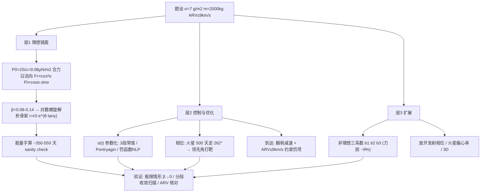

# 2017 题A：太阳帆飞往火星（Solar Sailing to Mars）

> 赛题来源：UPC 2017 Problem A（当年 265 队中 193 队选题 A，金奖 3 队：华沙大学 670 队、国防科技大学 699 队、巴塞罗那自治大学 744 队）

## 1. 题目原文与关键数据

**原文压缩引用**：
> Light exerts a pressure equal to **twice its energy density** when reflected... Assume that the sail is made of material of mass **7 g/m²**; a rocket will launch a total mass of **2,000 kg** (sail plus payload) to escape velocity from Earth. **Determine the size of the sail and a flight plan** for the solar sail spacecraft from Earth to Mars. Assume that the Earth and Mars are at their **closest approach** at the time of launch and that the spacecraft and Mars must have a **relative velocity of no more than 9 km/s** for safe landing. **Optimize** the flight plan to maximize the payload and reduce transit time.

**中文翻译**：光被反射时压强为其能量密度的两倍，因此大面积轻质反光"太阳帆"可借阳光推进。设帆材面密度 7 g/m²；火箭把 2000 kg（帆+载荷）送出地球逃逸速度。确定帆的尺寸与从地球到火星的飞行计划。设发射时地球与火星正处最近距离，且航天器与火星的相对速度不超过 9 km/s 以便安全着陆。优化飞行计划，使载荷最大、航时最短。

**题面给定参数表**：

| 参数 | 数值 | 备注 |
|---|---|---|
| 帆材面密度 | $\sigma_{sail}=7\ {\rm g/m^2}$ | 仅帆材，不含桁架（真实帆远高于此，见第 7 节） |
| 总质量 | 2000 kg | 帆质量 $0.007A$，载荷 $2000-0.007A$——**帆面积是自由变量** |
| 火箭能力 | 送至地球逃逸速度 | 地球逃逸由火箭负责，帆只管日心段 |
| 发射相位 | 地火最近（冲日） | 给定初相位，放开它就是扩展题 |
| 到达约束 | 相对速度 $\le9$ km/s | 需自释：相对火星的 $v_\infty$ |
| 优化目标 | 载荷↑ 且 航时↓ | 双目标冲突，需自行构造权衡 |

自取常数：$S=1361\ {\rm W/m^2}$（1 AU 太阳常数）、$GM_\odot=1.327\times10^{20}$、$r_M=1.524$ AU、$v_M=24.13$ km/s、火星公转 687 天、会合周期 780 天。

## 2. 题目到底在问什么（去模糊化）

1. **"determine the size of the sail" 不是查表题而是优化变量**：帆面积 $A$ 越大推力越大但载荷越小（载荷 $=2000-0.007A$），$A$ 太小则推不动/航时不可接受。答案是一个**权衡曲线上的最优点**，必须呈现 Pareto 或加权目标，单一"标准答案"不存在。
2. **"flight plan" = 帆角控制律 + 相位几何**：模糊词是"计划"。操作化为 $\alpha(t)$（帆面法向与日径夹角的时间函数）加发射-交会相位设计。关键洞察：火星在 500 天航程中自己走 $\sim500/687\times360°\approx262°$，必须瞄准"火星将到达的地方"而非当前位置。
3. **"relative velocity ≤9 km/s" 的参考系**：合理读法是相对火星的双曲超速 $v_\infty$。对数螺旋的到港速度天然**低于**当地圆轨道速度（帆是"欠速"飞行），相对速度由矢量几何决定——这一约束实际上决定了末段必须翻帆减速/等待相位，是"计划"的一部分而非事后核对。
4. **题面第一句是送分提示**："压强=两倍能量密度"就是要你写出 $P=2S/c$；理想镜面下**合力恒沿帆面法向**（入射与反射的切向分量抵消），这个性质应推导出来，它是全部轨道力学的基石。

## 3. 物理建模路线图

**层次 1：理想镜面帆 + 对数螺旋（解析骨架）**

1 AU 处光压 $P_0=2S/c=9.08\ \mu{\rm N/m^2}$；帆面倾斜 $\alpha$ 时：法向力 $F=2P_0A\cos\alpha\ (\cos\alpha\,\hat n)$ 的径/切向分解为

$$F_r=\frac{2SA}{c}\frac{\cos^2\alpha}{r^2},\qquad F_t=\frac{2SA}{c}\frac{\cos\alpha\sin\alpha}{r^2},$$

径向是 $\cos^2\alpha$（投影两次：受照截面一次、反射几何一次）。定义特征加速度与光压因子：$a_c=P_0 A/m_{tot}$、$\beta=a_c/g_\odot(1\,{\rm AU})$。代入题面：帆材单独 $\beta=0.22$；但整船 $A=10^5\ {\rm m^2}$ 时 $\sigma_{tot}=20\ {\rm g/m^2}$、$a_c=0.45\ {\rm mm/s^2}$、$\beta\approx0.08$；金奖帆面积 $A=(1.3\text{–}1.8)\times10^5\ {\rm m^2}$ 对应 $\beta\approx0.10\text{–}0.14$。固定螺距角的对数螺旋解 $r(\theta)=r_0e^{\theta\tan\gamma}$ 给出解析骨架，且螺旋速度恒低于当地圆速度。**量级自检（本解读独立估算）**：能量法——1→1.524 AU 圆轨道比能差 $\Delta\varepsilon=\frac{GM_\odot}{2}(1/r_1-1/r_2)=1.5\times10^8\ {\rm J/kg}$，切向加速度做功率 $a_t v\approx2\times10^{-4}\times2.5\times10^4\approx5\ {\rm W/kg}$，得 $T\approx3.5\times10^7\ {\rm s}\approx350$ 天——与金奖结果 500–532 天同量级（差值来自末段减速与等待相位），这个 30 秒手算值得写进论文当 sanity check。参照系：化学火箭 Hohmann 需 $\Delta v=5.6$ km/s、259 天——帆的优势是零工质。

**层次 2：飞行计划与优化**

- **控制参数化**：$\alpha(t)$ 取 2–3 段常值已接近连续最优（三队一致结论），或用庞特里亚金极小值原理求 $\alpha^*(\lambda)$ 解析式 + 协态初值打靶，或直接罚函数 NLP（SLSQP/PSO）。
- **目标函数**：$g=k_1\max(D_p-R,0)+k_2\max(D_v-9,0)+k_3t_f+k_4A$ 型（终端距离/速度罚项 + 时间/面积项），把"可行"与"最优"解耦。
- **到达段**：翻帆减速 + 相位等待；到达判据写"距火星中心 < 捕获半径 且 $v_{rel}\le9$ km/s"。

**层次 3：可选扩展**：非理想帆三系数模型 $\vec F_{SRP}=2PA\cos\alpha\,(b_1\hat r+(b_2\cos\alpha+b_3)\vec n)$（$b_1=0.086,\ b_2=0.828$，含吸收/漫反射/再辐射，力损失 $\sim9\%$）；日面有限角修正（1 AU 处仅 $10^{-4}$ 相对量级，可忽略）；放开发射相位求最优相位角（火星应超前地球 $\sim65°$，可再省 $\sim20\%$ 面积）；火星偏心率（近日点 1.381 AU）与三维倾角。

## 4. 关键物理效应量级表

| 效应 | 估算量级 | 是否必须建模 | 估算依据 |
|---|---|---|---|
| 1 AU 光压 | $P_0=9.08\ \mu{\rm N/m^2}$ | 必须 | $2S/c$ |
| 整船特征加速度 | 0.45–0.83 mm/s²（$A=10^5$–$1.8\times10^5\ {\rm m^2}$） | 必须 | $P_0A/2000$ |
| 光压因子 $\beta$ | 0.08–0.14 | 必须 | $a_c/g_\odot$；$\beta$ 与日距无关 |
| $10^5\ {\rm m^2}$ 帆推力 | 0.91 N（1 AU 正照） | 必须 | $P_0A$ |
| 螺旋航时 | 350–550 天 | 必须 | 能量法手算 + 数值积分 |
| 火星相位漂移 | 500 天 $\to\ 262°$ | 必须（决定瞄准点） | $500/687\times360°$ |
| 到达相对速度 | 螺旋到港 ~20 km/s vs 火星 24.1 → 几何决定 3–9 km/s | 必须（约束） | 矢量合成；$v_\infty$ 口径声明 |
| 帆面积-载荷交换 | $A$ 每 +$10^4\ {\rm m^2}$，载荷 −70 kg | 必须（优化本质） | $2000-0.007A$ |
| 非理想反射 | 合力损失 $\sim9\%$ | 建议建模（成本低档次高） | 三系数 $b_1,b_2,b_3$ |
| 日面有限角 | 相对修正 $\sim10^{-4}$（1 AU） | 可不做 | $1-(1-(R_\odot/r)^2)^{3/2}$ 展开 |
| Hohmann 基准 | 259 天 / $\Delta v=5.6$ km/s | 建议对照 | 文献值，凸显帆优势 |

## 5. 求解算法与数值要点

- **数值框架**：状态 $x=(r,\theta,\dot r,\dot\theta)$ 的 RK4/RK45 积分（`dopri5` 即可）；**统一单位制（AU/天）**防浮点溢出——这是 744 队用 Earth→Jupiter 算例崩溃换来的真实教训。
- **优化器选型**：网格搜索（先物理先验压参量盒，如"初始段禁止负倾角"）→ PSO/SLSQP 精化；协态法（Pontryagin）则优化 $[\lambda_1..\lambda_4,t_f]$ 五维初值，配动态罚因子（$M_{i+1}=cM_i$）。
- **必做的三重验证**：① 分段收敛扫描（$\alpha$ 离散为 1/3/10/30 段，结果应稳定在 500 天附近——一张表证明"无需频繁调姿"）；② 极限情形（$\beta\to0$ 退化为开普勒、$q\to0/1$ 效率下降）；③ 多组初值重复优化得同一形态（防局部最优质疑）。
- **常见数值陷阱**：光压写成 $\cos\alpha$ 或 $\cos^3\alpha$（正确径向为 $\cos^2\alpha$）；理想帆推力方向不沿法向；$\theta$ 跨 $2\pi$ 时积分变量跳变；到达判据忘了火星引力聚焦（$v_\infty$ 与"距火星表面速度"不同）。

## 6. 常见错误与陷阱

1. **把帆尺寸当查表值**：不呈现"面积↔载荷↔航时"权衡就给出单一答案——优化题没有权衡曲线就没有"optimize"。
2. **相位几何缺失**：瞄准火星当前位置而非 262° 之外的预测位置；或把"最近距离发射"误解为地火距离 0.5 AU 而在模型里用 1.524 AU 却不声明。
3. **到达约束当摆设**：从不验算 ARV，或把 9 km/s 混同为"相对火星表面速度"；其实约束真正的功能是逼出末段翻帆减速设计。
4. **重复计光压投影**：在压强里乘一次 $\cos\alpha$、面积投影又乘一次、反射几何再乘——$\cos$ 的幂次要能从"截面×反射"两因子推导出来。
5. **双目标无权衡声明**：同时宣称"载荷最大且时间最短"而不给加权/约束处理与权重灵敏度，评委一眼判定优化未做透。

## 7. 全网参考与延伸

1. **JAXA/ISAS：IKAROS 任务页**（[isas.jaxa.jp](https://www.isas.jaxa.jp/en/missions/spacecraft/past/ikaros.html)）——2010 年人类首次行星际太阳帆演示：14 m × 14 m（196 m²）、总质量 310 kg（整船面密度 $\approx1.6\ {\rm kg/m^2}$），证实光压加速。用它做"题设 7 g/m² 是激进未来技术"的现实校准，并在讨论节承认这一点。
2. **NASA NTRS：《Near-Earth Asteroid Scout: NASA's Solar Sail Mission to a NEA》**（[ntrs.nasa.gov](https://ntrs.nasa.gov/citations/20170009096)）——86 m² 帆、整船 <14 kg（面密度 $\approx0.16\ {\rm kg/m^2}$）的 6U 立方星，2022 年随 Artemis-1 发射，是"帆尺寸 vs 总质量"的当代工程参照点。
3. **eoPortal：IKAROS 任务详页**（[eoportal.org](https://www.eoportal.org/satellite-missions/ikaros)）——含帆膜厚度（7.5 μm 聚酰亚胺）与展开机构细节，可支撑"帆材 7 g/m² 不含结构"的假设讨论。

## 8. 金牌论文思路对比

- **670 队（华沙，5 页）**：黑体辐射推光压，所有力 $\propto1/r^2$ 的"修正引力场"洞察；$\Theta(t)$ 三段常值 + 网格搜索；最优帆质量占比 $q=0.46$（$A\approx1.31\times10^5\ {\rm m^2}$）→ 载荷 1080 kg、532 天、ARV 8.6 km/s。最短金奖论文，靠摘要自带完整可复算结论链取胜。详见 `05_论文赏析\2017\2017-GM-A-670.md`。
- **699 队（国防科大，28 页）**："物理模型 + Pontryagin 最优控制（$\alpha^*(\lambda)$ 解析式）+ PSO 求解协态初值"三段式；动态罚函数处理终端约束；对 $A=10^4$–$2\times10^5\ {\rm m^2}$ 四点扫描后选定 $10^5\ {\rm m^2}$：载荷 1300 kg、504 天、末速 8.3 km/s。方法学层次感最强。详见 `05_论文赏析\2017\2017-GM-A-699.md`。
- **744 队（巴塞罗那，34 页）**：物理保真度最高——完整非理想帆三系数 SRP 模型 + RK4/SLSQP 双目标 NLP；分段数 1–30 收敛扫描 + 初值重复 + 权重灵敏度三重验证；主线 500 天、$A=183158\ {\rm m^2}$、载荷 718 kg、ARV 8.31 km/s，并扩展出最优发射相位 1.14 rad（载荷增至 978 kg）与火星→地球反向转移。详见 `05_论文赏析\2017\2017-GM-A-744.md`。

## 9. 评分要点：评委想看什么

- [ ] $P=2S/c$ 现场推导 + 理想帆"合力沿法向、径向 $\cos^2\alpha$"的论证（题面第一句的兑现）。
- [ ] 帆面积作为优化变量：呈现面积–载荷–航时权衡（Pareto 或加权），并给出灵敏度。
- [ ] 相位几何显式处理（火星航程内走 $\sim262°$），到达判据含 $v_\infty\le9$ km/s 的验算数字。
- [ ] 控制律参数化合理并做分段收敛性检验（1/3/10/30 段结果稳定）。
- [ ] 至少一组极限情形自检（$\beta\to0$、$q\to0/1$）或量级手算（350–550 天）。
- [ ] 声明简化假设（共面圆轨道、理想镜面、地球逃逸由火箭完成）并给出非理想帆等扩展的影响量级。
