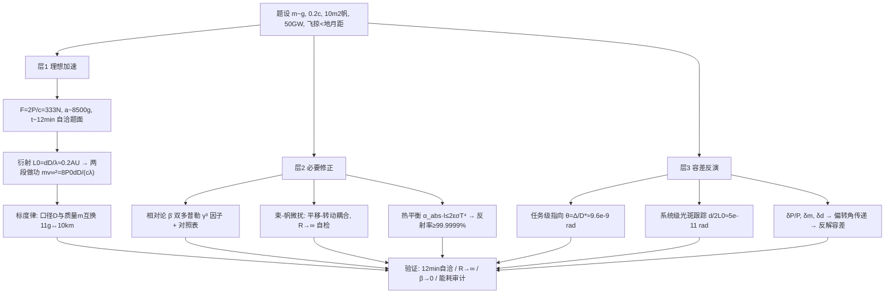

# 2018 题A：光帆纳米飞行器飞掠比邻星（Sending a Light Sail Propelled Nanocraft to Alpha Centauri）

> 赛题来源：UPC 2018 Problem A（当年 281 队中 185 队选题 A，金奖 3 队：IIT Delhi 158 队、UCSB 258 队、国防科大 295 队）

## 1. 题目原文与关键数据

**原文压缩引用**：
> An ultralight spacecraft, with a mass of only **a few grams**, could be accelerated up to approximately **20% of the speed of light** by pressure on a light sail from a **ground-based array of lasers**. This would require a light sail area of approximately **10 square meters** and a laser array operating at a power of approximately **50 gigawatts for 10–20 minutes**. Analyze the spacecraft's dynamics during acceleration: If the goal is to **flyby Proxima Centauri b at closer than the Earth-Moon distance**, what would be the **necessary accuracy and precision of the beam** from the laser array? What would be the **margin of error in the fabrication of the light sail and the uniformity of the laser beam**?

**中文翻译**：仅数克重的超轻航天器，可由地基激光阵列对光帆的压力加速到约 20% 光速。这需要约 10 m² 的光帆与工作功率约 50 GW、持续 10–20 分钟的激光阵列。分析加速阶段的航天器动力学：若目标是以小于地月距离的间距飞掠比邻星 b，激光束需要多高的指向精度与准度？光帆制造误差与激光束均匀性的容差又是多少？

**题面给定参数表**：

| 参数 | 数值 | 备注 |
|---|---|---|
| 总质量 $m$ | "a few grams"（1–10 g） | **自由参数**，1 g / 2 g / 4 g 各给一条曲线更佳 |
| 目标速度 | $\beta=v/c\approx0.2$ | 加速段终点指标 |
| 帆面积 $A_s$ | $\approx10\ {\rm m^2}$ | 方帆边长 $d=\sqrt{10}=3.16$ m |
| 激光功率 $P_0$ | 50 GW | 持续 10–20 min，与 $m$ 自洽（见第 3 节） |
| 飞掠距离 $\Delta$ | $<$ 地月距离 $3.844\times10^8$ m | 唯一的"成功判据" |
| 目标 | 比邻星 b | 距离 4.246 ly $=4.02\times10^{16}$ m；行星轨道半径 0.0485 AU（周期 11.2 天） |
| 阵列口径 $D$、波长 $\lambda$ | **未给** | 自取：$D=10$ km（Lubin DE-STAR-4）、$\lambda=1064$ nm，需声明 |

## 2. 题目到底在问什么（去模糊化）

1. **"accuracy and precision of the beam" 是两级判据，不是一回事**。任务级（accuracy）：加速结束瞬间速度矢量偏 $\theta$，巡航 $vT=4.02\times10^{16}$ m 后横向偏差 $\theta vT=\theta D_\ast$，故 $\theta_{max}=\Delta/D_\ast=3.844\times10^8/4.02\times10^{16}\approx9.6\times10^{-9}$ rad——**与飞船速度无关**（$vT$ 恒等于星距）。系统级（precision）：加速全程光斑不得滑出帆面，跟踪角精度 $\lesssim d/(2L_0)\sim5\times10^{-11}$ rad（见第 3 节 $L_0$），比任务级严 200 倍，**取严者作答**。把两级分开呈现是本题最重要的操作化。
2. **"fabrication margin" 要翻译成动力学参数**：面密度不均 $\to$ 质心偏离帆心 $\to$ 光压力矩 $\to$ 姿态发散；反射率/吸收率不均 $\to$ 局部推力差；帆面平整度（曲率）$\to$ 被动回复力矩有无。每一项都必须接到同一个微扰动力学方程上，给出"扰动幅值 → 最终偏转角"的传递比。
3. **"uniformity of the laser beam" 同理**：束强剖面（高斯/平顶）与随机涨落 $\delta P/P$ 造成横向力梯度。理想平顶束对平面帆的横向力虽对称但不稳定（任何微偏移都被放大），这正是题目要你量化的"束-帆稳定性"。
4. **瞄准对象是"预报的行星位置"而非恒星**：比邻星 b 距恒星 0.0485 AU $=7.3\times10^9$ m，是飞掠容差的 **19 倍**——必须瞄准 21 年后（$4.246\,{\rm ly}/0.2c\approx21$ yr）行星所在的星历预报点，或声明"瞄准恒星 + 行星相位概率"策略。忽略这一层的队伍等于没读完题。

## 3. 物理建模路线图

**层次 1：理想点质量加速（解析骨架，本解读独立估算）**

- 光压推力 $F_0=2P_0/c=333$ N（理想镜面），$a_0=F_0/m$：取 $m=4$ g 得 $a_0=8.3\times10^4\ {\rm m/s^2}\approx8500g$；到 $0.2c$ 需 $t\approx v/a_0\approx720$ s $\approx12$ min——**与题面"10–20 分钟"自洽**（反推 $m\approx3\text{–}5$ g，可写进论文当第一重自检）。
- 衍射决定"光斑罩住帆"的距离：$L_0=dD/\lambda=3.16\times10^4/1.064\times10^{-6}\approx3.0\times10^{10}$ m $\approx0.2$ AU。加速距离 $\tfrac12a_0t^2\approx2.2\times10^{10}$ m $<L_0$，模型自洽。
- 极限速度的标度律（两段做功积分）：光斑超出帆后帆截获功率 $\propto(L_0/L)^2$，故 $F\propto L^{-2}$；两段做功相等，总功 $W=\tfrac{4P_0}{c}L_0=\frac{4P_0dD}{c\lambda}$，得

$$m v_\infty^2=\frac{8P_0\,dD}{c\lambda}\ \Longrightarrow\ v_\infty=\sqrt{\frac{8P_0dD}{c\lambda m}}.$$

代入数值得 $mv_\infty^2\approx4.0\times10^{13}$ J：$m=11$ g 时恰达 $0.2c$，或 $m=4$ g 需 $D\approx3.6$ km——**阵列口径是题面没给的自由参数，它与小舟质量互相兑换**，这一句就是"设计空间"的钥匙。

**层次 2：必要修正**

- **相对论**：$\beta=0.2$ 时 $\gamma-1\approx2\%$、动能相对论/非相对论之比约 4%，动量方程差 $\gamma^3$ 因子。用反射光子双多普勒图像（出射光子能量 $\to E_i\frac{1-\beta}{1+\beta}$）得 $\dot\beta=\frac{2P}{mc^2\gamma^3}\frac{1-\beta}{1+\beta}$；或直接积出 $t(\beta)=\frac{mc^2}{4P\eta}\big[\frac{\beta}{\sqrt{1-\beta^2}}+\frac12\ln\frac{1+\beta}{1-\beta}\big]$。附一张 1–10 g 的"非相对论 vs 相对论"对照表，量化"何时必须相对论"。
- **束-帆稳定性微扰模型（本题核心）**：随动系中写平移-转动耦合方程。帆面取微凹球面（曲率半径 $R$）才有回复力；平顶束下横向力与力矩可解析积分（UCSB 258 队给出 $F_x=-\tfrac12F_{rad}\frac{X+L_r\theta_y}{R}$ 型闭式），$R\to\infty$ 应退化回平面帆失稳——极限自检。数值积分初扰动扫描得容差：横向 $\sim10\ \mu{\rm m}$ 级、倾角 $\sim10^{-6}$ rad 级。
- **热-材料判据（fabrication margin 的物理内核）**：帆吸收率 $\alpha_{abs}$ 的入射强度 $I=P_0/A_s=5\times10^9\ {\rm W/m^2}$，辐射平衡 $\alpha_{abs}I\le2\varepsilon\sigma T_{max}^4$。取 $T_{max}=1000$ K、$\varepsilon=0.06$：$\alpha_{abs}\lesssim1.4\times10^{-6}$，即**反射率须 $\ge99.9999\%$**；等价地 $\varepsilon/\alpha\gtrsim10^4\text{–}10^5$（$T_{max}$ 取 1000–1600 K），把"材料容差"变成一个可查表的无量纲数。

**层次 3：可选扩展**：大气透过率（垂直路径 $\sim0.72$，295 队）；高斯束与多模束的力矩差；帆自旋稳定；尘埃/星际介质撞击的概率性评估；太阳引力对巡航段的系统偏折（见第 4 节）。

## 4. 关键物理效应量级表

| 效应 | 估算量级 | 是否必须建模 | 估算依据 |
|---|---|---|---|
| 光压推力/加速度 | 333 N；$8\times10^4\ {\rm m/s^2}$（4 g） | 必须 | $2P_0/c$、$F/m$ |
| 加速时长/距离 | $\sim12$ min；$\sim0.15$ AU | 必须 | $v/a_0$、$\tfrac12at^2$，与题面互证 |
| 衍射发散 | $\lambda/D\approx1.1\times10^{-10}$ rad；$L_0\approx0.2$ AU | 必须 | 决定两段加速结构与 $v_\infty$ 标度律 |
| 相对论修正 | $\gamma-1\approx2\%$ @0.2c | 必须（精度层面） | $\gamma$ 与 $t(\beta)$ 级数 |
| 任务级指向容差 | $\approx9.6\times10^{-9}$ rad | 必须（核心答案） | $\Delta/D_\ast$ |
| 光斑跟踪容差 | $\sim5\times10^{-11}$ rad | 必须（更严一级） | $d/(2L_0)$ |
| 热平衡→吸收率上限 | $\alpha_{abs}\lesssim10^{-6}$（1000 K） | 必须 | $\alpha I\le2\varepsilon\sigma T^4$，$I=5$ GW/m² |
| 面密度不均→力矩 | 容差 $10^{-5}\text{–}10^{-4}$ 量级 | 必须 | 力矩 $F_0\delta$ 对 $I\ddot\theta$ 的时间积分 |
| 太阳引力巡航偏折 | $\sim5\times10^{-7}$ rad | 可预测可修正（不进随机预算，但须声明） | Rutherford 型 $\theta=2GM_\odot/(bv^2)$，$b=1$ AU、$v=0.2c$ |
| 加速期太阳引力 | 力比光压小 7 个量级 | 可忽略 | $GM/r^2$ vs $2P/(mc)$ |
| 星际尘埃/溅射 | 概率性、微小动量损失 | 可选（定性讨论） | 数密度 $\sim0.1\ {\rm cm^{-3}}$ |

## 5. 求解算法与数值要点

- **主战场是解析**：标度律 $mv_\infty^2=8P_0dD/(c\lambda)$、$t(\beta)$ 闭式、平顶束下的力/力矩闭式积分，全部可手推——评委能逐步验算的论文天然可信。数值只承担微扰方程的积分与初扰动扫描。
- **微扰方程**：$(X,\theta_y)$ 二维线性耦合 ODE，先求本征值判断稳定性、再积分得振幅；扰动-振幅线性标度用两组初值即可呈现（一张图定容差）。
- **随机扰动路线**（295 队）：扰动注入为高斯过程，先证"偏转角随扰动幅值单调"，再用梯度下降/二分反解临界容差，比蒙特卡洛省一个量级机时且结论更硬；三因素单独解 + PSO 联合优化两套结果并列。
- **验证四件套**：$m\approx4$ g 与题面 10–20 min 互证；$R\to\infty$ 退化平面帆失稳；$\beta\to0$ 退化常加速；振荡动能（$\sim$ kW 级）对比束功率（50 GW）的能耗审计。
- **数值陷阱**：非相对论积分到 0.2c 不自检（动能差 4%、时间差更大）；$\beta$ 方程用 $F=2P/c$ 却忘了帆背向反射的动量修正随 $\beta$ 变化；角度单位 rad/µrad/nrad 混写；把地月距离 $3.84\times10^8$ m 当成 $4\times10^{16}$ m 的量级错误（差 5 个量级）。

## 6. 常见错误与陷阱

1. **两级精度混为一谈**：只给 $10^{-8}$ rad 的任务级答案，不提"光斑全程罩住帆"需 $\sim10^{-10}$ rad 的更严判据——题目问的是 accuracy **and** precision。
2. **忽略"瞄准预报星历"**：行星距恒星 0.049 AU 远大于飞掠容差，瞄恒星不等于瞄行星；至少要讨论瞄准策略（瞄星/瞄预报点）及其概率含义。
3. **热负荷缺席**：5 GW/m² 的辐照下吸收率必须压到 ppm 级，否则帆在数秒内烧毁；不谈热的制造容差讨论是空中楼阁。
4. **稳定性只给结论不给模型**："平面帆不稳定"人人会说，金牌与银牌的分界是有微扰方程 + 临界扰动数值。
5. **忽略项不辩护**：太阳引力、衍射、尘埃等每项都应有"与主力量级对比"的一句话定量排除（或声明可修正）。
6. **把 0.2c 当牛顿问题算到底**：不给相对论方程也要给对照表，否则 $t_{acc}$、$L_0$ 内的速度演化都有百分之几的系统性偏差。

## 7. 全网参考与延伸

1. **Breakthrough Starshot（Wikipedia）**（[en.wikipedia.org/wiki/Breakthrough_Starshot](https://en.wikipedia.org/wiki/Breakthrough_Starshot)）——任务原始参数：公里级相位阵列、组合相干功率至 100 GW、克级 StarChip、0.2c、4×4 m 帆。用它校准题面参数（50 GW 是保守档），并确认"题面即 Starshot 简化版"的定位。
2. **Taghavi et al., Scientific Reports 2022（beam-riding 稳定性）**（[nature.com/articles/s41598-022-24681-w](https://www.nature.com/articles/s41598-022-24681-w)）——系统分析光帆对位移/倾斜的回复力与回复力矩，多图样帆可扩大稳定域；直接支撑第 3 节的微扰建模与帆形选择。
3. **arXiv:2502.17828（2025）**（[arxiv.org/html/2502.17828v1](https://arxiv.org/html/2502.17828v1)）——把激光束本身的空间/时间涨落列为失稳源，正是题目"uniformity of the laser beam"的现代注脚；可在讨论节引用以说明 $\delta P/P$ 容差的现实意义。
4. **Breakthrough Initiatives 官方概念页**（[breakthroughinitiatives.org/concept/3](https://breakthroughinitiatives.org/concept/3)）——StarChip 量产成本与帆尺寸的官方口径，用于 practicality 段的工程锚点。

## 8. 金牌论文思路对比

- **158 队（IIT Delhi）**：形状×光束×材料的组合矩阵筛选（球形最稳、方帆动力学最优但需匹配方阵）+ 标度律动力学，$v_\infty$、$L_0$、$\beta_0=0.166$ 全解析；精度给两级判据（$9.4$ nrad 任务级 / $0.106$ nrad 系统级），忽略项全部定量辩护。详见 `05_论文赏析\2018\2018-GM-A-158.md`。
- **258 队（UCSB）**：一个球面帆微扰模型贯穿全部子问题——热平衡判据 $\epsilon\eta/\alpha\ge6.6\times10^3$ 直答 fabrication margin，平顶束下平移-转动耦合方程闭式可积，数值积分给出 $10\ \mu{\rm m}$/$10^{-6}$ rad 级容差与 $\theta_{max}\approx10^{-8}$ rad 指向；两处极限自检（$R\to\infty$、$\beta\to0$）。详见 `05_论文赏析\2018\2018-GM-A-258.md`。
- **295 队（国防科大）**：帆离散为 $100\times100$ 单元 + 相对论刚体姿态动力学，三类扰动（$\delta P/P$、$\delta m$、$\delta d$）作高斯过程注入，先轨道几何反解 $\alpha_{max}=1.98\times10^{-7}$ rad，再梯度下降/PSO 反解容差（$\delta P/P\sim10^{-8.3}$ 等），附 $N$ 从 10 到 100 的三组收敛实验。详见 `05_论文赏析\2018\2018-GM-A-295.md`。

## 9. 评分要点：评委想看什么

- [ ] 三问（束精度、帆制造容差、束均匀性）各有带单位的数值落点，且都从同一个动力学模型导出。
- [ ] 两级精度判据并存：任务级 $\sim10^{-8}$ rad + 光斑罩帆级 $\sim10^{-10}$ rad，说明取严者。
- [ ] 相对论处理不敷衍：$\dot\beta$ 方程或 $t(\beta)$ 闭式 + 非相对论对照表。
- [ ] 热平衡-材料判据把 fabrication margin 落到 $\varepsilon/\alpha$ 或反射率 ppm 级上限。
- [ ] 束-帆稳定性有微扰方程与临界扰动数值（平移-转动耦合，非一句"平面帆不稳"）。
- [ ] 每个忽略项（太阳引力、衍射、尘埃、大气）有一句话量级辩护；瞄准策略（恒星 vs 预报星历点）显式声明。
