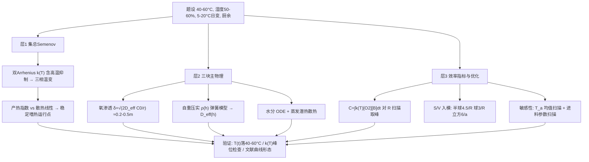

# 2018 题B：堆肥堆尺寸（Compost Pile Sizes）

> 赛题来源：UPC 2018 Problem B（96 队选题 B，金奖 2 队：巴塞罗那自治大学 240 队、国防科大 285 队）

## 1. 题目原文与关键数据

**原文压缩引用**：
> Composting is the process in which microbes turn organic matter into a useful soil conditioner. Efficient composting requires the right range of **temperatures (40–60 °C)**, sufficient **moisture content (usually 50–60%)**, and **aeration** to deliver adequate oxygen to the microbes. Larger piles can better maintain high internal temperatures because the heat will diffuse out more slowly. However, larger piles are also more likely to **compact the material, thus inhibiting the flow of oxygen**. What pile size will result in the most efficient composting if we are working with **kitchen vegetable waste** in a climate where the ambient temperature ranges between **5 and 20 °C in a 24-hour period**? How would the most effective pile size vary depending on the **ambient temperatures** and the **input organic materials**?

**中文翻译**：堆肥是微生物把有机质转化为土壤改良剂的过程。高效堆肥需要适宜的温度（40–60 °C）、足够的含水率（通常 50–60%）以及向微生物供氧的通气。较大的堆体更易维持内部高温（热量扩散更慢），但大堆也更易把物料压实、阻碍氧气流动。对环境温度在 24 小时内于 5–20 °C 间变化的气候下的厨余蔬菜垃圾，多大的堆体堆肥效率最高？最优尺寸如何随环境温度与进料有机物种类变化？

**题面给定参数表**：

| 参数 | 数值 | 备注 |
|---|---|---|
| 有效温区 | 40–60 °C | 兼作模型输出的**验收标准** |
| 含水率 | 50–60% | 同上；亦进入热物性 |
| 环境温度 | 5–20 °C / 24 h | 均值 12.5 °C、振幅 7.5 °C，可正弦或阶梯 |
| 物料 | 厨余蔬菜垃圾 | 密度、孔障率、产热势、C/N 需自取并声明 |
| 问题 1 | 最优"尺寸" | 尺寸 = 形状 + 线度，二者都要答 |
| 问题 2 | 对 $T_a$、进料的敏感性 | 至少两条"最优尺寸 vs 参数"曲线 |

## 2. 题目到底在问什么（去模糊化）

1. **"most efficient composting" 必须先变成一个可积分的标量**。候选操作化：(a) 固定周期（如 100 天）内已反应氧/已分解生物质总量 $C\propto\int_0^{\Delta t}k(T)[O_2][B]\,dt$（240 队）；(b) 温度与含水率始终落在给定区间约束下的氧含量最大化（285 队）；(c) 达腐熟时间最短；(d) 单位体积产物速率。**选哪个都要声明并辩护**——本题两支金奖答案相差 6 倍（9.2 m³ vs 1.6 m³），根源正是指标定义不同，这是开放题的常态而非缺陷。
2. **"pile size" = 形状 × 线度，但物理只通过 $S/V$ 进入方程**（若忽略内部分布）：半球 $S/V=4.5/R$、球 $3/R$、$H=2R$ 圆柱 $3/R$、立方 $6/a$。让形状浓缩为单一几何参数后，"选什么堆形"与"选多大"就变成同一组 ODE 的参数扫描。
3. **题面两句定性提示各是一条建模命令**："大堆保温好" $\to$ 散热项 $\propto hS(T-T_a)$、冷却时间 $\tau\propto L$；"大堆压实碍氧" $\to$ 需要一个 $\rho(h)$ 或孔隙率 $\varepsilon(h)$ 子模型，让扩散系数随深度塌缩。回避任何一句都等于丢掉半个题。
4. **"5–20 °C in 24 hours" 不是让你做日变方程，而是先算趋肤深度**（见第 4 节，$\sim0.1$ m）：振幅只影响外壳，核心只"看见"均值 12.5 °C——这一步估算决定你用正弦、阶梯还是常数，以及要不要写清理由。

## 3. 物理建模路线图

**层次 1：零维 Semenov 集总模型（解析骨架）**

对整堆写三条守恒律（240 队框架）：

$$\rho c_V\frac{dT}{dt}=Q_bF_bk(T)[B][O_2]-X_t\frac{S}{V}(T-T_a),\qquad \frac{d[O_2]}{dt}=-F_bk(T)[B][O_2]+\frac{X_mS}{V}([O_2]_a-[O_2]),\qquad \frac{d[B]}{dt}=-F_b'k(T)[B][O_2].$$

动力学常数取**带抑制项的双 Arrhenius** $k(T)=A_1e^{-E_1/RT}/(1+A_2e^{-E_2/RT})$——高温抑制项让 $k(T)$ 在 $\sim70\text{–}90$ °C 出现峰值后回落，这是模型能自然产生"升温→嗜热→衰减"三相、且不会一路失控烧到自燃的关键。Semenov 图像：产热随 $T$ 近指数增长、散热随 $T$ 线性，两曲线的交点给出点火/熄火温度——堆肥要的是**稳定嗜热运行点**而非热失控（失控即堆肥自燃，是病理极限）。

**层次 2：必要修正（本题的三块主 physics）**

- **氧渗透深度**（主动限制侧）：稳态扩散-反应 $\;D_{eff}\frac{d^2[O_2]}{dx^2}=r\;$ 给出渗透深度

$$\delta\approx\sqrt{\frac{2D_{eff}[O_2]_0}{r}}.$$

取 $D_{eff}\sim10^{-6}\text{–}3\times10^{-6}\ {\rm m^2/s}$（多孔介质迂曲度把空气中的 $2\times10^{-5}$ 压低近一个量级）、$[O_2]_0\approx8.6\ {\rm mol/m^3}$（21% O₂，1 atm）、活性期耗氧 $r\sim3\times10^{-4}\text{–}10^{-3}\ {\rm mol\,m^{-3}s^{-1}}$，得 $\delta\approx0.2\text{–}0.5$ m——**超过这个深度的核心必然缺氧**，这就是"大堆受罚"的定量来源。
- **自重压实**（285 队的核心创新）：把堆料当自重弹簧，分段 Hooke 方程取 $n\to\infty$ 得密度分布 $\rho(h)=\frac{M}{\pi R^2}\cdot\frac{kH+\frac{Mg}{2}}{kH^2+\frac{(Mg)^2}{4k}+Mgh}$；它通过 $D_{eff}(\varepsilon)$ 与产热项 $K_0\rho(h)$ 同时进入热/氧两个场方程。
- **水分平衡**：蒸发潜热是常被漏掉的一等散热项（湿表面潜在通量可达数百 W/m²，实际因表面结壳而自抑制），同时含水率 50–60% 是验收约束——至少补一条水汽 ODE（240 队式 18）。

**层次 3：可选扩展**：2D/3D 傅里叶-菲克场方程（285 队路线：$\lambda=\lambda_0(1+bT)$ 温度依赖导热）；翻堆/强制通风计划优化；烟囱效应对流通风；保温覆盖层设计。

## 4. 关键物理效应量级表

（以下数字为本解读独立估算，物料取 $\rho\approx500\ {\rm kg/m^3}$、$c\approx1800\ {\rm J/(kg\cdot K)}$、$\lambda\approx0.5\ {\rm W/(m\cdot K)}$、$h\approx8\ {\rm W/(m^2K)}$ 自然对流）

| 效应 | 估算量级 | 是否必须建模 | 估算依据 |
|---|---|---|---|
| 集总冷却时间 $\tau=\rho cL/h$ | $L=0.5$ m：$\sim16$ h；$L=2$ m：$\sim2.6$ d | 必须 | 半径越大"越保温"的定量版本 |
| 环境日变的趋肤深度 $\sqrt{\alpha\tau_{day}/\pi}$ | $\approx0.12$ m | 必须（决定 $T_a$ 处理方式） | $\alpha=\lambda/\rho c\approx5.6\times10^{-7}\ {\rm m^2/s}$，$\tau=86400$ s |
| 氧渗透深度 $\delta$ | 0.2–0.5 m（活性期） | 必须 | $\sqrt{2D_{eff}C_0/r}$，见第 3 节 |
| 扩散可支撑的产热密度 $D_{eff}C_0 r^{...}$ | $\sim10^2\text{–}2\times10^2\ {\rm W/m^3}$ | 必须 | $q=(D_{eff}C_0/\delta^2)\times470$ kJ/mol O₂ |
| 维持 60 °C 核心所需产热 | $R=1.5$ m 半球需 $\sim140\ {\rm W/m^3}$（$h_{eff}\approx1.5$） | 必须（给出张力） | $q=h(S/V)\Delta T$，$S/V=4.5/R$ |
| 自重压实应变 $\rho gh/E$ | $\approx25\%/\mathrm{m}$（$E\sim20$ kPa） | 必须 | $D_{eff}\propto\varepsilon^3$，每米孔隙损失近半 |
| 蒸发潜热散热 | 表面可达 $10^2$ W/m² 量级，结壳后自抑制 | 建议建模/至少讨论 | $h_m L_v\Delta\rho_v$ 估算 |
| 散热系数 $h_{eff}$ | 需 $\lesssim2\ {\rm W/(m^2K)}$ 才能撑起 50 K 温升 | 必须（参数敏感性核心） | 覆盖、避风、干壳使 $h$ 从 8 降到 1–2 |

**张力即答案**：把第 4、5、6、8 行放在一起看——氧扩散撑得起 $\sim150\ {\rm W/m^3}$，维持 60 °C 核心恰好需要 $\sim140\ {\rm W/m^3}$（$R\approx1.5$ m、$h_{eff}\approx1.5$），而压实把 1 m 以下供氧砍半。三者交叠的最优区 $R\sim0.8\text{–}1.6$ m（$V\sim2\text{–}10\ {\rm m^3}$），恰是两支金奖答案的落点。**量级估算 30 秒就能预测答案的量级区间，这是本题最值得学会的手算。**

## 5. 求解算法与数值要点

- **ODE 组是刚性的**：Arrhenius 中 $E/R\sim6000\text{–}9000$ K，普通 Euler 会溢出；用 `scipy.odeint`（LSODA）或 MATLAB `ode15s`。240 队 100 天 $\times$ 1001 点 $\times$ 100 个半径的扫描成本完全可控。
- **先做相干性检查再跑优化**：画 $k(T)$ 曲线，看峰值温度是否落在题给 40–60 °C 附近；240 队发现文献参数峰在 80–100 °C，明说并重标定——这是"用文献参数"与"被文献参数用"的分水岭。
- **验收即验证**：跑出的 $T(t)$、含水率 $(t)$ 必须落在题给区间；温变三相（0–20 天升温、中期缓降、末期失温）与已发表堆肥实验曲线形态对比，是最便宜的外部验证。
- **优化呈现**：$C(V)$ 归一化曲线（消除未知比例常数 $\alpha$）图内标注 $V_{max}$；敏感性对 $T_a$、$[B]_0$、$\rho$ 逐个重跑成表。
- **陷阱**：忘了高温抑制项导致温度一路冲到自燃（非物理）；用空气扩散系数 $2\times10^{-5}$ 冒充多孔介质 $D_{eff}$；半球与整球的 $S/V$ 因子（4.5 vs 3）用错；把环境温度振幅直接加到核心温度上（趋肤深度已否定）。

## 6. 常见错误与陷阱

1. **效率指标不定义或定义不可算**：通篇"堆肥效率高"而无积分量/判据，评委无法给分；或多指标混用、结论自相矛盾。
2. **只算热不算氧**：把题目做成纯传热"最大保温尺寸"，丢掉题面第二句定性提示（压实-供氧），答案必然偏大且物理链断半条。
3. **压实不做模型只做口号**：一句"大堆会压实"没有 $\rho(h)$/$\varepsilon(h)$ 量化，等于没处理；反之 285 队的弹簧闭式解正是金牌差异化卖点。
4. **文献参数静默照搬**：$k(T)$ 峰位与题给温区矛盾而不检查、不声明，模型输出与题面区间对不上还不自知。
5. **忽略表面状态与 $h_{eff}$**：自然对流的 $h\sim8$ 根本撑不起 50 K 温升，必须讨论覆盖/结壳使有效换热降到 1–2 W/(m²K)，否则会得出"任何尺寸都达不到 60 °C"的假死局。
6. **日变温度处理过度**：为 5–20 °C 写复杂时变边界却不给趋肤深度论证；先算 0.1 m 趋肤深度再说"核心只见均值"，既严谨又省事。

## 7. 全网参考与延伸

1. **Nelson et al. 2003, "A Semenov Model of Self-Heating in Compost Piles"（Process Safety and Environmental Protection）**（[sciencedirect.com/science/article/abs/pii/S0957582003711112](https://www.sciencedirect.com/science/article/abs/pii/S0957582003711112)）——把 Semenov 热爆炸理论用于堆肥自热的奠基文献，正是 240 队框架的出处；集总模型、点火/熄火条件可直接取材。
2. **Luangwilai, Sidhu & Nelson 2009（ANZIAM J., 开放获取）**（[journal.austms.org.au/ojs/index.php/ANZIAMJ/article/view/2439/1346](https://journal.austms.org.au/ojs/index.php/ANZIAMJ/article/view/2439/1346)）——在 Semenov 框架中引入**氧依赖**的生物学产热（质量传递限制），与本题"保温 vs 供氧"的张力完全同构，是层次 2 氧渗透项的文献支撑。
3. **BioCycle: Spontaneous Combustion in Composting（自燃成因）**（[biocycle.net/spontaneous-combustion-in-composting-the-causes](https://www.biocycle.net/spontaneous-combustion-in-composting-the-causes)）——真实堆肥自燃案例与条件（大堆、干燥、高孔隙局部）；用作"失控分支"的现实注脚，说明为何动力学里必须有高温抑制项。

## 8. 金牌论文思路对比

- **240 队（巴塞罗那自治）**：五 ODE 集总模型（Semenov + 生物质消耗 + 水汽），以"已反应氧质量"为效率指标，对半球与四棱截锥各扫一遍 $C(V)$：半球 $V_{max}=9.20\ {\rm m^3}$、截锥 $6.33\ {\rm m^3}$；最优体积随环境温度升高而增大、随进料浓度升高而减小，并给出"氧通量优先于保温"的机理解释；三层自检（$k(T)$ 峰位、区间验收、文献曲线形态）。详见 `05_论文赏析\2018\2018-GM-B-240.md`。
- **285 队（国防科大）**：场分布路线——圆柱堆对称切片，微元守恒推带内热源的傅里叶温场 PDE，用"产热=耗氧、方向相反"的同构论证镜像出氧方程；独创自重压实弹簧模型解出闭式 $\rho(h)$ 并作两方程的耦合系数；在 $40\le u\le60$ °C 约束下取 $R=H=0.8$ m，并以温场剖面图论证取舍。详见 `05_论文赏析\2018\2018-GM-B-285.md`。
- **对照启示**：240 的"整堆 ODE + 优化"与 285 的"场方程 + 闭式子模型"是同题异构的两极；前者胜在指标与敏感性体系，后者胜在把题面最难的"压实-供氧"做成了硬核子模型。

## 9. 评分要点：评委想看什么

- [ ] 效率指标显式定义、可积分、全文一致（摘要/正文/图表同一数字）。
- [ ] 热与氧两条物理链都在：散热 $\propto S/V$ 与供氧 $\propto\delta$（或传质项）同场竞争，最优尺寸是权衡的产物而非单边结论。
- [ ] 压实有定量子模型（$\rho(h)$ 或 $\varepsilon(h)$），并实际进入控制方程。
- [ ] 文献动力学参数经过相干性检查（$k(T)$ 峰位 vs 40–60 °C），矛盾处明说并重标定。
- [ ] 模型输出落在题给验收区间（温度、含水率），并与实验/文献曲线形态比对。
- [ ] 两条敏感性曲线（最优尺寸 vs 环境温度、vs 进料参数）各有机理解释，而非只报数。
