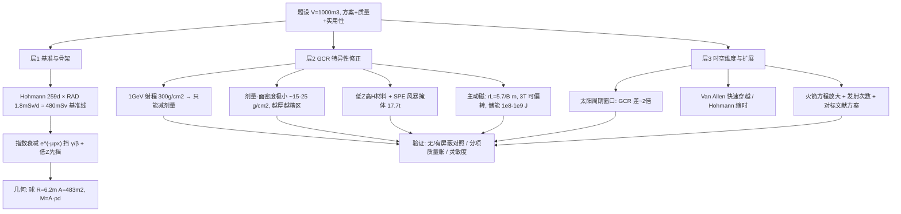

# 2019 题A：火星旅行辐射防护（Protecting Travelers to Mars）

> 赛题来源：UPC 2019 Problem A（当年 305 队中 186 队选题 A，金奖 3 队：德里大学 105 队、孟加拉工程技术大学 289 队、国防科大 343 队）

## 1. 题目原文与关键数据

**原文压缩引用**：
> One of the challenges of sending humans to Mars is the **significant radiation** they would experience during the journey. **Develop a plan for protecting humans** in a spacecraft traveling to Mars from most radiation. To protect a **habitable volume of 1,000 cubic meters**, **how much additional mass** would need to be brought on the journey? Provide a **careful and thorough evaluation of your plan and its practicality**.

**中文翻译**：载人火星之旅的一大挑战是旅途中宇航员将承受的显著辐射。请制定一个使飞船在飞往火星途中免受大部分辐射的乘员防护方案。若要保护 1000 m³ 的可居住容积，需要为旅程额外携带多少质量？请对你的方案及其实用性作出细致而全面的评估。

**题面给定参数表**：

| 参数 | 数值 | 备注 |
|---|---|---|
| 可居住容积 | $V=1000\ {\rm m^3}$ | **唯一硬数据**；形状自选（球形 $R=6.20$ m 最省屏蔽） |
| 交付物 | 方案 + 附加质量 + 实用性评估 | 三问缺一不可 |
| 辐射环境、判据、材料 | **未给** | 自取并声明：GCR/SPE 能谱、剂量限值、材料库 |
| 航时 | 未给 | 自定转移轨道（Hohmann $\approx259$ 天）即成参数 |

## 2. 题目到底在问什么（去模糊化）

1. **"most radiation" 的判据链**：辐射 → 吸收剂量（Gy）→ 品质因子加权 → 剂量当量（Sv）→ 与**职业限值**比较（NASA 现行口径 $\sim600$ mSv/职业生涯；历史上曾用 3% 致死癌风险当量）。"防护"操作化为：巡航全程总剂量 + 一次大 SPE 的短时剂量均低于限值并留余量。**没有基准线就没有防护**：先算无屏蔽剂量（RAD 实测巡航 $\sim1.8$ mSv/天 $\times259$ 天 $\approx480$ mSv，尚未含大 SPE），再算屏蔽后剂量，最后给降幅——"559 Sv → 1.86 Sv"这类对照正是评委要的可判定结论。
2. **"additional mass" 必须是分项明细账**：屏蔽本体 + 支撑结构 + 余量，几何由 $V$ 出发（球形 $A=4\pi R^2=483\ {\rm m^2}$），质量 $M=A\times(\rho d)$（面密度）。再补一刀**火箭方程放大**：附加质量 $\to$ 推进剂代价，把"质量"从数字变成任务可行性。
3. **"plan" 是时空物三维度**：何时（太阳活动周相位：极小期 GCR 约低一半但 SPE 风险结构不同）、何路（Hohmann 缩短航时、快速穿越 Van Allen 带）、用什么（被动材料/主动磁场/掩体战术）。时间与路径是**零质量**的防护手段，先讲它们再谈质量，方案立意立刻高一层。
4. **分粒子类型是本题专业感的分水岭**：GCR（GeV/n 级，连续）、SPE（百 MeV 质子，稀有短暴）、捕获带辐射（穿越几分钟）、γ/中子（次级产物）。四者的屏蔽物理完全不同，混在一层"指数衰减"里就是最大的失分点。

## 3. 物理建模路线图

**层次 1：剂量基准线 + 指数衰减屏蔽（解析骨架）**

- 基准：$D_0=\dot D\,T_{cruise}$。取 RAD 实测 $\dot D\approx1.8$ mSv/天（舱内、典型船体屏蔽后）、$T=259$ 天（Hohmann：$a=(1+1.524)/2=1.262$ AU、$T^2=a^3\Rightarrow$ 半程 258.7 天），得 $D_0\approx4.7\times10^2$ mSv——已逼近职业限值，这就是"为什么必须防护"的第一性论证。
- γ/X 射线屏蔽：$I=I_0e^{-\mu_m\rho x}$，配质量衰减系数表反解厚度；多层屏蔽按**低穿透先挡**排序（Plexiglass/PE 挡 β 与低能带电粒子以抑制韧致辐射，再高 Z 挡 γ）。
- 几何：同容积下球形表面积最小（$A_{sphere}=4.83\times10^2\ {\rm m^2}$；等容积 $r=5$ m、$h=12.7$ m 圆柱 $A=556\ {\rm m^2}$，多 15%），无棱角泄漏，屏蔽质量直接省 15%。

**层次 2：必要修正——GCR 不是 γ 射线**

- **带电重粒子的屏蔽逻辑与光子根本不同**：GCR 质子 $\sim1$ GeV 在水中射程 $\sim300\ {\rm g/cm^2}$（3 m 水），"挡住"在质量上不可能（每 100 g/cm² 即 $\sim48$ t）；只能**减剂量**。且 1 GeV 质子的剂量-面密度曲线在 $\sim15\text{–}25\ {\rm g/cm^2}$ 处有极小值，再厚则次级中子/散裂碎片使剂量**回升**——"越厚越好"对 GCR 不成立，这一句话价值连城。
- **材料选低 Z 高 H**（水、PE、食物/水/废料墙）：氢含量高利于通过弹性散射慢化中子且次级产额低；铝是结构材料不是好屏蔽。
- **SPE 掩体战术**：200 MeV 质子射程 $\sim27\ {\rm g/cm^2}$，故 30–50 g/cm² 的小型风暴掩体（如 20 m³ 球、$R=1.68$ m、$A=35.4\ {\rm m^2}$、50 g/cm² 水 $\Rightarrow$ 仅 17.7 t）即可保命——**"全舱重屏蔽 + 小掩体应对爆发"** 的混合战术，是"附加质量"问题的高级答案。
- **主动磁屏蔽（可选替代/混合）**：洛伦兹偏转判据 $r_L=p/(qB)$；1 GeV 质子 $pc\approx1.7$ GeV，$r_L\approx5.7/B[\rm T]$ m——$B\sim3$ T、特征尺度数米可偏转 GCR 质子，但 γ 与中子完全不受影响，须配被动层；超导储能 $E=B^2V_s/2\mu_0$ 达 $10^8\text{–}10^9$ J 量级，失超风险必须讨论。

**层次 3：可选扩展**：航线段 Van Allen 带穿越剂量（化学推进快速穿越 $\ll1$ h，剂量贡献小；电推进慢螺旋则致命——路径设计义务）；太阳周期窗口定量（极小/极大 GCR 通量比 $\sim2$）；GEANT4/PHITS 或 HZETRN 类输运代码引用值对标；火星表面段（题目只问 journey，可一句划界）。

## 4. 关键物理效应量级表

（球形舱 $A=483\ {\rm m^2}$；本解读独立估算）

| 效应 | 估算量级 | 是否必须建模 | 估算依据 |
|---|---|---|---|
| 巡航 GCR 基准剂量 | $\approx480$ mSv / 单程 | 必须（基准线） | RAD 实测 1.8 mSv/d × 259 d |
| 全舱水屏蔽 20 g/cm² | $483\times0.2\times1000=96.6$ t | 必须 | $M=A\rho d$ |
| 全舱 PE 15 g/cm² | $\approx72$ t（$\rho=920$） | 必须 | 同上 |
| 全舱铝 10 g/cm² | 48.3 t；30 g/cm² 则 145 t | 必须（对照） | 高 Z 材料质量罚 + 次级产额高 |
| GCR 质子 1 GeV 射程 | $\sim300\ {\rm g/cm^2}$（3 m 水） | 必须（否定"挡住"路线） | PSTAR 类射程表 |
| GCR 剂量极小值 | $\sim15\text{–}25\ {\rm g/cm^2}$，之后回升 | 必须 | 次级中子 buildup（文献剂量-深度曲线） |
| SPE 200 MeV 质子射程 | $\sim27\ {\rm g/cm^2}$ | 必须 | 30–50 g/cm² 掩体可挡 |
| 风暴掩体（20 m³、50 g/cm² 水） | 17.7 t | 强烈建议 | $4\pi(1.68)^2\times0.5\times1000$ |
| 1 GeV 质子 Larmor 半径 | $5.7/B$ m（$B$ 以 T 计） | 若做主动屏蔽则必须 | $pc\approx1.7$ GeV/c |
| 磁体储能 | $B^2V_s/2\mu_0\sim10^8\text{–}10^9$ J | 若做主动屏蔽则必须 | 失超与结构应力来源 |
| Van Allen 穿越剂量 | 快速穿越分钟级、贡献小 | 必须（一句话+数字） | 轨道设计决定，非屏蔽 |
| 太阳周期调制 | GCR 通量极小/极大差 $\sim2$ 倍 | 建议（零质量收益） | 中子监测网/太阳调制势 $\Phi$ 数据 |

## 5. 求解算法与数值要点

- **解析为主即够金牌**：$V\to R\to A\to M$ 的几何链、$e^{-\mu_m\rho x}$ 反解厚度、射程/Larmor 半径判据、火箭方程放大，全程可手算；粒子轨道仿真（如做主动屏蔽）用 RK4 且**步长挂回旋周期**（$\Delta t=T_{cyc}/100$，343 队做法），一步到位回应收敛性质疑。
- **数据表是第一生产力**：质量衰减系数表、质子射程表（PSTAR/NIST）、RAD 剂量率、NASA 职业限值——附录一张"符号-含义-数值-单位-出处"五列总表，评委可逐项核查。
- **验证手段**：无屏蔽/有屏蔽剂量对照；屏蔽厚度对判据限值的灵敏度；与已发表方案（NIAC 磁屏蔽报告、MSL 实测）的数值对标；主动+被动混合方案用**面积加权**合成总效率避免重复计数（343 队）。
- **常见数值陷阱**：把光子衰减系数直接用于带电粒子；射程与剂量当量混谈（Gy vs Sv，品质因子 2–20 倍差异）；磁场只画场图不验算 $r_L$ 与储能；质量只算屏蔽膜不算支撑/密封/余量；圆柱/球体表面积算错导致质量差 15%。

## 6. 常见错误与陷阱

1. **用 $e^{-\mu x}$ 挡 GCR**：γ 射线公式误用于 GeV 带电重粒子，且完全丢失"次级粒子使厚屏蔽剂量回升"的非单调物理——本题最典型的银牌级错误。
2. **只有厚度没有剂量闭环**：报了 20 cm 水却不给"无屏蔽 vs 有屏蔽"的 Sv 数字与限值比较，"protect from most radiation" 无从判定。
3. **忽略任务相位**：只做巡航稳态，漏掉 Van Allen 穿越（路径问题）与 SPE 短时暴（掩体场景）；方案在真实任务剖面下直接穿洞。
4. **质量账不完整**：不算支撑结构、不做余量、不做火箭方程/发射次数换算，"additional mass" 停在裸数字。
5. **几何随手估**：不论证球形最小面容比、圆柱端盖泄漏不处理；$V=1000\ {\rm m^3}$ 对应 $R=6.2$ m、$A=483\ {\rm m^2}$ 应是全文第一个算清的数。
6. **判据口径漂移**：Gy/Sv 混用、用"年剂量限值"套"单程剂量"、忽略品质因子随粒子类型变化。

## 7. 全网参考与延伸

1. **Guo et al. 2015（A&A，MSL/RAD 巡航剂量随屏蔽深度变化）**（[aanda.org/articles/aa/full_html/2015/05/aa25680-15/aa25680-15.html](https://www.aanda.org/articles/aa/full_html/2015/05/aa25680-15/aa25680-15.html)）——给出巡航剂量随铝/聚乙烯/水屏蔽厚度（g/cm²）的变化曲线，包括 SPE 剂量当量在 $\sim5\text{–}10\ {\rm g/cm^2}$ 以上因次级粒子反升的结论；第 3 节"极小值/越厚越糟"论证的直接文献支撑。
2. **SwRI 新闻稿：首份火星巡航/表面辐射实测**（[swri.org/newsroom/press-releases/swri-scientists-publish-first-radiation-measurements-the-surface-of-mars](https://www.swri.org/newsroom/press-releases/swri-scientists-publish-first-radiation-measurements-the-surface-of-mars)）——巡航 $\sim1.8$ mSv/天剂量当量、表面 $\sim0.7$ mSv/天的官方实测口径，是基准剂量线的第一手数据。
3. **JPL 辐射剂量对比图 PIA17601**（[jpl.nasa.gov/images/pia17601-radiation-exposure-comparisons-with-mars-trip-calculation](https://www.jpl.nasa.gov/images/pia17601-radiation-exposure-comparisons-with-mars-trip-calculation)）——往返约 1 Sv 的官方直观图；适合放在引言建立"为什么 480 mSv 已很紧张"的语境。
4. **AGU Space Weather 2026：当前技术下载人火星任务的辐射约束**（[agupubs.onlinelibrary.wiley.com/doi/10.1029/2025SW004724](https://agupubs.onlinelibrary.wiley.com/doi/10.1029/2025SW004724)）——用能量最优转移评估 1000 mSv 职业限值可达性的最新系统研究，可用于 conclusion 的现实对标。

## 8. 金牌论文思路对比

- **105 队（德里大学，单人队）**：时空物三因子全走一遍——数值积分发射角避开 Van Allen 带（$43.6°/55.3°$ 窗口）+ Hohmann 258.7 天 + 太阳周期窗口；屏蔽用三层材料（Plexiglass 40 cm + 铅 3.5 cm + Kevlar 6 cm）+ 铝线 Faraday 笼（拉普拉斯边值问题判线网屏蔽有效性），总附加质量 $\sim6.4\times10^5$ kg，剂量 559.48 → 1.86 Sv（降 99.667%）。详见 `05_论文赏析\2019\2019-GM-A-105.md`。
- **289 队（BUET）**：全主动路线——Størmer 定理否决展开式线圈、散裂论证否决纯被动，选 MgB₂ 连续跑道线圈（0.5 T）+ JWST 级遮阳罩热设计，粒子轨道 Euler 仿真扫描 0.01–4 GeV 与 $Z$，附加质量 48.346 t，并用火箭方程与被动方案（$\sim130$ t）定量对比。详见 `05_论文赏析\2019\2019-GM-A-289.md`。
- **343 队（国防科大）**：混合路线设计空间搜索——筒区线形场 + 端盖环形场组合出 8 种构型全仿真排名（$B=10$ T、$L=2$ m 时屏蔽 81–87%），磁场盲区加 10 mm 铝板、全舱 3.75 mm 铝挡 γ（$e^{-\mu x}\le0.05$），Biot–Savart 反推电流、$J_c$ 定线径，总质量 16.53 t；发现低场强 $\eta<0$ 的"聚拢反效应区"是亮点。详见 `05_论文赏析\2019\2019-GM-A-343.md`。
- **对照启示**：三队附加质量相差近 40 倍（636 t / 48 t / 16.5 t），差异来自方案立场（全被动/全主动/混合）与防护口径（挡 γ vs 减 GCR 剂量）——题目开放度之大正体现在这里；但三队共同点是**都有基准剂量线与判据闭环**。

## 9. 评分要点：评委想看什么

- [ ] 剂量学口径清晰（Gy/Sv、品质因子、判据限值），有无屏蔽对照的闭环数字。
- [ ] 分粒子类型讨论屏蔽（GCR 只能减剂量、SPE 可挡、γ 用指数衰减、中子靠低 Z），材料选择有次级产额理由。
- [ ] 附加质量分项明细（本体+结构+余量）+ 几何链 $V\to R\to A$ 可复算 + 火箭方程/发射次数放大。
- [ ] 时间与路径维度在案：Hohmann 航时、Van Allen 穿越、太阳周期窗口——零质量防护手段。
- [ ] 实用性专节：与已发表方案/实测数据对标、风险清单（次级辐射、失超、SPE 概率）、假设的保守方向声明。
- [ ] 摘要数字与正文严格一致（105 队 $6.33$ vs $6.36\times10^5$ kg 的前车之鉴）。
