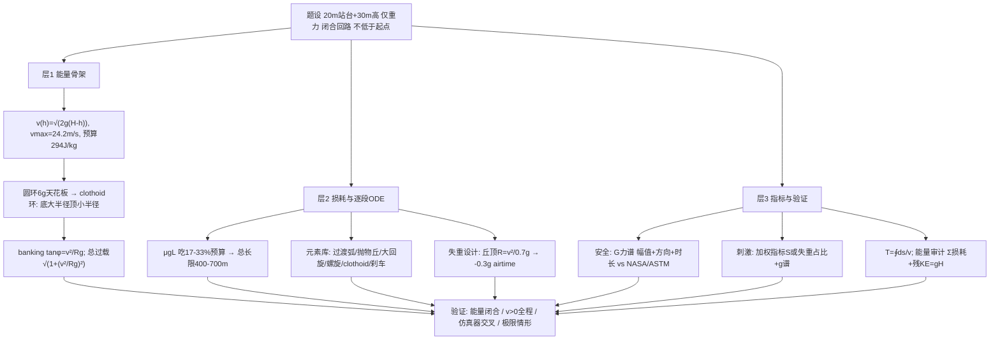

# 2019 题B：过山车设计（Design a Roller Coaster）

> 赛题来源：UPC 2019 Problem B（119 队选题 B，金奖 2 队：上海交大交密学院 190 队、青岛大学 389 队）

## 1. 题目原文与关键数据

**原文压缩引用**：
> You must design a roller coaster ride to be **as exciting as possible, yet safe**. The roller coaster will begin with a **20 meter horizontal segment**, where passengers board, then climb up a hill to its highest point, taking it to an altitude **30 meters above the starting location**. This **gravitational potential energy will be the only source of energy**. **Precisely describe the path** that the roller coaster track would follow, through **three-dimensional space**, and indicate the **orientation of the car** as it follows this track. The track must form a **closed loop**, with the ride **ending at the starting location**. At no point may the track **descend below its starting altitude**. **Analyze the dynamics** of a roller coaster car and determine the **total duration** of the ride. Use your analysis to make a persuasive case that your design would be **safe, but riders would find it to be especially exciting**.

**中文翻译**：设计一条尽可能刺激且安全的过山车。起点为 20 m 水平登车站台，随后爬升至高出起点 30 m 的最高点；重力势能是运动的唯一能量来源。请精确描述轨道在三维空间中的路径，并给出车厢沿轨道行进时的姿态。轨道须构成闭合回路，最终回到起点；任何位置不得低于起始高度。分析车厢动力学并给出全程时长。用你的分析论证：设计安全，且特别刺激。

**题面给定参数表**：

| 参数 | 数值 | 备注 |
|---|---|---|
| 登车段 | 20 m 水平 | 兼作末段刹车区（闭合回路的物理出口） |
| 最大高度 $H$ | 30 m | 总能量预算 $gH=294$ J/kg |
| 能量来源 | 仅重力势能 | 刹车/磁涡流制动**合法**（只耗能不供能）；链条提升属"爬坡"自身 |
| 拓扑约束 | 闭合回路、终点=起点、全程 $\ge$ 起点高度 | 三条硬约束，须逐条核验 |
| 交付物 | 3D 路径 + 车厢姿态 + 动力学 + 时长 + 安全/刺激论证 | 五件套 |
| 自由参数 | 车质量、轮轨摩擦、风阻、各元素几何 | 全部自取并列表 |

## 2. 题目到底在问什么（去模糊化）

1. **"exciting" 和 "safe" 必须先变成标量指标，再开始画轨道**。安全：$G$ 力按**方向 + 幅值 + 持续时间**三维判据（正纵向/法向容忍 $\sim4\text{–}5g$，负法向仅 $\sim-1\text{–}-1.5g$，侧向 $\lesssim1.5g$；NASA Kumar & Norfleet、Eiband 曲线、ASTM F2291/EN 13814 框架）。刺激：自建加权指标（190 队 $S=4G_x+5G_y+3G_z+0.05v+0.1H$，并用"急加速 3g 对应 $S=12$"标定阈值）或用客观量组（最大/负/侧向 $g$、失重时间占比、最高速度、时长）。**先定指标后设计**，是本题与普通"画个环"拉开差距的关键。
2. **"precisely describe the path" = 给出可复算的数学对象**：分段解析元素（圆弧、抛物线山丘、螺旋线、回旋线 clothoid）的显式方程，或全线的曲率-挠率-侧倾描述 $\kappa(s),\tau(s),\varphi(s)$；车厢姿态即轨道标架（切向/法向/副法向）+ 侧倾角 $\varphi(s)$。只给示意图不给方程不叫 precisely。
3. **"gravity only + closed loop + never below start" 是能量审计题**：总预算 $gH=294$ J/kg，全程损耗 $\sum\mu g\Delta s+\sum F_{drag}ds$ 必须留出末端刹车余量，且全程 $v>0$（倒立段尤其要验 $v_{top}^2\ge gR$）；终点回起点高度，残余动能由 20 m 站台段制动吸收。**30 m 是很小的预算**——这是本题隐藏的设计枷锁（见第 4 节）。
4. **"duration" 不是估的**：$T=\oint ds/v(s)$，由分段 ODE 数值积分给出，与能量审计交叉校验。

## 3. 物理建模路线图

**层次 1：理想能量骨架（解析）**

- 无损耗速度谱：$v(h)=\sqrt{2g(H-h)}$，最大速度（最低点）$v_{max}=\sqrt{2\times9.8\times30}=24.2$ m/s $\approx87$ km/h。
- **圆环的"6g 天花板"（本解读独立推导，本题最值钱的一条物理）**：竖直圆环恰好不脱轨要求环顶 $v_{top}^2=gR$；能量 $v_{bot}^2=v_{top}^2+4gR=5gR$；环底法向过载 $a_n=v_{bot}^2/R+g=6g$。**任何"刚好通过"的竖直圆环，环底必然 $\ge6g$**，超人体上限——结论：在 30 m 预算下圆环不可行，必须改回旋线（clothoid）环：环底大半径（$a_n\approx3\text{–}4g$）、环顶小半径（维持 $v_{top}^2/R_{top}\approx1.3g$ 防失重滞留），把过载谱压平。389 队用 clothoid 正是工程正解。
- 侧倾（banking）：$\tan\varphi=v^2/(Rg)$；注意**侧倾不减总过载**，只是把侧向 $g$ 换成法向 $g$：车体系法向过载 $\sqrt{1+(v^2/Rg)^2}$，选半径时按这个总量校核。

**层次 2：必要修正（损耗与逐段动力学）**

- 滚动摩擦 + 平方空气阻力逐段 ODE：$m\dot v=-mg\sin\theta-\mu N-\tfrac12\rho C_dA v^2$，$N$ 含曲率项 $mv^2/R_n$。损耗预算是设计枷锁：$\mu g L_{tot}$，取 $\mu=0.01\text{–}0.02$、$L_{tot}=500$ m 得 $49\text{–}98$ J/kg，**吃掉 $gH$ 预算的 17–33%**；再加风阻（20 m/s 时 $\sim0.8$ N/kg，量级 $\sim8\%$），实际可用落差仅 $\sim20\text{–}25$ m——轨道总长被限制在 $\sim400\text{–}700$ m，元素数量必须克制。
- 逐段元素库与衔接：圆弧过渡（坡底缓和曲率）、抛物线山丘（可控失重：丘顶 $a_n=v^2/R$，取 $R=v^2/(0.7g)$ 得 $-0.3g$ 失重段）、大半径回旋（侧倾调头）、下降螺旋（螺距修正 $g_{eff}\propto\rho/\sqrt{\rho^2+k^2}$，190 队）、clothoid 环、末段匀减速刹车（$v^2=2a\Delta x$）。
- 全程 $v(s)>0$ 与三约束核验：闭合、不低于 0 m、终点回起点（残速由站台段刹车吸收）。

**层次 3：可选扩展**：多车编队与耦合、乘客头部的 Jerk（加加速度）舒适度指标、结构载荷与支撑验算、风载/雨天的 $\mu$ 灵敏度、专用仿真器（NoLimits 2）交叉验证。

## 4. 关键物理效应量级表

（本解读独立估算；取 $m$ 不敏感的比能量口径）

| 效应 | 估算量级 | 是否必须建模 | 估算依据 |
|---|---|---|---|
| 理想最大速度 | 24.2 m/s（87 km/h） | 必须 | $\sqrt{2gH}$ |
| 能量总预算 | $gH=294$ J/kg | 必须 | 全文的总账 |
| 滚动摩擦损耗 | $\mu gL=49\text{–}98$ J/kg（$L=500$ m） | 必须 | $\mu=0.01\text{–}0.02$，预算的 17–33% |
| 空气阻力 | 20 m/s 时 $\sim0.8$ N/kg，全程 $\sim8\text{–}15\%$ 预算 | 建议 | $\tfrac12\rho C_dAv^2/m$，$A\sim2\ {\rm m^2}$、$C_d\sim0.8$ |
| 圆环环底最小过载 | 恰好不脱轨即 $6g$ | 必须（判圆环死刑） | $v_{bot}^2=5gR$ 代入 $v^2/R+g$ |
| Clothoid 环设计点 | 底 $3\text{–}4g$、顶 $\ge1.3g$ | 必须 | 曲率随弧长线性分配 |
| 侧倾后总法向过载 | $\sqrt{1+(v^2/Rg)^2}$（如 1.47 → 1.77g） | 必须 | 侧倾换向不减总量 |
| 失重（airtime）设计 | $-0.3g$ 持续 $\sim1$ s | 建议（刺激指标核心） | 丘顶 $R=v^2/(0.7g)$，$v=10$ m/s 时 $R\approx15$ m |
| 末速刹车需求 | $v_f=10$ m/s 残余 50 J/kg，20 m 内 $a\approx2.5\ {\rm m/s^2}$ | 必须（闭合回路） | $v^2=2a\Delta x$ |
| 全程时长 | $T\approx45\text{–}65$ s（$L\approx450\text{–}550$ m） | 必须 | $\oint ds/v$；两金奖答案 49.0 s 与 62.7 s |

## 5. 求解算法与数值要点

- **两条路线都通金牌**：(a) 分段动能定理递推（$v_{i+1}^2=v_i^2-2g\Delta h-2W_{loss}/m$，段内速度取均值 $v_j=(v_i+v_{i+1})/2$）——半解析、可手算、48 小时性价比最高（389 队）；(b) 逐段 ODE + Euler/RK 数值积分（$\Delta t=10^{-4}$ s，190 队递归实现），配合圆弧段以 $\theta=\int v/R\,dt$ 为状态变量。
- **能量审计是第一验证**：$\tfrac12v_{end}^2+\sum W_{loss}=gH$ 必须闭合到 $\sim1\%$；任何一段的 $v(s)$ 出现非物理回升或归零即报错。
- **交叉验证神器**：NoLimits 2 等领域仿真器按同一几何与参数重建轨道，理论-仿真逐点对照（389 队给出平均误差 2.1 m/s、拟合度 94.26%）；无仿真器则用"无摩擦极限 $v=\sqrt{2g\Delta h}$"做极限自检。
- **常见数值陷阱**：法向力漏掉曲率项 $mv^2/R$ 导致环顶速度判据失真；欧拉法步长太大使环顶 $v^2$ 出现虚假负值；段间衔接初条件接错（上一段末速/末高度未传递）；刹车段忘了检查减速度上限（$\sim1.5g$ 生理舒适）；时长用"总长/平均速度"粗糙估计而非 $\oint ds/v$。
- **设计自由度的呈现**：把 $H$、$\mu$、$C_dA$ 做一次灵敏度表（如 $\mu$ 从 0.01 到 0.03，总长上限从 700 m 缩到 300 m），既显工程感又是对"结论是否稳健"的预防性回答。

## 6. 常见错误与陷阱

1. **踩中"圆环 6g 天花板"**：画一个漂亮的竖直圆环却不验算环底过载——恰好能过的圆环环底必然 $\ge6g$，直接违反自己的安全判据；必须用 clothoid 或把环抬高、减小能量。
2. **能量预算超支**：按无摩擦设计元素，忽略 $\mu gL$ 要吃掉 17–33% 预算、风阻再吃 $\sim10\%$，结果轨道后半程 $v\to0$ 卡死或元素无法闭合。
3. **"exciting/safe" 无量化指标**：用形容词自证刺激与安全；或安全判据只看正 $g$ 峰值，忽略侧向、负 $g$ 与持续时间维度。
4. **约束核验缺席**：不验全程 $v>0$（尤其倒立段 $v_{top}^2\ge gR$）、不给末段刹车方案（闭合回路的物理出口）、车厢姿态无 $\varphi(s)$ 或轨道标架描述。
5. **侧倾概念错误**：以为侧倾能降低总过载（实际只换方向），或 banking 角与速度不匹配导致残余侧向 $g$。
6. **时长与路径脱节**：路径是手绘概念图、时长是拍的数，两者对不上总账；正确做法是同一条弧长参数化贯穿路径方程、动力学与 $T=\oint ds/v$。

## 7. 全网参考与延伸

1. **ANSI 博客：ASTM F2291-25 游乐设施设计标准**（[blog.ansi.org/ansi/astm-f2291-25-standard-practice-amusement-rides](https://blog.ansi.org/ansi/astm-f2291-25-standard-practice-amusement-rides)）——业界主流设计标准：要求按**加速度的方向、幅值、持续时间与乘客姿态**建立暴露限值并做人体耐受工程分析；安全章节引用它即可把自设阈值升级为"对标行业标准"。
2. **CoasterForce: Roller Coaster Physics**（[coasterforce.com/physics](https://coasterforce.com/physics)）——行业口径的 $G$ 力常识区间（正 $g$ 常见 3–5、持续 4–5g 接近耐受极限、纪录级 $\sim6.3g$）与元素类型（clothoid、螺旋、airtime 丘），为"设计点落在真实工程范围内"提供参照。
3. **Thrillzing: The Science of Roller Coaster G-Forces**（[thrillzing.com/science/roller-coaster-g-forces-explained](https://thrillzing.com/science/roller-coaster-g-forces-explained)）——正/负/侧向 $g$ 的乘客体验含义（$-1\text{–}-1.5g$ 为 airtime 上限、侧向需限 $\sim1.5g$），刺激指标加权时可引为依据。
4. **CPSC: Amusement Ride Voluntary Standards 页**（[cpsc.gov/Regulations-Laws--Standards/Voluntary-Standards/Amusement-Rides-Trampoline-Parks-and-Adventure-Attractions](https://www.cpsc.gov/Regulations-Laws--Standards/Voluntary-Standards/Amusement-Rides-Trampoline-Parks-and-Adventure-Attractions)）——美国监管体系对设计标准（ASTM F2291/F24 系）的采纳情况，practicality/合规段一句话引用即可。

## 8. 金牌论文思路对比

- **190 队（上海交大）**：五段轨道（斜坡、三连半圆、上爬坡、双螺旋、下斜+圆弧）+ 自建"车体系 G-axes"与加权刺激指标 $S=4G_x+5G_y+3G_z+0.05v+0.1H$（$S=12$ 阈值用汽车急加速标定）；安全引用 NASA Kumar & Norfleet（$G_z<4.8g$ 等且持续 $<2.5$ s）；MATLAB 递归欧拉（$\Delta t=10^{-4}$ s）解分段 ODE，双螺旋螺距修正因子 $\rho/\sqrt{\rho^2+k^2}$ 是几何亮点；结果 $L=428$ m、$T=48.99$ s，最大 $G_z=6.5$ 持续 1 s（以时长辩护）。详见 [05_论文赏析/2019/2019-GM-B-190.md](../05_论文赏析/2019/2019-GM-B-190.md)。
- **389 队（青岛大学）**：九段元素化设计（圆弧过渡、抛物线丘、50 m 大半径半圆、竖直环+螺旋、**clothoid 环**）+ 动能定理半解析递推（段内均速近似），再用 NoLimits 2 独立仿真交叉验证（平均误差 2.1 m/s、拟合度 94.26%）；判据落"幅值+持续时间"双门限并引 EN 13814；$L=518$ m、$T=62.67$ s、最大 4.1g/0.01 s、失重+超重占比 87%。详见 [05_论文赏析/2019/2019-GM-B-389.md](../05_论文赏析/2019/2019-GM-B-389.md)。
- **对照启示**：190 的指标体系（先定义刺激/安全再设计）与 389 的元素工程选型（clothoid、大半径、双门限判据）+ 仿真器互验，恰好互补——合起来就是本题的"满分解法画像"。

## 9. 评分要点：评委想看什么

- [ ] 3D 路径有精确数学描述（分段显式方程或 $\kappa(s),\tau(s),\varphi(s)$），车厢姿态（轨道标架+侧倾）明确。
- [ ] 三条硬约束逐条核验：闭合回起点、全程不低于起点高度、仅重力供能（刹车合法且方案明确）。
- [ ] 动力学含损耗（滚动摩擦+平方风阻）并有能量总账：$\sum W_{loss}+$ 残余动能 $=gH$ 闭合。
- [ ] 安全判据为"方向×幅值×持续时间"三维并引标准/文献（ASTM F2291、EN 13814、NASA 耐受数据），$G$ 力谱全程呈现。
- [ ] 刺激性有定义、有标定、有设计因果链（clothoid 压平环顶、airtime 丘、banked 转弯如何服务于指标）。
- [ ] 时长由 $T=\oint ds/v$ 数值给出，且与能量审计/独立仿真交叉验证；附可复现代码或逐点对照表。
