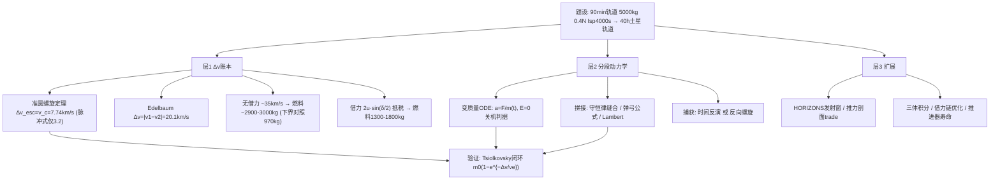

# 2020 题A：离子推进器去土星（Ion Thrusters to Saturn）

> 赛题来源：UPC 2020 Problem A（当年 346 队投稿；题 A 金奖 4 队：同济大学 340、雅各布大学不来梅 354、佐治亚理工 426、博阿齐奇大学 447）

## 1. 题目原文与关键数据

**原文压缩引用**：
> A spacecraft is in a circular orbit around the Earth, with an orbital period of **90 minutes**... total mass of **5,000 kg**, including fuel... ion thrusters that can provide a **constant thrust of 400 millinewtons**, with a **specific impulse of 4,000 seconds**. Our goal is to place the spacecraft into a circular orbit around Saturn, with an orbital period of **40 hours**. **What is the minimum amount of fuel** this will take? **What will be the duration** of the trip? **How should the thrusters be controlled** during the journey?

**中文翻译**：航天器位于地球圆轨道（周期 90 min），总质量 5000 kg（含燃料），装有离子推进器：恒定推力 400 mN、比冲 4000 s。目标：进入土星圆轨道（周期 40 h）。问：最少需要多少燃料？航时多长？途中推进器应如何控制？

**题面给定参数表**（含由题面数值直接反推的导出量）：

| 参数 | 数值 | 导出量（读者应自行复算） |
|---|---|---|
| 地心轨道周期 90 min | $r_E=(\mu_E T^2/4\pi^2)^{1/3}=6653$ km | $v_E=\sqrt{\mu_E/r_E}=7.74$ km/s |
| 总质量（含燃料） | 5000 kg | 满箱可烧 $5000/\dot m=15.5$ 年 |
| 推力 | 0.4 N 恒定 | $a=F/m=8\times10^{-5}\ {\rm m/s^2}\approx8\ \mu g$ |
| 比冲 4000 s | $v_e=g_0I_{sp}=39.2$ km/s | $\dot m=F/v_e=1.02\times10^{-5}$ kg/s（0.88 kg/天，322 kg/年） |
| 土星轨道周期 40 h | $r_S=2.71\times10^5$ km | $v_S=11.8$ km/s |
| （隐含）行星轨道半径、$GM_\odot$ | 土星 9.58 AU | 地会合周期 1.035 年（相位窗口） |

三问实为一体：燃料是**优化目标**，航时是**输出**，控制律是**设计变量**。

## 2. 题目到底在问什么（去模糊化）

1. **"minimum fuel" 没有规定航线**——借不借力、走哪条路全由你定。可操作的答案 = "给出你方案族内的最小值 + 一个**下界论证**（无借力的 Δv 账本）+ 2–3 条备选航线对比"，只报一个数不叫 minimum。
2. **0.4 N 意味着"脉冲火箭"的所有直觉作废**：$a\approx8\ \mu g$，任何霍曼式冲量都打不出来。本题的核心物理是**低推力罚金**——逃逸圆轨道不能再吃 Oberth 红利，Δv 预算比化学火箭方案高数倍。谁没意识到这一点，燃料就低估 2–3 倍。
3. **"duration" 与燃料强耦合**：流量固定，燃料 = $\dot m\times$ 开机时长；想省燃料就多滑行（346 队方案），想省时间就一直开（447 队 8.29 年）。两问要一起答才自洽。
4. **第三问 "how controlled" 是 UPC 特色题眼**：要给出推力**方向**（切向/沿速度/合成方向）、**开关判据**（如机械能达到逃逸能即关机）、**占空比**。426 队把三种推力剖面做成 trade study 是标杆答法。
5. **行星相位**：题面没给发射窗口，要么声明"理想相位"假设（340），要么查真实星历（426 用 JPL HORIZONS 找到 2038 年 6 月窗口）——这决定答案是否可执行。

## 3. 物理建模路线图

**层次 1：Δv 账本（解析骨架，30 分钟手算定大局）**

- 准圆螺旋逃逸定理：切向推力下准圆轨道满足 $E=-v^2/2$，推力功率 $\mathrm dE=v\,\mathrm d(\Delta v)$，故 $\mathrm d(\Delta v)=-\mathrm dv$，逃逸（$E=0$，即 $v\to0$）所需
$$\Delta v_{esc}=v_c=7.74\ {\rm km/s},$$
对比冲量式的 $(\sqrt2-1)v_c=3.2$ km/s——**低推力罚金 4.5 km/s**。对应开机时长 $t\approx v_c/\bar a\approx 7740/(8.8\times10^{-5})=2.8$ 年、耗燃料 $m_0(1-e^{-v_c/v_e})\approx900$ kg。
- 日心段 Edelbaum 结论：圆到圆低推力螺旋 $\Delta v=|v_1-v_2|=29.78-9.68=20.1$ km/s（又要交一遍"无 Oberth 税"），耗掉约 40% 剩余质量。
- **无借力总账**：$7.7+20.1+7\ (\text{捕获螺旋})\approx35$ km/s → $m_f=5000\,e^{-35/39.2}\approx2050$ kg，**燃料 ≈ 2900–3000 kg**（与 426 队 2924 kg 吻合）；理想脉冲下限约 8.5 km/s → 970 kg（0.4 N 做不到，仅作下界参考）。
- **借力版**：弹弓免费旋转 $\vec v_\infty$，增速 $\Delta v\approx2u\sin(\delta/2)$（金星 $u=35$ km/s，转折角 $\delta$ 由近心点定），可抵掉日心 Edelbaum 税 → **燃料 1300–1800 kg**（447：1308、354：1809）。

**层次 2：分段动力学 + 圆锥曲线拼接**：地心段极坐标（或直角坐标）含变质量方程 $\ddot{\vec r}=-\mu_E\vec r/r^3+(F/m(t))\hat t$，$m(t)=m_0-\dot m t$；以 $E(t)=0$ 为关机判据；段间用角动量/能量/几何守恒拼接（340）或引力弹弓公式 $v_f=(v_i+2u)\sqrt{1-4uv_i(1-\cos\theta)/(v_i+2u)^2}$（354/447）；捕获段用**时间反演**（426：把"刹车入轨"倒放成逃逸问题，与逃逸段共用代码且自动匹配边界）。

**层次 3：可选扩展**：发射窗口星历验证；推力剖面 trade（恒推力→对数螺线、$1/r^2$ 衰减、partial-coast 占空比）；借力链全局优化（Lambert + $v_\infty$ 匹配）；三体全程积分；推进器寿命约束。

## 4. 关键物理效应量级表

| 效应 | 估算量级 | 是否必须建模 | 估算依据 |
|---|---|---|---|
| 推力加速度 | $8\times10^{-5}\ {\rm m/s^2}$（随质量降至 $2\times10^{-4}$） | 必须 | $0.4/5000$；质量必须实时更新 |
| 排气速度 / 流量率 | 39.2 km/s；$1.02\times10^{-5}$ kg/s | 必须 | $g_0I_{sp}$；322 kg/年 |
| 低推力逃逸罚金 | 7.74 vs 冲量 3.2 km/s | 必须（核心） | 准圆螺旋定理推导见 §3 |
| 逃逸螺旋时长/燃料 | ~2.8 年 / ~900 kg | 必须 | $v_c/\bar a$；Tsiolkovsky |
| 日心 Edelbaum Δv | 20.1 km/s | 必须（无借力时） | $\lvert v_1-v_2\rvert$ |
| Hohmann 半周期 | 6.1 年（$a=5.29$ AU） | 对照值 | 螺旋全程推进约 5.3 年反而更快 |
| 土星捕获 | $v_\infty\approx5.5$ km/s → 双曲 13.0 km/s；冲量 1.2 / 螺旋 ~7 km/s | 必须 | $\sqrt{v_\infty^2+v_S^2}-v_S$ |
| 金星弹弓增益 | 理论上限 $2u\sin(\delta/2)\sim50$ km/s，实用 10–20 | 建议 | 拼接几何 + 转折角限制 |
| 相位窗口 | 地土会合周期 1.035 年 | 建议 | 滑行 6 年土星走 ~200° |
| 推进器累计开机 | 本题需 3.6–6.5 万小时 vs Dawn ~2.8 万小时 | 现实性讨论 | 见 §7（寿命是真实约束） |

## 5. 求解算法与数值要点

- **数值框架**：状态 $x=[r,\theta,v_r,v_\theta,m]$，RK45（`ode45`/`ode113` 即可）；地心段步长 $10^2$–$10^3$ s、日心段小时级；建议无量纲化（AU、年、$m_0$）防浮点病。
- **解析监控量**：每步核对 $E(t)=v^2/2-\mu/r$ 与 $m(t)$，关机判据直接读 $E=0$；燃料用 $m_0(1-e^{-\Delta v/v_e})$ 闭环复核——数值积分结果若与账本偏差 >10%，先查程序再查物理。
- **验证三件套**：① 逃逸燃料 ≤ 900 kg（定理值）；② 各阶段时间/质量表行列可加（447 的三阶段表）；③ 换推力方向重跑做策略对比（这本身就是第三问的答案）。
- **常见数值陷阱**：$a=F/m(t)$ 忘随质量更新；km/s 与 m/s 混写（354 队的 5.2 节就错标了单位）；地心 $v_\infty$ 与日心速度重复/漏算；弹弓后旋转的是 $v_\infty$ **方向**而非大小；积分跨越行星影响球时引力模型切换不连续。

## 6. 常见错误与陷阱

1. **套霍曼+脉冲**：$\Delta v\approx8.5$ km/s → 燃料 ~1000 kg。0.4 N 打不出冲量，Oberth 红利不存在——低估近 3 倍。
2. **单方案称"最小"**：不给出下界账本、不比较借力/不借力，"minimum"无从谈起。
3. **恒定 $a=F/5000$ 用到全程**：质量从 5000 掉到 ~2000，加速度涨 2.5 倍，航时系统性偏差可达年。
4. **第三问失守**：答"始终满推"却不比较方向策略；或给出控制律却与前面的轨迹不自洽。
5. **捕获段漏 $v_\infty$**：把到港速度当 $v_S$，捕获 Δv 直接算错；或把土星大气制动当免费手段（题设是纯离子推进）。
6. **相位假设不声明**：行星要恰好在交会点等你，"理想相位"与真实星历差几个月到几年。

## 7. 全网参考与延伸

1. **NASA NTRS：Garner 2013《Ion Propulsion: An Enabling Technology for the Dawn Mission》**（[ntrs.nasa.gov/citations/20150007440](https://ntrs.nasa.gov/citations/20150007440)）——Dawn 离子推进累计 Δv ≈ 11 km/s、耗氙 425 kg、累计开机 ~28,000 小时、$I_{sp}=3100$ s。用途：校准"电推进能做什么"；并做现实性检验——本题需连续开机 3.6–6.5 万小时，已超 Dawn 累计值，值得在论文里点名推进器寿命约束。
2. **Wikipedia：Ion thruster**（[en.wikipedia.org/wiki/Ion_thruster](https://en.wikipedia.org/wiki/Ion_thruster)）——Dawn 11.5 km/s 数据与各类电推进参数速查。
3. **MIT OCW 16.522 Space Propulsion, Lecture 6: Analytical Approximations for Low-Thrust Maneuvers**（[ocw.mit.edu](https://ocw.mit.edu/courses/16-522-space-propulsion-spring-2015/7f725e54b9be201164d56ebbd5e08023_MIT16_522S15_Lecture6.pdf)）——Edelbaum $\Delta v=|v_2-v_1|$ 的课堂推导，直接为 §3 解析骨架背书。
4. **Oleson 1993《An Analytical Optimization of Electric Propulsion Orbit Transfers》（NASA NTRS）**（[ntrs.nasa.gov](https://ntrs.nasa.gov/api/citations/19930017871/downloads/19930017871.pdf)）——低推力任务分析工程标准（$\Delta v=gI_{sp}\ln(t/(t-\tau))$ 型关系），可交叉核对燃烧时间与燃料。

## 8. 金牌论文思路对比

- **340（同济）**：圆锥曲线拼接五段（逃逸螺旋→绕日→金星借力→绕日→土星捕获），"少开机多滑行"，捕获仅开机 0.43 h；2403 kg / 13.49 年。注意：按其流量×开机 65453 h 反推逃逸段等效 Δv ≈ 25.7 km/s，为准圆螺旋定理值的 3.3 倍——其推力指向偏离切向最优，这正是各队燃料差 2 倍的微观根源，也是"用 Δv 账本审计别人论文"的绝佳练习。详见 [05_论文赏析/2020/2020-GM-A-340.md](../05_论文赏析/2020/2020-GM-A-340.md)。
- **354（雅各布）**：月球+双地球弹弓链（0.934→10.65 km/s），全程 Euler-Richardson 三体积分，声明最简转向律给出燃料**上界**；1809 kg / 9.2 年。详见 `2020-GM-A-354.md`。
- **426（佐治亚理工）**：三段微推进二体 + 推力剖面 trade study（恒推 / $1/r^2$ / partial-coast）+ 时间反演捕获 + HORIZONS 发射窗（2038-06）；2924 kg / 20.92 年，"如何控制"答得最完整。详见 `2020-GM-A-426.md`。
- **447（博阿齐奇）**：显式状态-控制表述 + 控制参数扫描（逃逸 3 指向 × 日心 4 偏角），解析证明月球弹弓不可行后改木星弹弓；1308 kg / 8.29 年，保留失败轨迹图是亮点。详见 `2020-GM-A-447.md`。

## 9. 评分要点：评委想看什么

- [ ] 由周期反推 $r_E,r_S,v_E,v_S$ 且全文数字闭环可复算。
- [ ] $\dot m,v_e$ 正确，质量全程演化，燃料与 $\dot m\times$ 开机时长精确吻合。
- [ ] 低推力罚金显式化：逃逸 Δv 接近 $v_c=7.74$ km/s（或数值积分结果与之自洽），而不是冲量式的 3.2。
- [ ] "最小燃料"有论证：至少一个下界账本 + 2–3 方案（借力 vs 不借）对比。
- [ ] 控制律具体（方向律、开关判据、占空比）并独立成节回答第三问。
- [ ] 航时分解（逃逸/巡航/捕获）与开机总时长 × $\dot m$ 自洽；假设清单（相位、共面、弹弓几何）完整，最好加推进器寿命等现实性讨论。
