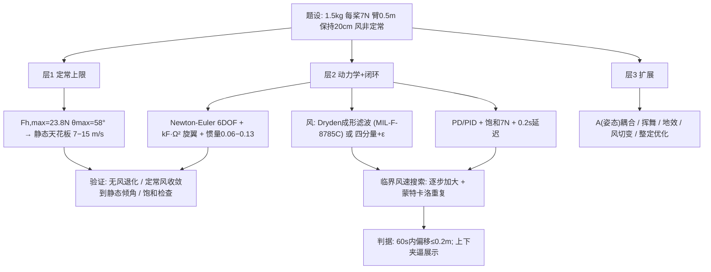

# 2020 题B：四旋翼无人机抗风稳定性（Quadcopter Stability in Wind）

> 赛题来源：UPC 2020 Problem B（当年 346 队投稿；题 B 金奖 2 队：同济大学 335、国防科技大学 380）

## 1. 题目原文与关键数据

**原文压缩引用**：
> We have designed a quadcopter UAV drone that has a **mass of 1.5 kg**, and is powered by **four rotors which can each generate up to 7 Newtons** of thrust. The rotors... are each centered **50 cm** from its center of mass, arranged in a square. Determine the **maximum windspeed for safe operation**, so that it can **stay within 20 cm of a target location**. Note that **real wind is not steady**, varying in magnitude and direction.

**中文翻译**：四旋翼无人机质量 1.5 kg，四个旋翼各能产生至多 7 N 推力，旋翼中心距质心 50 cm、呈方形布置。求其安全作业的最大风速——要求保持在目标点 20 cm 范围内。注意真实风并非定常，其大小与方向都在变。

**题面给定参数表**：

| 参数 | 数值 | 备注 |
|---|---|---|
| 质量 | 1.5 kg | 悬停总升力 14.7 N |
| 单旋翼最大推力 | 7 N | 总 28 N，**推重比 1.90**——题目给的核心余量 |
| 旋翼臂长 | 0.5 m | 反推整机尺寸 ~1 m → 迎风面积、转动惯量的唯一几何依据 |
| 位置精度 | 20 cm | 判据，需自行定义空间维度与持续时间 |
| 风的非定常性 | 题面明示 | **题眼**：只做定常力平衡第一步就偏题 |
| 未给定（须自定并论证） | $C_d$、迎风面积 $A$、旋翼半径、控制律、风谱/高度 | 全部自由参数都要给出来源 |
| 自取常数 | $\rho=1.225\ {\rm kg/m^3}$，$g=9.8$ | |

## 2. 题目到底在问什么（去模糊化）

1. **"maximum windspeed" 是谁的风速？** 平均风、阵风峰值、还是规范参考高度（MIL 规范用 20 ft 高度 $u_{20}$）的风速？不定义参考量，答案不可复核。335 队用 Dryden 的 $u_{20}$（临界 23 m/s，合成 10.63 m/s）；380 队用"基本风 $V_b$ + 变化因子 $\varepsilon$"（临界基本风 2.65 m/s，含阵风包络 5.30 m/s）。两种口径都成立，但必须写清。
2. **"stay within 20 cm" 是动态判据**：水平还是三维？持续多久？瞬时越界还是统计越界（如 60 s 内不超）？380 队明确定义"60 s 内水平偏移 ≤ 20 cm"。判据定义直接决定临界值。
3. **"safe operation" 的隐含约束**：推力矢量既要够顶风又不能超 7 N/旋翼——**电机饱和**必须进模型，否则控制器可以"要求"不存在的推力。
4. **题面最后一句是送分题眼**：真实风非定常 → 必须给风的时间结构建模（湍流谱或分量分解），把 20 cm 从静力学位移判据升级为**随机响应的包络判据**。评委区分论文档次的分水岭就在这一步。

## 3. 物理建模路线图

**层次 1：定常力平衡上限（30 秒手算，先立天花板）**

悬停每桨 $T_0=mg/4=3.675$ N（54% 满载）；总推力上限 28 N，最大水平推力
$$F_{h,\max}=\sqrt{28^2-(mg)^2}=\sqrt{784-216}=23.8\ {\rm N},\qquad \theta_{\max}=\arcsin(23.8/28)=58°.$$
风阻 $F_d=\tfrac12\rho C_dA v^2$；由 0.5 m 臂长估整机迎风 $A\approx0.3$–$0.6\ {\rm m^2}$、钝体 $C_d\approx0.3$–1.3 → $C_dA\approx0.18$–0.8。静态抗风天花板
$$v_{st}=\sqrt{\frac{2F_{h,\max}}{\rho C_dA}}\approx7\text{–}15\ {\rm m/s}.$$
任何超过此值的"抗风答案"都说明模型漏了饱和约束；而动态答案一定**低于**它。

**层次 2：动力学 + 闭环控制（主模型）**

- Newton-Euler 六自由度：$m\ddot{\vec X}=R(\varphi,\theta,\psi)\left(\sum_i \vec F_{Ti}+\vec F_w\right)+m\vec g$；$\sum\vec\tau=J\dot{\vec\omega}+\vec\omega\times J\vec\omega$（含反扭矩、风致力矩、陀螺项 $\vec\omega\times J_r\vec\Omega_r$）。
- 旋翼气动：$F_T=k_F\Omega^2$；悬停诱导速度 $V_d=\sqrt{F_T/(2\rho A_d)}$；有风时按动量理论 $F_R=F_T+2\rho A_dV_dV$（335 队， McCormick 教材），并自检无风退化。
- 惯量：机身理想化为边长 $2l=1$ m 匀质方板，$J_{xx}=J_{yy}=ma^2/12\approx0.125$（或 $ml^2/6\approx0.0625$，同量级），$J_{zz}$ 加倍。
- 风场：**Dryden 成形滤波器**（335）：三方向功率谱 + 一阶滤波 $G_u(s)=K_u/(T_us+1)$ 把白噪声"染色"，低空尺度/强度用 MIL-F-8785C 公式（见 §7）；或**四分量分解**（380：基本风 + 余弦阵风 + 渐变风 + 随机风），用单参数 $\varepsilon$ 压缩不确定性并得到闭式 $V_{\max}=(1+2\varepsilon)V_b$。
- 控制：四通道 PD/PID + **饱和** + 采样延迟（380 取 0.2 s，对应 5 Hz 传感器）；380 的"弹簧"类比（偏离 20 cm 时恰用满修正力 → 等效刚度 $k=F_{\max}/0.2=119$ N/m，$\omega_n=\sqrt{k/m}=8.9$ rad/s）值得抄。
- 稳定判据：60 s 内偏移 ≤ 0.2 m（或 N 次蒙特卡洛的 3σ 包络）。

**层次 3：可选扩展**：姿态-迎风面积耦合（倾斜时 $A$ 变）、旋翼挥舞与桨盘风载力矩、地面效应、阵风方向反转、风切变幂律剖面、传感器噪声、GA/Q-learning 整定。

## 4. 关键物理效应量级表

| 效应 | 估算量级 | 是否必须建模 | 估算依据 |
|---|---|---|---|
| 悬停单桨推力 | 3.675 N（54% 满载） | 必须 | $mg/4$ |
| 最大水平推力 / 倾角 | 23.8 N / 58° | 必须 | $\sqrt{28^2-(mg)^2}$ |
| 静态抗风天花板 | 7–15 m/s（$C_dA$ 0.18–0.8） | 必须 | $\sqrt{2F_h/(\rho C_dA)}$，动态答案必低于它 |
| 机身惯量 | $J_{xx}\approx0.06$–0.13 kg·m² | 必须 | 1 m 方板 $ma^2/12$ 或 $ml^2/6$ |
| 姿态机动能力 | $\tau_{\max}=7\times0.5=3.5$ N·m → $\alpha\approx30$–56 rad/s²，翻身 90° 仅 ~0.3 s | 建议 | $\tau/J$；对照阵风时间尺度 |
| 湍流强度（20 ft 低空） | $\sigma_w=0.1W_{20}$，$\sigma_u\approx0.19W_{20}$ | 必须（非定常题眼） | MIL-F-8785C 低空模型 |
| 湍流尺度 / 时间尺度 | $L_u\approx44$ m，$L_w\approx6$ m；$\tau=L_u/U\approx4.4$ s（$U=10$） | 必须 | MIL 低空公式；4.4 s ≫ 0.3 s → **控制不是瓶颈，推力上限与阻力才是** |
| 阵风增量气动力 | $\rho C_dA\,U\sigma_u\approx4$ N（$U=10$，$\sigma_u=1.9$，$C_dA=0.18$） | 建议 | 线性化 $\Delta F=\rho C_dA U\sigma$ |
| 悬停诱导速度 | ~3.5 m/s（$A_d=0.126$ m²，桨半径 0.2 m） | 可选 | 动量理论 $T=2\rho A_dV_d^2$ |
| 旋翼转速/推力系数 | $\Omega_{\max}\approx362$ rad/s，$k_F\approx5.3\times10^{-5}$ N·s² | 可选 | 335 队 $7/k_F=\Omega^2$ |
| 等效控制刚度 | $k\approx119$ N/m，$\omega_n\approx8.9$ rad/s | 建议 | 380 "弹簧"模型 $F_{\max}/0.2$ |

## 5. 求解算法与数值要点

- **数值框架**：12 维状态 $[x,y,z,\dot x,\dot y,\dot z,\varphi,\theta,\psi,p,q,r]$ 闭环 RK4 积分，步长 ≤ 0.01 s（$\Omega\sim360$ rad/s，步长必须远小于旋翼/控制带宽）；风由成形滤波器从离散白噪声生成。
- **临界值搜索**：参考风速逐步增大（步进或二分），每个风速跑 N 次蒙特卡洛（固定随机种子可复现），取越界概率/包络；**必做上下夹逼展示**——380 队用 2.65 与 2.66 m/s 两幅对照图证明临界值卡准，这是最省篇幅的说服力。
- **验证三件套**：① 无风退化到悬停平衡；② 定常风仿真应收敛到层次 1 的静态平衡倾角（$\tan\theta=F_d/mg$）；③ 检查控制输出是否触饱和（触饱和的风速就是硬上限）。
- **常见数值陷阱**：积分步长过大滤掉高频姿态动力学；PID 输出忘饱和出现"上帝之手"；风速直接加在机体坐标上而忘了旋转矩阵；湍流三个分量的尺度/强度取成同一组值（纵向与垂直方向差 7 倍）；把 20 cm 只在 z 方向检查。

## 6. 常见错误与陷阱

1. **定常风静态平衡交差**：只解 $\tfrac12\rho C_dAv^2=mg\tan\theta$——题眼"real wind is not steady"没接住，且答案必然偏高。
2. **参考风速不定义**：报一个"临界 10 m/s"却不说这是平均风、阵风还是 20 ft 高度参考值，评委无法复核。
3. **阻力面积拍脑袋**：不用 0.5 m 臂长反推几何（迎风面积、惯量全可从它估出），$C_dA$ 差 4 倍 → 答案差 2 倍。
4. **控制器无饱和/无延迟**：算出 30+ m/s 的"超能力"无人机——28 N 总推力早就封顶了。
5. **无上下夹逼**：只给临界值不展示两侧行为，数值可信度打折。
6. **参数无推导链**：$k_F$、$J$、$C_dA$ 不给来源；335 队的垂直轴定理推导与无风退化自检是低成本高回报的动作。

## 7. 全网参考与延伸

1. **MathWorks：Dryden Wind Turbulence Model (Continuous)**（[mathworks.com/help/aeroblks](https://www.mathworks.com/help/aeroblks/drydenwindturbulencemodelcontinuous.html)）——MIL-F-8785C 低空（<1000 ft）模型的尺度与强度公式及实现：$L_w=h$、$L_u=2L_v=h/(0.177+0.000823h)^{1.2}$（h 单位 ft）、$\sigma_w=0.1W_{20}$、$\sigma_u=\sigma_v=\sigma_w/(L_w/L_u)^{1/3}$。h = 20 ft 处 $L_u\approx44$ m、$L_w\approx6$ m——本文 §4 的数值全部由此复算，可直接搬进论文。
2. **NASA NTRS：Madden 2018《Verifying Implementation of the Dryden Turbulence Model》**（[ntrs.nasa.gov](https://ntrs.nasa.gov/api/citations/20190000875/downloads/20190000875.pdf)）——MIL-STD-8785C 与 MIL-HDBK-1797 两套参数的对照与实现验证方法，写"模型验证"一节时可引。
3. **Wikipedia：Dryden Wind Turbulence Model**（[en.wikipedia.org/wiki/Dryden_Wind_Turbulence_Model](https://en.wikipedia.org/wiki/Dryden_Wind_Turbulence_Model)）——谱函数形式及与 Von Karman 谱的对比。注意 380 队反向用它：论证"低空超低速场景不适合标准高空模型"后自建四分量风——**拒绝模板并给出理由**同样是加分动作。

## 8. 金牌论文思路对比

- **335（同济）**："标准工程路线"满分示范——Dryden 湍流 + Newton-Euler 六自由度 + 四路 PD 闭环 + $K_p/K_d$ 六组扫描图定参（$K_p$ 过大饱和、$K_d$ 过大高频振动），湍流只注入 [4,10] s 时间窗便于读图；临界 $u_{20}=23$ m/s → 合成风速 10.63 m/s，摘要-正文-结论三点一线。详见 [05_论文赏析/2020/2020-GM-B-335.md](../05_论文赏析/2020/2020-GM-B-335.md)。
- **380（国防科大）**："方法论原创"路线——先论证 Dryden/Von Karman 属高空模型而拒用，自建四分量自然风（基本/阵风/渐变/随机），用变化因子 $\varepsilon$ 把开放不确定性压成单参数并得闭式 $V_{\max}=(1+2\varepsilon)V_b$；仿弹簧比例反馈 + 0.2 s 采样延迟；理论 5.3678 vs 仿真 5.3487 m/s 双轨互验（偏差 0.4%）。详见 `2020-GM-B-380.md`。

## 9. 评分要点：评委想看什么

- [ ] 参考风速与"20 cm"判据有明确、可复现的定义（含空间维度与持续时间）。
- [ ] 先给定常天花板（层次 1 手算），再谈动态——展现物理直觉的阶梯，且动态答案必须落在天花板之下。
- [ ] 风的非定常性有谱或分量模型且注明出处/选型理由（用 Dryden 或拒绝 Dryden 都行，理由要硬）。
- [ ] 执行机构饱和（7 N）与动态（$J$、$\Omega_{\max}$）进入模型，控制输出有饱和检查。
- [ ] 临界风速上下夹逼 + 蒙特卡洛重复，答案对 $C_dA$ 等敏感参数有灵敏度。
- [ ] 参数推导链完整（$C_dA$、$J$、$k_F$ 从臂长 0.5 m 与动量理论出发），极限情形自检（无风退化）。
