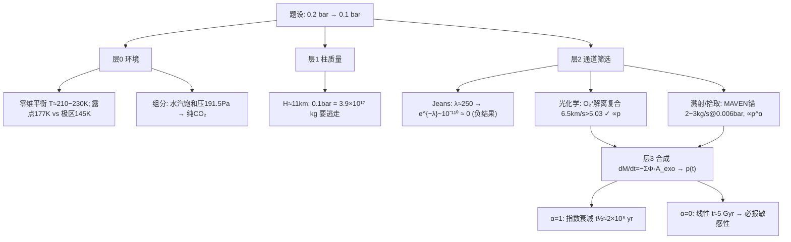

# 2021 题A：更厚的火星大气（A Thicker Martian Atmosphere）

> 赛题来源：UPC 2021 Problem A（当年 324 队投稿；题 A 金奖 2 队：同济大学 200、青岛大学 349）

## 1. 题目原文与关键数据

**原文压缩引用**：
> Suppose that we could increase the atmospheric pressure on the surface of Mars to **0.2 bar**, by vaporizing the polar caps and subsurface ice. This atmosphere would then likely decrease over time, as a result of **several processes, such as escape into space, and erosion by the solar wind**. **How would the surface pressure decrease as a function of time? How much time** would it take until the pressure is only **0.1 bar**?

**中文翻译**：假设通过蒸发极冠与地下冰，把火星表面气压提升到 0.2 bar。此后大气会因多种过程（如向太空逃逸、太阳风剥蚀）逐渐减少。问：表面气压如何随时间衰减？多久降到 0.1 bar？

**题面给定参数表**——题面只有两个数，其余全部要自取并论证：

| 参数 | 数值 | 来源/备注 |
|---|---|---|
| 初始气压 | 0.2 bar | 题给 |
| 终止气压 | 0.1 bar | 题给（判据） |
| 火星半径 / 重力 / 质量 | $R=3389.5$ km，$g=3.71\ {\rm m/s^2}$，$M=6.42\times10^{23}$ kg | 自取（标准值） |
| 逃逸速度 | $v_{esc}=5.03$ km/s | 自取 |
| 太阳辐照（日均） | $S=589\ {\rm W/m^2}$ | 定温度用 |
| 现今气压 | 0.006 bar | MAVEN/文献锚点，用于标定逃逸速率 |

## 2. 题目到底在问什么（去模糊化）

1. **"several processes" 是一张开放清单**：Jeans 热逃逸、流体动力学逃逸、光化学逃逸、太阳风溅射/离子拾取、撞击剥蚀、CO₂ 极冠再凝结、表壤吸附。建模任务分两步：先用量级估算**筛通道**（哪些值得算），再对保留通道定**通量-气压标度律** $\Phi(p)$——后者才是答案的决定者。
2. **$p(t)$ 的函数形状由标度律决定**：$\Phi=$ const → 线性下降；$\Phi\propto p$ → 指数下降 $p=p_0e^{-t/\tau}$。题面第一问"how would the pressure decrease as a function of time"问的是**形式**，"多久降到 0.1 bar"只是形式的一个读数——只交一个时间数不交函数形式的论文答了一半。
3. **隐含初始态必须自算**：温度（用零维温室模型）、组分（论证近似纯 CO₂——水汽饱和蒸气压极低）、标高。200 队"先算 $T=257.6$ K、再查 257.6 K 下水饱和蒸气压仅 191.5 Pa ≪ CO₂ 分压"的两步论证是范式。
4. **数值答案对假设极度敏感**（见 §4）：同一道题，金奖队给出 $8.6\times10^7$ 年（200）与 $7\times10^8$ 年（349），差 8 倍——根源正是逃逸通道权重与标度律不同。答案只有落在"区间 + 敏感性"里才有意义。

## 3. 物理建模路线图

**层次 0：环境先行（两条小计算撑起全部假设）**

零维辐射平衡 $T_s=\left[\frac{S(1-\alpha)}{4\sigma}\right]^{1/4}$（$\alpha\approx0.25$）≈ 210 K，加 CO₂ 温室修正至 ~215–230 K（200 队的单层温室模型给 257.6 K）。再由 Clausius–Clapeyron（$\Delta H_{sub}^{\rm CO_2}\approx25$ kJ/mol，沸点 194.7 K @1 atm）算 **0.2 bar 的 CO₂ 露点 ≈ 177 K**：高于全球均温（大气不会整体凝结，题设演化通道成立），但**低于极区冬夜 140–150 K** → 季节性极冠会再凝结，是应写进 caveat 的真实物理。

**层次 1：柱质量与静力学骨架**

标高 $H=kT/mg\approx11$ km（$T=210$ K，CO₂）；全球大气质量
$$M_{atm}=\frac{4\pi R^2p}{g}:\quad 0.2\ {\rm bar}\to7.8\times10^{17}\ {\rm kg},\quad 0.1\ {\rm bar}\to3.9\times10^{17}\ {\rm kg}.$$
**要逃掉的就是这 $3.9\times10^{17}$ kg**——所有通量模型最终都要换算回这个量。

**层次 2：三通道通量（自己动手筛）**

- **Jeans 热逃逸——负结果也要算给人看**：Jeans 参数 $\lambda=(v_{esc}/u)^2$，$u=\sqrt{2kT/m}$。取逸散层 $T\approx250$ K、$r_{exo}\approx R+200$ km（$v_{esc}=4.85$ km/s，$g=3.2$）：$u_{\rm CO_2}=307$ m/s → $\lambda\approx250$，通量 $\propto(1+\lambda)e^{-\lambda}\sim10^{-110}$——**死路**。对照：H 原子 $u=2030$ m/s → $\lambda\approx6$，逃得动但质量库可忽略。
- **光化学逃逸——能量判据筛选**：CO₂ 直接光解碎片动能 <1 eV → $v\approx3.5$ km/s $<v_{esc}$，不够；真正通道是**解离复合** $\mathrm{O_2^+}+e\to\mathrm{O}+\mathrm{O}$ 释放 6.96 eV、两 O 平分可达 3.48 eV → $v=\sqrt{2E/m_O}=6.5$ km/s $>5.03$ km/s ✓。通量 ∝ EUV 通量 × O₂⁺ 密度 ∝ $p$——这是线性标度的物理来源。
- **太阳风溅射/离子拾取——MAVEN 锚点**：现今总逃逸 2–3 kg/s（0.006 bar），其中太阳风直接剥离 ~100 g/s、CME 时 ×10–20。标度假设 $\Phi(p)=\Phi_0(p/p_0)^\alpha$，$\alpha=1$ 为最常用（349 队：0.2 bar → 3333 g/s）。

**层次 3：合成与扩展**：$\mathrm dM/\mathrm dt=-\sum_i\Phi_i\cdot A_{exo}$ → $p(t)=M(t)g/(4\pi R^2)$。扩展项：移动的逸散层（exobase 随大气变稀下移，200 队写入变系数 ODE）；双组分 H₂O+CO₂ 变平均分子量（349 队）；早期太阳 EUV 增强系数；极冠再凝结循环。

## 4. 关键物理效应量级表

| 效应 | 估算量级 | 是否必须建模 | 估算依据 |
|---|---|---|---|
| 0.1 bar 大气质量 | $3.9\times10^{17}$ kg | 必须 | $pA/g$，$A=4\pi R^2=1.44\times10^{14}$ m² |
| 标高 | 10.7 km（210 K） | 必须 | $kT/mg$，CO₂ $m=7.3\times10^{-26}$ kg |
| CO₂ Jeans 参数 | $\lambda\approx250$ → $e^{-\lambda}\sim10^{-110}$ | 必须（负结果） | $u=307$ m/s @250 K vs $v_{esc}=4.85$ km/s |
| O 解离复合碎片速度 | 6.5 km/s $>v_{esc}$ | 必须 | 6.96 eV 平分，$v=\sqrt{2E/m_O}$ |
| 光解直接碎片速度 | ~3.5 km/s $<v_{esc}$ | 建议（排除用） | <1 eV/碎片 |
| 现今逃逸锚点 | 总 2–3 kg/s；太阳风 100 g/s（CME ×10–20） | 必须 | MAVEN（见 §7） |
| **线性标度（α=1）半衰期** | $t_{1/2}=\ln2\,M_{0.006}/\dot M_0=\ln2\times(2.3\times10^{16}/2.5)=2.0\times10^8$ yr | 必须 | $k=\dot M_0/M_{0.006bar}=1.07\times10^{-16}\ {\rm s^{-1}}$ |
| **常速率（α=0）耗时** | $3.9\times10^{17}/2.5=4.9\times10^9$ yr | 必须（对照） | 答案区间 0.2–5 Gyr 全由 α 决定 |
| 0.2 bar CO₂ 露点 | 177 K vs 极区冬夜 140–150 K | 建议（caveat） | Clausius–Clapeyron，$\Delta H_{sub}\approx25$ kJ/mol |
| H 逃逸（对照） | $\lambda\approx6$，快但质量小 | 可选 | 验证模型方向（200 队 H₂ vs CO₂ 对照实验） |

**一句话参考答案**：$\Phi\propto p$ 时 $p(t)=0.2\,e^{-t/\tau}$ bar、$\tau=2.9\times10^8$ 年、$t(0.1\ {\rm bar})=2.0\times10^8$ 年；$\Phi=$ const 时 $t=4.9$ Gyr。金奖答案 0.086 Gyr（200，光化学主导、速率取值更激进）与 0.7 Gyr（349，仅太阳风 100 g/s 标度）都落在这条标度轴附近——**报告 α 的敏感性比报告单点答案更专业**。

## 5. 求解算法与数值要点

- **ODE 框架**：$\mathrm dp/\mathrm dt=-(g/4\pi R^2)\sum_i\Phi_i\cdot4\pi r_{exo}^2$——通量积分在**逸散层球面**上、质量换算回**表面**气压用柱质量，这个面积/单位链条是最大出错点。RK45（`ode45`，RelTol 1e-5）足够；时间跨度 $10^{15}$–$10^{17}$ s，用 Myr 作时间单位、对数间隔取点输出（349 队 $dt\in[0.1,18]$ 对数步长横跨 17 个量级）。
- **蒙特卡洛只用来定参数**：如 200 队先用 MC 统计太阳风粒子平均有效溅射数 $K=16$，再喂给确定论 ODE——不要拿 MC 直接跑一亿年。
- **验证四件套**：① 换气体重跑对照（H₂ 秒逃 vs CO₂ 纹丝不动，证明趋势正确）；② Jeans 公式取 $\lambda\to0$ 与 $\lambda\to\infty$ 两个极限核对渐近行为；③ α=0 与 α=1 两极端夹逼答案区间；④ 把现今 $p=0.006$ bar 代回模型，输出速率应还原 MAVEN 的 2–3 kg/s。
- **数值陷阱**：$e^{-\lambda}$ 指数下溢（先判 $\lambda>100$ 直接置零）；exobase 面积与表面积混用；平均分子量 $m(t)$ 与标高 $H(t)$ 忘随组分/温度演化；"年"用儒略年还是 365 天要统一。

## 6. 常见错误与陷阱

1. **给 CO₂ 算出非零 Jeans 通量**：没先估 λ 就代公式；$\lambda\approx250$ 意味着任何多项式前因子都救不了 $e^{-250}$。
2. **标度律不声明就外推 33 倍气压**：MAVEN 的 2–3 kg/s 是在 0.006 bar 测的，$\Phi\propto p$ 还是 $\Phi=$ const 差 25 倍——不报敏感性等于没答。
3. **只给 $t$ 不给 $p(t)$ 形式**：题面第一问就是"as a function of time"。
4. **忽略组分演化**：H/H₂ 逃得快 → 剩余大气变重变冷 → 标高与 exobase 漂移，长期积分里不可忽略。
5. **重复计费**：把"太阳风剥蚀"与"溅射"当两个独立通道相加（溅射正是太阳风驱动的次级过程），或把离子拾取算两次。
6. **温度/组分直接抄地球值**：火星 210 K 与 288 K 下露点、饱和压、Jeans 参数全不同，两条前置小计算不能省。

## 7. 全网参考与延伸

1. **LASP/MAVEN：MAVEN Reveals Speed of Solar Wind Stripping of the Martian Atmosphere**（[lasp.colorado.edu/maven](https://lasp.colorado.edu/maven/2015/11/05/maven-reveals-speed-of-solar-wind-stripping-martian-atmosphere)）——2015 年实测太阳风剥离约 **100 g/s**、CME 期间增强 10–20 倍。这是 349 队标度律（0.2 bar → 3333 g/s）的直接锚点，也可作为自己标度律的文献起点。
2. **Jakosky et al. 2018（Icarus）：Loss of the Martian atmosphere to space: Present-day loss rates**（[sciencedirect.com](https://www.sciencedirect.com/science/article/abs/pii/S0019103517306917)）——全火星年观测给出**现今总逃逸 2–3 kg/s** 及"按早期太阳活动回推，40 亿年丢掉大部分 CO₂ 与水"的结论：既是量级锚点，也是"模型回代自洽"的检验基准。
3. **NASA（2025-05）：MAVEN Makes First Observation of Atmospheric Sputtering at Mars**（[science.nasa.gov](https://science.nasa.gov/missions/maven/nasas-maven-makes-first-observation-of-atmospheric-sputtering-at-mars)）——溅射通道的首次直接观测：证明该通道真实存在、但现今很弱、早期太阳更活跃时更重要——正好支撑"通道排序 + 早期增强系数"的讨论节。

## 8. 金牌论文思路对比

- **200（同济）**：分层模型（Knudsen 数定 exobase）+ 三通道并行（**光化学 > 溅射 ≈ 1/10 > Jeans ≈ 0** 的权重结论）+ ODE 与蒙特卡洛配合（MC 统计溅射参数 $K=16$ 后喂 ODE）+ 逸散层随解移动的变系数处理；先算 $T=257.6$ K、再论证纯 CO₂；$8.6422\times10^7$ 年（摘要表述 70–90 Myr）。机制权重结论最完整。详见 [05_论文赏析/2021/2021-GM-A-200.md](../05_论文赏析/2021/2021-GM-A-200.md)。
- **349（青岛大学）**："少而精"标度律路线——排除法砍掉次要因素，只保留 MAVEN 100 g/s 线性标度（0.2 bar → 3333 g/s）+ 双组分 H₂O/CO₂ 变分子量隐式方程 + 基础模型→分层温度→变重力两级修正；约 $7\times10^8$ 年。数据锚定与递进叙事的代表。详见 `2021-GM-A-349.md`。
- 两队 8 倍的差异恰好演示了标度假设的主导性——自己写论文时应把这条敏感性轴显式画出来，而不是让评委替你发现。

## 9. 评分要点：评委想看什么

- [ ] 初始态有计算论证：温度（能量平衡/温室模型）与组分（饱和蒸气压）两步先行。
- [ ] 每条逃逸通道先做量级筛查再决定建模与否：Jeans 用 λ、光化学用能量判据——负结果（Jeans≈0）显式报告。
- [ ] 通量-气压标度律显式声明（$\Phi\propto p^\alpha$），并对 α 做敏感性扫描/给出答案区间。
- [ ] 双输出：$p(t)$ 的函数形式（线性 vs 指数）+ $t(0.1\ {\rm bar})$，且模型回代 0.006 bar 能还原 MAVEN 现今速率。
- [ ] 单位链条（exobase 通量 → 全球质量 → 表面气压）可逐级复核。
- [ ] caveat 到位：极冠再凝结（露点 177 K vs 极区 145 K）、组分演化、早期太阳 EUV 增强。
