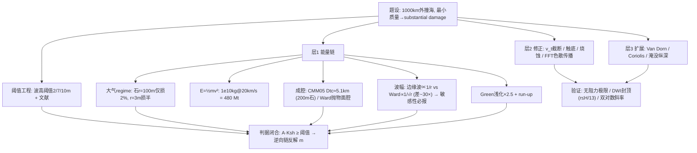

# 2021 题B：小行星撞击沿海城市（Asteroid Ocean Impact）

> 赛题来源：UPC 2021 Problem B（当年 324 队投稿；题 B 金奖 4 队：Harvey Mudd 216、国防科技大学 385、华沙大学 442 与 445）

## 1. 题目原文与关键数据

**原文压缩引用**：
> Consider the impact of an asteroid in the ocean, **1,000 km from a coastal city**. What is the **minimum mass** the asteroid would require in order to cause **substantial damage** to this city?

**中文翻译**：考虑一颗小行星在距沿海城市 1000 km 处撞击海洋。要对城市造成"实质性破坏"，这颗小行星最小需要多大质量？

**题面给定参数表**——题面只给了两个信息，其余全是自由参数：

| 参数 | 取值 | 备注 |
|---|---|---|
| 撞击点距城市 | 1000 km | 题给（唯一的空间尺度） |
| 破坏判据 | "substantial damage" | **全题题眼**，必须翻译成带文献的数值阈值 |
| 小行星密度 | 石质 2500–3000 / 铁质 7800 kg/m³ | 自选；"最小质量"应偏向有利组合 |
| 入射速度 | 11–30 km/s（最概然 ~17–19.3） | 自选并给出处 |
| 入射角 | 45° 最概然；90° 对成波最有利 | 自选并声明口径 |
| 海洋深度 | 深水 4–5 km | 需论证处于深水撞击（DWI）区 |
| 自取常数 | $\rho_w=1027\ {\rm kg/m^3}$，$g=9.8$ | |

## 2. 题目到底在问什么（去模糊化）

1. **"substantial damage" 必须先变成波高阈值**——这是开放题的胜负手。四支金奖队四种选择：2 m（216，引 Tinti 1993 / Reese 2007 / Ruangrassamee 2006 三篇灾害调查：2 m 毁木屋/砖房）、7 m（442，ITIS-2012 量表 D 类建筑 3–4 级破坏）、10 m（385，Watanabe 海啸等级 3 级）、10 m（445，自定并附历史数据讨论）。**阈值差 5 倍，答案就差一个量级**。
2. **"minimum mass" 有口径问题**：要么取"最有利于破坏"的参数组合（铁质、高速、垂直入射——385/442 的做法），要么取最概然值并声明——两种口径都对，但不声明就是缺陷。
3. **破坏通道要先排序**：热辐射、冲击风（超压）、地震震动、海啸四个候选，谁在 1000 km 处说了算？445 队的三行标度律论证最漂亮——冲击波球对称、强度 $\propto1/r^2$；海啸柱对称、振幅 $\propto1/\sqrt r$（或经验 $1/r$）；二者源能量相近 → 远场海啸必胜。442 队则逐一精算排除（热辐射需直径 >4.61 km、超压 ~1 kPa < 阈值、PGV <3 cm/s）。
4. **隐含物理链**：大气减速 → 撞击成腔 → 成波 → 色散传播 → 浅水放大 → 爬岸。每一环都有"是否可以忽略"的量级判断要做。

## 3. 物理建模路线图

**层次 1：解析骨架（能量链 + 两条经验波幅律）**

- **大气段先判 regime**：大气柱质量 $\rho_0H\approx10^4\ {\rm kg/m^2}$ 对比小行星面密度 $(4/3)\rho_a r$。指数大气解析减速（385 式(7)）：$v/v_0\approx\exp[-\tfrac34 C_d(\rho_0/\rho_a)(H/d)\sin^{-1}\theta]$，取 $C_d=0.9$、$H=8$ km：**石质 r=100 m 仅损 ~2%，r=20 m 损 ~10%，r=3 m 损半**。即本题答案区间（≥$10^9$ kg）基本处于"全速入水"区，但小质量端必须检查。
- **撞击能量**：$E=\tfrac12mv^2$；$10^{10}$ kg @ 20 km/s = $2\times10^{18}$ J ≈ 480 Mt TNT。
- **成腔**：Collins–Melosh–Marcus (CMM05) 经验式 $D_{tc}=1.365(\rho_a/\rho_w)^{1/3}d^{0.78}v^{0.44}g^{-0.22}\sin^{1/3}\theta$——**示例复算**：200 m 石陨石、20 km/s、45° → $D_{tc}\approx5.1$ km；Ward 抛物面腔模型（$\epsilon\approx0.15$）是替代方案（445）。
- **波幅（最大不确定源，两条文献定律并存）**：CMM 边缘波 $A(r)=\min(D_{tc}/14,H)\cdot\frac{3D_{tc}}{4r}$（$\propto1/r$；崩塌波衰减更快可略）；Ward 线性远场 $\propto1/\sqrt r$；实验室律（Gault & Sonett）$A=9700\sqrt{E_{kt}}/r$（$E$ 单位 kt，$r$ 单位 m）。两条定律在 1000 km 处可差 ~一个量级——**必须报告对定律选择的敏感性**。
- **浅化与爬岸**：Green 定律 $A\propto h^{-1/4}$：4 km → 100 m 水深放大 $\times2.5$；run-up 再 ×2–3。
- **判据闭合**：$A(1000\ {\rm km})\times K_{shoaling}\ge$ 阈值 → 反解 $m$。385 队的"逆向链"（等级 → 岸边波幅 → 1000 km 波幅 → 动能 → 质量）配合流程图是最清晰的呈现方式。

**层次 2：必要修正**：入水速度取 $\max(v, v_{terminal})$ 截断（442，防小质量端外推失真）；空腔触底处理（445：腔深 > 水深时海底成坑）；烧蚀（445 从变质量牛顿定律自推并对接 Chyba 1993）；波的色散传播（445 用 FFT 谱方法按 $\omega^2=gk\tanh(kH)$ 演化，并在双对数图上数值复现 $1/\sqrt r$）。

**层次 3：可选扩展**：Van Dorn 效应（撞击海啸在陆架外破碎/陷波，可能高估）；Coriolis；斜入射与空爆分支；地形与淹没纵深（445 额外给出 715 m，"第三输出量"加分）。

## 4. 关键物理效应量级表

| 效应 | 估算量级 | 是否必须建模 | 估算依据 |
|---|---|---|---|
| 大气减速 regime | 石质 r=100 m 损 ~2%、r=20 m ~10% | 必须（先判） | $\exp[-\tfrac34C_d(\rho_0/\rho_a)(H/d)]$，柱质量 $10^4$ kg/m² |
| 撞击能量 | $10^{10}$ kg @20 km/s = $2\times10^{18}$ J ≈ 480 Mt | 必须 | $\tfrac12mv^2$ |
| 瞬态腔径 | 200 m 石 @20 km/s、45° → $D_{tc}\approx5.1$ km | 建议 | CMM05 代入复算（见 §3） |
| 初始边缘波幅 | $\min(D_{tc}/14,H)\approx370$ m（腔缘处） | 建议 | CMM05；1000 km 处按 $1/r$ 得 ~1.4 m |
| **衰减定律分歧** | $1/r$ vs $1/\sqrt r$：1000 km 处差 ~$\sqrt{1000}\approx30$ 倍 | 必须（主导不确定度） | CMM/实验室律 vs Ward 线性理论 |
| **复现 216 链条（验证示范）** | $m=10^9$ kg、$v_f=19.34$ km/s → $E=4.5\times10^4$ kt → $A=9700\sqrt E/r=2.0$ m @1000 km = 其 2 m 阈值 | 必须（自检范本） | 实验室律逐字复算，与其结果自洽 |
| Green 浅化 | $\times(4000/100)^{1/4}=2.5$ | 建议 | $A\propto h^{-1/4}$ |
| 传播时间 | $c=\sqrt{gh}\approx200$ m/s → 1.4 h | 可选 | 深水重力波 |
| 阈值文献 | 2 m 毁木屋 / 7 m D 类建筑 3–4 级 / 10 m Watanabe 3 级 | 必须 | 三套量表对应三档答案 |
| 答案区间 | $10^9$–$1.7\times10^{11}$ kg（四支金奖队） | 必须 | 阈值×衰减定律主导；区间即结论 |

## 5. 求解算法与数值要点

- **主线几乎全解析**（幂律 + 逐步反解），数值只出现在三处：大气减速 ODE（`ode45`，配无阻力能量守恒上限 $v_e=\sqrt{v_0^2-2GM_E(1/r_E-1/(r_E+y_0))}$ 做渐近校验——216 队大质量端数值解收敛到同一 19340 m/s）；参数网格扫描（密度 × 角度 × 质量 log 网格，442）；波场 FFT 演化（445，$10^5$–$5\times10^5$ 空间格点）。
- **反解用"逆向链"**：阈值 → 岸边波幅 → 1000 km 波幅 → 腔径 → 动能 → 质量，每步一个可独立检验的代数式；配一张流程图（385 的 Figure 6 范式）评委 30 秒抓住主线。
- **验证四件套**：① 无阻力极限校核大气 ODE；② DWI 判据封顶（$r_A\le$ 水深/13，216 用它把扫描上限定在 $10^{12}$ kg——先论证有效域再遍历）；③ 双对数图核对衰减斜率（1/r 还是 1/√r）；④ 阈值上下各取一个质量做"越界/不越界"对照图。
- **数值陷阱**：波高 = 2×振幅，阈值用的哪个要统一；经验公式常数的单位约定（216 的 9700 隐含 E 用 kt、r 用 m）；log 网格上反解的插值精度；把撞击点水深当成岸边水深。

## 6. 常见错误与陷阱

1. **"substantial damage" 不定义或无文献**——答案失去可评判性；只用一句"取 2 m"而不引灾害文献，阈值工程不及格。
2. **用地震海啸直觉套撞击波**：地震海啸波长极长、能量 $\propto1/r$ 稀释；撞击波是色散波列，边缘波 $1/r$ 与线性远场 $1/\sqrt r$ 的适用范围要交代，不能混用。
3. **忘记"最小"**：不取有利参数组合（铁、高速、垂直）也不声明口径，"minimum"无从谈起。
4. **小质量端不查大气减速**：$10^7$–$10^9$ kg 石陨石已进入减速区，末速不再是 20 km/s，能量账全错。
5. **振幅/波高/run-up 三者混用**；或能量-波耦合效率（385 取 20% 入水）拍脑袋无出处。
6. **只答一个魔法数字**：不报对阈值、密度、角度、衰减律的敏感性——本题金奖答案横跨两个量级，敏感性就是结论本身。

## 7. 全网参考与延伸

1. **Robertson & Gisler 2019（Planet. Space Sci.）：Near and far-field hazards of asteroid impacts in oceans**（[sciencedirect.com](https://www.sciencedirect.com/science/article/pii/S0094576517314996)）——现代数值模拟：远场波幅更接近 $1/r$ 衰减、500 m 以下小天体深水撞击的危害低于早期线性理论估计。用于对冲 Ward $1/\sqrt r$ 的高估，是"敏感性讨论"的现成弹药。
2. **Korycansky & Chapman 2005：Offshore breaking of impact tsunami: the Van Dorn effect**（[boulder.swri.edu](https://www2.boulder.swri.edu/~cchapman/tsukl05.pdf)）——撞击海啸在陡陆架外缘破碎/能量陷存，线性外推到岸边可能高估波高——写 caveat 与扩展节的最好素材（442 队也点名了此效应）。
3. **Ward & Asphaug：Asteroid impact tsunami of 2880 March 16**（[academia.edu](https://www.academia.edu/110289095/Asteroid_impact_tsunami_of_2880_March_16)，另见亚利桑那大学 Chesley & Ward 概率评估页 [experts.arizona.edu](https://experts.arizona.edu/en/publications/asteroid-impact-tsunami-a-probabilistic-hazard-assessment)）——抛物面空腔 + Fourier 积分解 + 深水色散关系 $\omega^2=gk\tanh(kH)$ 的原始出处（445 队主干），想走"真波场模拟"路线从这里入手。
4. **Kharif & Pelinovsky 2005（C. R. Physique）：Asteroid impact tsunamis**（[academie-sciences.fr](https://comptes-rendus.academie-sciences.fr/physique/item/10.1016/j.crhy.2004.12.016.pdf)）——综述：生成机制分类与远场最大波幅 $r^{-1}$ 衰减的结论，适合做引言与"多机制排序"的权威支撑。

## 8. 金牌论文思路对比

- **216（Harvey Mudd，2 人队）**：变速入大气 ODE（16 颗实测小行星密度加权拟合 2481 kg/m³、标准大气 $R^2=0.9975$）+ 实验室波幅律 + 三文献交叉定义 2 m 阈值 + DWI 封顶扫描域 → $10^9$ kg。数据驱动与守恒上限校验是范本。详见 `05_论文赏析\2021\2021-GM-B-216.md`。
- **385（国防科大）**：逆推链可视化（Watanabe 3 级 10 m → 1000 km 处 1.3 cm → 波能积分 → 动能 → 质量），铁质垂直入射、烧蚀解析律（入大气前质量为落海时 2.03 倍）、Stokes 二阶波浅化 → $4.05\times10^{10}$ kg。解题路线图呈现的典范。详见 `2021-GM-B-385.md`。
- **442（华沙）**：四效应逐一排除（热辐射需 d>4.61 km、超压 ~1 kPa、PGV<3 cm/s）→ 锁定海啸；CMM05 公式体系 + 7 m（ITIS D 类）阈值 + 密度×角度参数网格 → 最有利条件 $1.7\times10^{11}$ kg。论证架构最严密，"为什么只算海啸"从假设升级为定理。详见 `2021-GM-B-442.md`。
- **445（华沙）**：变质量烧蚀自推并对接 Chyba 1993 + Ward 抛物面腔 + FFT 谱方法演化波场并数值复现 $1/\sqrt r$ + Green 爬岸 → $10^{10}$ kg（r≈97 m），附淹没纵深 715 m。数值含量最高、标度律排除法最省笔墨。详见 `2021-GM-B-445.md`。
- **四队答案跨 $10^9$–$1.7\times10^{11}$ kg 两个量级**，根源是阈值（2/7/10 m）与衰减定律（1/r vs 1/√r）——这本身就是本题最深的物理教训：开放题的"答案"是区间加论证。

## 9. 评分要点：评委想看什么

- [ ] "substantial damage" → 带文献出处的波高阈值，且说明选该建筑类别/等级的理由。
- [ ] 多效应排序或排除（海啸 vs 冲击波 vs 热 vs 地震）：量级论证即可，但要形成闭环。
- [ ] 大气段 regime 判定（减速与否）+ 入水速度有出处；小质量端有终端速度截断。
- [ ] 波幅定律注明出处与适用范围，答案对定律/阈值/角度做敏感性（网格或曲线）。
- [ ] "最小"口径声明（最优参数组合 vs 最概然值），扫描前用物理判据（DWI）封顶有效域。
- [ ] 验证证据：无阻力极限校核、双对数斜率核对、阈值上下夹逼；有余力给第二输出量（半径、到达时间、淹没纵深）。
