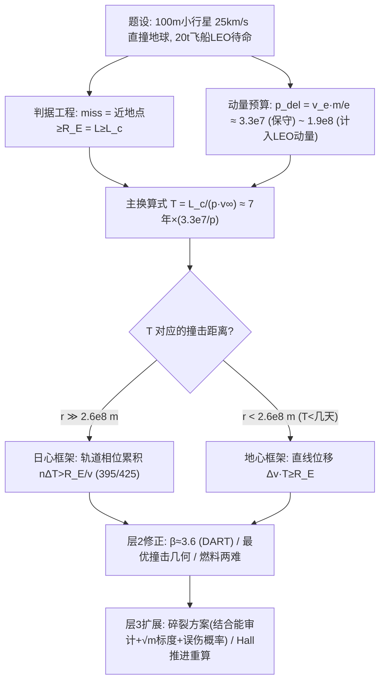

# 2022 题A：偏转小行星（Deflecting an Asteroid）

> 赛题来源：UPC 2022 Problem A（当年 417 队投稿；题 A 金奖 4 队：多伦多大学 346、同济大学 395、华沙大学 425、上海交大 460）

## 1. 题目原文与关键数据

**原文压缩引用**：
> Consider an asteroid with a diameter of **100 meters** on a trajectory to **directly impact** the Earth at a speed of **25 km/s**. To deflect this asteroid, we put a spacecraft into **low Earth orbit** with a mass of **20,000 kg**, including both fuel and spacecraft. **How much time before Earth impact** would our craft need to hit the asteroid, to make it miss the Earth?

**中文翻译**：一颗直径 100 m 的小行星正以 25 km/s 的速度直撞地球。为使其偏离，我们将一艘总质量 20,000 kg（含燃料）的飞船送入近地轨道。飞船需要提前多久撞击小行星，才能让它错过地球？

**题面给定参数表**——只有 4 个数，其余全是自由参数：

| 参数 | 取值 | 备注 |
|---|---|---|
| 小行星直径 | 100 m | 体积给定，密度自选 |
| 撞地速度 | 25 km/s | "directly impact"暗示瞄准精度高（碰撞参数小） |
| 飞船总质量 | 20,000 kg（含燃料）| 已在 LEO 待命；质量怎么"花"是全题核心自由度 |
| 待求量 | 提前量 $T$ | 撞击时刻距地球撞击还有多久 |
| 自选 | 小行星密度 | C 型 1380 / S 型 2700 / M 型 5320 kg/m³ |
| 自选 | 推进比冲 $v_e$ | 化学 4.4–4.6 km/s；霍尔推进 20–50 km/s |
| 自选 | 动量增强因子 $\beta$ | 溅射物反冲，DART 实测约 3.6 |
| 自选 | "miss"判据 | 近地点 $\ge R_E$（大气 ~100 km 可忽略） |

## 2. 题目到底在问什么（去模糊化）

1. **"directly impact"**：最坏情形是瞄准地心（$D=0$，初始角动量为零）——这是必须显式选取的"设计工况"。425 队反其道行之：把所有可能轨道参数化成单变量 $\phi$ 再扫描，两种处理都合法，但不声明就是缺陷。
2. **"make it miss the Earth"**：必须翻译成守恒量判据。"错过"= 近地点 $r_p \ge R_E$；考虑引力聚焦 $b^2=r_p^2\left(1+\frac{2GM_E}{r_p v_\infty^2}\right)$，换成擦地临界角动量
$$L_c = M_a R_E v_\infty\sqrt{1+\frac{v_{esc}^2}{v_\infty^2}},\qquad \frac{v_{esc}^2}{v_\infty^2}=\Big(\frac{11.2}{25}\Big)^2\approx0.20$$
即 $L_c\approx1.1\,M_a R_E v_\infty$——**引力弯折在 25 km/s 下只是 ~10% 的修正**，但这一行不写，判据就是悬空的。
3. **"how much time"**：提前量 $T$ 的物理载体是"在多远处注入动量"。撞击点距地 $r$、小行星近匀速飞行，则 $T \approx r/v_\infty$；于是问题变成"冲量必须在哪里施加"。
4. **"a spacecraft ... 20,000 kg"**：题目最大的暗坑——这 20 吨里有多少能变成**作用在小行星上的冲量** $p_{del}$？先逃逸再机动（460 口径）、从静止最优燃烧（346 口径）、还是利用日心俯冲叠加公转速度（395 口径），答案可差 30 倍。**本题本质是一道"动量预算记账"题**。
5. 隐含的第二输出：偏转方案是否有"后悔药"（碎裂）、推迟一圈能否更省（多圈相位累积）。

## 3. 物理建模路线图

**层次 1：解析骨架（冲击量 ↔ 提前量的换算链）**

- 质量：$M_a=\frac{\pi}{6}D^3\rho$。取 $\rho=2000$ kg/m³ 得 $M_a=1.05\times10^9$ kg。
- 错过判据（角动量语言）：撞击在垂直视线方向注入 $\Delta L=p\cdot r$（最优方向 $\phi=90°$），要求 $\Delta L\ge L_c$。
- 飞船可传递动量：完全非弹性撞击，$p_{del}$ 上限由火箭方程对 $p=m\,u$ 求极值。从静止开始烧：$\frac{dp}{dm}=u-v_e=0\Rightarrow u=v_e$，得 $p^*=v_e m_0/e$（$v_e=4.5$ km/s、$m_0=2\times10^4$ kg 时 $p^*=3.3\times10^7$ N·s）；计入 LEO 初速的口径 $p^*=v_e m_0 e^{u_0/v_e-1}\approx1.9\times10^8$ N·s。
- **主换算式（本题最值得带走的一行）**：
$$T_{min}\approx\frac{r_{min}}{v_\infty}=\frac{L_c}{p_{del}\,v_\infty}\approx2.2\times10^8\ {\rm s}\times\frac{3.3\times10^7}{p_{del}}\times\frac{\rho}{2000}\ (v_e=4.5\ {\rm km/s})$$
即"**每 3.3×10⁷ N·s 的可传递动量约换 7 年提前量**"（$\rho=2000$）。代入各口径：保守 $p_{del}=3.3\times10^7$ → 5–7 年（460 得 14 年，因其先扣了逃逸燃耗）；计入 LEO 动量 $1.9\times10^8$ → 约 1.2 年；乘 $\beta=3.6$ → 约 4 个月。等价的直线判据 $\Delta v\cdot T\ge R_E$（$T=1$ 年需 $\Delta v=0.2$ m/s）给出同一量级。

**层次 2：必要修正**

- **日心框架切换（必须做）**：地球引力主导半径 $r_{SOI}=\sqrt{M_E/M_\odot}\,{\rm AU}\approx2.6\times10^8$ m，对应单程仅 ~3 小时航程。只要 $T\gtrsim$ 几天，撞击点就远在太阳主导区，地心直线外推自相矛盾——395 队"先立地心模型、再算出 $F_\odot/F_E=10^4$ 自我推翻"是范本。
- **轨道相位累积**：日心系里小冲量改半长轴 $\Delta a/a=2\Delta v/v$，到达相位提前 $\delta\phi\approx\frac{3}{2}\frac{\Delta a}{a}\frac{t}{T_{orb}}2\pi$，沿轨位移 $a\,\delta\phi$ 可数倍于直线位移 $\Delta v\cdot t$——425 队的判据 $n\Delta T>R_E/v$ 是其单圈版本。
- **溅射增强 $\beta$**：DART 实测 $\beta\approx3.6$（预期 2.2–4.9），直接把 $p_{del}$ 乘上去；$T\propto1/\beta$。
- **落时修正**：引力加速使末段快于 $v_\infty$，修正量 $\sim GM_E/(rv_\infty^2)\ll1$，可略。

**层次 3：可选扩展**

- 最优撞击几何（近日点、顺小行星速度方向，425 的双扫掠）；Hall 推进 $v_e=50$ km/s 重算全链（460：0.67 年）；
- 碎裂方案：引力结合能 $\frac{3GM_a^2}{5R}\sim4\times10^5$ J ≪ 撞击动能 $\sim6\times10^{12}$ J，五个量级差允许"碎块自由飞散"模型；能量按 $\sqrt{m/M}$ 标度分配使碎块散开半径 $\sim\sqrt{M/m_{sat}}\,R_E$（346），代价是越晚撞碎块坠地概率越高。

## 4. 关键物理效应量级表

| 效应 | 估算量级 | 是否必须建模 | 估算依据 |
|---|---|---|---|
| 小行星质量 | $7.2\times10^8$–$1.9\times10^9$ kg（C/S/M 型） | 必须 | $\frac{\pi}{6}D^3\rho$，答案 ∝ ρ |
| 小行星动能 | $\sim3.3\times10^{17}$ J ≈ 79 Mt TNT | 背景量 | $\frac12Mv^2$，用来说明"拦截不可能" |
| 动量比 $p_{del}/(M_av_\infty)$ | $\sim10^{-6}$–$10^{-5}$ | 必须 | 只能侧推偏转，不能顶停 |
| 可传递动量 $p_{del}$ | $1.7\times10^7$（先逃逸，460）→ $3.3\times10^7$（346）→ $\sim10^8$–$10^9$（日心俯冲，395） | **必须（全题最大分歧点）** | 火箭方程 $p^*=v_em/e$ + 口径选择 |
| 引力聚焦 | $(v_{esc}/v_\infty)^2=0.20$ → $L_c$ 增 ~10% | 应查 | $b^2=r_p^2(1+2GM_E/(r_pv^2))$ |
| 太阳引力主导距离 | $2.6\times10^8$ m ≈ 3.8 h 航程 | 必须（决定框架） | $r_{SOI}=\sqrt{M_E/M_\odot}\,$AU |
| 轨道相位累积 | 半圈可积累 ~$10^3$ s × $v_\oplus$ ≈ 数 $R_E$ | 建议（日心框架下） | $\delta\phi=\frac32\frac{\Delta a}{a}nt$ |
| 落时引力加速 | $GM_E/(rv_\infty^2)\sim6\times10^5/r$ m ≪ 1 | 可略 | 能量守恒 $v(r)=\sqrt{v_\infty^2+2GM_E/r}$ |
| β 溅射增强 | 2.2–4.9（实测 ~3.6）→ $T$ 缩短同倍 | 强烈建议 | Cheng 2023 (Nature) |
| 答案谱系 | 58 天 – 14 年（四支金奖队） | 必须 | 口径×β×框架共同决定 |

## 5. 求解算法与数值要点

- **解析主线足够拿高分**：$L_c$ 判据 + $p^*$ 对数极值 + 落时闭式积分（$\sinh^2\zeta=v_\infty^2s/2GM_E$ 代换，346）——三步全是手算，无数值也能成文。
- **需要数值时**：Verlet 积分（时间可逆，与哈密顿系统匹配，425）或 RK45；"求最近可行撞击点"用二分法；轨道族用单参数扫描 + 开普勒第三定律把 $\Delta a$ 换算 $\Delta T$。
- **验证四件套**：① 量纲 sanity check（$r>\sqrt{M/m_{sat}}\,R_E$，346 的降阶对照）；② 双框架互查（直线判据 vs 日心判据应同量级）；③ 最优条件的物理解释（$u=v_e$ 之后烧反而损失惯性系动量——废气在静止系中向前喷）；④ 对 $\rho$、$v_e$、$\beta$ 各取两端重算。
- **数值陷阱**：把 LEO 速度当"免费动量"却不检查方向是否能对准小行星；逃逸燃耗是否从 20 t 里扣没有统一口径就中途换账本；长弧段积分用非辛算法累计能量漂移；$\theta$ 扫描步长太粗导致极值是"读图极值"。

## 6. 常见错误与陷阱

1. **把"偏转"做成"拦截"**：动量比 $10^{-6}$，正面顶停（$\Delta v\sim25$ km/s）需要 $10^5$ 艘飞船——不先做标度分析就动手，全盘皆输。
2. **忘记太阳**：提前量答案落在月地距离之外时，地心二体模型不自洽；395 的"自我纠错循环"正是为此设的。
3. **燃料双记账**：同一批燃料既当动量源又当轨道机动代价，或者反过来既扣逃逸又扣撞击——账本要一以贯之并明说口径。
4. **忽略 $\beta$ 或把它当精确值**：$\beta$ 从 1 到 3.6 直接改答案 3.6 倍，应给区间而非单点。
5. **"miss"判据不显式**：不说清是近地点 $\ge R_E$ 还是"错开一个地球半径"、是否含引力聚焦，评委会追问到底。
6. **只报一个魔法数字**：本题金奖答案跨 58 天–14 年，对密度/比冲/β/框架的敏感性本身就是结论的一部分。

## 7. 全网参考与延伸

1. **Cheng et al. 2023, "Momentum transfer from the DART mission kinetic impact", Nature**（[nature.com](https://www.nature.com/articles/s41586-023-05878-z)）——DART 撞击 Dimorphos 的动量增强因子预期 2.2–4.9、实测约 3.6，轨道周期缩短 32–33 分钟。是 $\beta$ 取值与"动能撞击可行"的一手定标，直接进论文参考文献。
2. **JHU APL 官方发布：DART validates impact method**（[jhuapl.edu](https://www.jhuapl.edu/news/news-releases/230301-dart-validates-impact-method-nature-release)）——给出 $\Delta v\approx2.7$ mm/s 的实测偏转量，可用来给自己的 $\Delta v$–$T$ 换算做量级对照。
3. **Wikipedia: Double Asteroid Redirection Test**（[en.wikipedia.org](https://en.wikipedia.org/wiki/Double_Asteroid_Redirection_Test)）——任务时间线、飞船 570 kg/6.1 km/s 撞击参数，适合作"以真实任务定标"章节的数据源。
4. **NASA JPL: DART mission changed orbit of Didymos**（[jpl.nasa.gov](https://www.jpl.nasa.gov/news/nasas-dart-mission-changed-orbit-of-asteroid-didymos-around-sun)）——日心轨道变化的官方口径，支撑"偏转效应要在日心系里审计"的框架论证。

## 8. 金牌论文思路对比

- **346（多伦多）**：两个"失败方案"（着陆烧掉 99% 质量、系绳 5000 倍缆绳）一行公式证伪 → 角动量判据 + $p^*=v_em_0e^{u_0/v_e-1}$ → **4.8 年**（$3.8\times10^9$ km）；再以结合能审计转入碎裂方案得 14.6 小时，并用 200 碎块蒙特卡洛给出误伤概率曲线。方案空间全覆盖的范本。详见 `05_论文赏析\2022\2022-GM-A-346.md`。
- **395（同济）**：以撞点速度方向角 $\theta$ 单参数化轨道族，用轨道能量符号切成椭圆（周期回归、动能撞击无解）/双曲（数值搜索可解）两支；中途发现太阳引力主导、自我纠错换日心框架；MATLAB 二分法 + 逐度扫描得 **58–139 天**（结论依赖撞点速度与相位累积的乐观组合）。前提自检的范本。详见 `2022-GM-A-395.md`。
- **425（华沙）**：反问题思维——从地球反向发射 25 km/s 虚拟天体，单参数 $\phi$ 穷举所有撞地轨道；DART 实测定标动量、$\beta\sim8.4$；开普勒第三定律一阶展开得周期提前量，判据 $n\Delta T>R_E/v$ 给 **0.1–0.7 年**。判据最透明。详见 `2022-GM-A-425.md`。
- **460（上海交大）**：全程解析零模拟，标度分析贯穿（$p/P\sim10^{-6}$ 定侧推、大气标高 $H$ 等效半径）；逃逸先扣燃料再取 $p^*=v_rm_1/e$，得化学推进 **14 年**、霍尔推进 **0.67 年**，并坦承前者"不令人满意"。误差控制最干净。详见 `2022-GM-A-460.md`。
- **四队横跨 58 天–14 年**，根源正是 §3 的三个口径（动量预算、$\beta$、地心/日心框架）——把这层"为什么答案不同"讲清楚，比多算十页更得分。

## 9. 评分要点：评委想看什么

- [ ] "miss" 操作化为显式判据（近地点判据 + 引力聚焦修正 $L_c$ 或等价形式），并指出最坏瞄准工况。
- [ ] 动量预算口径自洽：20 t 如何在逃逸/机动/撞击间分配，$p^*$ 极值有推导和物理解释。
- [ ] 框架自检：给出太阳 vs 地球引力的主导半径，并据此选择地心或日心模型（有自我纠错更佳）。
- [ ] $\beta$ 与小行星密度有文献出处，答案对其做敏感性（区间或曲线）。
- [ ] 提前量的换算链闭合：$p_{del}\to r_{min}\to T$，含落时/轨道相位等修正的取舍理由。
- [ ] 至少一个超越主线的增值项：碎裂方案+风险量化、多圈累积、推进方式对照，或真实任务（DART）定标。
