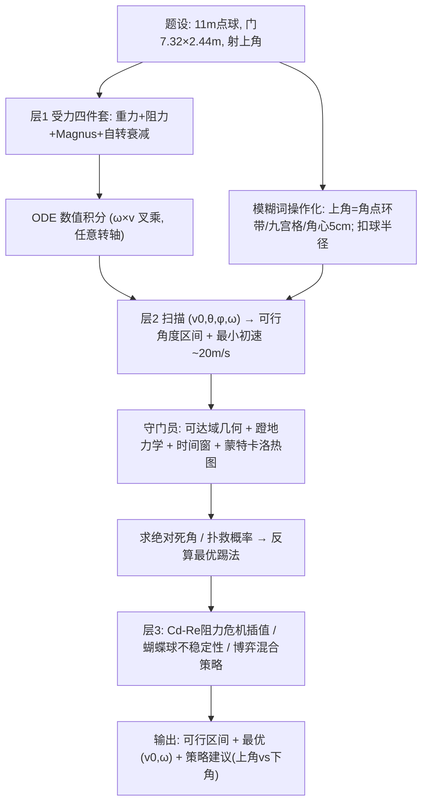

# 2022 题B：点球最优策略（FIFA Penalty Kicks）

> 赛题来源：UPC 2022 Problem B（当年 417 队投稿；题 B 金奖 3 队：同济大学 358、国防科技大学 471 与 480）

## 1. 题目原文与关键数据

**原文压缩引用**：
> When a penalty kick is taken, one player takes a single shot at the goal, defended only by the goalkeeper. The ball is at the penalty mark, **11 m** from a goal **7.32 m wide and 2.44 m tall**. To avoid the goalkeeper, the shooter often aims for an **upper corner**. **What initial ball velocities and spins** will result in a successful shot to an upper corner? **What initial ball velocity and spin** should the shooter attempt to create to have the **best chance** of avoiding the goalkeeper and making the goal?

**中文翻译**：点球由一名球员主罚，只由对方守门员防守。球放在距球门 11 m 的罚球点，球门宽 7.32 m、高 2.44 m。为避开守门员，射手常瞄准上角。问：哪些初速度与自转能把球射入上角？为最大化"躲开守门员且进球"的概率，射手应创造多大的初速度与自转？

**题面给定参数表**：

| 参数 | 取值 | 备注 |
|---|---|---|
| 罚球点距球门 | 11 m | 题给 |
| 球门 | 7.32 m × 2.44 m | 题给 |
| 瞄准区 | "上角" | **模糊词**，需操作化定义 |
| 球质量/半径 | 0.43 kg / 0.11 m（FIFA 规则 410–450 g） | **题面未给**，必须自己引入并给出处 |
| 空气 | $\rho\approx1.2$ kg/m³，$\mu\approx1.8\times10^{-5}$ Pa·s | 自取 |
| 待求 | $(v_0,\ \vec\omega)$ 的可行集合 + 最优策略 | 两问递进 |

## 2. 题目到底在问什么（去模糊化）

1. **"upper corner" 要变成可计算区域**：三支金奖队三种定义——上角角点外 1–2 倍球半径的环带（480）、九宫格顶部两格（358）、距上角中心 < 0.05 m（471）。定义决定可行域大小，必须显式声明。
2. **"successful shot" 是双条件**：球过门线平面时在门框内（**扣除球半径**：$0.11<x<7.21$、$z<2.33$）且未被扑到。漏掉球半径是高频硬伤。
3. **"what velocities and spins" 问的是集合不是点**：应输出 $(v_0,\theta,\phi,\omega)$ 空间中的可行区间/区域（358 给出 $\theta\in[76.7°,79.8°]$ 一类区间），只给一个"最优踢法"等于少答了半问。
4. **"best chance" 必须引入对手模型**：守门员可达域 + 时间窗 + 概率（358 的蒙特卡洛、471 的扑救时间约束、480 的最大防守面积），或引入真实统计（480 用 2002–2018 世界杯数据反把目标区改到下角）。这是本题从"弹道题"升级为"决策题"的关键一步。
5. **自转是三维矢量**：绕竖直轴的侧旋出弧线（香蕉球），水平轴旋转产生升/坠（电梯球近乎无旋时是不规则蝴蝶球）——把 $\vec\omega$ 当标量或只留一个分量会丢分。

## 3. 物理建模路线图

**层次 1：旋转球飞行动力学（四件套受力）**

- 重力 $m\vec g$ + 浮力（占比 $10^{-3}$，可略）+ 阻力 $\vec F_D=-\frac12\rho C_d A v\,\vec v$ + Magnus 力 $\vec F_M=\frac{8}{3}\pi\rho r^3\,\vec\omega\times\vec v$（Kutta–Joukowski 型，叉乘形式天然支持任意转轴）。
- 运动方程无解析解，写成三个二阶 ODE 数值积分。自转衰减可先纳入再舍弃：切向黏性力矩给 $\omega=\omega_0e^{-kt}$，飞行 <1 s 内变化 <1–5%（358 的"先解出、再量级舍弃"是最规范的写法；471 用 Stokes 力矩 $\omega'=\omega_0e^{-9\pi\eta at/m}$ 作后期修正；480 直接把 $e^{-\mu t}$ 放进方程）。
- 降维技巧（471）：Magnus 充当水平向心力时方位角线性增长 $\theta=\theta_0+\frac{G}{m}\omega_0 t$（$G=\frac83\pi\rho a^3$），弧线问题可压成准二维。

**层次 2：可行域与优化**

- 把初速度方向球坐标化 $(\theta,\phi)$，对 $(v_0,\theta,\phi,\omega)$ 网格扫描/规划求解：命中判据 = 过线平面落点 ∈ 上角区域。358 扫出最小初速 $v_{0min}\approx20.2$ m/s；471 写成显式规划 $\min d$（距角心）s.t. 运动方程与物理约束，四轮变步长搜到偏差 1.2–3.6 cm。
- **守门员三层模型**：① 几何可达域（身高 1.85–1.90 m、臂展≈身高、肩高 $\frac56h$）；② 力学（蹬地 $\approx34$ m/s²、离地 ~0.18 s、弹跳 0.5–1 m 反推起跳速度）；③ 时间窗（飞行 0.45–0.6 s 减反应 0.2–0.3 s）。扑救起跳角 $\alpha$ 可对覆盖面积求极值（358：$\alpha=0.64$ rad；480：$s_{max}=13.34$ m²、$\alpha=57.5°$）；概率层用二维正态 + 蒙特卡洛渲染"扑救热图"，与可达域作差得**绝对死角**。

**层次 3：可选扩展**

- $C_d$–Re 插值（阻力危机）：罚球速度下 $Re=\rho v D/\mu\approx(2\text{–}4)\times10^5$ 恰跨临界区，$C_d$ 从 0.5 跌到 0.1 以下——471 用 Asai 实验曲线插值，是同题唯一的速度依赖阻力建模。
- 无旋/低旋的不稳定性（蝴蝶球）：临界 Re 附近非定常横向力，可作为"为什么必须带旋"的论证。
- 博弈论层：射手—门将左右选择的混合策略均衡（实证文献成熟），给"最优策略"加一层决策学解读。

## 4. 关键物理效应量级表

| 效应 | 估算量级 | 是否必须建模 | 估算依据 |
|---|---|---|---|
| 雷诺数位置 | $Re\approx3.7\times10^5$ @25 m/s——**恰在阻力危机区** | 必须（至少要讨论） | $\rho vD/\mu$；$C_d$ 0.5→0.1 跌落 |
| 阻力减速 | $\sim8$ m/s² ≈ 0.85g @25 m/s | 必须 | $\frac12\rho C_dAv^2/m$，与重力同量级 |
| Magnus 加速度 | @$\omega=60$ rad/s、$v=22$：$\sim40$ m/s² ≈ 4g，0.5 s 横移 ~5 m | 必须（横向主导） | $\frac83\pi\rho r^3\omega v/m$ |
| 重力下坠 | 20 m/s 全程 ~1.6 m（门高的 2/3） | 必须 | $\frac12gt^2$，决定"低速打不了上角" |
| 飞行时间 | 上角 11.8 m 路程 → 0.45–0.6 s | 必须 | 守门员只剩 0.2–0.3 s 反应+扑救 |
| 自转衰减 | <1–5% / 单次飞行 | 可略（但要论证） | $\omega_0e^{-kt}$ 量级论证或 Stokes 修正 |
| 守门员扑救能力 | 蹬地 34 m/s²、0.18 s 起跳、最大横移 ~3 m | 必须 | 蹬地模型（两支队伍数值一致） |
| 上角不可达性 | 角点距门将起点 $\sqrt{3.66^2+2.2^2}\approx4.3$ m > 扑救可达 ~3.2 m | 必须 | 几何即"上角策略"的物理根基 |
| 最小成功初速 | ~20 m/s（358：20.17 m/s） | 参考输出 | 网格扫描下界 |

## 5. 求解算法与数值要点

- **ODE 求解**：RK45 自适应（scipy `odeint`/`solve_ivp`）优于改进 Euler（471 用 Euler + $dt=10^{-4}$ s，可行但应与高阶格式对比验证）；事件函数检测"过门线平面"比固定步长截断更准。
- **搜索策略**：先粗网格定位可行域，再多轮变步长收紧（步长每轮 ÷10，471 范式），并附"参数灵敏度四联图"反向论证步长必须细；对含噪声的仿真结果做滤波并报告核宽敏感性（480 的六维可视化、471 的收敛表是呈现范本）。
- **守门员模型标定**：人体参数全部给出处（五大联赛身高统计、艺用解剖、弹跳实测）；把"完美判断、零延迟"等强假设显式隔离（480 的三因素取一），否则概率模型无法自圆其说。
- **验证手段**：能量/动量守恒抽查；与真实点球统计对照（梅西 133 罚 103 中、世界杯 16 年分角数据）；初值扰动 ±2 m/s、±2 rad/s 数命中数做鲁棒性检验。
- **陷阱**：$C_d$ 取常数却不声明适用段；$\vec\omega\times\vec v$ 符号/坐标约定写错导致弧线方向反转；"上角"判据用硬阈值对步长过敏；角度定义（从水平/从竖直、方位角零向）前后不一致。

## 6. 常见错误与陷阱

1. **忽略阻力或阻力危机**：阻力减速 ~0.85g，绝不可略；而 $Re$ 恰在临界区，"常数 $C_d$ + 不讨论"是最常见的物理档次滑落点。
2. **把 Magnus 当小修正**：横向 Magnus 加速度可达 4g，弧线米级——用"小扰动"线性化会全错。
3. **不给守门员建模就谈"best chance"**：没有可达域/时间窗/概率，第二问退化成第一问复读。
4. **几何细节失分**：不扣球半径、把 11 m 当斜距（实际到上角 ~11.8 m）、射门高度起点（触球 ~0.2 m）不说明。
5. **只答单点不答区域**："what velocities and spins"问的是可行集合；缺最小初速、缺角度区间都属于漏答。
6. **结论不敢超越题面**：题面引导射上角，480 用鲁棒性+真实统计证明下角更优——有证据的反转是加分项，无证据的标新立异才是风险。

## 7. 全网参考与延伸

1. **Bush 等人（MIT），"The aerodynamics of the beautiful game"**（[thales.mit.edu PDF](https://thales.mit.edu/bush/wp-content/uploads/2013/11/Beautiful-Game-2013.pdf)）——足球 Magnus 效应与阻力危机的经典综述：指出 drag crisis 常发生在下落段、慢旋减速穿过临界 Re 时升力反向。直接支撑 $C_d(Re)$ 建模与"为什么要带足转速"。
2. **Asai et al. 2007, "Fundamental aerodynamics of the soccer ball", Springer**（[link.springer.com](https://link.springer.com/article/10.1007/BF02844207)）——实测 $C_d$–$Re$ 曲线的原始出处之一（471 的插值数据源），做速度依赖阻力的必引文献。
3. **Chiappori, Groseclose & Levitt 2002, "Testing Mixed-Strategy Equilibria When Players Are Heterogeneous"**（[pricetheory.uchicago.edu PDF](https://pricetheory.uchicago.edu/levitt/Papers/ChiapporiGrosecloseLevitt2002.pdf)）——用真实点球数据检验射手/门将混合策略均衡的计量经典；给"best chance"补一层博弈论框架与真实概率底座。

## 8. 金牌论文思路对比

- **358（同济）**：受力四件套逐一现场推导（Bernoulli 压差导阻力、Kutta–Joukowski 导 Magnus）+ 自转衰减"先纳入再舍弃"；守门员用蹬地—抛体—臂长三层建模 + 2 万点蒙特卡洛热图，求出**绝对死角**两块矩形并反算最优角度区间。模型完整性与图表叙事最佳。详见 `05_论文赏析\2022\2022-GM-B-358.md`。
- **471（国防科大）**：把射门写成显式单目标规划，唯一引入 $C_d$–$Re$ 插值捕捉阻力危机；四轮变步长搜索收敛到距角心 3.6 cm，再用 Stokes 黏性力矩修正自转、精度提升到 1.2 cm；末尾用梅西真实数据校验。优化方法论与"先简后修"叙事最完整。详见 `2022-GM-B-471.md`。
- **480（国防科大）**：$\vec\omega$ 任意轴 + 指数衰减一步到位，六维参数（速度大小/方向 + 转速/转轴）压进一张三维图；守门员取"判断完美、只剩面积"的最坏假设求最大防守域（13.34 m²）；再用鲁棒性扰动 + 世界杯 2002–2018 统计**反转为射下角更优**。决策反转与数据可视化最出彩。详见 `2022-GM-B-480.md`。

## 9. 评分要点：评委想看什么

- [ ] "上角"与"成功"的操作化定义（含扣球半径、过线平面判定），并说明选择理由。
- [ ] 受力模型完整：重力 + 阻力（$C_d$ 有出处、最好讨论 $Re$/阻力危机）+ Magnus 叉乘形式支持任意转轴。
- [ ] 自转衰减等被忽略项有"先纳入再量级舍弃"的显式论证。
- [ ] 输出是可行集合（角度区间、最小初速、参数上下界表），不止一个最优点。
- [ ] 第二问有守门员模型（可达域 + 时间窗 + 概率或最坏情形假设），"最佳"有明确的优化目标。
- [ ] 验证与落地：数值收敛/步长说明、真实比赛统计或球星案例对照、参数扰动鲁棒性。
