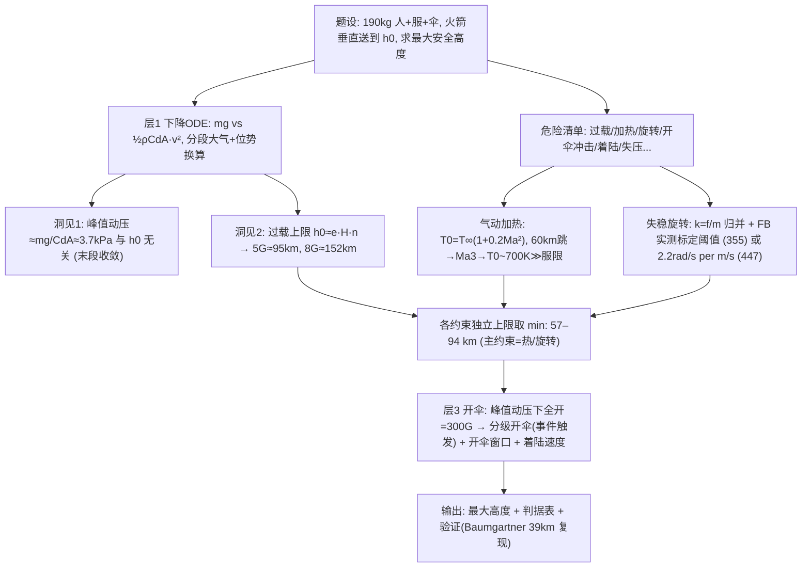

# 2023 题A：近太空跳伞最高安全高度（Space Diving）

> 赛题来源：UPC 2023 Problem A（当年 466 队投稿；题 A 金奖 6 队：上海交大 131/227/244、同济 355、国防科大 447/464）

## 1. 题目原文与关键数据

**原文压缩引用**：
> Consider a skydiver, carried by a rocket **vertically up** to an altitude, **perhaps above the Earth's atmosphere**, who then exits the rocket in a **space suit with a parachute**, to descend back down. **Analyze the challenges and dangers** in such a descent, assuming the total mass of skydiver, space suit, and parachute is **190 kg**. What would be the **maximum altitude** from which a person could successfully descend to the surface?

**中文翻译**：一名跳伞者由火箭垂直送至某一高度（可能在大气层之外），身穿航天服、携带降落伞出舱下降回地面。设人+服+伞总质量 190 kg。请分析这一下降过程中的挑战与危险，并求出人能成功返回地面的**最大起跳高度**。

**题面给定参数表**：

| 参数 | 取值 | 备注 |
|---|---|---|
| 系统总质量 | 190 kg | 唯一给定数；内部拆分（人/服/伞）是自由度 |
| 出舱方式 | 火箭垂直送到顶点释放 | 初速 ≈ 0，竖直下落 |
| 装备 | 航天服 + 降落伞 | 伞的面积/开伞时序全自定 |
| 待求 | 最大安全高度 | **"安全"必须先定义成判据清单** |
| 自选 | 大气模型 | US Standard Atmosphere 八层 / NRLMSIS / 指数大气 |
| 自选 | 姿态与 $C_dA$ | 弓身 ~0.4–0.5 m²，翻滚时增大数倍 |

## 2. 题目到底在问什么（去模糊化）

1. **"challenges and dangers" 是要求先列危险清单再分级**：过载、气动加热、失稳旋转（flat spin）、开伞冲击、着陆速度、失压/低温、风漂移……金奖队的共同动作是"先穷举、再筛选、精算主因、量级排除次因"（464 甚至列 A–J 十项）。
2. **"successfully descend" 必须操作化为判据集**：峰值过载 ≤ 5–8g（受训者可到 15g 短时）、装备表面温度 ≤ 服材耐温（NASA 舱外服 ~121–150 °C）、姿态可控（旋转积分判据）、开伞冲击 ≤ 15g、着陆 ≤ ~6 m/s。
3. **"maximum altitude" = 各判据上限取最小**：131 的 94/120/78 → 综合 80 km；447 的 162.7/63.78 → 63.78 km；227 因"出舱即开伞"改写问题得 153 km；464 区分普通人与运动员给 19.46/60.675 km 双档。**答案 = 判据选择的函数**，必须报出每个约束的独立上限。
4. **190 kg 要拆开用**：447 拆成 160 kg 人+服 + 30 kg 伞，按伞衣面密度 0.2 kg/m² 反推总面积 150 m²——题目给的每一个数都应进入计算。
5. **对谁安全**：普通人（姿态控制与过载耐受弱）与专业跳伞者上限差 3 倍（464 的 19.46 vs 60.7 km）——把"人"画像化是最高级的去模糊化。

## 3. 物理建模路线图

**层次 1：下降动力学骨架**

$$m\frac{dv}{dt}=mg(h)-\frac12\rho(h)\,C_dA\,v^2,\qquad \frac{dh}{dt}=-v$$

配分段标准大气（记得**位势高度换算** $H_{geo}=\frac{R_E H}{R_E+H}$，244 的细节）。核心洞见是**两个"高度无关性"**：

- **峰值动压与起跳高度近似无关**：在阻力主导段，峰值速度处 $dv/dt=0$ 给出 $\rho v^2\approx 2mg/(C_dA)\approx7.4$ kPa（$C_dA=0.5$ m²），即任意高度起跳、到达某密度层时速度就被"钉死"在同一条包络上——355/464 都数值复现了"临地速度与初值无关"。
- **过载上限的解析公式（可手算）**：指数大气 $\rho=\rho_0e^{-z/H}$（标高 $H\approx7$–7.6 km）下弹道减速 $a(\rho)=\frac{\rho v_e^2}{2\sigma}e^{-\rho H/\sigma}$（$\sigma=m/C_dA$），在 $\rho^*=\sigma/H$ 处取极大：
$$a_{max}=\frac{v_e^2}{2eH},\qquad v_e^2\approx2gh_0\ \Rightarrow\ \boxed{h_0^{max}\approx e\,H\,\frac{a_{max}}{g}\approx19\,{\rm km}\times n}$$
即**每允许 1g 过载约换 19 km 起跳高度**：5G → ~95 km（131 恰得 94 km）、8G → ~152 km（447 得 162.7 km）。一行解析式复现两支金奖队，是本题最漂亮的量级锚点（注意它假设 $C_dA$ 常数、忽略峰值段重力，跨声速修正会变动 20–30%）。

**层次 2：决定性约束——气动加热与失稳旋转**

- **驻点温度**：$T_0=T_\infty\left(1+\frac{\gamma-1}{2}Ma^2\right)$。从 ~60 km 起跳，峰值速度 ~1 km/s 出现在 35–40 km（$Ma\approx3$），$T_0\sim650$–750 K ≫ 服限 394–423 K；表面实际只达驻点温度的 ~85%（447 的工程系数，仿飞船防热的 80% 规则）且为瞬态过程——用服材热容（10 kg × 1.5 kJ/(kg·K)）+ 辐射散热的热平衡 ODE 判"烧不烧"（227/244）。对照：Baumgartner 39 km 起跳峰值仅 Ma 1.25，$T_0\approx315$ K，安然无恙——**"热"正是从 ~57 km 开始变得致命的原因**，六队中四队以热/旋转为主约束（答案 57–80 km）。
- **失稳旋转（flat spin）**：稀薄大气中静力矩配平越来越难，一旦翻滚、迎风面突变会锁死在平旋。两条定标路线：355 把判据归并为单位质量阻力 $k=f/m$，用 Baumgartner 实测失控/恢复两点标定阈值并定义耐受积分 $S=\int k\,dt$；447 用 FB 失速时 ~180 rpm 标定"每损失 1 m/s 速度角速度增 2.2 rad/s"的耦合系数。

**层次 3：开伞与着陆（工程分系统）**

- 峰值动压 ~3.7 kPa 若直接开 150 m² 主伞：$F\sim qA\sim5.6\times10^5$ N ≈ 300G——必须**分级开伞**（447：8g 触发副伞→主伞，用 ode45 事件函数自动切换；244：0.5 s 一档面积阶梯模拟充气）。
- 着陆：$v_{land}=\sqrt{2mg/(\rho A)}\approx4.6$ m/s（150 m²），与 447 的 6.5 m/s 同量级。
- 开伞窗口：最早由反冲限制（464：15g 交点 3.64 km）、最迟由减速距离限制（~20 m 高度）——把"时机窗口"做成两个交点的差集。

## 4. 关键物理效应量级表

| 效应 | 估算量级 | 是否必须建模 | 估算依据 |
|---|---|---|---|
| 大气标高 | $H\approx7$–7.6 km（平流层） | 必须 | 指数大气；一切解析估计的地基 |
| 峰值动压 | $q^*\approx mg/C_dA\approx3.7$ kPa，与 $h_0$ 无关 | 必须 | 峰值速度处 $dv/dt=0$ |
| 过载上限 | $h_0\approx eHn$：5G→95 km、8G→152 km | 必须（先算） | $a_{max}=v_e^2/(2eH)$，本文自推并复现 131/447 |
| 气动加热 | 60 km 跳峰值 $Ma\approx3$ → $T_0\sim700$ K（表面 ~85% + 瞬态热容缓冲） | **必须（主约束）** | 驻点温度公式 + 热平衡 ODE |
| 39 km 对照 | Baumgartner：Ma 1.25、377 m/s、34 s 破音速 | 必须（验证锚点） | Red Bull Stratos 实测 |
| 失稳旋转 | FB 失控点 33.4 km / 313 m/s 可定标阈值；恢复点 19 km / 201 m/s | 建议（第二主约束） | 单事件标定 + 耐受积分 $S=\int k\,dt$ |
| 开伞冲击 | $q^*A_{canopy}\sim5.6\times10^5$ N ≈ 300G（若全动压下主伞瞬开） | 必须（分级开伞） | $F=qA$；副伞+收口压到 ≤15g |
| 着陆速度 | 150 m² 全展 → ~4.6–6.5 m/s | 必须 | $\sqrt{2mg/\rho A}$ |
| 跨声速 $C_d$ 突变 | $C_d$ 增大数倍、迎风面翻滚倍增 | 建议 | 马赫数状态机或连续 $C_d(Ma)$ 二次拟合（355） |
| 科氏力/风漂移 | 水平 ~百 m/s 级漂移、落点偏移 km 级 | 可选 | $2m\vec\omega\times\vec v$（仅 227 纳入） |
| 答案谱系 | 19.5（普通人）/ 57–94（主流）/ 153 km（立即开伞口径） | 必须 | 判据选择决定上限 |

## 5. 求解算法与数值要点

- **推荐数值框架**：`ode45`/`solve_ivp` + **事件函数**（检测 8g、马赫数、开伞高度自动切阶段，447 范式）；以 $v^2/2$ 对 $x$ 的方程降阶更稳（131）；上标大气直接用 US Standard Atmosphere 八层表或 NRLMSIS，勿在 86 km 以上沿用低空拟合。
- **跨声速处理**：$C_d$ 用马赫数分段（131 状态机）或连续二次拟合（355，避免伪不连续尖峰）；迎风面积随姿态（弓身/翻滚/俯卧开伞）切换。
- **验证是本题的胜负手**：把 39 km 代入模型复现 Baumgartner——进出超声速高度误差 0.56%/1.5%（131）、失控时长 56.1 s vs 实际 ~52 s（355）、逐帧高度/速度/加速度三联对比（244）；再用"末段收敛"性质把开伞子问题与 $h_0$ 解耦。
- **扫描与求根**：对 $h_0$ 扫描出"峰值 $Ma$–$h_0$""$a_{max}$–$h_0$"曲线，与判据水平线求交（`polyxpoly`/样条极值，464）。
- **陷阱**：指数大气外推到 100 km 失真；热模型把"绝热驻点温度"当真实表面温度（差 15%+ 且无瞬态缓冲）；开伞用"瞬间全展"高估冲击 20 倍；多项式拟合 $v(t)$ 积分热量的拟合误差不报告；步长不收敛性检验。

## 6. 常见错误与陷阱

1. **上来就算一条 ODE 而不列危险清单**：题目明写"analyze the challenges and dangers"，只给一条速度曲线等于没回应题面。
2. **用 $\sqrt{2gh_0}$ 估峰值速度**：高空起跳早已进入阻力主导段，真实峰值速度被 $\sqrt{2mg/\rho C_dA}$ 钉死且低于自由落体值；两个 regime 不分，加热与过载全错。
3. **开伞时机拍脑袋**：在峰值动压高度开主伞即 300G 必死；必须分级开伞并核算充气时间与减速裕度（447 的 $\Delta t$ vs $t_{m1}$ 对照表是范本）。
4. **热判据只会套公式**：不区分驻点温度/表面温度/瞬态热容，直接 $T_0$ 超限就判死，会得到过度保守的答案（这也是部分队伍答案偏低的原因）。
5. **忽略姿态与旋转耦合**：跨声速翻滚既增大 $C_dA$ 又威胁生存，是"安全"二字的隐性主语。
6. **不给"对谁安全"的口径**：普通人与受训者的 5g/15g 之差直接把答案改写 3 倍。

## 7. 全网参考与延伸

1. **Wikipedia: Felix Baumgartner**（[en.wikipedia.org](https://en.wikipedia.org/wiki/Felix_Baumgartner)）——2012-10-14 从 ~39 km 跳下：最高 1357.6 km/h（377.1 m/s，Ma ≈1.25）、34 s 破音速。是本题最现成的模型标定与验证数据集（六支金奖队全都用了它）。
2. **Red Bull Stratos: Space jump facts and figures**（[redbull.com](https://www.redbull.com/us-en/stratos-space-jump-key-facts-numbers)）——任务官方关键数字（起跳高度、自由落体时长、开伞时序），用于校准开伞时刻与分段参数。
3. **Wikipedia: U.S. Standard Atmosphere**（[en.wikipedia.org](https://en.wikipedia.org/wiki/U.S._Standard_Atmosphere)）——八层温度直减率/基准压强表与位势高度定义，是分段大气模型的标准出处（244 队内置其 `stdatmo` 实现）。
4. **Guinness World Records: First person to break the sound barrier in freefall**（[guinnessworldrecords.com](https://www.guinnessworldrecords.com/records/hall-of-fame/felix-baumgartner-first-person-to-break-sound-barrier-in-freefall)）——独立旁证 34 s 破音速与 Ma 1.25 的官方认定，适合做引用背书。

## 8. 金牌论文思路对比

- **131（上海交大）**：NRLMSIS 温度 + 自推含 $g(h)$ 的密度公式；马赫数状态机切换三段 $C_d/A$；用 Baumgartner 进出超声速高度做 0.56%/1.5% 误差的定量验证；三判据 94/120/78 km → 综合 **80 km**。验证闭环最硬。详见 `05_论文赏析\2023\2023-GM-A-131.md`。
- **227（上海交大）**：策略反转——假设出舱立即开伞（HAHO 缓降），消解音障与开伞冲击；麦克斯韦分布推阻力、科氏力全程在模并被二次用作"死亡螺旋"力矩来源；四约束 255/510/153 km → **153 km**。改写问题边界的代表。详见 `2023-GM-A-227.md`。
- **244（上海交大）**：排除法主线——先定量证明速度（150 m/s）与过载（3g）不构成约束，锁定**摩擦热积累**（MLI 换热 + NASA 热容参数），得 **61,270 m**。因果链最清晰。详见 `2023-GM-A-244.md`。
- **355（同济）**：把旋转失控判据归并为单位质量阻力 $k=f/m$，用 FB 失控/恢复两点标定并原创耐受积分 $S=\int k\,dt$（极限取 1.5×FB 实况），得 **57 km**；临地速度收敛性质 + 连续 $C_d(Ma)$ 拟合。单事件标定范式。详见 `2023-GM-A-355.md`。
- **447（国防科大）**：三段式开伞时序（8g 触发副伞→主伞，事件函数自动切换）+ 专业降落伞四阶段动力学 + 驻点温度 85% 工程系数，得**热约束 63.78 km**、"每损失 1 m/s 速度角速度增 2.2 rad/s"。工程化程度最高。详见 `2023-GM-A-447.md`。
- **464（国防科大）**：自定义指标 SVA $=z_0/v_{max}$ 并区分普通人（**19.46 km**，全程亚声速）与运动员（驻点温度判据 **60.675 km**）；开伞窗口 19.93 m–3.64 km 双边界。语义去模糊化最彻底。详见 `2023-GM-A-464.md`。

## 9. 评分要点：评委想看什么

- [ ] 危险清单完整且分级：主约束精算、次约束量级排除，每项有交代（对应"analyze the challenges and dangers"）。
- [ ] "安全"操作化为数值判据集（过载 g 数、温度上限、姿态/旋转判据、开伞冲击、着陆速度），并声明适用人群。
- [ ] 大气模型有出处（标准大气/NRLMSIS）+ 位势高度换算；$C_d$ 的跨声速处理有意识（分段或连续）。
- [ ] 各约束的独立高度上限 + 取 min 的最终答案；对 $C_dA$、服温比例等敏感参数给区间。
- [ ] 用真实事件（Baumgartner/Kittinger/Eustace）做定量验证，误差以数字呈现。
- [ ] 工程 subsystem 至少一个亮点：分级开伞时序、伞面积/质量预算、开伞窗口双边界或装备强度校核。
