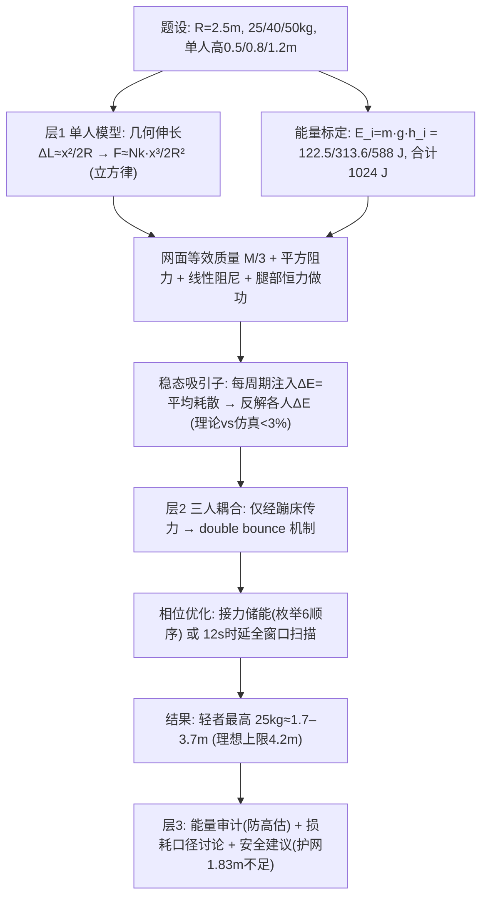

# 2023 题B：三人蹦床（Trampoline Jumping）

> 赛题来源：UPC 2023 Problem B（当年 466 队投稿；题 B 金奖 3 队：北京师范大学 102、上海交大 138、华沙大学 471）

## 1. 题目原文与关键数据

**原文压缩引用**：
> Three kids are jumping on a **circular trampoline that is 5 meters in diameter**. The kids have masses **25 kg, 40 kg, and 50 kg**. If alone on the trampoline, the 25 kg kid can bounce to a maximum height of **0.5 m** above the trampoline surface's equilibrium height, the 40 kg kid **0.8 m**, and the 50 kg kid **1.2 m**. If all three kids are on the trampoline together, **what is the maximum height that each kid could reach**?

**中文翻译**：三个孩子（25、40、50 kg）在一张直径 5 m 的圆形蹦床上跳跃。单独一人时，25 kg 孩子能跳到离蹦床面平衡高度以上 0.5 m，40 kg 达 0.8 m，50 kg 达 1.2 m。三人同床时，每个孩子最高能到多高？

**题面给定参数表**：

| 参数 | 取值 | 备注 |
|---|---|---|
| 蹦床直径 | 5 m（$R=2.5$ m） | 题给几何 |
| 三人质量 | 25 / 40 / 50 kg | 题给 |
| 单人最大高度 | 0.5 / 0.8 / 1.2 m | **全题唯一的动力学信息**——是标定数据，不是约束 |
| 高度参考 | "surface's equilibrium height" | **模糊词**：空载/单人/三人的哪个平衡面？须声明 |
| 自选 | 弹簧数、单簧刚度、网面质量 | 须自建参数链（55–135 根 × 3000–5300 N/m，网 1–2 kg） |
| 待求 | 三人各自的最大高度 | "could"= 允许另外两人最优配合 |

## 2. 题目到底在问什么（去模糊化）

1. **"could reach" 是策略最优而非静态极限**：三支金奖队一致把它读成"在另外两人最佳时机配合下该孩子能达到的最高点"——本质是一个**相位/时序优化问题**（何时触网、何时压底、何时蹬伸）。若读成"三人各跳各的"则整道题的相互作用物理全部落空。
2. **单人高度是能量标定**：$E_i=m_igh_i$ 得 122.5 / 313.6 / 588 J（合计 1024 J）。更精细的用法是把"腿做功"等效为触网期恒力（102 标定 122.7–239.5 N；138 得 236–473 N，为体重的 0.8–1.0 倍），让"人会发力"进入动力学而非只进初始条件。
3. **耦合通道唯一**：孩子之间只通过蹦床（弹簧+网面惯性+阻尼）交换能量——这就是民间"double bounce"（借力颠）的物理本体。题目实际在问：**通过时序编排，能把分散在三人每跳做功里的能量汇聚到一个人身上多少？**
4. **必须回收现实语境**：三支队伍最后都落到安全讨论——最轻的孩子被抬到最高（落地动能最大、护网一般只有 1.83 m），多人蹦床对最小者最危险。这是"results 有 application 层"的隐性评分点。

## 3. 物理建模路线图

**层次 1：单人力学模型（标定闭环）**

- **弹簧几何非线性（本题最重要的物理）**：中心下陷 $x$ 时单簧伸长 $\Delta L=\sqrt{R^2+x^2}-R\approx\frac{x^2}{2R}$，取竖直分量后
$$F_v\approx N k_s\,\frac{x^3}{2R^2}\quad(x\ll R)$$
即**小形变下弹力是立方律、储能 $\propto x^4$**（138 的"小幅形变为何储能巨大"的答案）。线性化有效刚度依赖振幅：$x=0.5$ m 处约 $(0.8\text{–}1.6)\times10^4$ N/m（102 取 8000 N/m，55 簧×3000 N/m 直算约 $1.6\times10^4$）；471 还刻画了弹簧预紧分段（96 kN/m → 2.7 kN/m）。
- **网面等效质量**：设网面速度线性分布 $v(r)=v_0(1-r/R)$，对面积分加速度场得 $\frac13M\ddot z$（471 的解析推导，$M\approx1$–2 kg 时贡献 <3%，可略但应论证）。
- **标定**：单人稳态是吸引子——无论初值如何，"每周期腿部注入 $\Delta E$ = 周期平均耗散"收敛到同一 $h_{max}$。471 用简谐 anzatz 给出闭式 $\Delta E(h_{max})$，与仿真偏差 <3%，再用题给 $h_i$ 反解各人 $\Delta E_i$。

**层次 2：三人耦合与相位优化**

- 分段运动方程（质点，接触时才受弹力）：$m\ddot x_i=-mg-k x_i$（$x_i<a$ 时自由飞），加平方空气阻力、线性阻尼、腿部恒力做功项。孩子间零直接耦合，全靠网传。
- **能量传递机制（double bounce）**：前一人压网至最低点停住 → 后一人落下触网把动能存入弹簧 → 弹簧储能再把"压底者"射出。102 用"两人追压"机制图讲透，471 引用文献把它升级为**接力储能策略**并枚举全部 6 种落地顺序；138 用自研物理引擎对另外两人的下落时延做 12 s 全窗口扫描（粗扫→45° 旋转精扫→高斯滤波去数值毛刺）。
- **能量上限（自算）**：全部能量汇聚给 25 kg 孩子的无损耗上限 $=1024\ {\rm J}/(25g)=4.2$ m；三队结果 3.67/3.20/1.69 m 对应损耗口径从"仅阻尼"到"完全非弹性碰撞"的谱系。

**层次 3：可选扩展**

- 网面形状假设的理论辩护（138：由膜微元 PDE 论证 V 形直母线）；孩子间碰撞与落点偏移；耗散参数对结果的敏感性；护网高度/安全标准的工程对照。

## 4. 关键物理效应量级表

| 效应 | 估算量级 | 是否必须建模 | 估算依据 |
|---|---|---|---|
| 单跳能量标定 | $E_i=122.5/313.6/588$ J，合计 1024 J | 必须 | $mgh_i$，题给条件的唯一动力学出口 |
| 理想汇聚上限 | 1024 J 全给 25 kg → **4.2 m** | 必须（作上限） | 能量守恒 |
| 弹簧几何非线性 | $\Delta L\approx x^2/2R$：$x=0.5$ m 时仅伸长 5 cm → $F_v\propto x^3$ | **必须（核心物理）** | $\sqrt{R^2+x^2}-R$ 展开 |
| 线性化刚度 | $k_{eff}\sim(0.8\text{–}1.6)\times10^4$ N/m @ $x\approx0.5$ m | 必须 | 55–135 簧 × 3000–5300 N/m 竖直投影 |
| 储能容量 | $x=1$ m 时网内已储 ~3000 J ≫ 1024 J | 应查 | 立方力积分 $\int Fdx\propto x^4$ |
| 网面等效质量 | $M/3\approx0.3$–0.7 kg（占比 <3%） | 可略（但要论证） | 速度线性分布面积分（471） |
| 触网时间 | 半周期 $\pi\sqrt{m/k}\approx0.13$–0.18 s；视频实测 0.25–0.27 s | 应查（标定） | 非线性+阻尼拉长；138 逐帧验证 |
| 腾空段空气阻力 | 5 m/s 时 ~7–13 N vs 体重 245–490 N → 损耗 ~3–5% | 可略 | $\frac12\rho C_dAv^2$ |
| 回弹高度保持率 | 60–70%/跳（视频实测）→ 每跳损耗 30–40% 是最大"漏洞" | 必须 | 138 用视频定阻尼 $c=9.4$ N·s/m |
| 腿部做功 | 等效恒力 122–473 N（0.5–1.0 体重） | 必须 | 102/138/471 三种标定口径 |
| 结果谱系 | 25 kg：1.69 / 3.20 / 3.67 m（138/471/102），均轻者最高 | 必须 | 损耗建模强度决定数值 |

## 5. 求解算法与数值要点

- **分段 ODE + 事件函数拼接**：自由落体—触网—离网各段用 `solve_ivp`（DOP853）的事件检测（速度过零、位置越过 $a$）自动衔接，比手写定步长循环精确且不漂移；138 的 1 ms 帧步长物理引擎 + 动量定理处理碰撞亦可。
- **相位优化的务实路线**：可控量是"另外两人的下落时延"——二维参数空间粗扫（窗口长度取三人周期最小公倍数，138 用 12 s 保证完备）→ 定位候选区 → 坐标旋转/细化精扫；或小规模组合（6 种顺序）直接穷举（471）。**不要**指望解析极值——系统近混沌、目标函数多峰。
- **数值毛刺处理**：连续碰撞/刚体切换会产生噪声点，对结果场做高斯滤波并报告核宽敏感性（138 的 std=3.0 vs 1.5 对比图是范本）。
- **验证三件套**：① 理论 $\Delta E$ vs 仿真 $\Delta E$（<3%，471）；② 接触时间 vs 视频逐帧计数（0.25 s 级，138）；③ 结果 vs 独立外部数据（护网 1.83 m、商品弹簧参数）。外加**能量审计**：肌肉注入总量 vs 系统能量增量（471 查出 50 kg 情形可能高估 ~200 J 并解释了偏差方向）。
- **陷阱**：把三人并成单质点（相位即全部物理）；弹力用线性 $kx$ 外推到大形变（真实是硬化立方律，振幅大时刚度差数倍）；腿做功只进初始条件不进过程；时延扫描步长大于触网时间（~0.25 s）导致漏掉最优窗口。

## 6. 常见错误与陷阱

1. **把蹦床当线性弹簧**：小形变下 $F\propto x^3$，等效刚度随振幅变；用单一 $k$ 会同时错掉周期、储能与传递效率。
2. **忽视"人做功"**：单人高度是能量输入的标定，三人情形里每次触网都能再做功——只按 $mgh_i$ 发"一次性launch"会系统性低估。
3. **丢失相位自由度**：题目问的是"could"，最优解必然是错相接力（一人压底、下一人触网），"三人同时起跳"不是候选解。
4. **不做能量审计**：注入能量与系统能量增量不对照，就发现不了模型高估（如瞬时蹬跳理想化），结论可信度打折。
5. **忽略损耗主导参数**：回弹保持率 60–70% 意味着每跳漏掉 1/3 能量，阻尼/非弹性碰撞建模粗糙对答案的影响远大于把弹簧数从 55 数到 135。
6. **不回应安全语境**：最轻孩子飞得最高、落地动能却未必最大（$m\sqrt{2gh}$），但 1.83 m 护网明显不够——结论不带应用层是本题的普遍失分点。

## 7. 全网参考与延伸

1. **Eager et al. 2022, "Investigation into the Trampoline Dynamic Characteristics and Analysis of Double Bounce Vibrations", Sensors**（[pmc.ncbi.nlm.nih.gov](https://pmc.ncbi.nlm.nih.gov/articles/PMC9031171)）——蹦床动力学参数与 double bounce 能量传递的仿真研究，正是 102 队的物理机制出处；其蹦床刚度/面密度参数链可直接借用。
2. **Srinivasan et al. 2013, "People Bouncing on Trampolines: Dramatic Energy Transfer, a Tabletop Demonstration, Complex Dynamics and a Zero Sum Game", PLOS ONE**（[journals.plos.org](https://journals.plos.org/plosone/article?id=10.1371/journal.pone.0078645)）——证明非生命质量被动弹跳也发生剧烈能量传递（"零和博弈"视角），是 471 队接力储能策略的文献根基。
3. **Akrobat: The Physics of Bouncing**（[akrobat.co.uk](https://m.akrobat.co.uk/the-physics-of-bouncing-exploring-elasticity-and-energy-transfer-on-trampolines)）——厂商科普级的能量转换叙述，可用于引言的现实背景与护网/安全标准对照。

## 8. 金牌论文思路对比

- **102（北师大）**：真实商品参数（55 簧×3000 N/m）+ 几何伸长精确式再线性化；先用"两人追压"机制图讲透 double bounce，再三人仿真；理想模型 2.9/2.2/2.1 m，修正（二次力律+全耗散+腿部恒力补偿）后 **3.67/2.54/2.09 m**。机制叙事与参数落地最佳。详见 [05_论文赏析/2023/2023-GM-B-102.md](../05_论文赏析/2023/2023-GM-B-102.md)。
- **138（上海交大）**：自研 Python 物理引擎 + 二维时延全窗口扫描（粗扫→45° 精扫→高斯滤波），参数链最硬（$k=Gd^4/8nD^3$、FIG 弹簧数比例、视频实测接触时间 0.27 s 与回弹保持率定阻尼）；结果 **1.689/1.281/1.367 m**（完全非弹性碰撞口径），与护网 1.83 m 交叉验证。工程化与实证校准最强。详见 `2023-GM-B-138.md`。
- **471（华沙）**：理论色彩最浓——网面等效质量 $\frac13M$ 解析推导、周期平均给出闭式 $\Delta E(h_{max})$（理论 vs 仿真 <3%）、稳态吸引子论证；引用 PLOS ONE 文献设计接力储能并枚举 6 种顺序，得 **3.20/2.74/2.39 m**；能量审计主动指出瞬时蹬跳可能高估并给出"增大空气阻力系数 $c_a$"的设计建议。解析—数值互证范本。详见 `2023-GM-B-471.md`。
- **三队共同结论**：最轻的 25 kg 孩子能被抬到最高（单跳最弱却获益最大）；分歧在数值（1.7–3.7 m），根源是**损耗建模强度**（从视频定标阻尼到完全非弹性碰撞）——这也是本题最值得写进"敏感性讨论"的一笔。

## 9. 评分要点：评委想看什么

- [ ] "could reach" 读成相位/时序优化问题，明确交互只经蹦床耦合（double bounce 机制图先行）。
- [ ] 弹簧几何非线性（$\Delta L\approx x^2/2R$、$F\propto x^3$、储能 $\propto x^4$）被显式建模或至少线性化区间有论证。
- [ ] 单人高度被用作标定（能量或腿部恒力），标定参数有自洽验证（理论 vs 仿真、视频逐帧）。
- [ ] 耗散参数有出处（实测保持率/文献值），并说明其对答案的支配地位。
- [ ] 结果附能量审计与上限对照（1024 J → 理想 4.2 m），高估/低估方向有解释。
- [ ] 回收安全/工程语境：护网高度对照、最轻者最危险的量化结论、对厂商或家长的建议。
