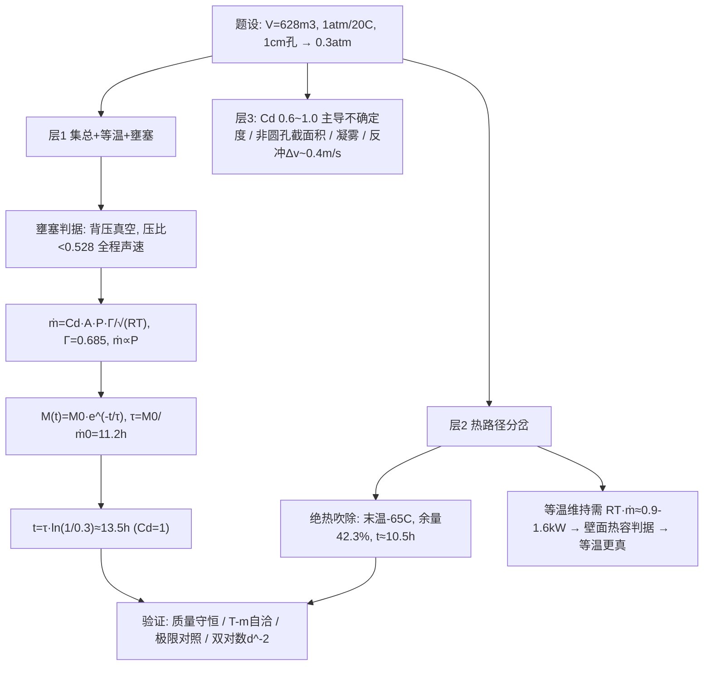

# 2024 题A：空间站空气逃逸时间（Space Station: Air Evacuation Time）

> 赛题来源：UPC 2024 Problem A（当年 681 队投稿；题 A 金奖 12 队 ≈1.8%，题 B 金奖仅 3 队）

## 1. 题目原文与关键数据

**原文压缩引用**：
> A space station is approximately shaped like a cylinder with an interior length of 50 meters, and a diameter of 4 meters. The air inside is at 20 °C and 1 atm (101.3 kPa). A micrometeorite makes a hole 1 cm in diameter in the center of one end. How much time would it take until the air pressure was only 0.3 atmosphere? How would this time be different for holes of different diameters?

**中文翻译**：空间站近似圆柱，内长 50 m、直径 4 m；舱内空气 20 °C、1 atm。微流星体在端面中心击出一个直径 1 cm 的孔。问舱压降到 0.3 atm 需要多长时间？孔径不同时该时间如何变化？

**题面给定参数表**——题面参数完整，自由度几乎全在物理假设上：

| 参数 | 取值 | 备注 |
|---|---|---|
| 圆柱长 $L$ | 50 m | |
| 直径 $D$ | 4 m | 端面积 $12.57\ {\rm m^2}$ |
| 容积 $V$ | $628\ {\rm m^3}$ | $\pi(D/2)^2L=200\pi$ |
| 初温/初压 | 293.15 K / 101.325 kPa | 初始空气质量 $M_0=P_0V/(RT_0)\approx757$ kg |
| 孔 | $d=1$ cm，端面中心 | $A_h=7.85\times10^{-5}\ {\rm m^2}$，薄壁穿孔 |
| 终压 | 0.3 atm ≈ 30.4 kPa | **恰为舱外航天服工作压强**（EMU 4.3 psi ≈ 0.296 bar），题眼之一 |
| 外部 | 真空 | 壅塞判据全程成立 |
| 自取 | $\gamma=1.4$，$R=287\ {\rm J/(kg\cdot K)}$，$C_d$ | 薄锐孔 $C_d\approx0.6$–0.7 |

## 2. 题目到底在问什么（去模糊化）

1. **"How much time" 判据明确，但时间依赖三条未言明的物理假设**：① 孔的流量系数 $C_d$（微流星孔是撕裂薄壁孔，不是光滑喷嘴）；② 泄气过程是等温还是绝热（决定末温与时间，二者差 ~20%）；③ 流动是否全程壅塞（需证明而非默认）。把它们逐一"定界"是本题第一层考法。
2. **"different diameters" 要的是标度律而非数表**：在壅塞区 $t\propto d^{-2}$，并说明该律的适用域（壅塞 + 连续介质 + 集总参数），只给一张扫描表不给定律是失分点。
3. **隐含考点是"先证模型合法再用模型"**：舱内可否当集总参数系统（压强波渡越时间、舱内流速、Knudsen 数都要查一遍）；0.3 atm 的选点本身就是工程常识钩子（那是乘组穿舱外服的底线压力），论文应回答"这个时间对乘组意味着什么"。

## 3. 物理建模路线图

**层次 1：集总 + 等温 + 壅塞（主线，全解析）**

壅塞判据：背压/上游压强 $< (2/(\gamma+1))^{\gamma/(\gamma-1)}=0.528$。外部真空，**全程声速**。壅塞质量流：

$$\dot m=C_d A_h\,P\sqrt{\frac{\gamma}{RT}}\left(\frac{2}{\gamma+1}\right)^{\frac{\gamma+1}{2(\gamma-1)}}=\frac{C_dA_hP\,\Gamma}{\sqrt{RT}},\qquad \Gamma=0.685$$

等温下 $\dot m\propto P\propto M$，得指数衰减 $P(t)=P_0e^{-t/\tau}$，$\tau=M_0/\dot m_0$。代入：$\dot m_0=18.8$ g/s（$C_d=1$），$\tau=40280\ {\rm s}=11.2$ h，

$$t=\tau\ln\frac{P_0}{0.3P_0}=11.2\times1.204\approx \mathbf{13.5\ h}$$

**层次 2：热路径分岔（必须讨论）**

绝热刚性舱吹除（无壁面热交换）：$T/T_0=(P/P_0)^{(\gamma-1)/\gamma}$，$m/m_0=(P/P_0)^{1/\gamma}$。降到 0.3 atm 时末温 $293\times0.3^{0.286}\approx208$ K = **−65 °C**，剩余质量 42.3%（等温为 30%）；此时 $\dot m\propto P/\sqrt T\propto m^{(\gamma+1)/2}=m^{1.2}$，积分得 $t=\frac{M_0}{\dot m_0}\frac{(M_0/M)^{0.2}-1}{0.2}\approx10.5$ h。哪个更真？看舱壁热容：维持等温所需加热功率 $\dot Q=RT\dot m$（峰值 1.6 kW、全程平均 ~0.9 kW，合计 $4.5\times10^7$ J）——空间站结构与热控系统完全供得起，**等温支更接近现实**，绝热支是下界。再加上 $C_d=0.6$–1.0 的不确定度，诚实的答案是**区间 10.5–22 h，名义值 ~13.5 h**。

**层次 3：可选扩展**：绝热路径过露点 → 舱内凝雾/设备结露；非圆破口按最小截面取 $A_h$；泄气反冲（$\int\dot m v_e\,{\rm d}t\approx1.7\times10^5$ N·s，对 420 t 级空间站 $\Delta v\sim0.4$ m/s）；多舱段与补漏策略；极小孔的分子流极限。

## 4. 关键物理效应量级表

| 效应 | 估算量级 | 是否必须建模 | 估算依据 |
|---|---|---|---|
| 初始质量/初始泄漏 | 757 kg；18.8 g/s（$C_d=1$） | 必须 | $M_0=P_0V/RT_0$；壅塞流量式代入 |
| 壅塞全程 | 出口声速 $v_*\approx313$ m/s | 必须 | 真空背压，压比 $0<0.528$ |
| 时间尺度 | $\tau=11.2$ h → $t=13.5$ h | 必须 | 指数衰减积分 $\tau\ln(1/0.3)$ |
| 等温 vs 绝热 | 13.5 h vs 10.5 h；末温 −65 °C | 必须讨论 | $T\propto m^{\gamma-1}$；所需加热 ~0.9–1.6 kW |
| 流量系数 $C_d$ | 0.61（薄锐孔）→ 时间 ×1.6 | 必须（最大不确定度） | 锐缘孔经验值；穿孔形态论证 |
| 舱内漂移速度 | $A_h/A_{end}\times v_*\approx2$ mm/s | 可忽略（集总合法性） | $\dot m/\rho A_{end}$ |
| 压强波均衡时间 | $\sim V^{1/3}/c\approx0.01$ s | 可忽略 | 声速渡越 ≪ 过程时标 |
| Knudsen 数 | $Kn\approx2\times10^{-5}$ @0.3 atm | 可忽略 | $\lambda(1{\rm atm})\approx68$ nm，$\lambda\propto1/P$ |
| 水汽凝结 | 绝热路径 −65 °C 必凝雾 | 讨论 | 0.3 atm 水饱和温度 ~70 °C |
| **孔径标度** | $t\propto d^{-2}$：1 mm→56 天，5 mm→54 h，5 cm→32 min，10 cm→8 min | 必须 | $A\propto d^2$，壅塞区内严格成立 |
| 泄气反冲 | $F\approx\dot m v_e\approx6$ N → $\Delta v\approx0.4$ m/s | 可选 | 冲量积分 / 站质量 |

## 5. 求解算法与数值要点

- **主线几乎全解析**：等温支一维指数积分；绝热支 $m^{1.2}$ 幂律积分。数值计算只作验证：用 `ode45` 联解质量与能量 ODE，对照两条解析极限。
- **验证四件套**：① 质量守恒（$\int\dot m\,{\rm d}t=M_0-M_f$）；② 绝热解自洽（$P\propto m^\gamma$ 的 T–m 关系）；③ $C_d=1$ 与等温/绝热四角对照表；④ 孔径扫描画双对数图核对斜率 −2。
- **常见数值陷阱**：把 0.3 atm 当成"质量剩 30%"（绝热下剩 42.3%）；漏速取常数线性外推（高估时间 ~40%）；用不可压缩 Bernoulli $\sqrt{2P/\rho}$ 直算漏速（得 ~400 m/s 的"超音速孔流"，量纲上碰巧接近声速但物理错误）；忽略 $C_d$；大孔端（$d\gtrsim1$ m）才需要担心集总失效，扫描域内不必。

## 6. 常见错误与陷阱

1. **不做壅塞判别**，直接套不可压缩小孔公式——第一性原理分直接丢。
2. **以为质量流率恒定**，用 $0.7M_0/\dot m_0$ 线性估算，得到 ~19 h 的错误答案。
3. **只报一个魔法数字**（如 13.5 h），不给 $C_d$ 与热路径造成的 10–22 h 区间——开放题答成闭题。
4. **"不同孔径"只列表**，不提炼 $t\propto d^{-2}$ 标度律、不声明适用域（壅塞、连续介质、集总三条件）。
5. **没有工程判读**：0.3 atm 恰是舱外服压力，13 h 意味着乘组有充足定位/补漏时间——少了这一句，题目就白选了 0.3。

## 7. 全网参考与延伸

1. **NASA 官方博客：ISS 星辰号（Zvezda）PrK 过渡段裂纹泄漏的持续排查**（[nasa.gov/blogs/spacestation](https://www.nasa.gov/blogs/spacestation/2026/06/05/nasa-provides-update-on-space-station-leak)）——真实在轨泄漏率仅 ~0.5–1 kg/天量级，比本题 1 cm 孔（~1600 kg/天）小三个数量级；是"现实标定 + 引言钩子 + 为什么真实裂缝要用周级时间排查"的现成素材。
2. **Wikipedia: Mir**（[en.wikipedia.org/wiki/Mir](https://en.wikipedia.org/wiki/Mir)）——1997 年 Progress M-34 撞击光谱号（Spektr）舱致其失压封舱的真实案例：破孔真实形态（撕裂、不规则）、应急封舱决策，用于论证 $C_d$ 取值与"乘组响应"叙事。
3. 想吃透壅塞流的读者可直接查气体动力学教材中 "discharge from a tank / blowdown" 一节（如 Anderson《Modern Compressible Flow》），本题就是该经典问题的太空版：刚性容器 + 真空背压 + 指数衰减。

## 8. 金牌队伍名单与机构观察（2024 年官方未公开金牌论文）

**题 A 金奖 12 队**：多伦多大学 380；上海交大密西根学院 3 队（422/427/520，同一位指导教师 Zijie Qu）；达卡大学 494；同济大学 2 队（541/568）；上海科技大学 646；国防科技大学 3 队（660/662/674）；佐治亚理工 824。

**机构观察**：① 中国高校占 9/12，上交密院与国防科大各 3 队、同济 2 队，同一导师名下多队齐发，团队化备赛痕迹极重；② 北美仅两校（Toronto、Georgia Tech），孟加拉达卡大学是亮点；③ 同年题 A 金奖率 1.8% vs 题 B 0.44%——两题难度共识差异明显，题 A 的"标准可压缩流内核"让训练有素的队伍更容易收口。

**常见解法路线推断**（基于题目结构与他年公开论文惯例）：主线必然是"壅塞孔流 + 舱内准稳态 + 指数/幂律衰减"；高分卷的分水岭在——等温/绝热是否双路径讨论、$C_d$ 是否有穿孔形态论证、是否给了孔径双对数标度图、以及是否写出 0.3 atm 的乘组工程含义；更进一步的队伍会补数值 ODE 对照、多舱段/补漏扩展与泄气反冲。

## 9. 评分要点：评委想看什么

- [ ] 壅塞判据显式写出（0.528 压比），而非默认声速。
- [ ] 中间量链条可复核：$M_0\approx757$ kg → $\dot m_0\approx19$ g/s → $\tau\approx11$ h → $t\approx13.5$ h。
- [ ] 等温/绝热双路径 + 取舍依据（舱壁热容/加热功率核算），并指出绝热末温 −65 °C 的后果。
- [ ] $C_d$ 有取值依据（穿孔形态），最终答案以区间呈现。
- [ ] 孔径变化给出 $t\propto d^{-2}$ 标度律 + 双对数验证 + 适用域声明。
- [ ] 集总/波传播/Knudsen 三个假设合法性各有量级论证；有余力给"乘组可用时间"式工程判读。
