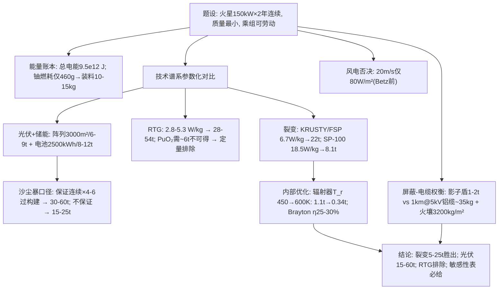

# 2024 题B：火星 150 kW 电源最小质量设计（Mars Electrical Power）

> 赛题来源：UPC 2024 Problem B（681 队投稿，题 B 金奖仅 3 队 ≈0.44%，为近年最少）

## 1. 题目原文与关键数据

**原文压缩引用**：
> A base on Mars will require a power system that can continuously provide 150 KW for at least 2 Earth years. We need to design this power system with the smallest amount of mass to minimize the cost of sending this to Mars. What is the minimum mass that such a power system could have? Assume that the crew of the base can do work for assembly and maintenance of the power system.

**中文翻译**：火星基地需要一套电源系统，**连续**输出 150 kW 电功率、至少 **2 个地球年**。以"发射质量最小"为目标设计该系统，求可达的最小质量。假设乘组可承担装配与维护工作。

**题面给定参数表**——题面只给三个数，其余全部要自己定义：

| 参数 | 取值 | 备注 |
|---|---|---|
| 电功率 $P_e$ | 150 kW | "continuously" 是全题题眼 |
| 寿命 | ≥2 地球年 $=6.31\times10^7$ s | 总电能 $9.47\times10^{12}$ J |
| 目标函数 | 系统总发射质量最小 | 质量边界（含不含屏蔽/储能/电缆）必须自定并声明 |
| 火星环境 | $g=3.71\ {\rm m/s^2}$；$\rho\approx0.020\ {\rm kg/m^3}$；晴空均辐照 ~590 W/m²；存在全球沙尘暴 | 自取并给出处 |
| 乘组劳动 | "免费"资源 | 装配、清尘、堆火壤屏蔽、拉电缆 |

## 2. 题目到底在问什么（去模糊化）

1. **"continuously" 是最大的分叉点**：夜晚与全球沙尘暴期间也要 150 kW 吗？全球沙尘暴可持续数周至数月、直射辐照可跌到晴空的 15–25%。必须先定义可用性口径（设计基准工况 vs 最恶劣工况保证），否则"最小质量"没有定义。这是 681 队只有 3 队拿金奖的直接原因之一。
2. **"power system" 的质量边界**：发电、储能、热控（辐射器）、屏蔽、配电、结构是否计入？不声明边界，数字不可比。
3. **"minimum" 要求参数化而不是罗列**：在技术谱系（光伏+储能 / RTG / 裂变堆 / 风能）上建立质量随功率的标度模型，对连续变量（辐射器温度、转换效率、屏蔽距离）求优，对离散技术做对比——给一个魔法数字等于没做。
4. **最后一句是题面赠送的钥匙**：乘组可劳动意味着可以把部分质量外部化——清理光伏板尘埃、用火星土壤替代屏蔽体、远置反应堆拉高压电缆。用不用这把钥匙，答案差 3–10 t。

## 3. 物理建模路线图

**层次 1：能量与质量账本（先算死两件事）**

- 总电能 $E=P_et=9.47\times10^{12}$ J。裂变路线按 $\eta=25\%$ 需热能 $3.8\times10^{13}$ J；铀-235 裂变释能 $8.2\times10^{13}$ J/kg → **只需裂变 ~460 g**，按 3–5% 燃耗装料 10–15 kg 富集铀——燃料质量与寿命（2 年）完全不是约束，约束全在功率密度硬件上。
- 风能一票否决：火星 20 m/s 大风时功率密度 $\frac12\rho v^3=0.5\times0.02\times8000=80$ W/m²（Betz 后 ~47），供 150 kW 需数千平方米风轮，且沙尘暴与风常同时失效。

**层次 2：三条技术路线的参数化质量模型**

- **光伏 + 储能**：赤道日辐照 ~4.8 kWh/m²/天（NASA TM-102299），电池效率 30%、系统效率 0.85 → 阵列 $A=3600/1.22\approx3000$ m² → 按 2–3 kg/m² 计 6–9 t；夜间储能 $1800\ {\rm kWh}/(0.8{\rm DoD}\times0.9)\approx2500$ kWh → 按 250 Wh/kg 计 8–12 t；**若保证沙尘暴期连续**需 ×4–6 过构建 → 总 30–60 t；若不保证、口径声明清楚 → 15–25 t。乘组清尘可回收部分降额。
- **RTG**：MMRTG ~2.8 W/kg、GPHS-RTG ~5.3 W/kg → 150 kW 需 **28–54 t**；且按 MMRTG 比例需 ~6 t PuO₂（全球年产量公斤级）——物理与供给双重不可行，必须定量排除而非一句带过。
- **裂变堆（最优）**：公开设计比功率 KRUSTY 10 kWe/~1500 kg ≈ 6.7 W/kg、NASA FSP 40 kWe/~6 t ≈ 6.7 W/kg → 150 kW 需 ~22 t；SP-100 设计 100 kWe/5422 kg ≈ 18.5 W/kg → 8.1 t。内部再优化两项：
  - **辐射器是主导项**：废热 $P_e(1/\eta-1)=450$ kW，$A_{rad}=P_{rej}/(\varepsilon\sigma T_r^4)$：$T_r=450$ K → 215 m²/1.1 t（5 kg/m²）；$T_r=600$ K → 68 m²/0.34 t。提高排热温度（高温气冷堆 + Brayton，$\eta$ 25–30%）是质量优化第一杠杆。
  - **屏蔽–电缆权衡**：机上影子盾 1–2 t；改为"距离 + 火壤"——乘组堆 2 m 火壤（1600 kg/m³ → 3200 kg/m² 面密度）近乎免费；5 kV 输电 1 km、5% 损耗仅需 I=30 A、回路电阻 8.3 Ω → 铝缆截面 $6.4\times10^{-6}$ m²、**约 35 kg**。屏蔽质量可压到 ~0.5 t。

**结论框架**：裂变 5–25 t（激进自研参数化 ~5–8 t，公开设计缩放 8–25 t）胜过光伏 15–60 t 与 RTG ≥28 t；**"最小质量" ≈ 5–10 t 量级，保守工程口径 10–25 t**，答案的价值在参数链而非端点。

**层次 3：可选扩展**：双堆冗余与负载因子；沙尘暴频次与电池循环寿命（730 次深循环）核算；昼夜负载管理；发射成本–质量–风险的折中讨论。

## 4. 关键物理效应量级表

| 效应/选项 | 估算量级 | 是否必须建模 | 估算依据 |
|---|---|---|---|
| 总电能 | $9.47\times10^{12}$ J（2 年） | 必须 | $P_e t$ |
| 铀燃耗 | 裂变 ~460 g；装料 10–15 kg HEU | 必须（排除"2 年是约束"） | $8.2\times10^{13}$ J/kg、3–5% 燃耗 |
| 光伏阵列 | ~3000 m²、6–9 t | 必须 | 4.8 kWh/m²/天、η=30%、2–3 kg/m² |
| 储能电池 | 2500 kWh → 8–12 t | 必须 | 1800 kWh/夜、250 Wh/kg、80% DoD |
| 沙尘暴过构建 | ×4–6 → 光伏总 30–60 t | 必须（口径决定） | 全球沙尘暴直射 → 15–25% |
| RTG | 28–54 t；PuO₂ ~6 t 不可得 | 必须排除 | MMRTG 2.8 / GPHS 5.3 W/kg |
| 裂变基准 | 6.7–18.5 W/kg → 8–22 t | 必须 | KRUSTY / FSP / SP-100 公开数据 |
| 辐射器 | 450 K：215 m²/1.1 t；600 K：68 m²/0.34 t | 必须（质量主导项） | $\varepsilon\sigma T_r^4$、5 kg/m²、废热 450 kW |
| 火壤屏蔽 | 2 m → 3200 kg/m²，替代 1–2 t 影子盾 | 建议（用足乘组劳动） | 1600 kg/m³ × 厚度 |
| 高压输电 | 5 kV、1 km、5% 损耗 ≈ 35 kg 铝 | 建议（屏蔽可远置） | $A=\rho\cdot2L/R$ |
| 风能 | 80 W/m²（Betz 前） | 排除 | $\frac12\rho v^3$，$\rho=0.02$ |
| 答案区间 | 裂变 5–25 t；光伏 15–60 t；RTG ≥28 t | 必须 | 参数化模型 + 敏感性 |

## 5. 求解算法与数值要点

- **本题主线无高深数值**，本质是"参数化质量模型 + 技术谱系对比 + 一维优化 + 敏感性分析"。最佳呈现是一张系统质量分解表：每一行（堆芯/转换/辐射器/屏蔽/电缆/PMAD）都带标度律与出处，评委可逐行复核。
- **求最小**：对连续变量（$T_r$、$\eta$、堆-基地距离）各做一维扫描找拐点；对离散技术（光/同位素/裂变）做谱系对比图（质量 vs 功率曲线族）。
- **验证**：能量账本逐工况闭合（发电 = 负载 + 损耗 + 弃电/存电）；电池循环寿命与沙尘暴频次核算；裂变堆满功率与沙尘暴工况两套热平衡。
- **数值陷阱**：电功率与热功率混淆（150 kW 电 ↔ 450–600 kW 热）；辐射器面积按电功率而非**废热**算；电池"装机容量"与"可用容量"（DoD、效率）混淆；屏蔽质量拍一个数不写面密度假设；火星辐照 590 W/m² 是晴空均值，不能×24 h 直除。

## 6. 常见错误与陷阱

1. **不定义"连续"口径**：晴空光伏答案 ~12 t 直接交卷，评委一句"沙尘暴与夜里呢"即毙——这是本题金奖率 0.44% 的主因。
2. **质量边界不声明**：不算储能/热控/屏蔽/电缆，与别人答案不可比。
3. **RTG 只除以比功率**：既不做 Pu-238 供给核查，也不引出处数字。
4. **裂变堆只给一个 W/kg**：不拆堆芯–转换–辐射器–屏蔽，就没有"最小"可言——辐射器温度这个最大的杠杆消失。
5. **弃用题面最后一句**：不用乘组劳动（火壤屏蔽、清尘、装配）等于丢掉题目送的 3–10 t 质量。
6. **把 590 W/m² 当峰值**、或忽略 2 年寿命对电池循环次数与沙尘暴遭遇频次的含义。

## 7. 全网参考与延伸

1. **Gibson et al., KRUSTY 核热-斯特林地面试验（NASA NTRS 20180005435）**（[ntrs.nasa.gov](https://ntrs.nasa.gov/citations/20180005435)）——1 kWe 裂变电源地面试验的官方报告，Kilopower 系统质量与比功率的权威出处，裂变路线标定的首选文献。
2. **Appelbaum, Solar Radiation on Mars, NASA TM-102299**（[镜像 large.stanford.edu](http://large.stanford.edu/courses/2017/ph240/black1/docs/nasa-tm-102299.pdf)）——火星表面 ~590 W/m² 均辐照与逐日辐照模型，光伏路线所有输入数据的源头。
3. **DOE：Powering Curiosity – Multi-Mission Radioisotope Thermoelectric Generators**（[energy.gov](https://www.energy.gov/ne/articles/powering-curiosity-multi-mission-radioisotope-thermoelectric-generators)）——MMRTG ~110 W_e/45 kg 与 PuO₂ 装量，做 RTG 定量排除的硬数据。
4. **NASA Fission Surface Power 概念报告（NTRS 20200001569）**（[ntrs.nasa.gov](https://ntrs.nasa.gov/citations/20200001569)）——现役工程基线 40 kWe/约 6 t，线性缩放到 150 kW 即 ~22 t，作保守锚点与乐观自研设计的对照。

## 8. 金牌队伍名单与机构观察（2024 年官方未公开金牌论文）

**题 B 金奖仅 3 队**：南京航空航天大学 128（指导 Kan Caixia）、南京航空航天大学 367（XingZhong Zhu）、国防科技大学 659（Liu Yonglu）。

**机构观察**：① 金奖率 0.44%，远低于题 A 的 1.8%——开放系统设计题的评委共识面窄，答案区间大；② 两所获奖校（南航航天学院、国防科大）恰是空间电源与飞行器总体设计的传统强校；③ 值得注意的是 Kan Caixia 一位教师在 2025 年题 B 又带出 2 支金奖队——赛前训练体系与论文模板的复用效应非常显性。

**常见解法路线推断**：金奖卷大概率是"技术谱系质量模型对比（光伏/RTG/裂变）+ 明确的连续性口径 + 参数化拆解 + 敏感性表"；拉开差距的应是三处——是否把乘组劳动（火壤屏蔽/清尘）写进模型、是否做了屏蔽-电缆（远置堆）权衡、以及裂变堆是否有内部优化变量（辐射器温度、转换效率）而非单一 W/kg 缩放。

## 9. 评分要点：评委想看什么

- [ ] "continuously" 口径定义（夜间/沙尘暴是否保证）并全程一致执行。
- [ ] 质量边界声明：储能、热控、屏蔽、配电是否计入总质量。
- [ ] 至少三条技术路线的参数化质量模型，标度律与比功率数字有文献出处。
- [ ] 裂变路线有内部拆解与优化变量（辐射器温度、效率、屏蔽策略），而非一个 W/kg 了事。
- [ ] 排除项定量封口：风电功率密度、RTG 的 Pu-238 供给。
- [ ] 用足"乘组可劳动"：火壤屏蔽、清尘、装配至少一项落入模型并给出质量收益。
- [ ] 敏感性分析（效率、比功率、屏蔽距离、口径）+ 结论以区间与"最可能值"呈现。
