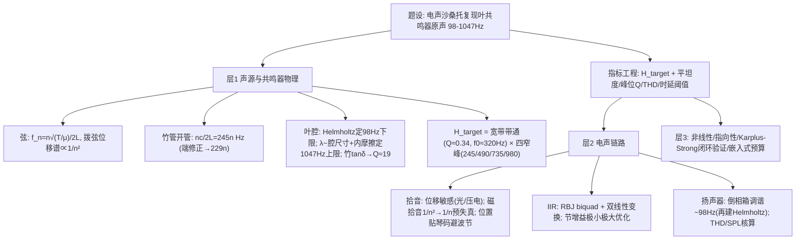

# 2025 题A：电声沙桑托琴的声学保真（Acoustic Preservation of the Electric Sasando）

> 赛题来源：UPC 2025 Problem A（838 队投稿；题 A 金奖 3 队，官方公开全部论文）

## 1. 题目原文与关键数据

**原文压缩引用**：
> The sasando is a traditional Indonesian string instrument where sound is produced by vibrating strings acoustically amplified through a hand-formed, dried lontar leaf resonator. This unique resonator naturally amplifies frequencies between 98 Hz and 1047 Hz. The strings are mounted on a bamboo tube measuring 70 cm in length with a diameter of 8 cm. Modern electric versions replace the resonator with a pickup and speaker, sacrificing acoustic quality for portability. Your challenge is to develop a method for the electric sasando to replicate the authentic acoustic sound of the traditional instrument.

**中文翻译**：沙桑托（sasando）是印尼传统弦乐器，琴弦振动由手工编织、晒干的龙脑棕（lontar）叶共鸣器作声学放大，该共鸣器天然增强 **98–1047 Hz** 频段。琴弦装在**长 70 cm、直径 8 cm 的竹管**上。现代电声版用拾音器+扬声器取代共鸣器以换取便携性，却牺牲了原声音色。任务：设计一种方法，让电声沙桑托复现传统乐器的原声。

**题面给定参数表**——题面几乎全是"软信息"，数值要靠物理自己挖：

| 参数 | 取值 | 物理含义 |
|---|---|---|
| 通带 | 98–1047 Hz（G2–C6） | 目标传递函数的支撑区间 |
| 竹管 | $L=70$ cm、$d=8$ cm | 开管驻波 $f_n=nc/2L=245n$ Hz（含端修正 → ~229n Hz） |
| 共鸣器 | lontar 叶手工成形 | 宽带带通 + Helmholtz 低频下限；不可解析精算 → 需参数化/测量 |
| 拾音/放声 | 自选 | 磁/压电/光学拾音；扬声器与箱体 |
| 自取 | $c=343$ m/s；采样率 $f_s$；全部保真指标 | "保真"判据自定（见 §2） |

## 2. 题目到底在问什么（去模糊化）

1. **"authentic acoustic sound" 是全题的模糊词**，必须操作化为可测判据集：通带频响平坦度（±x dB）、各谐振峰位/峰宽（Q 值）、瞬态衰减时间 $\tau=Q/(\pi f)$、THD、群时延/起音、谱质心、端到端时延（<10 ms 听感阈值）与响度。三支金奖队无一例外先建指标体系——这是本题第一评分点。
2. **"replicate" 的对象是一条传递函数**：传统琴的声链是"弦→叶共鸣器→空气"，电声链是"弦→拾音器→滤波→功放→扬声器"。保真 = 两链传递函数（含非线性与瞬态）一致。目标频响 $H_{target}(f)$ 从哪来？无实物琴的队伍用物理先验（Helmholtz + 开管驻波 + 内摩擦阻尼 + 类比吉他/曼陀林），有条件的提测量方案——数据来源必须声明。
3. **拾音器物理本身在"保真"范围内**：磁拾音是速度敏感（法拉第感应），会把理想拨弦位移谱的 $1/n^2$ 改写为 $1/n$，高次谐波被人为抬高（电吉他"偏亮偏尖"的根源），后级 EQ 补不回相位与瞬态——选位移敏感的光学/压电拾音是物理正解。
4. **题面尺寸不是废参数**：70 cm 竹管直接给出 245n Hz 的窄谐振序列，98 Hz 下限对应叶腔 Helmholtz 模式，1047 Hz 上限对应"波长与腔体尺寸可比、集总失效"。题面三句话就是目标频响的完整物理骨架。

## 3. 物理建模路线图

**层次 1：声源与共鸣器物理（构造 $H_{target}$）**

- 弦：$f_n=\dfrac{n}{2L}\sqrt{T/\mu}$，拨弦位移谱基幅 $\propto 1/n^2$（决定激励的谐波结构）。
- 竹管开管驻波：$f_n=nc/2L=245n$ Hz → 245/490/735/980 Hz 四阶恰落在通带内；精修计入两端开口修正 $\Delta L\approx0.6r$（$r=4$ cm）→ $L_{eff}=0.748$ m → $f_1\approx229$ Hz（偏移 ~6%）。
- 叶共鸣器：低频下限 98 Hz → Helmholtz 模式 $f_H=\dfrac{c}{2\pi}\sqrt{\dfrac{A}{VL_{eff}}}$；高频上限 1047 Hz（$\lambda\approx0.33$ m 与腔体尺寸可比）→ 集总假设失效 + 竹材内摩擦（$\tan\delta\approx0.05\Rightarrow Q\approx19$）+ 表面散射三机制封顶。
- 合成目标频响：$H(f)=H_{HP}\cdot\prod_k H_{peak,k}(Q_k,g_k)\cdot H_{LP}$——宽带低 Q 带通（$f_0=\sqrt{98\times1047}\approx320$ Hz、$Q\approx0.34$）× 四个窄 Q 谐振峰。

**层次 2：电声链路与数字实现**

- 拾音：光学/压电（位移敏感、非接触/低侵入）优于磁（速度敏感、谐波预失真）；拾音位置用波动方程定——$n$ 次谐波的拾取幅度 $\propto\sin(n\pi x/L)$，贴琴码（$x\to L$）可避开波节、保留最多谐波与动态余量。
- 补偿滤波：参数化 IIR——RBJ 带通/峰化 biquad 节，双线性变换离散化（$f_s=44.1/48$ kHz 时 980 Hz 频率翘曲 <0.02%，可证可忽略；$f_s=8$ kHz 省算力但须防拾音信号带外混叠）；宽带节 + 四窄峰节级联或并联，节增益做极小极大优化压平坦度。
- 扬声器（最易被漏掉的一环）：小口径喇叭低频自然滚降——倒相箱调谐到 ~98 Hz，即**电声箱体重新做一个 Helmholtz 共振接回叶腔下限**；另需核算最大声压级与 THD，滤波器频响 ≠ 系统声学频响。

**层次 3：可选扩展**：幅度依赖阻尼与交叉调制（LTI 假设的边界）；共鸣器扇形结构的指向性辐射；演奏力度响应；Karplus-Strong 拨弦合成做"无实物闭环验证"；嵌入式实现预算（MIPS/内存/成本）。

## 4. 关键物理效应量级表

| 效应 | 估算量级 | 是否必须建模 | 估算依据 |
|---|---|---|---|
| 竹管驻波序列 | $245n$ Hz（端修正 → $229n$） | 必须 | $nc/2L$；$\Delta L\approx0.6r\times2$ |
| 通带中心/带宽 | $f_0\approx320$ Hz、BW 949 Hz、$Q\approx0.34$ | 必须 | $f_0=\sqrt{f_Lf_H}$，低 Q=宽带共鸣 |
| 竹材阻尼 | $\tan\delta\approx0.05\Rightarrow Q\approx19$；$\tau=Q/\pi f\approx25$ ms @245 Hz | 建议 | 内摩擦；衰减/音符重叠 |
| 磁拾音谐波加权 | 位移 $1/n^2$ → 输出 $1/n$ | 必须（若选磁拾音） | 法拉第感应对时间导数 |
| 拾音位置波节 | $x=L/N$ 处 $n=N$ 次谐波为零 | 建议 | $\sin(n\pi x/L)$ |
| 采样率频率翘曲 | 980 Hz @44.1 kHz：$<0.02\%$ | 可忽略（但要证明） | 双线性变换 |
| 高次谐波混叠 | $f_s=8$ kHz 时 Nyquist 4 kHz | 讨论 | 拾音信号带外内容 |
| 扬声器低频下限 | 封闭箱 $f_c$ 随 $V_b$ 缩小上移；倒相调谐 ~98 Hz | 建议 | 同一 Helmholtz 公式 |
| 端到端时延 | 听感阈值 ~10 ms；可实现 <1 ms | 必须 | 直接监听双通路干涉 |
| 谐振拖尾 | $Q=8$→10 ms、$Q=19$→25 ms 音符串音 | 讨论 | $\tau=Q/\pi f$ |

## 5. 求解算法与数值要点

- **方法栈**：模拟原型（RBJ 带通/峰化 biquad 公式）→ 双线性变换 → 级联/并联二阶节 → 节增益极小极大优化压通带波纹；稳定性用极点位置（$|a_2|<1$ 裕度）验证。
- **无实物验证闭环**：Karplus-Strong 合成拨弦激励 + 目标频响参考模型，逐音比对频响 RMS 误差、波形相关系数、谱质心偏移；扫频时频图核对峰位与 Q。
- **数值陷阱**：biquad 系数量化后极点贴近单位圆导致失稳或音染；窄 Q 节的群时延在峰附近可达毫秒级，谐波去同步改变起音"软硬"；把"滤波器频响达标"误当"系统声学达标"（末级扬声器必须单独验证）；$f_s$ 与抗混叠滤波器的配套。

## 6. 常见错误与陷阱

1. **把"保真"当"能出声"**：不给任何可测指标与验收阈值，论文无从评判。
2. **只抄 98–1047 Hz 做理想带通**：丢掉竹管 245n Hz 四个窄谐振峰——恰是题面尺寸白送的音色骨架。
3. **忽略拾音器物理**：默认磁拾音"透明"，速度敏感造成的 $1/n$ 预失真后级补不回。
4. **目标频响凭空设定**：无物理先验、无测量方案、无类比论证，参数沦为纯拟合。
5. **只做频域**：不做起音、衰减、THD 等时域/失真维度，也无实时性与硬件预算。
6. **交付物残缺**：题目要"一种方法"，完整交付应是传感→滤波→功放→扬声器→验证的全链路，单个滤波器不是答案。

## 7. 全网参考与延伸

1. **Wikipedia: Sasando**（[en.wikipedia.org/wiki/Sasando](https://en.wikipedia.org/wiki/Sasando)）——罗特岛竹管齐特琴的构造（竹管弦架、lontar 叶扇形共鸣器、调音用的圆形木环 bifa）与传统/gong/biola/电声变体，是引言与结构假设的可靠出处。
2. **Songlines: Sasando instrument guide**（[songlines.co.uk](https://www.songlines.co.uk/content/features/sasando-musical-instrument-guide-with-aga-ujma)）——音域、弦数与演奏形态的通俗介绍，帮助确定弦数（数十根）与音区假设的合理性。
3. **Indonesia Museum: Sasando Music and Rote Island's Cultural Memory**（[indonesiamuseum.org](https://indonesiamuseum.org/en/articles/sasando-music-and-rote-islands-cultural-memory)）——手工成形叶共鸣器的制作工艺，可用于论证"共鸣器无法解析精算、必须参数化或实测"这一建模立场。

## 8. 金牌论文思路对比

- **112（重庆邮电大学）——参数化 IIR 路线**：从弦谐波与竹管半波长共振出发辨识四个谐振模 245/490/735/980 Hz（$Q=8$、增益递减），六节 biquad 级联 + 极小极大优化；交付全指标体系（平坦度 <0.1 dB、THD 0.40%、2778 倍实时、0.58 KB 内存、极点裕度），并以谱质心统计证明音色增强跨音域一致。详见 [05_论文赏析/2025/2025-GM-A-112.md](../05_论文赏析/2025/2025-GM-A-112.md)。
- **182（滑铁卢大学）——系统工程路线**：先按物理机理对比磁/压电/光学拾音并选光学（位移敏感、非接触），再用波动方程证明拾音点应贴琴码（避开 $\sin(n\pi x/L)$ 波节、保留高次谐波与 headroom）；滤波端宽带 biquad（$Q\approx0.34$）+ 竹管四峰窄带节（$Q=19\pm2$ 由竹材 $\tan\delta$ 推出并**误差传递到每个滤波器系数**）；Class AB 功放 + 动圈扬声器全链路框图。详见 `2025-GM-A-182.md`。
- **485（南京理工大学）——物理先验路线**：Helmholtz 定 98 Hz 下限（配小 $ka$ 辐射失配论证）、开管驻波定四峰、"双腔耦合阻抗"解释峰与包络重合、上限三机制（集总失效/内摩擦/散射）；RBJ 峰化 EQ + Butterworth 高低通级联，8 kHz 低算力实现（0.25 MIPS、<$25 Cortex-M4），Karplus-Strong 仿真闭环验证（频响 RMS 0.73 dB、七类判据全过）。详见 `2025-GM-A-485.md`。
- **共同点与分歧**：三队都把"像不像"翻译成指标体系，且 245n Hz 竹管序列都是核心参数；分歧在目标频响来源（纯物理先验 vs 类比/测量）、拾音器是否纳入建模（仅 182 完整建模）、以及验证深度（112/485 有合成激励闭环，182 偏系数级误差传递）。

## 9. 评分要点：评委想看什么

- [ ] "authentic" → 可测判据集（频响平坦度、峰位/Q、THD、时延、响度）+ 明确阈值。
- [ ] 目标传递函数有出处：物理先验（Helmholtz + 开管 + 阻尼）或测量方案，假设透明。
- [ ] 拾音器类型及其频谱权重被讨论（速度 vs 位移敏感），而非默认"透明"。
- [ ] 题面尺寸进了模型（245n Hz、端修正、Helmholtz），无废参数。
- [ ] 端到端验证含扬声器末级；有实时性/算力/成本预算。
- [ ] 局限与扩展（非线性、指向性、演奏交互）诚实讨论；有余力给嵌入式落地路径。
