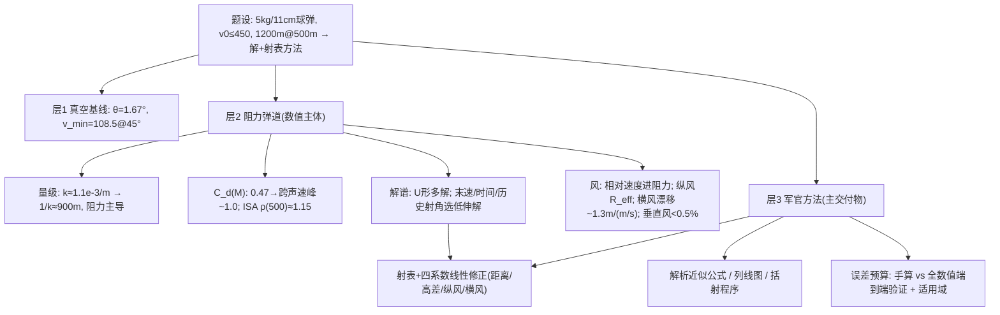

# 2025 题B：19 世纪火炮弹道与无计算器射表（Artillery）

> 赛题来源：UPC 2025 Problem B（838 队投稿；题 B 金奖 13 队，官方公开全部论文）

## 1. 题目原文与关键数据

**原文压缩引用**：
> Consider a cannon 150 or 200 years ago that fired spherical 5 kg projectiles that are 11 cm in diameter with a muzzle velocity of up to 450 m/s. If our target is at a horizontal distance of 1,200 meters, and both the cannon and the target are at an altitude of 500 meters above sea level, what muzzle velocity and firing angle above the horizontal will successfully hit the target? Then, consider targets at horizontal distances between 1,000 meters and 1,500 meters, at a variety of different altitudes, and accounting for different amounts of wind. Develop a method that an artillery officer trained in mathematics, but lacking computers or calculators, could use to quickly estimate a successful muzzle velocity and firing angle.

**中文翻译**：19 世纪火炮发射 5 kg、直径 11 cm 的球形弹，初速至多 450 m/s。目标位于水平距离 1200 m 处，炮与目标同为海拔 500 m。求能命中目标的初速与射角。再考虑 1000–1500 m 的水平距离、不同海拔与不同风况，设计一种"受过数学训练、但没有计算机或计算器"的军官能快速估算初速与射角的方法。

**题面给定参数表**：

| 参数 | 取值 | 备注 |
|---|---|---|
| 弹质量 $m$ | 5 kg | 密度 $m/(\pi d^3/6)=7174$ kg/m³ ≈ 铸铁，题面数值自洽（可作 credibility 检查） |
| 弹径 $d$ | 11 cm | 迎风面积 $A=9.50\times10^{-3}$ m²；截面密度 $m/d^2=413$ kg/m² |
| 初速上限 | 450 m/s | 500 m 处声速 ~338 m/s → **出膛 M1.33，超声速** |
| 基准目标 | 水平 1200 m、同海拔 500 m | $\Delta h=0$ 基线 |
| 参数域 | 1000–1500 m × 各种海拔 × 各种风 | 第二问 = 射表/速算方法 |
| 自取 | ISA 大气（500 m：$\rho\approx1.15$ kg/m³）、$C_d(M)$、风模型 | 模型保真度的主要自由度 |

## 2. 题目到底在问什么（去模糊化）

1. **第一问是"解的结构"而非"一个解"**：真空下 450 m/s 对应高/低两个射角；加阻力后解变成 $(\theta,v_0)$ 平面上的 U 形曲线族（金奖队报出 3°–82°、~14 组离散解到 366 组连续解对不等）。必须呈现解谱，并回答**选哪个解、凭什么**——末速/侵彻（高角解落地 ~136 m/s ≈ 球形弹终端速度，几乎无侵彻）、飞行时间（3.8 s vs 14+ s）、历史射角教范（野战直射 0–10°）三把尺子。
2. **第二问的交付物是"方法"而非数**：可操作化为四类——预计算射表 + 线性修正系数、解析近似公式（真空内核 + 修正）、列线图（nomogram）、试射括约程序（bracketing）；并附**误差预算与端到端验证**。没有误差预算的"速算方法"等于没交付。
3. **"various altitudes" 双重含义**：目标相对高差 $\Delta h$ 进边界条件（$y_{land}=h$），绝对海拔进大气 $\rho(h)$——两者都要建模，混为一谈是常见错。
4. **"amounts of wind" 的历史语境**：19 世纪没有风速计——用蒲福风级把风离散化、用目测描述（烟、旗、树）绑定风速档位，是"无计算器"约束下建模能力的加分项。
5. **历史可操作性约束**：初速由装药量决定且只能离散档位（等比装药 → $v\propto\sqrt{n}$），军官调的是装药与射角两个离散/半连续量，不是连续旋钮。

## 3. 物理建模路线图

**层次 1：真空基线（闭式内核）**

$$R=\frac{v_0^2\sin2\theta}{g}\quad\Rightarrow\quad \theta(450{\rm\,m/s})=1.67^\circ,\qquad v_{min}=\sqrt{gR}=108.5\ {\rm m/s}\ (45^\circ)$$

作为对照基线与速算内核（496 队的初估公式 $\theta\approx\sqrt{R/70}+2^\circ$ 即由此改造）。

**层次 2：阻力弹道（数值主体）**

$$m\dot{\vec v}=m\vec g-\tfrac12\rho(h)\,C_d(M)\,A\,|\vec v-\vec w|(\vec v-\vec w)$$

- **量级先行**：$k=\rho C_dA/2m\approx1.1\times10^{-3}\ {\rm m^{-1}}$（$C_d=1$）→ 速度特征衰减长度 $1/k\approx900$ m，与射程同量级 → 阻力是主导修正：450 m/s 低伸解从 1.67° 升至 ~2.7–3.5°；最小初速从 108.5 升至 ~118–144 m/s（随 $C_d$ 模型而异）；阻力全程耗散动能 49–79%。
- **$C_d(M)$ 是物理保真度的胜负手**：450 m/s 起步 M1.33、落地亚音速，全程跨越跨声速峰（球：0.47 → ~1.0 @M1.2–1.5 → ~0.9）。全程恒定 0.47 是最常见的第一性错误；可选 Morrison($Re$)、分段 $C_d(M)$、Loth 2021 Re–Ma 复合式，或 765 队的自建 Re–Ma 耦合模型。
- **大气**：ISA 对流层（500 m $\rho\approx1.15$）或指数大气 $H\approx8500$ m，差 <5%。
- **多解与选解**：U 形解谱 + 末速阈值（如 200 m/s 侵彻线）+ 时间 + 历史射角 → 推荐低伸解（各队 2.66°–4°/450 m/s 或最小初速 118–144 m/s/39–43°）。
- **风**：相对速度进阻力（改变力的大小与方向）；纵风用等效射程 $R_{eff}=R-v_{w,\parallel}t_f$（~−0.01°/(m/s)）；横风漂移 $z\approx W\,[\,t-\tau(1-e^{-t/\tau})\,]$，$\tau=1/(kv)$ ~2 s，量级 **~1.3 m/(m/s)**（188 队拟合斜率 1.314）；垂直风 <0.5% 可略；科氏偏移 0.2–7 m，用上界式或 Rossby 数定量封口。

**层次 3：军官方法（本题主交付物）**

- **射表法**：网格预计算（如 50 m × 50 m × 装药档）+ 四类线性修正系数（距离/高差/纵风/横风），每个系数用中心差分标定并报告线性度（$R^2$）与适用域；高角端密度非线性要单列。
- **公式法**：$\theta=\theta_{std}+k_x\Delta R+k_h\Delta h+k_w W$ 或等效射程折算，配口诀（每 50 m 距离修 0.2°、每 25 m 高差修 1.1° 等）。
- **列线图法**（765 队）与**括射法**（496 队：$\pm1.5/3/5/8^\circ$ 分档试射）。
- **历史对照**：Didion 1848、Siacci 1880 平射近似、Krupp 射表——把"无计算器方法"接回真实外弹道学传统，是引言与"方法合理性"的免费加分。

## 4. 关键物理效应量级表

| 效应 | 估算量级 | 是否必须建模 | 估算依据 |
|---|---|---|---|
| 自洽检查 | 弹密度 7174 kg/m³ ≈ 铸铁 | 必须（可信度） | $m/(\pi d^3/6)$ |
| 阻力/重力比 | 出膛 ~1100 N vs 49 N ≈ **22×** | 必须 | $\tfrac12\rho C_dAv^2$ @450 m/s |
| 速度衰减长度 | $1/k\approx900$ m（$C_d=1$） | 必须 | $k=\rho C_dA/2m$ |
| 跨声速 $C_d$ 峰 | 0.47 → ~1.0（M1.2–1.5） | 必须 | 450 m/s = M1.33，先超后亚 |
| 低伸解修正 | 1.67° → 2.7–3.5°（450 m/s） | 必须 | 各金奖队数值带 |
| 最小初速修正 | 108.5 → ~118–144 m/s | 必须 | U 形解谱谷底 |
| 高角解末速 | ~136 m/s ≈ 终端速度 $v_t=\sqrt{2mg/\rho C_dA}$ | 选解判据 | 侵彻不足 → 淘汰高角 |
| 纵风 | ~−0.01°/(m/s)（低角） | 必须 | $R_{eff}=R-v_wt_f$ |
| 横风漂移 | ~1.3 m/(m/s) @1200 m | 必须 | $z\approx W(t-\tau)$，阻尼弛豫 |
| 垂直风 | 落点偏差 <0.5% | 可略（数值对照） | 264 队三组对照仿真 |
| 科氏力 | 侧偏 0.2–7 m（低角→高角） | 可略（定量封口） | 上界式 / Rossby 数 ≫1 |
| 飞行时间 | 低角 3.7–3.8 s；高角 14+ s | 选解/横风换算 | 数值积分 |

## 5. 求解算法与数值要点

- **数值主线**：RK45 / `ode113` + 事件函数（落地过零检测）+ 外层求根（Brent/fsolve/LM）或参数网格遍历；解谱用 $(\theta,v_0)$ 平面 U 形曲线呈现最直观。步长收敛（$\Delta t\le10^{-3}$ s）与 `rtol/atol` 10⁻⁸ 级是标配。
- **修正系数标定**：以基准点为中心差分（风 ±10 m/s、距离 ±50 m、高差 ±50 m）取线性系数，报告 $R^2$ 与适用范围；交互项显著性检验（155 队证明可忽略、加法合成合法）是细节加分。
- **验证五件套**：① 真空极限对照（1.67°/108.5 m/s）；② 步长收敛；③ 能量账（阻力耗散 49–79%）；④ 修正公式回代全数值的落点偏差图；⑤ 手算方法端到端误差 vs 验收阈值（如 ±25 m）。
- **数值陷阱**：阻力按分量平方 $[v_x^2,v_y^2]$ 分解而不按模长 $\sqrt{v_x^2+v_y^2}$（方向错误，311 队问题一即有此瑕疵）；风只改初速或当恒力；插值外推超出射表有效域；把"海拔 500 m"只当 $\Delta h=0$ 而忘掉 $\rho(500)<\rho(0)$；Euler 大步长 + 跨声速 $C_d$ 陡变的组合误差。

## 6. 常见错误与陷阱

1. **$C_d=0.47$ 一条道走到黑**：450 m/s 出膛是 M1.33，跨声速峰贡献了阻力的大头——射角/射角修正系统性偏差可达两位数百分比。
2. **只报一个解、不谈解结构**：U 形多解是本题第一问的本质，选解判据（末速侵彻、时间、历史教范）缺失则"为什么是这个角"无从谈起。
3. **"军官方法"无误差预算、无算例**：评委无法判断这方法能不能用；也没有"手算 vs 全数值"的端到端验证图。
4. **横风漂移用 $W\times t_f$ 上界**：忽略阻力弛豫（$\tau\approx2$ s），高估 2–3 倍。
5. **线性修正不做线性度检验**：高角端密度沿弹道变化使高度修正明显非线性（188 队 $R^2$ 仅 0.814 并解释了原因——这才是诚实写法）。
6. **丢掉历史语境分**：装药离散（$v\propto\sqrt n$）、无风速计（蒲福风级）、直射教范 0–10°——题面给的 19 世纪约束不用，方法就"太现代"。

## 7. 全网参考与延伸

1. **R. McCoy, Modern Exterior Ballistics（全文 PDF）**（[mori.bz.it/Balistica](https://www.mori.bz.it/Balistica/Mc%20Coy%20Modern%20Exterior%20Ballistic.pdf)）——Siacci 平射法、Krupp 射击试验、球弹阻力与射表的标准参考书；"无计算器方法"的历史原型都在这一本里。
2. **B. Litz, How External Ballistics Programs Work（Applied Ballistics）**（[appliedballisticsllc.com](https://appliedballisticsllc.com/wp-content/uploads/2021/06/How-External-Ballistics-Programs-Work.pdf)）——Siacci 闭式解 vs 数值积分的取舍（快但限平射、常密度），直接对应本题"军官速算 vs 数值射表"的双层结构。
3. **D. Tournès, Ballistics during 18th and 19th centuries（HAL）**（[univ-reunion.hal.science](https://univ-reunion.hal.science/hal-01187210/document)）——Didion 1848（承 Poncelet 阻力律）与 19 世纪射表计算史，引言与"历史约束"节的权威综述。
4. **USNI Proceedings 1920: New Methods of Exterior Ballistic Computation**（[usni.org](https://www.usni.org/magazines/proceedings/1920/november/new-methods-exterior-ballistic-computation)）——Siacci 法如何处理沿弹道的空气密度变化，供想把"手算方法"做精的队伍参考。

## 8. 金牌论文思路对比（13 队）

**南航 NUAA 5 队**：
- **127**：低伸弹道拟合式 $\theta_L=0.0001v_0^2-0.1145v_0+29.312$ + 口诀化修正（每 50 m 距离 0.2°、每 25 m 高差 1.1–1.2°、每 m/s 风 0.01°）；以末速 200 m/s 侵彻阈值淘汰高角解。详见 [05_论文赏析/2025/2025-GM-B-127.md](../05_论文赏析/2025/2025-GM-B-127.md)。
- **155**：$(\theta,v)$ 全参数空间遍历（366 组可行解，3°–77°/143–450 m/s）+ 参考点相对坐标最小二乘线性修正；诚实报告风修 ±4° 短板。详见 `2025-GM-B-155.md`。
- **188**：保真度最高——ISA + Loth 2021 $C_d(M,Re)$ + `ode113`，把复杂物理折叠成 $C_X/C_H/C_W/C_Z$ 四个修正系数 + 射表；示例 1300 m/800 m/逆风 5/侧风 10 → 4.02° + 横移 13.1 m。详见 `2025-GM-B-188.md`。
- **204**：量纲分析清点各力（浮力占重 0.017%、科氏、Magnus）后砍成质点 + 分段 $C_d(M)$；fsolve 多起点求全解谱，推荐 4°/450；证明 $v_0(U)\approx v_0^{(0)}+kU$ 近似线性 → 三张射表"一查一乘一加"。详见 `2025-GM-B-204.md`。
- **207**：装药离散 $v_n=v_{max}\sqrt{n/n_{max}}$（三档装药）× 平射/曲射 × 距离的射表体系（Loth $C_d$），射表落点误差 1.2 m。详见 `2025-GM-B-207.md`。

**南理工 NUST 5 队（同一指导教师 Haiping Wu）**：
- **264**：最小初速主线（117.55 m/s @43.5°）+ 蒲福风级离散化 + "真空→风→密度"三步半经验公式（$R^2>0.98$）。详见 `2025-GM-B-264.md`。
- **311**：分段 $C_d(Ma)$ + Euler 法；14 组解族；高/低角两套逐轴线性修正规则，算例误差 ~5 m。详见 `2025-GM-B-311.md`。
- **392**：对数风廓线（真实边界层切变）+ SLSQP 罚函数"弹道计算器" + 二次多项式拟合与 432 行射表双轨。详见 `2025-GM-B-392.md`。
- **428**：8 条假设逐条数值论证（本文最系统）；等效射程查表 + 海拔 4%/km、纵风 0.8、横风密位式三条"解析推导+数值标定"修正；角度误差 ≤0.01°。详见 `2025-GM-B-428.md`。
- **460**：拿破仑时代直射 0–10° 史实圈定 5–8° 实用带；纵风等效射程 $R_{eff}=R-v_wt_f$ + 横风转方位修正；手算-数值误差 0.15–1.29%。详见 `2025-GM-B-460.md`。

**其他三队**：
- **496（孟加拉 RUET）**：真空 vs 真实对照表（450 m/s：1.67°→3.36°）；Rossby 数排除科氏；"皇家炮兵野战手册"式初估 $\theta\approx\sqrt{R/70}+2^\circ$ + 分档括射，±25 m、2–3 发命中。详见 `2025-GM-B-496.md`。
- **765（国防科大）**：自建 Re–Ma 耦合 $C_d$ 模型 + LM 反解；射表 + 修正表 + **列线图** + 心算公式四件套，工具形态最全。详见 `2025-GM-B-765.md`。
- **796（同济）**：大沽口炮台（1841）历史锚点；唯一把自旋 Magnus 力 + 转速衰减完整建入 ODE；以飞行时间/末速动能/弹道高三指标选解 → 2.66°；蒸馏出 $\theta_0\approx x/282+1.016$ 等手算式。详见 `2025-GM-B-796.md`。

**群像观察**：13 席中南航与南理工各占 5 席，且同导师多篇（Kan Caixia 2、Haiping Wu 5）——统一训练模板 + 队际差异化路线的参赛策略极其显性；技术路线上"ISA + 马赫分段阻力 + RK45 + 线性修正射表"已是金奖标配，差异化集中在阻力模型精细度（Loth/自建 Re–Ma）、风场 realism（均匀风 vs 风廓线）、军官方法形态（公式口诀 vs 射表 vs 列线图 vs 括射）与历史约束的显式程度。

## 9. 评分要点：评委想看什么

- [ ] 解的结构呈现（U 形/多解族）+ 明确选解判据（末速侵彻、飞行时间、历史射角教范）。
- [ ] 阻力模型与马赫数匹配（450 m/s 出膛 M1.33），$C_d(M)$ 有出处且跨声速峰被覆盖。
- [ ] 交付的"军官方法"有完整算例、误差预算、适用域，并被全数值解端到端验证。
- [ ] 风（纵/横/垂直）、高差、海拔三类修正系数有标定方法与线性度证据。
- [ ] 19 世纪约束的显式建模：装药离散、无风速计（风级目测）、直射教范。
- [ ] 被忽略项（科氏、Magnus、垂直风、浮力）定量封口而非一句带过；射表/公式附验证例题与失效模式。
