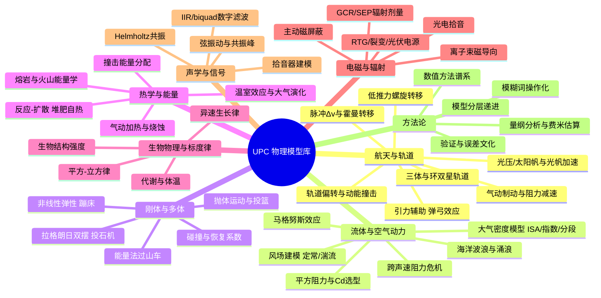

# UPC 2010–2025 物理模型总览

> 本文件是 `08_物理模型综述/` 的总目录与提炼。16 届赛事、32 道题目、74 篇金牌论文涉及的物理模型，按八大专题汇编，各专题的详细解读见本目录 01–08 号文件。

---

## 一、模型全景图谱

---

## 二、八大专题索引

| 文件 | 专题 | 覆盖题目（年份-题号） |
|---|---|---|
| [01_航天与轨道动力学.md](01_航天与轨道动力学.md) | 轨道力学全家桶 | 2010A、2011A、2013A、2014A、2016A、2017A/B、2018A、2020A、2022A |
| [02_流体与空气动力学.md](02_流体与空气动力学.md) | 阻力/马格努斯/大气模型 | 2010A、2011B、2014B、2015B、2020B、2021B、2023A、2025B |
| [03_刚体与多体动力学.md](03_刚体与多体动力学.md) | 拉格朗日/能量法/弹性 | 2010B、2011B、2012B、2015B、2019B、2023B |
| [04_热学与能量输运.md](04_热学与能量输运.md) | 反应-扩散/温室/加热 | 2012A、2015A、2018B、2021A、2021B |
| [05_生物物理与标度律.md](05_生物物理与标度律.md) | 标度律与"生物题物理化" | 2013B、2016B、2019A、2021B |
| [06_电磁辐射与辐射防护.md](06_电磁辐射与辐射防护.md) | 剂量学/磁屏蔽/电源 | 2017B、2019A、2024B、2025A |
| [07_声学与信号处理.md](07_声学与信号处理.md) | 弦振动/滤波器 | 2025A |
| [08_方法论与数值算法总论.md](08_方法论与数值算法总论.md) | **全部论文的公共方法论与写作配方** | 2010–2025 全部 |

---

## 三、十六年演进三阶段

**阶段一：草莽期（2010–2013，第 1–4 届）**
- 论文 8–26 页，附录里放全套代码与数据是惯例；Word 与 LaTeX 并存，数值工具五花八门（C++、MATLAB、Mathematica、Excel）。
- 核心结果多为闭式公式或小规模网格扫描；收敛性检验尚未制度化，图表偶有断链（"Figure ??"）、重复编号。
- 但"把模糊词钉死为可计算判据"的基因从第一届就存在：2010 的 *margin of error*（入射角窗口 0.025°）、2010 的 *maximize damage*（→ 末速度最大化）、2011 的 *successful shot*（→ 11.88 m/s 视觉追踪基准）。
- 代表作：2010-A-160（建议放弃气动制动的反直觉结论 + 步长减半检验）、2013-B-611a（N-S 方程定性 + 异速律 + L-曲线角点法）。

**阶段二：制度化（2014–2019，第 5–10 届）**
- 论文普遍 16–35 页；"理想模型 → 关键修正 → 扩展分析"三段式成为标配；收敛性、灵敏度、极限情形检验开始制度化出现。
- 真实数据库进入论文：JPL 小天体数据库（2015）、134 物种代谢率回归（2016）、NoLimits2 仿真互验（2019）、FIBA 官方参数（2011 已见端倪）。
- 同题多金牌开始成为常态（2017A 三篇、2018A 三篇、2019A 三篇），评委"不设标准答案、只看自洽性"的取向充分显形：同一低推力问题的燃料答案可以差两倍仍同获金牌。
- 代表作：2016-B-441（数据回归 + 假设否证法）、2018-A-295（四子模型 + PSO 反解三容差）、2019-A-289（MgB₂ 主动磁屏蔽 48 吨 vs 被动 130 吨）。

**阶段三：系统工程化（2020–2025，第 11–16 届）**
- 论文 20–111 页；trade study（方案对比表）、误差预算表、验证矩阵成为高频结构；防御性写作（"诚实的弱点与适用域声明"）成为加分项。
- 题型开始"出圈"：从纯力学/航天走向数据驱动（2020B 四旋翼抗风）、生物-工程混合（2021B 小行星海啸）、**振动+信号处理**（2025A 沙桑托琴：物理推导退为滤波器参数的依据）、**可计算性设计**（2025B 无计算器火炮：交付物从"一个数"变成"射表/列线图/心算口诀"这一整套方法）。
- 出现 AI 使用合规声明（2025-A-112）等新要素，反映评审规范随时代演进。
- 中国高校深度参与：2024–2025 金牌榜被南航、南理工、同济、国防科大、上交大等批量包揽，同一学校同题 5 队方案零重叠，是"刻意同题异构训练"的直接证据。
- 代表作：2020-A 四队四条转移路线、2023-A 六队 57–153 km 宽谱、2025-B-428（等效射程变换 + 三条线性修正 + 野战卡）、2025-B-796（111 页四层渐进建模）。

---

## 四、贯穿 16 年的"黄金方法论"（评审不变量）

1. **统一货币**：把不可比的方案变成可比的标量——Δv（2016A）、能量（2015A）、剂量（2019A）、裕度（2015B）、起飞质量（2024B）。
2. **端点锚定再外推**：先在已知情形校准模型（水星/地球、Galileo 任务、MAVEN 数据、Baumgartner 实测、FIBA 数据），再外推到题设的新区域。
3. **模糊词操作化**：damage→末速度、fun→命中窗口、stimulating→加权过载指标、safely stored→撞击概率 <10⁻⁶……先立判据再动手。
4. **模型分层递进**：理想（真空/点质量/定常）→ 关键修正（阻力/大气/转动）→ 扩展（风、海拔、失败模式），每层都有"为什么值得建模"的量级论证。
5. **验证三件套**：收敛性（步长减半）、极限情形（Re→0、阻力→0 退化为解析解）、灵敏度（参数 ±X% 对结果的影响条形图）。
6. **负结果显式报告**：2010-A"放弃气动制动"、2011-A"太空塔不经济"，反直觉且论据扎实的负结论恰恰是高分项。
7. **降维交付**：终值不是"我算出来了"，而是"给出可用的东西"——射表、修正公式、列线图、设计准则、心算口诀。

> 备赛者只需记住一句话：**UPC 评的不是答案，是"判据—方程—数值—检验"这条链的完整与诚实。**

---

## 五、数据速览

| 指标 | 数值 |
|---|---|
| 收录届数 | 16 届（2010–2025），另收录 2026 届页面（未开赛） |
| 收录题目 | 32 道（每年 A/B 两题） |
| 参赛队峰值 | 838 队（2025） |
| 金牌率 | 约 2%（2010：3%；2024：2.2%） |
| 官方公开金牌论文 | 74 篇（2024 年未公开；2013-B-611 与 611a 为同文异版，赏析按 611a） |
| 论文页数范围 | 5 页（2017-A-670）～ 111 页（2025-B-796） |
| 金牌大户（近年） | 南航、南理工、同济、国防科大、上交大密院、多伦多大学、Waterloo |
