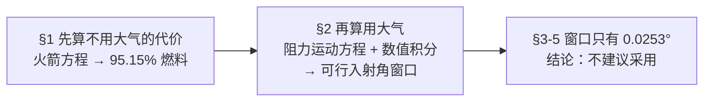

# 精读 01 · Voyage to Neptune（2010 题A 金牌 · 队伍 160）

> **这份精读怎么用**：左手边开论文 PDF（`03_优秀论文PDF/2010/Problem A/2010-GM-A-160.pdf`），右手边开本篇。每个小节我都按「它写了什么 → 为什么这样写 → 你要学什么」三层展开；每个公式都给出「物理直觉 → 完整推导 → 适用边界」；每张图都回答「为什么放这、为什么这样画、怎么画出来（附可运行代码）」。读完这一篇，你应当能独立复现全文，并把它的套路搬到你自己的 48 小时论文里。

---

## 0. 一分钟看懂全文骨架

论文只回答一个问题：**飞船以 30 km/s 飞抵海王星，想减速入轨，"擦大气"这条路线到底靠不靠谱？**

答案的结构是经典的"三段式否决"：



**为什么这个骨架好？** §1 不是废戏——它给 §2 提供了"性价比基准"（省下的燃料要和 95% 对比），也让 §5 的结论有分量（省 75% 燃料但窗口窄到不实用，trade-off 一目了然）。你写论文时也要先立一个"对照方案"，哪怕它注定被否决。

---

## 1. 逐节导读

### 1.1 Abstract（第 1 页）

**它写了什么**：定义符号（R_N≈24764 km、R_atm≈25464 km）→ 说明纯燃料方案代价大 → 引入气动制动及其两难（阻力太强坠毁 / 太弱没用）→ 预告方法（运动方程 + 数值轨迹）→ 给出最终区间 **8.8296° < θ < 8.8549°** 与结论"建议不做"。

**你要学什么**：
1. **摘要里敢放公式化结论**（角度区间、0.0253°）——评委扫一眼摘要就知道你算到了什么深度。大多数队伍的摘要只有形容词。
2. **两句话讲清核心矛盾**（"If the drag force is too strong... On the other hand, if... too weak..."）——开放题没有标准答案时，先把"问题的两难"写清楚，你的建模必要性就自动成立了。
3. **先定义、后使用**：R_N、R_atm 在摘要第二句就钉死（"We define... that is, R_N ≈ 24764 km"），全文再无歧义。

### 1.2 §1 No Atmospheric Entry（第 2–3 页）

**它写了什么**：三步走——(a) 能量判据 E>0 证明当前是双曲线轨道；(b) 相切点变轨求出圆轨道速度 v_f=16.38 km/s、Δv≈13.62 km/s；(c) 从动量守恒**亲手推导**火箭方程，得 m_f≈121 kg，燃耗 95.15%。

**为什么这样写**：这一节是全文的"锚"。注意它连火箭方程都不直接引用，而是用 (1.4)–(1.11) 八步推出来——48 小时论文里，自己推一遍经典公式既展示功底，又让后文 (2.21)–(2.24) 反复调用时"符号主权"在自己手里。

**你要学什么**：**对照组要算到底**。很多队伍写"燃料代价很大"就完了；这里给出 121.19 kg 这个精确到小数点后两位的数，§5 的对比（500 kg vs 2378 kg）才有冲击力。

### 1.3 §2.1 Equations of Motion（第 4–6 页）

**它写了什么**：建模的核心 8 步——极坐标定义引力 (2.2) → 二次阻力 (2.3) → **理想气体定律接出密度** (2.4)(2.5) → 压强随高度指数拟合 (2.6)（两个锚点：1 bar@0 km、0.01 Pa@600 km）→ 温度线性拟合 (2.7)（50 K→260 K）→ 大气简化为纯 H₂ (2.8) → 截面积类比 Voyager 2 (2.10) → 半球形体 c_d≈0.4 (2.11) → **组合参数 σ** (2.12) 压缩方程 → 变换到笛卡尔坐标 (2.15)–(2.19)。

**为什么这样写**：这一节是"数据贫乏下建模"的教科书。海王星大气数据只有两个文献锚点，作者没有瞎编密度表，而是**用物理定律（理想气体）把两个一维拟合（P(h)、T(h)）焊成 ρ(h)**——每一步都可溯源（式号+文献号），这就是评委说的 "well-motivated assumptions"。

**你要学什么**：
- **组合参数技巧**（σ ≡ c_d M_H2 A / 2k_B）：把五个常数打包成一个，方程 (2.14) 从此只含 P(h)/T(h) 一个函数依赖——推导、编码、灵敏度分析全都变简单。你在任何论文里看到"Define σ ≡..."都要注意：这是作者在给后文减负。
- **坐标系选择有交代**：为什么从极坐标转到笛卡尔？因为数值积分时 (x,y) 无奇点、代码好写。作者用 "We make a change of variables... Without loss of generality" 一句带过——**建模转换要说明动机，但不必长篇大论**。

### 1.4 §2.2 Simulation Using MatLab（第 6–7 页）

**它写了什么**：欧拉法、Δt=0.001 s、迭代格式三行伪代码、初始条件设定（(0, R_atm)、角度给定分量速度）、**分区受力**（大气内=引力+阻力；大气外=仅引力；触碰表面=终止并记录）。

**你要学什么**：
1. **数值方法描述的最小完备集**：方法名 + 步长 + 迭代式 + 初始条件 + 边界处理。五行，一样不能少，也一样不用多。
2. **把"程序在算什么"讲成物理语言**：注意它不说"while 循环退出条件"，而说 "the spacecraft may leave the outer atmosphere into space or into Neptune"——代码逻辑翻译成物理事件。
3. **附录放全部代码**（本篇 3 页 MATLAB）：2010 年代金标的标配，今天依然加分（可复现性）。

### 1.5 §2.3 Estimating the Exit Velocity（第 7–8 页）

**它写了什么**：把"省油"操作化——设定燃耗上限 20%（式 2.20），用火箭方程反解出出口速度的允许区间 v∈[15.3759, 17.3841] km/s（式 2.22、2.24）。

**为什么这样写**：这是全文**最关键的"翻译"一步**——题面只说"save a significant amount of fuel"（模糊词），作者把它钉成 20% 这个可计算的数，整个"角度窗口"才有了判定标准。原文自己都承认："a 'significant' saving of fuel is not quantitative enough. For a fair estimation we decided to set 20%"。**这种"把模糊词操作化并说明理由"的句子，请原样学走。**

### 1.6 §2.4 + §3 Results（第 8–9 页）

**它写了什么**：定义误差裕度 Δθ_a=θ_max−θ_min（式 2.25）；发现存在"临界速度 v_c"（出口角恰为 0）与"临界角 θ_c"，并用单调性论证：出口速度随出口角单调增 → θ_max 由"能否逃出"决定而非 v_min（"As we will see, v_c > v_min; consequently, θ_max does not correspond to v_min but instead to v_c"）；最后用**四对反例图夹逼**出 (3.2)(3.3) 两个不等式。

**你要学什么**：
- **先证单调性，再二分**：单调性论证让"夹逼"合法——8.8295° 不行 / 8.8296° 行，所以 θ_min 介于两者。这种"用一对仿真反例定界"的做法成本极低、说服力极强。
- **诚实处理意外**：作者发现 v_c > v_min 意味着 [v_min, v_c] 区间物理上不可达，于是**明说 θ_max 对应的不是 v_min**——不掩盖模型行为的反直觉细节，反而拿它当推理素材。

### 1.7 §4 Uncertainty Estimation（第 9–10 页）

**它写了什么**：三件事——(a) **步长减半法**估计数值精度（Δt=0.001 与 0.0005 两次同初值积分，前 5 位有效数字一致即认为准确：16876.8624 vs 16876.5332 m/s）；(b) 指出最坏情形（临界角轨迹最长、误差累积最大）并据此给全程精度封顶 0.001 km/s；(c) 列出未建模因素（海王星自转、600 m/s 风速、简单外形、大气近似）。

**你要学什么**：**收敛性检验的完整话术三件套**：怎么做（减半对比）→ 结果（几位有效）→ 最坏情形在哪。48 小时里你未必有精力做灵敏度扫描，但步长减半只需多跑一次，性价比之王。

### 1.8 §5 Conclusion（第 10 页）

**它写了什么**：汇总窗口 (5.1)、裕度 (5.2)、燃料对比（500 kg vs 2378 kg）、**反直觉结论**（窗口太窄，"we would advise against"）、以及一条改进方向（更大的目标轨道半径会放宽窗口）。

**你要学什么**：结论段敢写"不建议"，并立刻给出"如果一定要做，哪个参数可以放宽"——**负结论 + 出路**，比硬凑一个正面结论的论文高一个档次。

---

## 2. 图表深析（每张图：为什么放、为什么这样画、怎么画）

| 图 | 位置与作用 | 为什么这样画 | 怎么画出来 |
|---|---|---|---|
| Fig 1.1（双曲线→圆轨道相切示意） | §1 讲变轨策略处 | 轨道机动是几何问题，一句话说不清，一张相切图胜过三段文字 | 手绘/TikZ 级别的示意图即可，两段圆弧+切点 |
| Fig 1.2（向前喷气产生反推） | 火箭方程推导前 | 用箭头钉死"Δv 为负、v_ex 为正"的符号约定，推导不再口糊 | 简单矢量示意 |
| Fig 2.1（入射点坐标定义） | 坐标变换处 | (x,y)=(0,R) 的初始条件、θ 的测量基准，全靠这张图定义 | 通用 setuo 图 |
| Fig 1–5（轨迹图，正文用页码引用） | §3 逐对出现 | **一图一结论**：每张图的标题直接写"Entrance Angle: 8.8295° / Exit Speed: ..."，图就是证据本身 | 见下方代码 |
| Fig 6（两种步长对比双图） | §4 收敛性 | 两条曲线肉眼几乎重合 + 标题里给出两个出口速度数值，"收敛"不用多说 | 同一套代码跑两次 |

**这套"轨迹图"的绘制配方**（从附录 MATLAB 代码逆向整理，附 Python 等价实现）：

```python
import numpy as np, matplotlib.pyplot as plt

# ── 模型常量（对应论文式 2.6–2.13）──
G, mN, mR = 6.673e-11, 1.02e26, 2500.0
rN, h_atm = 24764e3, 700e3
R = rN + h_atm
sigma = 3.40e-4                       # 组合参数 σ = c_d·M_H2·A/(2k_B)
P = lambda h: 1e5*np.exp(-h/3.72e4)   # 式(2.6) 指数压强
T = lambda h: 0.3e-3*h + 50           # 式(2.7) 线性温度

def simulate(theta_deg, dt=1e-3):
    x, y = 0.0, R
    vx, vy = 30000*np.cos(np.radians(theta_deg)), -30000*np.sin(np.radians(theta_deg))
    X, Y = [x], [y]
    for _ in range(int(1000/dt)):
        r = np.hypot(x, y); h = r - rN
        if rN < r <= R:               # 大气内：引力+阻力（式 2.19）
            k = sigma*P(h)/T(h)*np.hypot(vx, vy)
            ax = -G*mN*x/r**3 - k*vx/mR
            ay = -G*mN*y/r**3 - k*vy/mR
        else:                         # 大气外：仅引力
            ax, ay = -G*mN*x/r**3, -G*mN*y/r**3
        vx, vy = vx+dt*ax, vy+dt*ay
        x,  y  = x+dt*vx,  y+dt*vy
        X.append(x); Y.append(y)
        if r <= rN:  return X, Y, None    # 坠入海王星
        if r > R and len(X) > 3: break    # 逃出大气
    return X, Y, np.hypot(vx, vy)

theta = 8.84
X, Y, ve = simulate(theta)
fig, ax = plt.subplots(figsize=(6, 6))
a = np.linspace(0, R, 400)
ax.plot(rN*np.cos(a), rN*np.sin(a), 'b',  lw=1.5, label='Surface')       # 蓝：表面
ax.plot(R*np.cos(a),  R*np.sin(a),  'c',  lw=1.5, label='Atmosphere')    # 青：大气边界
ax.plot(X, Y, 'r--', lw=1.5, label='Trajectory')                          # 红虚线：轨迹
ax.plot(X[-1], Y[-1], 'k+', ms=12)                                        # 出口点
ax.set(xlabel='x (m)', ylabel='y (m)', aspect='equal',
       title=f'Entrance Angle: {theta}°\nExit Speed: {ve:.1f} m/s')       # ← 结论写进图题！
ax.legend(); plt.tight_layout(); plt.show()
```

三个可以直接抄的绘图决策：**① 关键数值写进图题**（评委只看图也能拿到结论）；**② 三色语义固定**（蓝=行星、青=大气、红=轨迹，全文 6 张图完全一致）；**③ aspect='equal'**——轨迹图不等比例就是灾难。

---

## 3. 公式逐条精讲

### 3.1 能量判据（式 1.1）

$$E=\tfrac12 mv_0^2-\frac{GMm}{R_{atm}}\approx 4.54\times10^{11}\,\text{J}>0$$

- **怎么想到**：判断"不作为会怎样" cheapest 的办法就是总能量的符号——E>0 双曲逃逸、E<0 椭圆束缚、E=0 抛物线。这是轨道力学的"第一反应"工具。
- **适用边界**：E 是二体近似下的守恒量；有第三体/非引力时失效。本文场景够用。

### 3.2 圆轨道速度（式 1.2–1.3）

$$\frac{mv_f^2}{R}=\frac{GmM}{R^2}\;\Rightarrow\; v_f=\sqrt{\frac{GM}{R}}\approx 16.38\ \text{km/s}$$

- **怎么想到**：圆轨道=向心加速度恰好由引力提供，牛顿第二定律直接给出。注意作者**没有**背公式 v=√(GM/r)，而是从 F=ma 现场写——保持推导链完整。
- **注意单位坑**：M_N=1.02×10²⁶ kg 是海王星质量（代码里可见），G 用 6.673×10⁻¹¹，代入口径一致。

### 3.3 火箭方程（式 1.4–1.12）——全文最值得背的一段推导

**物理图像**：喷气是"质量流"，不是外力；系统（飞船+即将喷出的燃料）动量守恒。

四步推导（论文式 1.4–1.10 的展开讲解）：

1. t 时刻总动量 P(t)=m(t)v(t)；
2. t+Δt 时刻，喷出质量 Δm（以 v_ex **相对**飞船向后），飞船质量 m−Δm、速度 v−Δv：
   $$P(t+\Delta t)=(m-\Delta m)(v-\Delta v)+\Delta m\,(v-v_{ex})$$
   （论文写作 (v+v_ex) 是因为它取 v_ex 沿前进方向为正、喷气向前"减速"——符号约定见其 Fig 1.2）；
3. ΔP=−mΔv+v_exΔm+ΔmΔv，取 Δt→0 得 $\dot P=-m\dot v - v_{ex}\dot m$（注意 ṁ<0）；
4. 短时喷气内引力⊥速度 → $\dot P\approx 0$ → $m\,dv=-v_{ex}\,dm$，分离变量积分：
   $$\Delta v=v_{ex}\ln\frac{m_0}{m_f}\quad\Longrightarrow\quad m_f=m_0 e^{-\Delta v/v_{ex}}$$

- **怎么想到**：任何"变质量系统"问题，第一步写总动量、第二步做差取极限，几乎是套路。
- **数值感**：Δv=13.62、v_ex=4.5 → e^{-13.62/4.5}=e^{-3.03}≈4.8% → m_f≈121 kg。**火箭方程的残酷性**在于指数：Δv 每增加 v_ex，质量再乘 1/e。
- **适用边界**：瞬时脉冲（无重力损失）、v_ex 恒定。本节用它做"基准"；§2.3 反着用它做"预算"。

### 3.4 大气密度模型（式 2.4–2.9）——数据贫乏建模的范本

$$\rho(h)=\frac{M_{H_2}P(h)}{k_B T(h)},\qquad P(h)=\alpha e^{-h/\beta},\qquad T(h)=ah+b$$

- **怎么想到**：需要 ρ(h) 但没有数据表 → 把未知量拆成"物理定律 + 可拟合量"：理想气体定律（物理）+ P、T 各自的两点线性化（数据）。**两个锚点定一条指数/直线**，是天文建模的万能起手式。
- **锚点从哪来**：1 bar@h=0（R_N 的定义本身就是 1 bar 等压面！）与 0.01 Pa@600 km [文献1]；50 K@0 与 260 K@700 km [文献1]。**用定义当数据**，聪明且省事。
- **敏感性直觉**：β=3.72×10⁴ m 意味着每升高 37 km 密度掉一个 e 倍——这正是后文"入射角差 0.03° 轨迹就生死分野"的物理根源（0.03° 对应近地点深度差 ~3 km ≈ 0.08β）。

### 3.5 组合参数 σ（式 2.12–2.14）

$$\sigma\equiv\frac{c_d M_{H_2}A}{2k_B}\approx3.40\times10^{-4}\;\Rightarrow\; F_d=-\sigma\frac{P(h)}{T(h)}v^2\hat v$$

- **为什么这么干**：五个常数（c_d、M_H2、A、k_B、2）在后文只以固定组合出现，打包成一个符号后：(a) 方程短一半；(b) 代码只需一个常数；(c) 灵敏度分析只需对 σ 一个数扫描。**"Define σ≡..." 是金牌论文的高频句式**。

### 3.6 运动方程笛卡尔化（式 2.15–2.19）

把 $\ddot{\vec r}=-\frac{GM}{r^3}\vec r-\frac{\sigma P(h)}{m\,T(h)}|\dot{\vec r}|\dot{\vec r}$ 拆成 x、y 两个标量方程。没有什么高深数学，但注意两个工程细节：**r³ 放分母**（把 GMm·r̂/r² 写成 GMm·r⃗/r³，避免单独算 r̂ 再乘，数值更稳）；**|v| 因子**（二次阻力 = 系数×|v|×v⃗，方向由 v⃗ 定、大小由 |v|² 定）。

### 3.7 出口速度预算（式 2.20–2.24）

$$v_{max}=v_f+v_{ex}\ln\tfrac{10}{8}=17.384,\qquad v_{min}=v_f-v_{ex}\ln\tfrac{10}{8}=15.376\ \text{km/s}$$

- **怎么想到**：这是火箭方程的**逆向使用**——不是"给我 Δv 求燃料"，而是"给我燃料配额反解允许的 Δv 区间"。同一个公式，正向算基准（§1）、逆向算预算（§2.3），一篇论文把一个方程用到极致。
- **对称性**：上下界关于 v_f 对称（±v_ex ln(10/8)≈±1.0 km/s），因为预算对称。写下对称性 = 免费的自检。

### 3.8 收敛性的步长减半法（§4）

$$v_e(\Delta t)-v_e(\Delta t/2)\approx C\cdot\Delta t \;\Rightarrow\; \text{误差} \sim \tfrac12|v_e(\Delta t)-v_e(\Delta t/2)|$$

- **怎么想到**：欧拉法全局一阶精度，误差 O(Δt)——把步长减半，误差也减半；两次结果的前几位若一致，即为可信数字。这是数值分析的"穷人版 Richardson 外推"，**任何数值论文都能用**。
- **注意它挑了哪条轨迹做检验**：θ=8.84°（普通情形，5 位有效）之后，又说明临界角轨迹最长、只保 4 位——**用最坏情形给全文精度封顶**，这是误差声明的正确姿势。

---

## 4. 建模决策链（为什么这么建、放弃了什么）

| 决策 | 作者的选择 | 被放弃的替代 | 为什么 |
|---|---|---|---|
| 减速方式 | 对照组纯燃料 + 主方案气动制动 | 只算其一 | 没有基准就没有"省了多少" |
| 密度模型 | 理想气体 + 两点拟合 | 查表/复杂大气模型 | 数据只有两个锚点，复杂模型是伪精度 |
| 大气成分 | 纯 H₂ | 80% H₂+19% He 混合 | μ 差 ~10%，远小于 c_d 的不确定度，不值得复杂化 |
| 飞船外形 | 半球体 c_d=0.4 | 真实外形 CFD | c_d 在 0.3–0.5 间变化的影响 < 入射角敏感性，抓住了主要矛盾 |
| 坐标系 | 笛卡尔 | 极坐标（方程更短） | 数值实现无奇点、代码直白 |
| 数值方法 | 欧拉 + 步长减半 | RK45 | Δt=0.001s 下欧拉已够精度；方法朴素但误差声明完整 |
| 判据 | 燃耗 ≤20% | 别的阈值 | 承认任意性但给出理由（"significant"不可计算），且做了灵敏度讨论 |

**总规律**：每个"偷懒"都配了"为什么可以偷懒"的量级论证——这就是 UPC 评审说的 well-motivated simplification。

---

## 5. 从本篇提炼的可复用模板

**结构模板（可直接映射成 LaTeX 章节）**：

```
Abstract        符号定义 → 两难 → 方法 → 数值结论
1 Baseline      不用新方案的代价（火箭方程/能量法）
2 Model         2.1 方程推导（物理定律+数据拟合+组合参数）
                2.2 数值方法（方法+步长+初值+边界）
                2.3 判据操作化（模糊词 → 阈值 → 允许区间）
                2.4 误差/裕度定义
3 Results       单调性论证 + 反例夹逼 + 极端情形
4 Uncertainty   步长减半 + 最坏情形 + 未建模因素清单
5 Conclusion    区间 + 对比 + 负结论 + 出路
Appendix        全部代码
```

**句式库（从原文摘录，括号内为使用场景）**：
- "We define X as ...; that is, X ≈ ..." （钉死符号）
- "This is, however, a potentially dangerous maneuver. If ... On the other hand, if ..." （两难结构）
- "a 'significant' saving is not quantitative enough. For a fair estimation we decided to set ..." （操作化模糊词并自辩）
- "We conclude then that ..." （反例夹逼收尾）
- "We would advise against ..." （负结论）
- "Our analysis can be extended to consider ... This will produce ..." （指出路）

**图表配方**：轨迹/相变类问题 → "三色语义固定 + 结论进图题 + 等比例坐标"；数值检验 → "同图叠两种步长曲线 + 图题报数值"。

---

*精读完这篇后，建议对照 `05_论文赏析/2010/2010-GM-A-160.md`（宏观赏析）与 `07_题目解读/2010_题A_海王星气动制动.md`（题目全解）形成三位一体。下一篇精读：`2010_题B_投石机`。*
