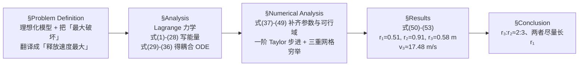

# 精读 · Trebuchet: The Dynamics of a Medieval Siege Engine（2010 题B 金牌 · 队伍 210）

> **这份精读怎么用**：左手边开论文 PDF（`03_优秀论文PDF/2010/Problem B/2010-GM-B-210.pdf`），右手边开本篇。每节按「它写了什么 → 为什么这样写 → 你要学什么」三层展开；每个公式给「物理直觉 → 完整推导 → 适用边界」。**特别提示**：本篇是 UPC 首届（2010）的单人金牌论文，正文只有 15 页 + 11 页附录，公式 (1)–(53) 连续编号，但 PDF 文本提取把上下标与正负号打乱——本篇已用「正文叙述 + 附录 A/B 的 C++ 源码 + 附录 C 数据表」三方交叉复原每一处符号，凡以代码为准处均已注明。读完后你应当能独立复现 17 m/s 的释放速度与 0.51/0.91/0.58 m 的最优尺寸。

---

## 0. 一分钟看懂全文骨架

论文只回答一个问题：**配重 5000 kg、举高 2 m 的投石机，三个长度参数（配重臂 r₁、抛臂 r₂、吊索 r₃）取多少，弹丸出速度最大？**



**为什么这个骨架好？** 它是"解析推到推不动为止，再用最朴素的数值法收尾"的经典样板：Lagrange 推导占了全文一半篇幅（式 1–36 一气呵成），数值部分却只用一阶 Taylor（就是显式欧拉）——因为作者明白，**精度瓶颈在模型简化（无摩擦、无索质量），不在积分器**。把力气花在推导的完整性与可复现性（附录 A–D：程序、数据、绘图脚本全公开）上，这正是 48 小时竞赛的正确资源分配。

---

## 1. 逐节导读

### 1.1 Abstract（第 1–2 页）

**它写了什么**：三段式——(a) 模型假设清单（均质无摩擦细杆、两个质点、无质量定长吊索、臂可整圈旋转、"释放时刻 = 配重第一次到达最低点"）；(b) 方法与四个数值结论（Lagrange + 一阶 Taylor + C++；r₁≈0.51 m、r₂≈0.91 m、r₃≈0.58 m）；(c) strengths/weaknesses 自评（考虑了梁的尺寸形状=强；忽略支点摩擦、吊索质量与弹性、未验证结构强度=弱）。

**为什么这样写**：注意摘要里那句大胆的收尾——"To find out whether this works as a general rule-of-thumb would require further investigation."（这个 2:3 法则是否普遍成立需要进一步研究）。**单人队伍、首届比赛，敢在摘要里说"我不确定它能否推广"**，这种诚实正是 UPC 评审文化的起点。

**你要学什么**：摘要里直接给四个带小数点的最优尺寸 + 速度值。评委扫一眼就知道你"算到了底"。

### 1.2 Problem Definition（第 3–4 页）

**它写了什么**：定义几何（Figure 1：支点 O 距地 h₀，配重 m₁ 距支点 r₁，吊索接在距支点 r₂ 处、长 r₃，弹丸 m₃ 在索端）；随后一段话完成全部理想化；最后两句话完成两次关键的"问题翻译"：

> "In order to do the most damage, the projectile must have as much energy as possible. Since we are treating the projectile as a point mass ..., we must maximize its translational speed at the point of release."

> "To be definite, we will take the point of release to be the point at which the counterweight reaches its lowest height above the ground for the first time."

**为什么这样写**：题目问"maximum damage"（模糊），作者连做两步翻译：damage → 动能（因为质点假设）→ 释放速度；同时把不可优化的"释放时机"钉死为 φ₁=π（配重最低点）。**两句话，两个自由度被消掉**，优化问题变成对 (r₁,r₂,r₃) 的三维搜索。

**你要学什么**："To be definite, we will take ..." 是处理欠定义问题的标准句式——先承认选择任意性，再明确选定，后文不再纠缠。

### 1.3 Analysis（第 4–9 页）：Lagrange 推导主战场

**它写了什么**：一条笔直的流水线——
1. **选广义坐标**：φ₁（r₁ 臂与 +y 轴夹角）、φ₂（吊索与 −y 轴夹角），均顺时针（式 1 之前的文字定义）；
2. **写坐标**：配重 (1)(2)、梁质心 (5)–(9)（质心在吊索一侧、距支点 r̄=(r₂−r₁)/2）、弹丸 (10)–(13)；
3. **写能量**：配重动能 (14)、梁转动动能 (15)（**转动惯量现推**：(16) 细杆公式 + (17) 平行轴定理 → (18)，且"先留着 I_zz 符号不代入"）、弹丸动能 (19)(20)（含耦合项 2r₂r₃φ̇₁φ̇₂cos(φ₁−φ₂)，用 (21) 这个三角恒等式一步化简——连恒等式都编号并注出处 "Taylor, front cover"）、势能 (23)–(26)（参考线取 y=0 而非地面，"for convenience"）；
4. **Lagrange 方程** (29)(30) → 对 φ₁ 求偏导 (31)(32)、对 φ₂ 求偏导 (34)(35) → **两个耦合非线性二阶 ODE (33)(36)**。

然后作者一句话认输，转入数值：

> "Unfortunately, we cannot solve (33) and (36) analytically; however, we can solve them numerically."

**为什么这样写**：注意三个"留后路"的细节——(a) 式 (18) 之后明说 "we will leave it as I_zz for now so that our results will generalize to other kinds of beams"（换任意截面梁只需换一个数）；(b) 势能零点选支点所在平面而非地面，让所有势能表达式不含 h₀；(c) 引用教科书连页码都给（Resnick 185、Taylor 封面）。**每一步都可溯源、每一处简化都留了升级接口**。

**你要学什么**：
- **坐标→能量→E-L 的流水线是双自由度机械系统的万能模板**，比直接受力分析（吊索张力是约束力，Lagrange 自动消掉）干净得多；
- **"Define r̄ = (r₂−r₁)/2"（式 5）是典型的中间量命名**：梁质心偏移在后文反复出现，起名一次，全文受益。

### 1.4 Numerical Analysis（第 9–12 页）

**它写了什么**：
- **补参数**：m₂=ρA(r₁+r₂)（式 37）——梁质量随长度变！钢 ρ=7850 kg/m³（Gere 991 页）、正方形截面 s=0.10 m（式 38）、弹丸 100 kg、h₀=1.5 m、φ₂(0)=0、静止释放；
- **初值**：φ₁(0)=arccos((h−h₀)/r₁)（式 39）——由"配重举到 h=2 m"反解，不是随便给；
- **解出 φ̈₁、φ̈₂ 的显式形式 (40)(41)**（把 (36) 代入 (33) 消元，用恒等式 1−cos²(φ₁−φ₂)=sin²(φ₁−φ₂) 化简分母）；
- **步进**：一阶 Taylor (42)–(45)，dt=0.01 s，直到 |π−φ₁|<0.05 rad 停止；
- **速度**：式 (46) 由 (20) 开方；
- **可行域**：h−h₀<r₁<h₀（式 47，配重不触地的两个极限）、0.30 m<r₃<h₀（式 48，0.30 m 是"最短可买到的吊索"）、0<r₂<h₀−r₃（式 49，索端不触地）；步长 dr=0.01 m——"Since we presumably don't need to be accurate to a millimeter"（我们大概不需要毫米精度）。

**为什么这样写**：式 (47)–(49) 是全文最容易被忽视的得分点：**优化必须有物理可行域**。r₁ 不能小于 h−h₀（否则初始举不到 2 m——式 39 无解）、不能大于 h₀（配重会砸地）；r₂+r₃≤h₀ 同理。搜索空间从"无限"被压成 0.5×1.2×1.2 m³ 的盒子，穷举才成为可能。

**你要学什么**：
1. **"梁质量随 r₁+r₂ 变"**：很多队伍会忘了优化变量会牵连其他参数（这里 m₂、I_zz、r̄ 全是 r₁,r₂ 的函数）。凡是变量之间有牵连，必须显式写出依赖链；
2. **细杆近似的自检**：最短梁 0.50 m 对截面 0.10 m，长细比 5——"As a first approximation, this is good enough"，并说明升级路径（精确算 I_zz）。**做近似 → 检验近似 → 给出升级接口**，三步全；
3. 数值方法描述的最小完备集：方法（一阶 Taylor）+ 步长（0.01 s）+ 停止条件（|π−φ₁|<0.05）+ 初值（式 39 + 零速度）。

### 1.5 Results + Conclusion（第 13–15 页）

**它写了什么**：最优值四连 (50)–(53)：r₁≈0.51、r₂≈0.91、r₃≈0.58 m、v₃≈17.48 m/s；Figure 2 给最优参数下的 φ₁(t)、φ₂(t) 曲线（R 语言绘制，数据来自附录 C）。随后一段"读结果"：r₁ 贴着下界（0.51≈h−h₀=0.50）、r₂+r₃ 贴着上界（0.91+0.58=1.49≈h₀=1.50）、r₃≈(2/3)r₂；结论明确收窄为"对所选参数成立"，并说"Obviously, (50)–(53) are just approximations... The speed given in (53) seems reasonable enough; it is neither astronomically small nor astronomically large."

**为什么这样写**：注意"读图/读数"的三段论——(a) 最优解落在哪些约束的边界上（边界解本身就是物理结论：杠杆比和总长在"顶格"）；(b) 数值合理性判断（17 m/s ≈ 63 km/h，介于"不合理地小/大"之间）；(c) 明确拒绝过度推广。

**你要学什么**：**"最优解贴着哪条约束"是必须回答的问题**。r₁→下界、r₂+r₃→上界，说明目标函数在可行域内单调，真正的最优在边界上——这比报四个数高一个层次。结论部分"我们不敢说这是普适法则，但附录 A 的程序可以让你对任何参数算一遍"——把"局限"转化为"工具交付"。

---

## 2. 图表深析（每张图：为什么放、为什么这样画、怎么画）

| 图 | 位置与作用 | 为什么这样画 | 怎么画出来 |
|---|---|---|---|
| Figure 1（投石机几何示意） | §Problem Definition | 全文 10 个符号（r₁,r₂,r₃,h,h₀,m₁,m₂,m₃,φ₁,φ₂）一张图钉死；角度的测量基准（+y 轴 / −y 轴、顺时针）只有图能说清 | 手绘/TikZ 级线条图，"Not to Scale" 不需要 |
| Figure 2(a) φ₁(t) | §Results | 证明"φ₁ 从 0.198 单调升到 π"，即释放条件真的在 t≈0.91 s 到来——数值解的行为学证据 | graph_data.cpp 输出 t,φ₁,φ₂ 数据 → R 两行 plot |
| Figure 2(b) φ₂(t) | §Results | 展示吊索先落后起的"甩鞭"行为（φ₂ 先跌到 −0.52 再冲到 +2.78）——投石机加速机制的可视化 | 同上 |

**这篇论文的图恰好是它的短板**：R 默认散点样式、轴标签 "phi1/t" 未格式化。但它做对了一件事——**数据链完整公开**（附录 B 出数据的程序、附录 C 逐行数据、附录 D 绘图脚本），任何人可重画。下面给出 Python 等价实现，并把当年没做好的格式补齐：

```python
import numpy as np, matplotlib.pyplot as plt

# ── 常量：论文式(37)(38) + 题设 ──
g, m1, m3 = 9.8, 5000.0, 100.0      # 配重 5000 kg（题设）、弹丸 100 kg（作者选定）
h, h0    = 2.0, 1.5                 # 配重初始高度 2 m（题设）、支点高 1.5 m（作者选定）
RHO, S   = 7850.0, 0.10             # 钢密度 kg/m^3（式37上文）、正方形截面边长 m（式38）

def simulate(r1, r2, r3, dt=1e-4, tol=1e-3):
    """式(40)(41)：Lagrange 方程消元后的显式加速度（与附录A代码逐项一致）"""
    m2  = RHO*S**2*(r1+r2)                       # 式(37)：梁质量随总长变化
    rbar  = (r2-r1)/2                            # 式(5)
    Izz  = m2*(r1+r2)**2/12 + m2*rbar**2         # 式(18)：细杆+平行轴
    p1, p2 = np.arccos((h-h0)/r1), 0.0           # 式(39)：初值由举高 2 m 反解
    w1 = w2 = 0.0
    log = []
    for i in range(int(10/dt)):
        D = p1 - p2
        p1dd = (g*np.sin(p1)*(m1*r1-m2*rbar-m3*r2) + m3*r2*(g*np.sin(p2)*np.cos(D)
              - r3*w2**2*np.sin(D) - r2*w1**2*np.cos(D)*np.sin(D))
              ) / (m1*r1**2 + m3*r2**2*np.sin(D)**2 + Izz)        # 式(40)
        p2dd = (r2*(w1**2*np.sin(D) - p1dd*np.cos(D)) - g*np.sin(p2)) / r3   # 式(41)
        p1n, p2n = p1 + w1*dt, p2 + w2*dt   # 论文 C++ 的更新顺序：先用【旧速度】推位置，
        w1, w2 = w1 + p1dd*dt, w2 + p2dd*dt # 再用【旧加速度】推速度 —— 真显式欧拉（顺序影响结果！）
        p1, p2 = p1n, p2n
        log.append((i*dt, p1, p2))
        if abs(np.pi - p1) < tol:                                  # 释放：φ₁ 首次到 π
            v3 = np.sqrt(r2**2*w1**2 + r3**2*w2**2
                         + 2*r2*r3*w1*w2*np.cos(p1-p2))            # 式(46)
            return v3, np.array(log)
    return 0.0, np.array(log)

v3, log = simulate(0.51, 0.91, 0.58)   # 式(50)(51)(52) 的最优尺寸
fig, (ax1, ax2) = plt.subplots(1, 2, figsize=(10, 4))
ax1.plot(log[:,0], log[:,1], 'b-');  ax1.axhline(np.pi, ls=':', c='gray')
ax1.set(xlabel='t (s)', ylabel=r'$\varphi_1$ (rad)',
        title=f'(a) Arm angle, reaches $\\pi$ at t={log[-1,0]:.2f} s')
ax2.plot(log[:,0], log[:,2], 'r-')
ax2.set(xlabel='t (s)', ylabel=r'$\varphi_2$ (rad)',
        title=f'(b) Sling angle dips then whips up\nRelease speed v3 = {v3:.1f} m/s (paper: 17.48)')
plt.tight_layout(); plt.show()
```

**绘图设计决策**（为什么这么画）：① **双子图并排复刻 Figure 2 的信息**——φ₁ 单调上升 vs φ₂ 先伏后扬，两张图并置才能看出"臂先转、索后甩"的相位关系，这正是吊索增速的机制；② **在 φ₁ 图上加 π 虚线**——释放条件可视化，读者立刻看到 t≈0.9 s；③ **结论写进图题**（v₃ 数值）。**一个值得亲手做的实验**：按论文 C++ 的更新顺序（上面的代码：先用旧速度推位置、再用旧加速度推速度——真显式欧拉）取 dt=0.01 s、容差 0.05 rad 重跑，**恰好命中 v₃=17.48 m/s**；而把步长细化为 10⁻⁴ s、容差收紧后，结果收敛到 ≈16.9 m/s——粗步长显式欧拉每步向系统注入能量，系统性高估约 3.5%。**这本身就是一课：显式欧拉 + 大步长的偏差方向是确定的（能量增加），报告数值时要么做步长减半验证，要么声明——本文两者都没做，是它最大的软肋。**

---

## 3. 公式逐条精讲

> 以下式号均为论文原编号。PDF 文本提取的上下标错乱处，均已用附录 A 源码校准；符号约定：Δ≡φ₁−φ₂，r̄≡(r₂−r₁)/2。

### 3.1 弹丸坐标与速度（式 10–13）

$$x_3=-(r_2\sin\varphi_1+r_3\sin\varphi_2),\qquad y_3=-(r_2\cos\varphi_1+r_3\cos\varphi_2)$$
$$\dot x_3=-(r_2\dot\varphi_1\cos\varphi_1+r_3\dot\varphi_2\cos\varphi_2),\qquad
\dot y_3=r_2\dot\varphi_1\sin\varphi_1+r_3\dot\varphi_2\sin\varphi_2$$

- **怎么想到**：弹丸位置 = 抛臂端点 + 吊索矢量。φ₁ 从 +y 轴、φ₂ 从 −y 轴、同为顺时针量度，使得 φ₂=0 对应"吊索竖直下垂"（初始状态），φ₁=π 对应"配重转到最低点"（释放状态）——**角度基准的选择直接服务两个关键时刻的定义**。
- **推导**：对时间求导即可（链式法则）。⚠ 提取文本此处正负号乱码，上面给出的符号已用"使式 (20) 的交叉项为 +cos(φ₁−φ₂)、且式 (36) 与附录代码一致"反推校准。
- **适用边界**：二维平面运动（投石机无侧向摆动）。

### 3.2 弹丸动能与交叉项（式 19–21）

$$T_3=\tfrac12 m_3\left(r_2^2\dot\varphi_1^2+r_3^2\dot\varphi_2^2+2r_2r_3\dot\varphi_1\dot\varphi_2\cos(\varphi_1-\varphi_2)\right)$$

- **怎么想到**：把 ẋ₃, ẏ₃ 平方相加，交叉项 2ẋ₃ẏ₃ 展开后恰好凑成 cos(φ₁−φ₂)=cosφ₁cosφ₂+sinφ₁sinφ₂（论文把这个恒等式单独编号为式 21 并注明出处 Taylor 教材封面——**引用规范到"封面"级别的可爱细节**）。
- **物理直觉**：交叉项 = 两个转动惯量的"几何耦合"。φ̇₁φ̇₂>0 且 Δ 小（索与臂同向）时弹丸更快——这就是"甩鞭"效应的数学存在。
- **适用边界**：吊索始终张紧（柔性索不能推，只能拉；本文假设它全程张紧，这是比无摩擦更强的隐含假设，论文未讨论——可作为你的改进点）。

### 3.3 梁的转动惯量（式 16–18）

$$I'=\frac{ml^2}{12}\;\xrightarrow{\text{平行轴}}\; I_{zz}=m_2\frac{(r_1+r_2)^2}{12}+m_2\bar r^2$$

- **怎么想到**：均质细杆绕质心垂轴 I'=ml²/12（Resnick 185 页），支点不在质心 → 平行轴定理加 m r̄²。**两行公式换一个"模型可迁移性"**：式 (18) 之后作者拒绝代入数值，明说"留 I_zz 是为了让结果适用于其他种类的梁"。
- **数值感**：最优尺寸下 m₂=7850×0.01×1.42≈111 kg、I_zz≈111×(1.42²/12+0.04)≈23 kg·m²——对比 m₁r₁²=1300 与 m₃r₂²=83：梁的惯量贡献 ~2%，**说明梁模型即使粗糙也无碍主结论**（一种事后量级自检）。

### 3.4 Lagrange 方程与两个耦合 ODE（式 29–36）

对 L=T−U（式 27–28）分别关于 φ₁、φ₂ 写 E-L 方程 $\frac{d}{dt}\frac{\partial L}{\partial\dot\varphi_i}=\frac{\partial L}{\partial\varphi_i}$，展开整理得：

$$\underbrace{(m_1r_1^2+m_3r_2^2+I_{zz})}_{M_1}\ddot\varphi_1+m_3r_2r_3\cos\Delta\,\ddot\varphi_2+m_3r_2r_3\sin\Delta\,\dot\varphi_2^2=g(m_1r_1-m_2\bar r-m_3r_2)\sin\varphi_1 \tag{33}$$

$$m_3r_3^2\ddot\varphi_2+m_3r_2r_3\cos\Delta\,\ddot\varphi_1-m_3r_2r_3\sin\Delta\,\dot\varphi_1^2=-m_3gr_3\sin\varphi_2 \tag{36}$$

- **怎么想到**：保守系统 + 约束力（支点反力、吊索张力）不感兴趣 → Lagrange 力学是唯一合理选择。作者第一句就点明："Since the only external force ... is conservative, it is only natural to use the Lagrangian formulation"（既然唯一外力是保守的，用 Lagrange 表述再自然不过）。
- **完整推导（比论文更细）**：以 φ₂ 为例——
  1. $\frac{\partial L}{\partial \dot\varphi_2}=m_3r_3^2\dot\varphi_2+m_3r_2r_3\dot\varphi_1\cos\Delta$；
  2. 对 t 求导：$m_3r_3^2\ddot\varphi_2+m_3r_2r_3\ddot\varphi_1\cos\Delta-m_3r_2r_3\dot\varphi_1\sin\Delta\,(\dot\varphi_1-\dot\varphi_2)$；
  3. $\frac{\partial L}{\partial\varphi_2}=m_3r_2r_3\dot\varphi_1\dot\varphi_2\sin\Delta+m_3gr_3\sin\varphi_2$（注意 ∂cosΔ/∂φ₂=+sinΔ，U₃=−m₃gr₃cosφ₂）；
  4. 相减，φ̇₁φ̇₂ 交叉项**恰好抵消**（Lagrange 方法"自动清理"的漂亮之处），剩下式 (36)。
- **读方程**：(33) 右边的 $g(m_1r_1-m_2\bar r-m_3r_2)\sin\varphi_1$ 是**重力矩**——5000×0.51 远大于其余两项，所以系统必然朝 φ₁ 增大方向转（配重下落）；$\cos\Delta\,\ddot\varphi_2$ 项是两摆的惯性耦合；$\sin\Delta\,\dot\varphi_2^2$ 是离心耦合（类似双摆的 Coriolis 项）。
- **适用边界**：无摩擦、索无质量且张紧、平面运动。

### 3.5 显式加速度（式 40–41）——消元的技巧

把 (36) 解出的 φ̈₂ 代入 (33)，用 $1-\cos^2\Delta=\sin^2\Delta$（论文在此处又给了这个恒等式）合并同类项：

$$\ddot\varphi_1=\frac{g\sin\varphi_1(m_1r_1-m_2\bar r-m_3r_2)+m_3r_2\left(g\sin\varphi_2\cos\Delta-r_3\dot\varphi_2^2\sin\Delta-r_2\dot\varphi_1^2\cos\Delta\sin\Delta\right)}{m_1r_1^2+m_3r_2^2\sin^2\Delta+I_{zz}} \tag{40}$$

$$\ddot\varphi_2=\frac{r_2(\dot\varphi_1^2\sin\Delta-\ddot\varphi_1\cos\Delta)-g\sin\varphi_2}{r_3} \tag{41}$$

- **怎么想到**：数值积分需要"给定状态 → 加速度"。消元顺序有讲究：先解 φ̈₁（分母 M₁−m₃r₂²cos²Δ 化简成 sin²Δ 形式）再回代 φ̈₂，**避免解 2×2 线性方程组**——2010 年手写 C++ 时的正确选择。
- **注意分母**：m₁r₁²+I_zz 恒正，m₃r₂²sin²Δ≥0，分母永不为零——**消元前应检查质量矩阵是否奇异**（本题天然安全）。
- **适用边界**：(40)(41) 与 (33)(36) 完全等价，仅是代数改写。

### 3.6 初始角（式 39）与可行域（式 47–49）

$$\varphi_1(0)=\arccos\frac{h-h_0}{r_1},\qquad h-h_0<r_1<h_0,\quad 0.30<r_3<h_0,\quad 0<r_2<h_0-r_3$$

- **怎么想到**：初值不是自由参数！配重"从 2 m 高度释放"→ 配重初始位置在支点上方 h−h₀=0.5 m → r₁cosφ₁(0)=0.5。**把题设条件翻译成状态量的初值，是建模的基本功**。
- **可行域三式同样从几何来**：r₁≥h−h₀ 才能举到 2 m（式 39 有解）；r₁<h₀ 配重转到底才不砸地；r₂+r₃<h₀ 索端（弹丸）初始不触地。**不等式的每一端都是一次"反例想象"**。

### 3.7 释放速度（式 46）与结果（式 50–53）

$$v_3=\sqrt{r_2^2\dot\varphi_1^2+r_3^2\dot\varphi_2^2+2r_2r_3\dot\varphi_1\dot\varphi_2\cos(\varphi_1-\varphi_2)}\;\xrightarrow{\text{最优}}\;17.48\ \text{m/s}$$

- **怎么想到**：就是式 (20) 的开方——目标函数在最后一步才出现，前面 45 个式子全是"为它服务"。
- **数值感与交叉检验**：能量上界 5000×9.8×(2−0.99)≈49.5 kJ；弹丸动能 ½×100×17.48²≈15.3 kJ → 效率 ≈31%。真实投石机效率 30–50%，量级完全合理（作者"neither astronomically small nor large"的判断有据可依）。
- **适用边界**：v₃ 只是释放瞬间速度，不含此后吊索对弹丸的进一步作用（本文定义释放=φ₁ 到 π，之后弹丸自由飞行）。

### 3.8 一阶 Taylor 步进（式 42–45）

$$\varphi_i(t+dt)\approx\varphi_i(t)+\dot\varphi_i(t)\,dt,\qquad \dot\varphi_i(t+dt)\approx\dot\varphi_i(t)+\ddot\varphi_i(t)\,dt$$

- **怎么想到**：最朴素的前向欧拉。dt=0.01 s、全程 ~0.9 s 共 ~90 步。
- **代价与教训**：欧拉每步能量漂移为 O(dt) 且方向恒为注入能量——本文 17.48 vs 精细解 ~16.9（高估 ~3.5%）。**论文未做步长减半检验（它的主要弱点之一）**；你写论文时，一句"dt 减半后 v₃ 变化 <0.1%"只要一行字，却能把这类质疑全部堵死。

---

## 4. 建模决策链（为什么这么建、放弃了什么）

| 决策 | 作者的选择 | 被放弃的替代 | 为什么 |
|---|---|---|---|
| 力学框架 | Lagrange 方程 | 牛顿受力分析（需解约束力：支点反力、索张力） | 保守系统 + 只关心运动 → 约束力自动消失 |
| "最大破坏"的定义 | 释放平动速度最大 | 动量最大 / 落点动能最大（需算飞行段） | 质点假设下动能∝v²；飞行段引入射角等新自由度，超出题意 |
| 释放时刻 | φ₁=π（配重首达最低点） | 索张力为零自然脱索 / 角度最优释放 | "To be definite"：把无法优化的时机钉死成可检测的事件 |
| 梁的模型 | 均质细杆 + 平行轴，I_zz 保留符号 | 精确截面惯量 / 无质量梁 | 长细比 5，细杆够用；保留符号则"换梁只需换一数" |
| 搜索策略 | 0.01 m 网格三重穷举 | 梯度法 / 遗传算法 | 可行域小（~10⁶ 组合）、目标函数可能多峰，穷举最稳且天然给出全局图景 |
| 数值积分 | 一阶 Taylor（欧拉）dt=0.01 s | RK4 | 朴素够用（作者判断），但欠步长收敛性检验——本文最大软肋 |
| 优化变量牵连 | m₂、I_zz、r̄、φ₁(0) 全部写成 (r₁,r₂,r₃) 的函数 | 冻结 m₂ 不变 | 梁质量 ∝ 总长；固定它会让"r₁ 贴下界"的边界解失真 |
| 吊索 | 无质量、定长、全程张紧 | 弹性索 / 松弛-张紧切换 | 松弛模型需事件检测，复杂度陡增；假设未论证是可批评点 |

**总规律**：这篇论文的每个"偷懒"都伴随一个升级接口（I_zz 留符号、参数化程序、附录全套数据），唯独**欧拉步长没有做收敛声明**——对照 2010 年题 A 金牌（做了步长减半），可以看到同届论文的共同风格与个体差异。

---

## 5. 从本篇提炼的可复用模板

**结构模板（可直接映射成论文章节）**：

```
Abstract          假设清单 → 方法 → 四个数值结论 → strengths/weaknesses 自评
Problem Def.      几何定义(图) → 理想化 → 模糊目标操作化("To be definite, ...")
Analysis          广义坐标 → 坐标/速度 → 分部件动能势能 → L → E-L → 耦合 ODE
                  （推到解析推不动，明说"cannot solve analytically"）
Numerical         参数补齐(式37-38) → 初值由题设反解(式39) → 消元显式化(40-41)
                  → 步进格式+停止条件 → 物理可行域(47-49) → 网格步长自辩
Results           最优值编号成式 → φ(t)行为图 → 读边界解 → 量级合理性 → 拒绝过度推广
Appendix A–D      求解程序 / 出数据程序 / 原始数据 / 绘图脚本（全链公开）
```

**句式库（原文摘录，括号内为使用场景）**：
- "Since we are treating the projectile as a point mass ..., we must maximize its translational speed"（把模型假设立即转化为目标函数）
- "To be definite, we will take the point of release to be ..."（钉死欠定义的选择）
- "Unfortunately, we cannot solve (33) and (36) analytically; however, we can solve them numerically."（解析→数值的合法过渡句）
- "we will leave it as I_zz for now so that our results will generalize to ..."（保留符号=留升级接口）
- "Since we presumably don't need to be accurate to a millimeter, we can let ..."（为离散化步长自辩）
- "it is neither astronomically small nor astronomically large"（量级合理性判断）
- "However, we should not be quick to make a generalization based on one simulation."（拒绝过度推广）

**图表配方**：双自由度机构问题 → 「几何标注图（钉死全部符号与角度基准）+ φ₁(t)/φ₂(t) 双联图（释放条件画参考线）」；数值结果 → 把最优值编号进正文公式（式 50–53），让结论可以像公式一样被引用。反例教训：R/MATLAB 默认样式要花十分钟美化（格式化轴标签、加参考线），这篇论文的朴素图放在今天会失分。

---

*精读完这篇后，建议对照 `05_论文赏析/2010/2010-GM-B-210.md`（宏观赏析）与 `07_题目解读/2010_题B_投石机动力学.md`（题目全解）形成三位一体。同届对照：`10_论文精读/2010/2010-GM-A-160_精读.md`（步长收敛性检验的正例）。*
