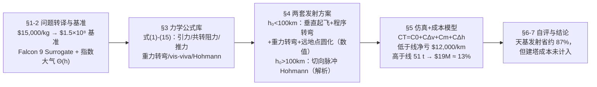

# 精读 · Space Tower Launch Costs（2011 题A 金牌 · 队伍 352）

> **这份精读怎么用**：左手边开论文 PDF（`03_优秀论文PDF/2011/Problem A/2011-GM-A-352.PDF`），右手边开本篇。每节按「它写了什么 → 为什么这样写 → 你要学什么」三层展开；每个公式给「物理直觉 → 完整推导 → 适用边界」。本篇 LaTeX 源、公式 (1)–(17) 编号清晰，文本提取质量高；唯一缺图注的是 Figure 6（推测为成本图，⚠ 不确定处已注明）。另注意：本文参数存在一处内在矛盾（§1.4 会讲），这本身就是极好的批判性阅读素材。读完你应当能复现"低于卡门线净亏 \$12,000/km、高于卡门线省 87%"的双分支结论。

---

## 0. 一分钟看懂全文骨架

论文只回答一个问题：**从高度 h₀ 的塔顶把 10,000 kg 载荷送入 300 km 圆轨道，塔建多高才划算？**



**为什么这个骨架好？** 全文最重要的判断在 §4 开头一句话："We consider two regimes of tower heights and design a distinct launch strategy for each of them."（我们按塔高分两个 regime，各设计一套发射策略。）卡门线（100 km）以下大气是主角→用含阻力与重力转弯的数值积分；以上大气消失→切向脉冲 Hohmann 全解析。**一个物理判据切开两套数学工具**，而不是一个模型硬套到底——这是评委眼中"物理洞察力"的直接证据。再往下，所有物理量（Δv、质量、能耗）都被折算成美元，问题问 cost，论文就答 cost。

---

## 1. 逐节导读

### 1.1 Abstract（第 1 页）

**它写了什么**：两分支方法概述（大气段仿真 Falcon 9 Surrogate / 天基段 Hohmann）+ 成本结论：塔高 100–300 km 时发射成本约 **\$19 million，即 \$1,900/kg**（对比基准 \$15,000/kg）。

**为什么这样写**：摘要里给"每公斤多少钱"这个唯一可比的市场化指标。评委读完第一段就知道答案的量级与比较基准。

**你要学什么**：摘要用"单价"（\$/kg）而非总额来表达成本——它是跨方案比较的通用语言。顺带一个反面教材：首句 "from an from an" 重复词——48 小时末尾务必留出校对时间。

### 1.2 §1 Interpretation + §2 Assumptions（第 1–3 页）

**它写了什么**：先把成本锚定在题目给的 \$15,000/kg × 10,000 kg = \$1.5×10⁸；然后构造"虚拟对标载具"Falcon 9 Surrogate（Table 1：A_f=π(2.3)²、C_D=0.3、一级满/空 342,859/20,000 kg、二级满/空 54,000/3,000 kg，取自 SpaceX 用户手册）；大气密度用式 (1) ρ=ρ₀exp[(r−R_E)/H]（H=8 km、ρ₀=1.225 kg/m³），并乘阶跃函数 Θ(h) 在 100 km 硬截断。

**为什么这样写**：注意那个 Θ(h)——**它把"卡门线以上忽略阻力"这条假设直接焊进了公式**，代码里不用再写 if。假设、公式、代码三者自洽，这是工程化建模的标志。

**你要学什么**：**Surrogate（替身载具）法**：不虚构参数、也不照抄实弹，而是"对标真实型号构造一个可自由修改的替身"，既保留真实性又保留灵活性。

### 1.3 §3 Launch Mechanics（第 3–6 页）：先建"公式库"再谈方案

**它写了什么**：一节塞进发射力学全部标准件——重力 (2)、变质量 m(t) (3)、**共转大气相对速度** v⃗_rel=v_r r̂+(v_θ−rΩ_E) θ̂ (4)、阻力 (5)、推力"火箭方程" (6) 与理想 Δv=v_e ln(m_i/m_f) (7)、重力转弯率 α̇=μ sinα/(v r²) (8)；随后按受力集合写三个力学期：大气内燃烧 (9)、大气外燃烧 (10)、惯性滑行 (11)；轨道段补 vis-viva (12)、偏心率与远地点 r_a=(1+e)a (13)、Hohmann 双脉冲 (14)(15)。

**为什么这样写**：作者把 §3 当作"库文件"写：与塔高无关的动力学一次性推完，§4 的两套方案只是从库里取函数拼装。公式复用率极高——式 (12)(13) 既当关机判据又当圆化预算。

**你要学什么**：式 (4) 的 v_θ−Ω_E r 是全文最容易被参赛队漏掉的细节——大气随地球共转，阻力取决于**相对**速度；赤道上这项值 463 m/s，约占轨道速度 6%。

### 1.4 §4 Launch Design（第 6–8 页）：两套方案

**它写了什么**：
- **低于卡门线**：一级 ṁ≈720 kg/s、v_e≈4020 m/s（T≈2890 kN）；垂直起飞 10 s → 程序转弯 0.5°/s 至天顶角 8.5° → 重力转弯 (8)；**关机写成状态判据**："engines cut off when E and L are such that r_a exceeds 300 km"；二级在远地点做脉冲圆化 (16)(17)。
- **高于卡门线**：无阻力 → **切向发射**（liftoff tangent to Earth's surface）；先把式 (14) 修正为含"塔随地球自转线速度 (R_E+h)Ω_E"的 Δv₁，再直接套式 (15) 得 Δv₂。

**为什么这样写**：两处都值得抄。状态判据关机（能量、角动量满足远地点=目标）比"定时关机"稳健，也正是真实火箭的制导逻辑；切向发射的论证只有一句但分量十足——"A liftoff tangent to Earth's surface is much more energy efficient than a vertical launch in this regime since atmospheric drag is no longer an issue."

**你要学什么**：⚠ **批判性阅读点**：用论文自己的数检查——T=ṁ·v_e=720×4020≈2.89 MN，而起飞重量 =407 t×9.8≈3.99 MN，**推重比只有 0.72，根本飞不起来**（真实 Falcon 9 约 1.2–1.5）。论文的仿真显然在别处补了推力或减了质量，但正文没有交代。**用两个参数的乘积做量级自检，是读任何论文的第一步。**

### 1.5 §5.1 Simulation（第 8–9 页）

**它写了什么**：Python 积分器、Δt=0.1 s 的 for-loop；俯仰率 0.5°/s 与 8.5° 门限"由人工微调"（manual fine tuning）；Figure 2/3 双参考系轨迹（南视共转系 / 北视惯性系——后者专门展示地球自转给火箭的初速）、Figure 4 五联时序图（a、v、h、α、m）；天基火箭平均总质量 51,000 kg。

**你要学什么**：① 双参考系画同一组轨迹是聪明的可视化决策——共转系看"弹道形状"，惯性系看"自转白送了多少速度"；② "manual fine tuning" 直说不装——比虚构一个"优化算法"诚实得多；③ 积分器粗糙（0.1 s for-loop）也照实写进 Weaknesses。

### 1.6 §5.2 Cost Analysis（第 9–12 页）：全文的经济学闭环

**它写了什么**：C_T=C₀+C_Δv+C_m+C_Δh。三个标定动作：(a) Δv 边际成本：LEO/GEO 发射差价 \$6.1 M 对应 Δv 差约 4 km/s → **\$1500 per m/s**；(b) 提升成本：太空电梯文献给 \$220/kg 对应 50 MJ/kg → **\$4.4×10⁻⁶/J**；(c) 结论对账：低于卡门线，每升高 1 km 省 Δv 约 3 m/s（值 \$5,000）但提升费 \$17,000 → **净亏 \$12,000/km，塔不划算**；高于卡门线，载具缩到 51 t（12%），提升费降到 \$2,000/km 且高度引起总成本变化 <\$2 M → 干脆删掉 C_m、C_Δh 项，按 \$368/kg×51,000 kg≈**\$19 M**（13%）收尾。

**为什么这样写**：三个无法直接定价的量（Δv、势能、质量）全部锚定到可查证的市场/文献数据，然后用一个不等式论证"哪一项小于不确定度、可以删"——**成本模型也要做量级论证**。

**你要学什么**：负结果照写（"The tower thus does not save money below the Kármán line"）——证明某种塔不值得建，同样是完整答案。

### 1.7 §6 Discussion + §7 Closing（第 12–14 页）

**它写了什么**：Weaknesses 四条（赤道二维假设、二级脉冲化、粗糙积分器、载具质量固定未随塔高优化）；Strengths 四条（二维而非一维、计自转与共转大气、流程贴近真实发射、两 regime 各有意义）；结论"省近 90%，但建塔的工程与成本'cannot be understated'"。

**你要学什么**：Strengths 的写法不是自夸"我们很准确"，而是逐条说明**为什么这些选择让结果可信**（"we used a two-dimensional analysis instead of a simple 1D liftoff"——对比式自证）。

---

## 2. 图表深析（每张图：为什么放、为什么这样画、怎么画）

| 图 | 位置与作用 | 为什么这样画 | 怎么画出来 |
|---|---|---|---|
| Figure 1（Falcon 9 发射照片） | §2 载具设定处 | 替身载具配上真身照片，一图建立"我们在模拟真东西"的可信度 | 官方照片 + 一句引用 |
| Figure 2（共转系轨迹族，南视） | §5.1 | 0–100 km 各起飞高度的曲线族并置，弹道形状差异一眼可比 | Python 积分 → 逐条画线 |
| Figure 3（惯性系轨迹族，北视） | §5.1 | 同一批轨迹换参考系，专门暴露"地球自送 463 m/s"的初速差异 | 同一批数据重画 |
| Figure 4（a/v/h/α/m 五联时序） | §5.1 | 一张图交代飞全程：加速度过载峰、速度分量（蓝径向/绿切向）、高度、俯仰角、质量阶梯 | 同一次仿真的状态量分五个子图 |
| Figure 5（Δv–高度总图，**全文核心**） | §5.2 | burnout Δv（理想）与 burnout v（实际）两条曲线之差把"重力+阻力损耗"可视化；apogee Δv 叠加得总 Δv；>100 km 换 elevator Δv 曲线 | 数值仿真 + 解析 Hohmann 分支拼接 |
| Figure 6（图注缺失，⚠ 推测为成本对比图） | §5.2 末 | 承接 "\$19 M vs \$150 M" 的结论 | — |
| Table 1（Surrogate 参数表） | §2 | "假设"变"数据"：七个参数全部有出处 | 手工三线表 |

**核心复现：Figure 5 的双分支 Δv–高度图**。高于卡门线的分支用论文自己的公式（修正 Δv₁ + 式 15）可精确复现；低于卡门线的分支依赖论文未公开的调参仿真，这里按论文正文自报的两个锚点（总 Δv 量级 ≈9.4 km/s、斜率"每公里省 3 m/s"）线性重构，并在图题中注明：

```python
import numpy as np, matplotlib.pyplot as plt

# ── 常量（论文 §2，WGS84 + Table 1）──
mu, RE, OmE = 3.986e14, 6378e3, 7.29e-5
rf = RE + 300e3                                # 目标圆轨道半径

h_hi = np.linspace(100e3, 300e3, 200)          # ── 高于卡门线：论文修正式 + 式(15) ──
ri   = RE + h_hi
Dv1  = np.sqrt(mu/ri)*np.sqrt(2*rf/(ri+rf)) - ri*OmE   # 修正 Δv₁（切向点火，含塔速 ri·ΩE）
Dv2  = np.sqrt(mu/rf)*(1 - np.sqrt(2*ri/(ri+rf)))      # 式(15) 圆化脉冲
dv_hi = Dv1 + Dv2

h_lo = np.linspace(0, 100e3, 100)              # ── 低于卡门线：按论文自报锚点线性重构 ──
dv_lo = 9400 - 3.0*(h_lo/1e3)                  # 总 Δv ≈9.4 km/s @h=0，斜率 −3 m/s per km

fig, ax = plt.subplots(figsize=(7, 4.5))
ax.plot(h_lo/1e3, dv_lo, 'b-',  label='Atmospheric Falcon 9 Surrogate (anchored: 9.4 km/s, 3 m/s per km)')
ax.plot(h_hi/1e3, dv_hi, 'r-',  label='Ideal tower rocket: modified $\\Delta v_1$ + eq.(15)')
ax.axvline(100, ls=':', c='gray'); ax.text(102, 7600, 'Kármán line', rotation=90, c='gray')
ax.annotate(f'{dv_hi[0]:.0f} m/s', (100, dv_hi[0]), xytext=(130, 8300),
            arrowprops=dict(arrowstyle='->'))
ax.annotate(f'{dv_lo[-1]:.0f} m/s', (100, dv_lo[-1]), xytext=(30, 8700),
            arrowprops=dict(arrowstyle='->'))
ax.set(xlabel='Launch altitude $h_0$ (km)', ylabel='Total $\\Delta v$ to 300 km orbit (m/s)',
       title='Two regimes: below the line each km saves only ~3 m/s;\n'
             'above it the vehicle shrinks to 51 t and $\\Delta v$ drops ~1.9 km/s')
ax.legend(loc='upper right', fontsize=8); plt.tight_layout(); plt.show()
```

**绘图设计决策**：① **两个分支画在同一坐标系但用不同颜色并注明方法来源**——评委立刻看到"低于线缓降（省得少）、跨线跳降（换载具）"，这正是结论"要建就建到 100 km 以上"的图形版；② **卡门线画竖直虚线**，物理 regime 的边界必须可视化；③ **每条线的定标依据写进图例**（anchored/eq.15），复现路径透明。数值自检：Δv₁(100 km)≈7.43 km/s、Δv₁(300 km)≈7.24 km/s——斜率约 1 m/s/km，与论文"Δv savings grow much more slowly"一致。

---

## 3. 公式逐条精讲

### 3.1 指数大气 + 阶跃截断（式 1 与其 Θ(h) 修正）

$$\rho=\rho_0\,e^{(r-R_E)/H}\times\Theta(h),\qquad \Theta(h)=\begin{cases}1,& h\le 100\text{ km}\\ 0,& h>100\text{ km}\end{cases}$$

- **怎么想到**：等温大气 + 流体静力学平衡 dP=−ρg dz 直接积分给出指数廓线；标高 H=RT/(Mg)≈8 km。
- **数值感**：ρ(100 km)/ρ₀=e^{−12.5}≈3.7×10⁻⁶——所以在 100 km 处硬截断，砍掉的阻力总量远小于 C_D 本身的不确定度。**用不等式给截断找借口，截断就不再是"偷懒"。**
- **适用边界**：H 实际随高度在 6–8.5 km 间变化；对入轨 Δv 这种积分量影响很小。

### 3.2 共转大气的相对速度（式 4）

$$\vec v_{rel}=v_r\hat r+(v_\theta-r\Omega_E)\hat\theta$$

- **怎么想到**：阻力取决于气流相对球的速度；假设大气被地球"刚体拖转"，切向相对速度就是 v_θ−Ω_E r。
- **数值感**：赤道 Ω_E R_E=7.29×10⁻⁵×6.378×10⁶≈465 m/s。向东发射等于阻力"起跑就少 465 m/s"，同时这也是高于卡门线分支里 (R_E+h)Ω_E 项的来源——**同一个物理量在两个 regime 里被用了两次**。

### 3.3 推力与理想火箭方程（式 6、7）

$$\vec T=-v_e\dot m(\cos\alpha\,\hat r+\sin\alpha\,\hat\theta),\qquad \Delta v=v_e\ln\frac{m_i}{m_f}$$

- **怎么想到**：推力沿弹体轴，弹体轴与矢径成 α 角；ṁ<0 使 T 沿 +弹体方向。对 m v̇=T 从点火到关机积分（无外力时）得 Δv 公式（完整动量守恒推导见本系列 2010-A 精读 §3.3）。
- **本文用法**：式 (7) 在成本层反向使用——由 Δv 配额反推质量比，这正是"$368/kg × 51,000 kg"那笔账的物理引擎。

### 3.4 重力转弯（式 8）

$$\dot\alpha=\frac{\mu\sin\alpha}{v\,r^2}$$

- **怎么想到**：大气中飞行要推力对准速度（减阻+结构安全），于是俯仰程序被"交还给重力"：速度矢量被重力以 g_perp/v 的角速度弯曲。设 γ=90°−α 为弹道角，dγ/dt=−(μ/v r²)cosγ=−(μ/v r²)sinα，反号即 α̇=+μ sinα/(v r²)。
- **数值感**：α=8.5°、v=300 m/s 时 α̇≈0.24°/s——与程序转弯的 0.5°/s 同量级，衔接平顺。
- **适用边界**：推力始终沿速度（零攻角）；文中通过 10 s 垂直段 + 程序转弯把 α"递"给重力转弯，避免低速段 α̇∝1/v 发散。

### 3.5 三力学期运动方程（式 9–11）

$$m\ddot{\vec r}=\vec F_g+\vec D+\vec T\;(9)\;\to\;\vec F_g+\vec T\;(10)\;\to\;\vec F_g\;(11)$$

- **怎么想到**：按"阻力在不在、推力在不在"切三种受力组合，分别展开成 r、θ 分量。分段的依据正是式 (1) 的 Θ(h)（阻力）与关机判据（推力）——**假设层的每个开关，方程层都有一条对应分支**。
- **注意**：极坐标切向方程论文写作 r θ̈，实为 a_θ=r θ̈+2ṙθ̇ 的记法简化；复现时按标准极坐标加速度展开即可。

### 3.6 vis-viva 与远地点（式 12、13）

$$\frac{mv^2}{2}-\frac{\mu m}{r}=E=-\frac{\mu m}{2a}\;\Rightarrow\;v=\sqrt{\mu\left(\frac2r-\frac1a\right)},\qquad r_a=(1+e)a,\;\; e=\sqrt{1+\frac{2EL^2}{\mu^2m^3}}$$

- **怎么想到**：束缚轨道（E<0）能量只依赖半长轴 a——这是"同一能量两种写法"的守恒律套利；e 由 E、L 组合出，于是**状态向量 (r, v) → (E, L) → (a, e) → r_a** 一条流水线，关机判据与远地点速度共用。
- **用途**：关机条件 "r_a≥300 km" 与远地点圆化速度 (16) 全由这两式供血。

### 3.7 Hohmann 双脉冲（式 14、15）与本题修正 Δv₁

$$\Delta v_1=\sqrt{\frac{\mu}{r_i}}\left(\sqrt{\frac{2r_f}{r_i+r_f}}-1\right),\qquad \Delta v_2=\sqrt{\frac{\mu}{r_f}}\left(1-\sqrt{\frac{2r_i}{r_i+r_f}}\right)$$

- **推导骨架**：转移椭圆 a=(r_i+r_f)/2；近地点速度由 vis-viva 算出，减圆轨道速度得 Δv₁；远地点同理得 Δv₂。
- **本题修正（§4.2 无编号式）**：塔顶火箭先随地球共转（速度 (R_E+h)Ω_E），要先加速到该高度圆速度再做切向点火，故 Δv₁ 增加两项，合并后：
$$\Delta v_1=\sqrt{\frac{\mu}{R_E+h}}\sqrt{\frac{2r_f}{R_E+h+r_f}}-(R_E+h)\Omega_E$$
- **怎么想到**：教科书公式假设初始已在圆轨道上共速飞行；本题初始条件不同 → **改写而不是重推**，并把"为什么改"写明。这是"文献公式落地"的标准姿势。
- **数值感**：h=100 km 时 Δv₁≈7.43 km/s、Δv₂≈59 m/s——圆化脉冲小两个量级，因为转移椭圆远地点已贴着目标轨道。

### 3.8 远地点圆化（式 16、17）

$$v_i=\sqrt{\mu\left(\frac{2}{r_a}-\frac1a\right)}\;\to\; v_f=\sqrt{\frac{\mu}{r_a}}\;\to\; \Delta v=v_f-v_i$$

vis-viva 在 r=r_a 处取值减圆速度——式 (12) 的第三次复用。**一篇论文把 vis-viva 用成"万能钥匙"**：关机判据、远地点速度、圆化预算。

### 3.9 成本模型与两项删除

$$C_T=C_0+C_{\Delta v}+C_m+C_{\Delta h},\qquad \frac{dC}{d\Delta v}=\$1500/(\text{m/s}),\qquad C_{\Delta h}=\$4.4\times10^{-6}/\text{J}$$

- **怎么想到**：Δv 无法直接标价 → 用 LEO/GEO 差价反推边际成本；势能无法标价 → 借太空电梯文献的 \$/J；最后用"高度项总变化 <\$2 M ≪ 成本不确定度"论证删除 C_m、C_Δh 的合法性。
- **适用边界**：固定成本与塔的建造费全部记为 sunk cost——这是题意允许的简化，但结论里必须重申（论文确实重申了）。

---

## 4. 建模决策链（为什么这么建、放弃了什么）

| 决策 | 作者的选择 | 被放弃的替代 | 为什么 |
|---|---|---|---|
| 总体架构 | 以卡门线分两个 regime | 单一模型全高度硬套 | 两侧物理主导项不同（大气 vs 无大气），工具自然分化 |
| 载具 | Falcon 9 Surrogate（对标真实参数） | 完全虚构 / 完全照抄 | 有出处又可改；成本结论还能与公开报价对照 |
| 大气模型 | 指数 + Θ(h) 硬截断 | 分层实测大气表 | Δv 是积分量，对廓线细节不敏感；截断误差 ≪ C_D 不确定度 |
| 阻力参考系 | 相对共转大气（式 4） | 惯性系速度 | 赤道差 465 m/s，6% 量级不可忽略 |
| 发射程序（<100 km） | 10 s 垂直→0.5°/s 至 8.5°→重力转弯 | 最优控制/攻角调度 | 手工调参足够（作者明说 manual fine tuning），省下时间做成本层 |
| 关机判据 | 状态判据（E,L 使 r_a=300 km） | 固定时间关机 | 状态判据对塔高扰动稳健，也是真实制导逻辑 |
| 二级 | 远地点脉冲近似 | 有限燃烧时长仿真 | 脉冲误差远小于其他不确定度，且换来闭式解 |
| 天基发射方向 | 切向（水平） | 垂直 | 无阻力时垂直起飞纯浪费（重力损失），一句物理论证完成决策 |
| 成本表达 | Δv、势能、质量全部折 \$/kg | 只报告 Δv 节省 | 题目问 cost；且 \$/kg 可与市场数据互检 |
| 项的删除 | 天基情形删 C_m、C_Δh | 保留全部四项 | 两项总变化 <\$2 M，小于定标不确定度——量级论证支持的简化 |

**总规律**：每个"换工具/删项/截断"的决定都附带一个量级论证或物理判据，这正是 regime 切分式建模的完整礼仪。

---

## 5. 从本篇提炼的可复用模板

**结构模板（可直接映射成论文章节）**：

```
1 Interpretation   把题目基准($/kg)钉死；列出待比较方案
2 Assumptions      替身载具表 + 环境模型(式1+Θ) + 常数出处
3 Mechanics Library引力/阻力/推力/转弯/轨道公式一次推完（式1-15）
4 Design           按 regime 给发射程序：程序段+关机判据+脉冲化
5 Numerical+Cost   轨迹族图 → Δv-高度汇总图 → 成本模型与两项删除
6 Discussion       Weaknesses(逐条+改进方向) / Strengths(对比式自证)
7 Closing          总结论 + 不可忽略的现实约束(建塔成本)
```

**句式库（原文摘录，括号内为使用场景）**：
- "We consider two regimes of ... and design a distinct ... for each of them."（切 regime 总起句）
- "This marks the end of the 'sensible atmosphere' for our purposes"（给截断阈值起名并自辩）
- "The values of the pitch rate and threshold pitch were determined by manual fine tuning."（诚实交代调参）
- "we chose to base our model on SpaceX's Falcon 9 ... We name our fictitious spacecraft Falcon 9 Surrogate"（替身载具法）
- "The tower thus does not save money below the Kármán line."（负结果一句话定论）
- "Although the incredible costs and engineering challenges of building a tower extending into space cannot be understated, the savings of nearly 90% ..."（结论不忘现实约束）

**图表配方**：混合 regime 问题 → "双分支同图 + regime 边界竖线 + 每条曲线注明方法来源"；轨迹族 → "双参考系各画一张（共转系看形状、惯性系看自转贡献）"；飞行剖面 → "a/v/h/α/m 五联时序图"；成本结论 → "统一折算 \$/kg 再对比"。

---

*精读完这篇后，建议对照 `05_论文赏析/2011/2011-GM-A-352.md`（宏观赏析）与 `07_题目解读/2011_题A_太空塔发射成本.md`（题目全解）形成三位一体。姊妹篇：`10_论文精读/2010/2010-GM-A-160_精读.md`（火箭方程的完整动量守恒推导）。*
