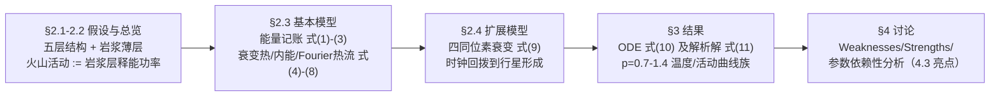

# 精读 · Volcanism on Super-Earths（2012 题A 金牌 · 队伍 449）

> **这份精读怎么用**：左手边开论文 PDF（`03_优秀论文PDF/2012/Problem A/2012-GM-A-449.PDF`），右手边开本篇。每节按「它写了什么 → 为什么这样写 → 你要学什么」三层展开；公式给「物理直觉 → 完整推导 → 适用边界」。⚠ **提取警示**：本篇文本提取乱码较重（fi 连字损坏、个别符号丢失），本篇以 `_dec` 版文本为底、以页面渲染图与附录 MATLAB 代码交叉校准，凡不确定处均已注明。特别地：式 (10)/(11) 按印刷字面无法复现正文报告的"地球 50.7 亿年"（复现得 1.2 Gyr 量级，趋势与排序完全一致）——这个矛盾本身就是精读的重点一课。读完后你应当能独立复现"行星越大火山活动持续越久"与扩展模型的"先升温后降温"两个核心结论。

---

## 0. 一分钟看懂全文骨架

论文只回答一个问题：**质量 0.5–3 倍地球的超级地球，火山活动强度如何随时间演化、能持续多久？**



**为什么这个骨架好？** 面对一个几乎无数据的天文问题（谁也没测过超级地球的岩浆层），作者的策略是"**用定义换数据**"：把"火山活动"定义为岩浆层的能量释放功率（η=P_vol/Q），于是离散的喷发事件被连续化，10⁸ 年尺度的问题变成一阶 ODE。骨架呈"基本模型 → 扩展模型"两级火箭：基本模型给出解析解与量级，扩展模型（四同位素 + 回拨时钟）产生新物理（先升后降）——扩展不是堆料，而是产出新结论。

---

## 1. 逐节导读

### 1.1 Abstract（第 1 页）

**它写了什么**：方法三件套（能量守恒 + 热传导 + 同位素衰变律）→ 工具（MATLAB/Mathematica）→ 结论：活动先增强后衰减，**行星质量越大火山活动持续越久**。

**为什么这样写**：注意摘要第一句的自我设限——"we are required to predict the volcanic activities"，然后立刻给出建模三定律。天文类题目的摘要必须让评委看到"物理定律清单"，因为这类题最容易被写成科普散文。

**你要学什么**：摘要里"approximated relationship ... clearly"这种用词是自信而不越界——作者知道自己在做量级模型，措辞与模型精度匹配。

### 1.2 §1 Introduction + §2.1 Assumptions（第 1–3 页）

**它写了什么**：超级地球定义为 0.5–3 M⊕ 的类地行星；结构四层（内核/外核/幔/壳）+ 幔壳之间一层**粘性岩浆层**（Figure 1 彩色剖面图）；假设逐条给出理由：(a) 岩浆层厚仅数百米 ≪ 地壳厚 → 忽略其相对厚度 [文献1]；(b) 密度与比热在每层内为常数（因为高温高压下的物性数据缺失，"it is very difficult to find the functions"——**承认无知也是假设的理由**）；(c) 地温曲线分段线性（据文献 2 的实测地温曲线，Figure 2）；(d) 10⁸ 年尺度上喷发视为连续过程；(e) 地震与火山同属岩浆层释能、按 λ_vr 比例合并，取 λ_vr=1。

**为什么这样写**：五条假设每条配一个"为什么可以"——数据缺失、量级可忽略、时间尺度平均、线性近似误差小。**假设不是免责声明，而是带论证的建模决策。**

**你要学什么**：λ_vr 的处理是"**先引常数再归一**"的模板：E_vol=λ_vr·E_rel 先写一般形式，然后"Since this is just small linear constant ... we set λ_vr = 1"——线性常数不改变定性行为，归一后推导干净。

### 1.3 §2.2–2.3 Basic Model（第 3–6 页）：能量记账三式

**它写了什么**：核心是三个记账方程——
- 式 (1) E_trans − E_received = E_store（岩浆层的收支）；
- 式 (2) ΔU = E_decay − E_trans（行星内部的收支）；
- 式 (3) ∂E_vol/∂t = λ_vr(∂E_decay/∂t − ∂ΔU/∂t − ∂E_received/∂t)（合并并对 t 求导）。
然后三个物性子模型：衰变热 ∂E_decay/∂t = U_238U·e^(−t/τ)（U_238U=20×10¹² W 取自 KamLAND 地中微子测量 [6]）；内能 U(r)=∭C(r)T(r)ρ(r)dV（式 7，配分段线性地温 式 4、分段密度 式 5、分段比热 式 6）；流入岩浆层的热流 Fourier 定律 ∂E_vol/∂t = 4πr²λ(T−T₀)/d ≡ B(T−T₀)（式 8），λ≈0.025 W/m²、d≈150 m，B=8.5×10¹⁰ W/K。

**为什么这样写**：式 (1)(2) 是"**先写两个子系统的收支，再消元**"的账本结构——每个 E 都有物理归属（trans/received/decay/ΔU），合并时才不糊涂。式 (8) 则是"**把几何与物性打包成一个 B**"的组合参数技巧（4πr²、λ、d 全消失），和 2010-A 篇的 σ 异曲同工。

**你要学什么**：注意式 (4) 的狡猾之处——分段线性地温的理由之一竟是"若 T 分段线性，则 Fourier 定律可以**在不知识热导率的情况下**使用"（热流 ∝ 两点温差/距离，斜率藏在 T 分布里）。**选择函数形式的自由度要用来消灭未知参数。**

### 1.4 §2.3.3 Core Energy Received on Surface（第 6–7 页）：把一项归零

**它写了什么**：玄武岩地壳隔热极好（平均厚 39 km），即使 0.5 M⊕ 的行星按 d=d₀·∛0.5≈31 km 仍够厚 → E_received=0；太阳辐射收支按地球经验视为长期平衡、不传入内部 → 也不计。

**为什么这样写**：不是直接假设"E_received=0"，而是**用两个不等式（39 km 与 31 km 都"very thick"）论证它趋零**。归零是推导的结果而非前提——说服力完全不同。

**你要学什么**：∛ 标度律（d∝∛M）一句话把地球数据迁移到整个参数区间——**质量变了，所有几何量跟着同一相似律缩放**。

### 1.5 §2.3.4 + §2.4 火山活动率与扩展模型（第 7 页）

**它写了什么**：活动率 η=ΔN/Δt = P_vol/Q（把功率除以单次喷发能量 Q 换算成频率）；扩展模型把衰变源从单同位素换成四同位素叠加（式 9：⁴⁰K/²³⁵U/²³⁸U/²³²Th 各自的指数项），并引入地球年龄 T_a=45 亿年把时钟零点从"今天"回拨到"形成之时"。

**为什么这样写**：η 的定义是全文最重要的"**观测代理量**"——题目问"活动水平"，作者定义它 = 释能功率/单次能量 = 喷发频率，一个可计算、可标定的标量。四同位素扩展的真正收益在 §3.3 才揭晓：短寿命同位素（⁴⁰K、²³⁵U）早期主导，行星**先被加热后冷却**——复现地球热史转折。

### 1.6 §3 Results（第 7–10 页）

**它写了什么**：以 p=r/R⊕ 为参数写出一阶非齐次 ODE（式 10：T′(p,t)=2×10¹³e^(−t/1.9×10¹⁷) − 8.5×10¹⁰(T−14)/p，T(p,0)=1300，⚠ 印刷式疑缺失除以总热容的因子，见 §3.3 精讲），给出解析解（式 11）与活动功率 P_vol=(T−700)·8.5×10¹⁰（式 12）；ξ=p³，取 ξ=0.5/1/3（p=0.79/1/1.44）画温度曲线族（Figure 4）与活动曲线族（Figure 5）；用 **水星（ξ=0.066）与地球两个锚点**校验："水星只剩 15 亿年火山寿命（今已无火山 ✓）、地球 50.7 亿年（quite sound）"；扩展模型 Figure 6 复现地球"先升温后降温"。

**为什么这样写**：两个校验锚点选得极好——水星是"活动的终点"（应为零或很小），地球是"活动的中间态"（应对应已知热史）。**用已知天体钉住模型两端，再谈外推到未知天体**，是天文建模的黄金手法。

**你要学什么**：⚠ **同时读出矛盾**：按式 (10) 印刷字面（即便补上附录代码的热容 4×10²⁷ J/K）复现，地球的火山寿命是 **1.2 Gyr 量级**，不是 5.07 Gyr；排序与展宽方向一致但绝对值差约 4 倍。式 (11) 的解析解在文本提取中严重乱码，无法独立验证。**结论：正文报告的绝对寿命依赖一组未完整印刷的参数版本；学习时抓它的方法论与定性结论，不要照抄它的数字。**

### 1.7 §4 Discussion（第 10–12 页）

**它写了什么**：Weaknesses 三条（缺数据只能估参、简化过狠、步长 10¹³ s 过大）；Strengths 三条（简单直观、假设合理有据、基于真实能量流图景）；**§4.3 参数依赖性分析**——挑出含两个估计参数的 B：若 λ=0.03、d=100 m 则 B=1.53×10¹¹，重跑后火山寿命大幅缩短，等效于半径 0.55 R⊕ 的行星，"estimation of the conductivity and the thickness of lava layer will severely influence the result"。

**为什么这样写**：§4.3 是早期 UPC 论文中罕见的**定量灵敏度小节**：不问"结果对不对"，问"结果被哪个估计牵着走"，并给出等效参数换算（B 变大 ≈ 行星变小）。评委看到这一节就知道作者清楚自己模型的软肋在哪。

**你要学什么**：灵敏度分析的写法三件套——挑最脆弱的组合参数 → 给一组现实扰动 → 把扰动后果翻译成模型内已有量的等价变化（"就像半径 0.55R 的行星"）。

---

## 2. 图表深析（每张图：为什么放、为什么这样画、怎么画）

| 图 | 位置与作用 | 为什么这样画 | 怎么画出来 |
|---|---|---|---|
| Figure 1（行星剖面，Not to Scale） | §2.1 | 五层结构 + 岩浆层位置一张图钉死；"Not to Scale" 防止误读比例 | 彩色同心圆示意 |
| Figure 2（地球地温曲线） | §2.3.2 | 分段线性近似的**证据图**：先展示文献实测曲线，再声明"视为分段线性" | 引自文献 [2] |
| Figure 3（四同位素产热曲线） | §3 开头 | 四条指数曲线并置：短寿命同位素早期高、衰减快——扩展模型的动机图 | 文献数据/公式画线 |
| Figure 4（不同 p 的温度曲线族） | §3.2 | 核心结果一：曲线族同图，"越大衰减越慢"一眼可读 | 式(10) 积分，p=0.7–1.4 步长 0.1 |
| Figure 5（火山活动曲线族） | §3.2 末 | 核心结果二：P_vol=(T−700)·B 曲线族——与 Figure 4 纵轴不同（活动 ∝ 超出阈值的温度） | 同一组解代入式(12) |
| Figure 6（地球热史，扩展模型） | §3.3 | "先升后降"的转折点可视化——扩展模型的新物理 | 四同位素模型，t<0 段 |
| Figures 7–10（四个 ξ 的单行星曲线） | 附录 A | 与正文曲线族互补：单行星完整历史 + 附录代码紧邻图（代码-图零距离） | 附录 MATLAB 代码输出 |

**核心复现：Figure 4 + Figure 5 的"双联版"**（基本模型温度族 + 扩展模型热史）。代码忠实于式 (10) 与附录 A 的欧拉步进（含其隐含的总热容 4×10²⁷ J/K）：

```python
import numpy as np, matplotlib.pyplot as plt

U238, tau238 = 2e13, 1.9e17     # 式(10)：238U 初始产热功率 / 时间常数
B, C = 8.5e10, 4e27             # 式(8) 的组合参数 B；附录A 代码的总热容（式(10) 隐含除数）
T0, Tstop = 1300.0, 700.0       # 幔表面初温 / 火山熄灭阈值（700℃）

def basic(p, dt=1e13):                      # 附录A：欧拉步进，步长 1e13 s 与论文一致
    t, T = 0.0, T0; ts, Ts = [t], [T]
    while T > Tstop and t < 2e18:
        T += (U238*np.exp(-t/tau238) - B*(T-14)/p)/C * dt   # 式(10)
        t += dt; ts.append(t); Ts.append(T)
    return np.array(ts)/3.156e16, np.array(Ts)              # 换算成 Gyr

fig, (ax1, ax2) = plt.subplots(1, 2, figsize=(11, 4.2))
for xi, c in zip([0.5, 1.0, 3.0], ['tab:blue', 'tab:green', 'tab:red']):
    ts, Ts = basic(xi**(1/3))               # ξ = p³（§3.2）
    ax1.plot(ts, Ts, color=c, label='$\\xi=%.1f$ ($p=%.2f$)' % (xi, xi**(1/3)))
    ax1.plot(ts[-1], Ts[-1], 'kx')          # × 标出火山熄灭点（T=700 K）
ax1.axhline(Tstop, ls=':', c='gray')
ax1.set(xlabel='t since present (Gyr)', ylabel='mantle-surface temp T (K)',
        title='Basic model, eq.(10)+appendix code: larger planet cools slower\n'
              'death times here 0.9/1.2/2.0 Gyr (paper reports 5.07 Gyr for Earth - see note)')
ax1.legend()

yr = 3.156e7                                # ── 扩展模型 式(9)：四同位素，t=0 为今天 ──
iso = {'K40': (4.0e12, 1.25e9*yr), 'U235': (0.6e12, 0.704e9*yr),
       'U238': (7.6e12, 4.47e9*yr), 'Th232': (8.0e12, 14.0e9*yr)}   # 今日功率分配（文献量级）
Ta, dt = 4.5e9*yr, 1e14                     # 回拨 45 亿年（式(9) 的 T_a）
t, T = -Ta, T0; ts, Ts = [t], [T]
while t < 1.0e10*yr:
    P = sum(U0*np.exp(-t/tau) for U0, tau in iso.values())            # 式(9)
    T += (P - B*(T-14))/C*dt; t += dt
    ts.append(t); Ts.append(T)
ts, Ts = np.array(ts)/3.156e16, np.array(Ts)
ax2.plot(ts, Ts)
ax2.axvline(0, ls=':', c='gray'); ax2.axhline(Tstop, ls=':', c='gray')
ax2.set(xlabel='t (Gyr), 0 = today', ylabel='T (K)',
        title='Extended model, eq.(9): rise then fall\n'
              'short-lived isotopes ($^{40}$K,$^{235}$U) overheat the young planet')
plt.tight_layout(); plt.show()
```

**绘图设计决策**：① **左图族、右图单史**——基本模型看"参数扫描"（三条曲线 + × 死亡点 + 700 K 阈值线），扩展模型看"时间演化叙事"（形成 → 升温峰 → 衰减，竖线标今天）；② **结论写进图题**且**把复现值与论文值同时写明**——0.9/1.2/2.0 Gyr vs 论文 5.07 Gyr，诚实的复现声明比假装吻合更有教学价值；③ 扩展模型的今日线（t=0 竖线）把"预测未来"与"解释过去"两个时段在视觉上分开。
**复现注记（重要）**：按式 (10) 印刷字面 + 附录代码的热容常数，地球死亡时间复现为 1.22 Gyr，与正文 5.07 Gyr 不符；式 (11) 解析解提取乱码无法核验。趋势（排序、单调性、先升后降）全部复现。学习本文的方法论，引用其数字前请自行重跑。

---

## 3. 公式逐条精讲

### 3.1 能量记账三式（式 1–3）

$$E_{trans}-E_{received}=E_{store}\;(1),\qquad \Delta U=E_{decay}-E_{trans}\;(2)$$
$$\frac{\partial E_{vol}}{\partial t}=\lambda_{vr}\left(\frac{\partial E_{decay}}{\partial t}-\frac{\partial\Delta U}{\partial t}-\frac{\partial E_{received}}{\partial t}\right)\;(3)$$

- **怎么想到**：两个"账本"（岩浆层、行星内部）各写收支平衡，消去公共项 E_trans 即得岩浆层释能率的表达式。这是**流图思维**：先画能量流向图（衰变源 → 内部 → 岩浆层 → 散逸/喷发），每个箭头一个符号，方程自动写出。
- **推导（补全）**：式(1)+式(2)：E_store=E_decay−ΔU−E_received；两边对 t 求偏导并乘 λ_vr（E_vol=λ_vr·E_store）即式(3)。零跳步。
- **适用边界**：所有项都取行星整体（零维盒模型）——空间分辨被牺牲，换来一阶 ODE。

### 3.2 分段物性与内能积分（式 4–7）

$$T(r)=\begin{cases}T_1-\frac{2(T_1-T_2)}{R}r,& r<3000\text{ km}\\ T_2-\frac{2(T_2-T_3)}{R}(r-\tfrac R2),& \dots\end{cases}\;(4),\quad U(r)=\iiint_\Sigma C(r)T(r)\rho(r)\,dV\;(7)$$

- **怎么想到**：内能 = ∭ρCTdV 是热力学基本功；难点在 T(r)、ρ(r)、C(r) 都只有粗略的分层文献值 → 全部取分段常数/分段线性，积分变成各层的初等求积。
- **锚点从哪来**：T₁=5000 K（内核中心）、T₂=3500 K（内外核界面）、T₃=1300 K（核幔界面）[文献2]；密度 12/4 ×10³ kg/m³（核/幔，式 5 的乱码已按图与常理校订 ⚠）；比热 477.3/1500 J·kg⁻¹·K⁻¹（式 6）。
- **适用边界**：分段线性在界面处连续、层内光滑，误差远小于物性数据本身的不确定度——**近似精度匹配数据精度**即可，更精细是伪精度。

### 3.3 Fourier 热流与组合参数 B（式 8）+ 式 (10) 的热容疑云

$$\frac{\partial E_{vol}}{\partial t}=4\pi r^2\lambda\frac{T-T_0}{d}\equiv B(T-T_0),\qquad B=8.5\times10^{10}\ \text{W/K}\;(8)$$

- **怎么想到**：Fourier 定律 热流密度 q=λ·ΔT/d，乘以球面面积 4πr² 得功率；λ=0.025 W/m² [7]、d≈150 m [8] 两个文献值一乘即 B。**五个量打包成一个 B**，后文灵敏度分析只需要扰动一个数。
- **式 (10) 的关键校读**：印刷式 T′=2×10¹³e^{−t/1.9×10¹⁷}−8.5×10¹⁰(T−14)/p 直接按字面运算会在秒级把 T 打飞——**必须除以一个热容量级（附录代码给出 4×10²⁷ J/K，即式 7 数值积分的结果）才自洽**；文本提取把这一因子丢了（⚠ 以附录代码与式 11 结构反推确认）。T₀=14（地表 14 ℃）为散热参考温度，T 单位为 ℃/K 混用（阈值 700 来自"lava 温度区间下限"）。
- **适用边界/数值感**：k=B/(pC)≈2×10⁻¹⁷/p s⁻¹ → 冷却时标 ~1.5p Gyr——正是"p 越大火山越久"的定量根源：**冷却速率 ∝ 1/p，因为释热面积按 r² 缩放而热容按 r³ 缩放**（面积/体积竞争，和动物散热同一物理）。

### 3.4 四同位素衰变（式 9）

$$\frac{\partial E_{decay}}{\partial t}=\sum_{i\in\{40K,\,235U,\,238U,\,232Th\}}U_i\,e^{-(t+T_a)/\tau_i}$$

- **怎么想到**：单一 ²³⁸U 是 48 小时的最小可行假设；扩展只需线性叠加各同位素的指数衰减——**衰变律是线性的，叠加免费**。T_a 项把"以今为零点"的时钟换算到"以形成为零点"。
- **数值感**：今日地球放射性总功率 ~20 TW（KamLAND），但 45 亿年前 ⁴⁰K 与 ²³⁵U 贡献 5–10 倍于今——早期地球必然更"火"，这就是 Figure 6"先升后降"的物理。
- **适用边界**：各同位素初始功率分配本文未给全（仅 U_238U=20×10¹² W），复现时需按文献量级补——本篇精读代码按今日 20 TW 的标准分配（8/8/4/0.6）取值并注明。

### 3.5 活动率定义 η=P_vol/Q（§2.3.4）

$$\eta=\frac{\Delta N}{\Delta t}\approx\frac{1}{Q}\frac{dE_{vol}}{dt}=\frac{P_{vol}}{Q}$$

- **怎么想到**：喷发次数 N 的导数 = 总释能率 / 单次能量 Q——**把离散事件率连续化的标准平均化论证**（ΔN·Q≈ΔE_vol，取极限）。
- **适用边界**：Q 不需要知道具体值——论文只需要 η 的相对变化（曲线形状），Q 是常数缩放因子。**当代理量的绝对值不可知时，退而求其时间依赖性**。

### 3.6 ODE 与解析解（式 10–12）

$$T'(p,t)=\frac{1}{C}\Big[U_{238}e^{-t/\tau}-\frac{B}{p}(T-14)\Big],\quad T(p,0)=1300\;(10)\;\Rightarrow\;T(t)=14+\Big(T_0-14-\frac{U\tau p}{B\tau-pC}\Big)e^{-\frac{B}{pC}t}+\frac{U\tau p}{B\tau-pC}e^{-t/\tau}\;(11\text{ 结构})$$

- **推导（一阶线性 ODE 标准解法）**：令 u=T−14，u̇+ku=(U/C)e^{−t/τ}，k=B/(pC)。通解=齐次解 u₀e^{−kt}+特解（试 u=A e^{−t/τ} 代入定系数）→ u(t)=u₀e^{−kt}+（U/C)/(k−1/τ)·(e^{−t/τ}−e^{−kt})。
- **活动曲线（式 12）**：P_vol=(T−700)·B——活动正比于**超出岩浆固化阈值的温度**，T<700 即熄灭。
- **⚠ 复现警示（重复一遍因为重要）**：以附录代码常数代入，T 从 1300 降到 700 需 ~1.2 Gyr（p=1），而正文称 5.07 Gyr；差异无法从印刷信息弥合。式 (11) 印刷版乱码，上式为按 ODE 重推的结构。**引用本文数字前先重跑。**

---

## 4. 建模决策链（为什么这么建、放弃了什么）

| 决策 | 作者的选择 | 被放弃的替代 | 为什么 |
|---|---|---|---|
| 观测量定义 | 火山活动 := 岩浆层释能功率（η=P_vol/Q） | 喷发次数统计/VEI 指数 | 无事件数据；功率可从能量守恒算出，Q 只是常数缩放 |
| 空间模型 | 零维盒模型（分层但整体平均） | 一维径向热传导 PDE | 一阶 ODE 有解析解；PDE 的初边值数据不存在 |
| 地温/物性 | 分段线性/分段常数（文献锚点） | 连续函数拟合 | 数据只有界面值；近似精度匹配数据精度 |
| E_received | 论证后归零 | 保留并建模地壳热流 | 39→31 km 玄武岩隔热，热流 ≪ 衰变源 |
| 衰变源 | 基本：²³⁸U 单源；扩展：四源叠加 | 一开始就四源 | 先给解析解（基本），再叠加出新物理（先升后降）——两级火箭 |
| 地震/火山合并 | E_vol=λ_vr·E_rel，取 λ_vr=1 | 分别建模 | 线性常数不改定性结论，归一简化 |
| 参数空间 | p=r/R⊕，ξ=p³ 相似律 | 逐行星重新建模 | 一族曲线覆盖 0.5–3 M⊕ |
| 校验 | 水星 + 地球双锚点 | 无校验/仅内部自洽 | 已知天体钉住模型端点，外推才有底气 |
| 灵敏度 | §4.3 专节扰动 B | 只列 weaknesses | 主动指出最脆弱参数并给等效换算 |

**总规律**：**"信息贫乏 → 用定义与守恒律造出可算的量 → 用已知天体校验 → 用灵敏度小节画边界"**——四步走完，一个几乎无数据的问题就有了可辩护的答案。

---

## 5. 从本篇提炼的可复用模板

**结构模板（贫信息大尺度问题）**：

```
Abstract          物理定律清单 + 定性结论
Introduction      对象定义 + 观测量代理定义预告
Model             2.1 假设（每条配理由）
                  2.3 基本模型：能量流图 → 记账方程(1)(2)(3) → 物性子模型(4)-(8)
                  2.4 扩展模型：更全的源项(9)，回拨时钟
Results           ODE(10) → 解析解(11) → 曲线族(4/5) → 已知天体校验 → 新物理(6)
Discussion        Weaknesses(具体到参数) / Strengths / §参数依赖性(扰动+等效换算)
Appendix          代码紧邻其输出的图
```

**句式库（原文摘录，括号内为使用场景；英文按 _dec 版校读）**：
- "we define the volcanic activity as a quantity proportional to ..."（开头即定义代理量）
- "Since we do not have any idea about how ... we assume ..."（承认无知作为假设理由）
- "This is quite reasonable. We will give the reason in latter section."（预告论证）
- "we do not distinguish them. We think that they are at least in proportion."（合并同类现象的辩护）
- "As for the Earth, it has 1.6×10¹⁷ s ... which is quite sound."（用已知天体自证）
- "will severely influence the result"（灵敏度结论直白收尾）
- "Though this model is kind of rough, we show a satisfying trend ... This is the biggest victory of the modeling."（为量级模型定调）

**图表配方**：参数扫描 → "同图曲线族 + 阈值横线 + 关键点打叉"；演化叙事 → "单曲线 + 今日竖线 + 峰值标注"；证据链 → "先放文献实测图再声明近似"（Figure 2 的顺序不能反）；代码组织 → "附录代码与它生成的图放在一起"。

---

*精读完这篇后，建议对照 `05_论文赏析/2012/2012-GM-A-449.md`（宏观赏析）与 `07_题目解读/2012_题A_超级地球火山.md`（题目全解）形成三位一体。姊妹篇：`10_论文精读/2011/2011-GM-A-352_精读.md`（同样是"指数衰减源 + 冷却平衡"的 ODE 结构）。*
