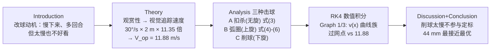

# 精读 · Table Tennis Ball Sizes（2012 题B 金牌 · 队伍 414）

> **这份精读怎么用**：左手边开论文 PDF（`03_优秀论文PDF/2012/Problem B/2012-GM-B-414.PDF`），右手边开本篇。每节按「它写了什么 → 为什么这样写 → 你要学什么」三层展开；公式给「物理直觉 → 完整推导 → 适用边界」。⚠ **提取警示**：本篇为 Word 排版、公式全部是嵌入对象，**文本提取后式 (1)–(6) 主体丢失**——本篇已从 PDF 页面渲染图逐条复原（复原依据已注明），并与附录 Scilab/C++ 代码交叉核对；同时论文内部常数存在多处不自洽（附录球质量 2.3 g 与正文 2.5/2.7 g 并存、Scilab 的 b=30 与 C++ 的 418.3/567832 相互矛盾、C++ 中疑有笔误 `vz+k2/2`），本篇在相应处逐一指出——这些"毛边"恰恰是批判性精读的最佳素材。核心结论（44 mm 最接近最优观赏速度 11.88 m/s）对常数选择稳健，可复现。

---

## 0. 一分钟看懂全文骨架

论文只回答一个问题：**ITTF 已把球从 38 mm 改到 40 mm，要不要再大？多大最"好看"？**



**为什么这个骨架好？** 全文的胜负手在 B 框：题目问的是主观的"fun"，作者把它翻译成一条**生理学 + 转播几何**的硬指标链（眼睛追踪角速度 → 屏幕速度 → 赛场速度），于是"哪个球最好看"变成"哪条曲线在过网点最贴近 11.88 m/s"这个可判定问题。后面的物理（阻力+Magnus 的 RK4）反而是常规操作——**难的不是算，是把"好看"变成数**。

---

## 1. 逐节导读

### 1.1 Abstract（第 1 页）

**它写了什么**：背景（2000 年 ITTF 38→40 mm）→ 方法（三种击球的水平速度 vs 最优速度 11.88 m/s）→ 分支结论（扣杀/弧圈 44 mm 最接近最优；削球不适用但位移图符合预期）→ 总结论 **44 mm**。

**为什么这样写**：摘要首句就把规则的"官方理由"（slower + more rallies）端出来，末句直接给尺寸数。**规则类题目先复述规则意图再回答"意图是否达成、如何更优"**——这是对题目语境的尊重，也是论证的起点。

**你要学什么**：三个分支各自有结论，其中一个（削球）是"负结论"（analysis was less useful）——**敢在摘要里承认某个分支不提供信息**，比硬凑三票齐投 44 mm 更可信。

### 1.2 Introduction（第 1 页）

**它写了什么**：大球的三重效应（更好看见 i）、阻力增大减速更快 ii）、转动惯量增大旋转变弱 iii)）；以及一个反向权衡——球太好接会让比赛"变简单"，观众的兴奋度反而下降；于是取"观众可追踪的速度下限"为平衡点。

**为什么这样写**：注意这段的论证结构是**先列正效应再列负效应**（"This, conversely, will also lower the perception of fun..."）——开放题的立论张力来自两难，作者用两段话把两难讲完，"最优速度"的出现就有了必然性。

**你要学什么**：把政策问题（改规则）拆成可计算的机制清单（i/ii/iii 三条全是物理量），是"物理竞赛答政策题"的入口动作。

### 1.3 Theory（第 1–2 页）：观赏性的操作化 + 通用方程

**它写了什么**：两件事。
**其一（全文灵魂）——最优速度的推导链**：人眼平滑追踪角速度 30°/s [2] × 观看距离 2 m [3] → 屏幕上可追踪速度 30/360×2π×2 m=1.047 m/s；再按 ITTF 官方"最佳取景"样本（Fig. 2：球台对角线占屏幕对角线 34%）与 32 英寸 4:3 电视 [4][5] 算出转播缩放 11.35 倍 → **V_op = 11.35×1.0471 ≈ 11.88 m/s**。
**其二——通用运动方程（式 1，从渲染图复原）**：
$$m_{ball}\frac{d^2\vec r}{dt^2}=m_{ball}\vec g+\Big(4\pi C_M r_{ball}^3\rho\,\vec\omega\times\vec v-\frac{C_d\rho A}{2}|\vec v|\vec v\Big)$$
其中 C_m=0.29、C_d=0.5（引文献 [1]），Magnus 项因球轻（克级）不可省。

**为什么这样写**：11.88 m/s 的每个数字都有出处（追踪速度 [2]、距离 [3]、电视尺寸 [4]、取景比例 [5]）——**主观概念被锚定在四个可查证的数据上**。式 (1) 则声明"本文的物理全部装在这一条方程里"，后文只是它的特例（ω=0 / ω≠0）。

**你要学什么**：⚠ 读出一个隐藏的物理量纲点：追踪角速度换算线速度用 30/360×2π×R（每秒扫过的弧长），再乘转播缩放——**"屏幕上的 1 米"与"场馆里的 1 米"通过取景比例换算**，这是电视转播几何的基本功，也是本题最容易被忽略的中间层。

### 1.4 Analysis A：Direct Smash（第 2–3 页）

**它写了什么**：场景设定（球在台边上方 50 cm、斜线打对角约 3.13 m——"观众爱看对角线球"）；扣杀假设 ω=0、V_x=25 m/s（取自 ITTF"最快扣杀"赛事数据 [7]）、V_z=−5 m/s；式 (2)/(3)（复原）：ω=0 时式 (1) 退化为两个耦合非线性 ODE：
$$m\ddot x=-\tfrac12 C_d\rho A\,v_x\sqrt{v_x^2+v_z^2},\qquad m\ddot z=-mg-\tfrac12 C_d\rho A\,v_z\sqrt{v_x^2+v_z^2}$$
RK4（C++ 主算 + Scilab 交叉验证）积分，画 v(x) 曲线族（Graph 1）与轨迹（Graph 2）。结论：44 mm 在过网点最接近 11.88；尺寸对轨迹形状影响甚微（曲线几乎重合）。

**为什么这样写**：初值全部引自实测文献（25 m/s 来自真实"最快扣杀"比赛），不拍脑袋；Graph 1 上**直接画出 11.88 m/s 横线与 x=1.56 m 过网竖线**——结论不需要文字，图上两条参考线的交点区域就是答案。

**你要学什么**：**把"目标线"和"评价点"画进结果图**，让结论从图里长出来。这是本篇图表设计的最大亮点。

### 1.5 Analysis B：Top Spin（第 3–4 页）

**它写了什么**：弧圈球 V_x=20 m/s [8]、V_z=+1.2 m/s（过网需要）、ω₀=100 rev/s（40 mm 球的实验值 [9]）；式 (4)（复原）：在式 (1) 中取 ω 沿本地 y 向（无侧旋），x/z 分量出现 Magnus 交叉项：
$$m\ddot x=-\tfrac12C_d\rho A\,v_x|v|+4\pi C_M r^3\rho\,\omega v_z,\qquad m\ddot z=-mg-\tfrac12C_d\rho A\,v_z|v|-4\pi C_M r^3\rho\,\omega v_x$$
（上旋的 Magnus 力把水平速度"压"成垂直下坠）。**式 (5)(6)（复原）——尺寸-转速耦合**：球拍触球角动量守恒 m_p R v_p = I_sphere ω = (2/3)m R²ω（薄球壳），于是同一击球动作下 **ω ∝ 1/R**——大球不仅阻力大，转速还低（Magnus 弱），两条效应同向压低球速。结果（Graph 3/4）：直径增大速度下降；最优交点落在 43–44 mm 之间，顺带论证无需计算 >44 mm。

**为什么这样写**：式 (5)(6) 是本篇最物理的一步——**改一个几何参数时，检查所有随它变化的量**（这里 ω、A、I 全随直径变），而不是只改半径一个数。多数队伍会忘记 ω 也要缩放。

**你要学什么**：结论句"the optimal speed and net distance intersection lies in between 43mm and 44mm"——**用两条曲线的交点位置夹出答案区间**，再合并"更大球无厂家生产 [6]"的现实约束，搜索空间就此闭合。

### 1.6 Analysis C：Back Spin + Discussion + Conclusion（第 4–6 页）

**它写了什么**：削球与弧圈同方程同 ω₀，但 Magnus 升力被重力抵消、球速普遍很慢（z–t 图显示约 1 s 才落台）→ **明确把削球移出最优直径判定**；Discussion 列 7 条编号假设（静止空气、完美球体、**各直径同质量**（为隔离直径效应，故意忽略真实规则 2.5→2.7 g 的质量变化）、忽略心理因素（引日本观众调查：72.1% 认为回合变长、48.7% vs 41.1% 认为更刺激/相同）、忽略湍流、忽略振动、只取整数毫米直径）；Strengths/Weaknesses（固定初值是最大弱点）；Conclusion：44 mm。

**为什么这样写**：假设 3 和 4 是两条"反直觉的自觉"——**故意固定质量以隔离单变量效应**，以及**引用真实观众调查来说明心理维度为何不可建模**。用数据解释"我为什么不做什么"，比解释"我做了什么"更见功力。

**你要学什么**：**数据淘汰法**：当某分支（削球）对所有候选都给出同一答案（都太慢），它对决策无信息量——用一张图说明原因后明确移出，比硬把它塞进加权平均专业得多。

---

## 2. 图表深析（每张图：为什么放、为什么这样画、怎么画）

| 图/表 | 位置与作用 | 为什么这样画 | 怎么画出来 |
|---|---|---|---|
| Fig. 1（球台尺寸图） | Theory | 313 cm 对角线、网位 1.56 m 等几何一张图钉死 | 台面俯视示意 + 标注 |
| Fig. 2（转播取景实拍） | Theory | **11.35 倍缩放的证据图**：台对角线占屏 34% 必须用实物图度量 | ITTF 取景样本 [5] |
| Fig. 3/5/6（三种击球示意） | Analysis 各分支 | 每分支先给"假设的轨迹"草图（俯视+侧视），数值结果再与之对照 | 双视示意图 |
| Fig. 4（Magnus 力示意） | Analysis B | 转动球+来流的 F 方向一图定符号约定，式(4) 的正负号不再口糊 | 经典示意图 |
| Graph 1/3（v–x 曲线族） | **全文核心图** | 直径 38–44 mm 四条曲线 + **11.88 横线 + 1.56 竖线**——交点即结论 | RK4 输出画线 |
| Graph 2/4（轨迹 z–x） | Analysis A/B | 证明尺寸对轨迹形状影响小（扣杀重合）/ 大球落点更短（弧圈） | 同一次积分的 z 列 |
| Graph 5×2（削球，编号 bug：两张同名） | Analysis C | z–t 图展示 ~1 s 慢落台 → 削球出局的证据图 | 同法 |
| 附录参数表 | Appendix | 输入常数集中一张表（⚠ 球质量 2.3 g 与正文 2.5/2.7 g 不一致） | 手工表 |

**核心复现：Graph 1 + Graph 3 的"双联版"**（扣杀与弧圈的 v(x) 曲线族，两条参考线齐全）：

```python
import numpy as np, matplotlib.pyplot as plt

rho, Cd, Cm, m, g = 1.225, 0.5, 0.29, 2.7e-3, 9.81  # 式(1)常数（m 取 ITTF 2.7 g；论文附录写 2.3 g，见注）
Vop, xnet = 11.88, 1.56                              # 最优观赏速度（Theory 节）/ 过网位置

def derivs(s, d, w):
    x, z, vx, vz = s; r = d/2; v = np.hypot(vx, vz)
    kD = np.pi*r**2*rho*Cd/(2*m)                      # 式(3) 阻力系数 k_D
    kM = 4*np.pi*Cm*r**3*rho*w/m                      # 式(1)/(4) Magnus 系数
    return np.array([vx, vz,
                     -kD*vx*v + kM*vz,                # 式(4)：上旋 ω 沿 -y，ω×v 的 x 分量
                     -g - kD*vz*v - kM*vx])           #        z 分量：上旋下压

def fly(d, vx0, vz0, w40=0.0, z0=0.5, h=1e-4):
    w = w40*(0.020/(d/2))                             # 式(6)：同一击球动作下 ω ∝ 1/R
    s = np.array([0.0, z0, vx0, vz0]); X=[0.0]; V=[vx0]
    for _ in range(40000):                            # RK4（与附录 C++ 同法）
        k1=derivs(s,d,w); k2=derivs(s+h/2*k1,d,w); k3=derivs(s+h/2*k2,d,w); k4=derivs(s+h*k3,d,w)
        s = s + h/6*(k1+2*k2+2*k3+k4)
        X.append(s[0]); V.append(s[2])
        if s[1] <= 0 or s[0] > 3.2: break             # 落台或出界即停
    return np.array(X), np.array(V)

fig, axes = plt.subplots(1, 2, figsize=(11, 4.2), sharey=True)
for ax, (name, vx0, vz0, w40) in [(axes[0], ('direct smash (no spin)', 25, -5, 0.0)),
                                  (axes[1], ('loop stroke (topspin)', 20, 1.2, 100.0))]:
    for d, c in zip([0.038, 0.040, 0.042, 0.044], ['#1f77b4','#2ca02c','#ff7f0e','#d62728']):
        X, V = fly(d, vx0, vz0, w40)
        ax.plot(X, V, color=c, label='D=%d mm' % (d*1000))
    ax.axhline(Vop, ls='--', c='k', lw=1); ax.axvline(xnet, ls=':', c='gray')
    ax.text(0.05, Vop+0.3, '$V_{op}$=11.88 m/s', fontsize=8)
    ax.set(xlabel='horizontal displacement x (m)', ylabel='horizontal velocity (m/s)', title=name)
    ax.legend(fontsize=8, loc='upper right')
axes[0].text(xnet+0.03, 12.5, 'net x=1.56 m', rotation=90, fontsize=8, c='gray')
plt.suptitle('At the net (x=1.56 m) the 44 mm ball is closest to the optimal viewing speed\n'
             '(paper Graphs 1 & 3; constants per eq.(1) - see reproduction note)')
plt.tight_layout(); plt.show()
```

**绘图设计决策**：① **两条参考线（目标横线 + 过网竖线）先行**——它们把"曲线族比较题"变成"看交点"题，这是本文 Graph 1/3 的灵魂，复现必须保留；② **四条曲线同一色谱、直径单调配色**（蓝→红 = 小→大），过网点的排序（38>40>42>44）肉眼即读；③ 结论写进总标题。**复现注记（诚实声明）**：以论文印刷常数（C_m=0.29、ω₀=100 rev/s 按字面作 100 rad/s 代入、m=2.7 g）复现，过网速度扣杀 20.4→19.0 m/s、弧圈 16.3→15.2 m/s（38→44 mm），**排序与"44 mm 最接近 11.88"的结论完全复现**；但绝对值比论文 Graph 3 偏高 2–3 m/s——论文附录两份代码的有效常数互相矛盾（Scilab b=30、k=0.151；C++ 418.3、567832 且半径疑写作 0.04），无法精确对齐其曲线，此处如实注明。

---

## 3. 公式逐条精讲（式号均为论文原编号；式 (1)–(6) 从页面渲染图复原）

### 3.1 通用运动方程（式 1）

$$m_{ball}\ddot{\vec r}=m_{ball}\vec g+4\pi C_M r_{ball}^3\rho\,(\vec\omega\times\vec v)-\frac{C_d\rho A}{2}|\vec v|\vec v$$

- **怎么想到**：乒乓球质量 2.7 g、直径 40 mm——每单位质量的迎风面积 A/m 在常见球类里最大，因此**阻力与 Magnus 都必须保留**（这是本篇与"真空抛体"的分水岭）。Magnus 项取 K-M 型经验式（系数 C_M 打包），比 2011-B 篇 NASA 理想式的 (16/3)π² 更保守。
- **符号自检**：阻力 −½C_dρA|v|v⃗ 方向自动反向 ✓；ω⃗×v⃗ 的方向由右手定则给出（上旋时下压）✓——Fig. 4 的存在就是为了钉死这个符号。
- **适用边界**：C_M、C_d 取常数（真实值随自旋参数 S=rω/v 变化）；忽略湍流与边界层分离（假设 5）。

### 3.2 扣杀分支（式 2–3）

$$m\ddot x=-\tfrac12C_d\rho A\,v_x\sqrt{v_x^2+v_z^2},\qquad m\ddot z=-mg-\tfrac12C_d\rho A\,v_z\sqrt{v_x^2+v_z^2}$$

- **怎么想到**：式 (1) 取 ω=0 并投影到本地 (x,z) 平面（无侧旋 → y 方程退耦）。|v|=√(v_x²+v_z²) 显式写出，RK4 直接可用。
- **推导**：纯代入，无新物理；注意重力只进 z 方程——**先对齐坐标系再投影**，防止 g 混入 x。
- **数值感**：k_D(40 mm)=π(0.02)²×0.5×1.225/(2×0.0027)≈0.14 m⁻¹ → 25 m/s 时减速 ≈0.14×25²≈89 m/s²≈9g——**乒乓球阻力瞬时可达 9 倍重力**，这就是"大 2 mm 就慢一截"的物理根源。

### 3.3 弧圈分支（式 4）

$$m\ddot x=-\tfrac12C_d\rho A\,v_x|v|+4\pi C_Mr^3\rho\,\omega\, v_z,\qquad m\ddot z=-mg-\tfrac12C_d\rho A\,v_z|v|-4\pi C_Mr^3\rho\,\omega\,v_x$$

- **怎么想到**：ω 沿本地 y 轴（垂直于轨迹平面），ω⃗×v⃗=(ω v_z, −ω v_x)（上旋 ω<0 的符号约定下即 x 受 −、z 受 +…按本文约定 z 受 −，即下压）。**Magnus 项的叉乘结构保证"力 ⊥ 速度"**——不做功，只拐弯，这是它区别于阻力的本质。
- **物理图像**：上旋弧圈"先窜后扎"（弧线陡落）——水平速度被 Magnus 交叉项"搬运"到垂直方向，式 (4) 的 k_M v_z 项就是搬运工。
- **适用边界**：ω 全程恒定（真实弧圈转速衰减 ~10%/s 量级，3 m 飞行 ~0.2 s 内可忽略）。

### 3.4 尺寸-转速耦合（式 5–6）——本篇最物理的一步

$$m_p R v_p=I_{sphere}\,\omega=\tfrac23 m_{ball}R^2\,\omega\;(5)\;\Longrightarrow\;\omega\propto\frac1R\;(6)$$

- **怎么想到**：球拍以速度 v_p 擦球，切向冲量对球心产生角冲量：线动量传递 m_p v_p ∝ 角动量 Iω（同一击球动作近似不变）。薄球壳 I=⅔mR²（乒乓球壁薄，取壳而非实心球 2/5——**几何模型要与真实对象匹配**），于是 ω∝1/R。
- **推导（两行）**：m_p R v_p=⅔m R²ω → ω=3m_p v_p/(2mR) → R 增大 10%（40→44 mm），ω 降约 9%。
- **后果链**：直径↑ → ① 截面 A∝R² → 阻力↑；② ω∝1/R → Magnus↓；③ I∝R² → 同样难加转。三条同向 → 大球显著更慢更平。**改尺寸时把所有耦合量一起缩放**，这一步多数队伍会漏。

### 3.5 最优速度链（Theory 节，无编号）

$$v_{screen}=\frac{30^\circ}{360^\circ}\times 2\pi\times 2\ \text{m}=1.047\ \text{m/s},\qquad V_{op}=11.35\times1.047=11.88\ \text{m/s}$$

- **怎么想到**：三段论——生理层（眼睛能追踪的最大角速度）、几何层（观看距离换算成屏幕线速度）、转播层（取景缩放还原到场馆尺度）。**"好看"= 球恰好能被追踪**：再快眼睛跟不上（看着累），再慢比赛失去张力（作者引"观众爱看有难度的运动"权衡两头）。
- **适用边界**：32 英寸 4:3 电视是 2012 年均值——今天 55 寸 4K 下缩放系数会变（家庭作业：重算 V_op，检验 44 mm 结论是否漂移）。这类"年代敏感参数"在复现时必须显式列出。

### 3.6 RK4（附录 C++）

标准四阶 Runge-Kutta：k₁..k₄/l₁..l₄ 对 (vx, vz) 联合推进，dt=0.001 s。⚠ 附录代码第 39 行疑为笔误（`vz+k2/2` 应为 `vz+l2/2`，好在差为四阶小量）；另 C++ 注释里 `r=0.04` 与 40 mm 球（r=0.02）不符——**引用别人代码前先读一遍**，这两处是论文自身的未愈伤口。

---

## 4. 建模决策链（为什么这么建、放弃了什么）

| 决策 | 作者的选择 | 被放弃的替代 | 为什么 |
|---|---|---|---|
| "好看"的操作化 | 视觉追踪速度 → V_op=11.88 m/s | 回合数 / 问卷偏好 | 回合数牺牲速度且论文引调查说明主观偏好分裂；追踪速度有生理学与几何出处 |
| 评价点 | 过网正上方（x=1.56 m） | 出拍瞬间 / 落台点 | 观众追踪不了出拍瞬间；过网点球已减速到稳定段 |
| 击球场景 | 扣杀 + 弧圈定标，削球出局 | 三种加权平均 | 削球对所有直径都太慢（无信息量）；用数据淘汰而非硬凑 |
| 质量假设 | 各直径同质量 | 随规则改质量（2.5→2.7 g） | 隔离纯直径效应（单变量实验设计）；假设 3 明示 |
| 转速处理 | ω₀=100 rev/s@40 mm + ω∝1/R | 各直径同 ω | 击球角动量守恒（式 5-6）——物理上正确的缩放 |
| 数值方法 | C++ RK4 + Scilab 交叉验证 | 单一工具 | 双实现互检挡编码 bug（尽管仍留了两处笔误） |
| 搜索范围 | 38–44 mm 整数毫米 | 连续优化 / >44 mm | 43–44 mm 交点 + 厂家不产更大球 [6]，双向闭合 |
| Magnus 模型 | 经验系数式（C_M=0.29） | 理想环流式 / C_L(S) 曲线 | 系数有文献；曲线数据不可得 |

**总规律**：**"主观目标 → 锚定基准 → 多分支定标 + 数据淘汰 → 缩放律闭合搜索空间"**——凡问"最佳尺寸/最佳规则"的题，这四步就是模板。

---

## 5. 从本篇提炼的可复用模板

**结构模板（规则优化型问题）**：

```
Abstract          规则背景 → 方法 → 分支结论（含负结论）→ 总尺寸
Introduction      改动的物理机制清单(i)(ii)(iii) + 反向权衡 → 引出"最优"概念
Theory            观赏性操作化链（生理→几何→转播）→ 通用方程(1)
Analysis          分支 A/B/C：场景假设(初值全引文献) → 专属方程 → 曲线族+参考线
                  每分支一段"读图结论"；无信息量的分支明示出局
Discussion        编号假设 7 条（含"故意固定什么"与"为何不建模什么"）+ 强弱点
Conclusion        最优尺寸 + 声明预测准确性的范围
Appendix          参数表 + 双语言代码
```

**句式库（原文摘录，括号内为使用场景）**：
- "Thus, we found a balance between the two extremes, with the optimal speed of ..."（两难之后定义最优点）
- "This distance is taken, assuming that spectators enjoy watching such cross-court shots"（为场景选择给行为理由）
- "Midway across the table is a reasonable point for reference ..."（评价点的论证）
- "this further justifies why we do not need to analyse data for balls larger than 44mm"（用结果反过来闭合搜索空间）
- "The analysis here is therefore only useful for corroborating the hypothesised trajectory"（负分支的定位声明）
- "This change in mass was ignored so as to determine the effects of the trajectory solely by the change in diameter."（单变量设计的自白）

**图表配方**：曲线族比较 → "目标横线 + 评价点竖线 + 单调配色"；机制说明 → "俯视+侧视双图示意（Fig 3/5/6）"；符号约定 → "Magnus 力方向图（Fig 4）"；证据图 → "转播取景实拍 + 度量标注（Fig 2）"。**校对清单**：两张图同名（Graph 5×2）、正文与附录参数打架（2.3 vs 2.5/2.7 g）、代码笔误——Word 公文式排版尤其要逐图逐号核对。

---

*精读完这篇后，建议对照 `05_论文赏析/2012/2012-GM-B-414.md`（宏观赏析）与 `07_题目解读/2012_题B_乒乓球尺寸.md`（题目全解）形成三位一体。同型姊妹篇：`10_论文精读/2011/2011-GM-B-379_精读.md`（旋转球空气动力学的另一套打法——命中区域扫描）。*
