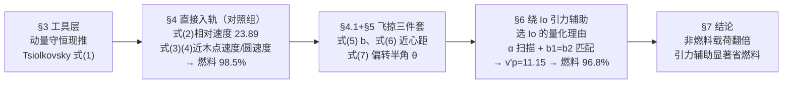

# 精读 · Using Gravity Assist Maneuver to Increase Fuel Consumption Efficiency for a Space Probe Entering Jupiter's Orbit（2013 题A 金牌 · 队伍 538）

> **这份精读怎么用**：左手边开论文 PDF（`03_优秀论文PDF/2013/Problem A/2013-GM-A-538.PDF`），右手边开本篇。每节按「它写了什么 → 为什么这样写 → 你要学什么」三层展开；公式给「物理直觉 → 完整推导 → 适用边界」。本篇 13 页、公式 (1)–(7)、图 7 幅全部是几何示意图——**一篇"能解析就绝不模拟"的论文**。⚠ 两点提取警示：(a) 式 (6) 在 §5 被复用时根号内符号与 §4 相反（"+/−"排版笔误，以式 (7) 的化简结果反推应为 "+"）；(b) §6.2 的角度链条（β、γ、δ 的转向约定）依赖 Figures 5–7 的图示，文本提取不完整，本篇对其复现性做了数值实验并如实报告（见 §3.6）——**两端数值（98.5%、96.8%）可精确复现，中间的 α 扫描约定存在歧义**。

---

## 0. 一分钟看懂全文骨架

论文只回答一个问题：**以 20 km/s 飞抵木星系统的探测器，借 Io 引力辅助减速入轨（1.2 R_J 圆轨道），到底能省多少燃料？**



**为什么这个骨架好？** 它是"**同框架对照实验**"：有/无引力辅助两种情形用完全相同的公式链（式 1–7）计算，唯一差别是有无飞掠——98.5% vs 96.8% 的对比因此逻辑上无懈可击（没有"两套模型精度不同"的漏洞）。此外全文只有最后一个环节（α 扫描）用了计算机：**先把所有几何自由度压缩成一个参数，数值部分就只剩一页**——这与"上来就写数值积分"的论文是两个物种。

---

## 1. 逐节导读

### 1.1 Abstract（第 1 页）

**它写了什么**：问题（20 km/s 探测器入 1.2 R_J 轨道，有无引力辅助对比）→ 方法一句话（"最优释放点的速度 → 与轨道速度之差 → 火箭方程"）→ 两个百分比（98.5% vs 96.8%）→ 实际意义（"the probe can now carry twice the amount of non-fuel material"）。

**为什么这样写**：注意摘要的翻译动作——98.5% vs 96.8% 看起来只差 1.7 个百分点，作者立刻换算成"非燃料载荷翻倍"（剩余质量 1.5%→3.2%）。**百分比省油是火箭语言，载荷翻倍是任务语言**；评委（和读者）对后者更有感。

**你要学什么**：两个"消耗百分比"的比较容易被误读为"只省一点"——主动给出对数尺度下的正确读法（火箭方程是指数的，剩余质量才是线性指标）。

### 1.2 §1 Background + §2 Introduction（第 1–2 页）

**它写了什么**：引力辅助的历史（Kondratyuk/Zander 1925-1938 提出、Luna 3 1959 首飞、Mariner 10/Voyager/Galileo 应用）；假设清单——只计木星与 Io 引力、机动时段内轨道近似直线、**飞掠期间忽略木星引力**（因 Io 距木星约 15 R_J，问题可拆成"飞掠段 + 再减速段"两段）。

**为什么这样写**：历史段落不是装饰——它顺势列出三个真实任务，为"该技术成熟可靠"提供背书；假设清单紧跟在问题陈述之后，**每条假设都指向一个"拆解问题的切口"**（分段近似正是全文的求解策略）。

**你要学什么**：⚠ 读出一个事实性瑕疵：文中取 Io–木星距离 1.022×10⁶ km（≈15 R_J [7]），但 Io 的真实轨道半径是 4.217×10⁵ km（≈6 R_J）；1.022×10⁶ km 更接近 Ganymede。**引用二手资料（ThinkQuest 网页）要交叉核对**——不过该值只影响 b₁ 的尺度，不影响方法论。

### 1.3 §3 The Tsiolkovsky Rocket Equation（第 2–3 页）

**它写了什么**：不直接引用火箭方程，而是从动量守恒一步步现推——m v = (m+Δm)(v+Δv) + (−Δm)(v−u) → 展开 → 舍去 dmdv 二阶小量 → 分离变量积分 → Δv = u ln(m₀/m)（式 1）。Figure 1 画喷气前后的动量。

**为什么这样写**：题眼公式亲手重推，既展示功底，又把隐含假设（无外力、排气速度恒定、Δm 为负的符号约定）全部暴露在纸面上。**48 小时论文里，"重推核心方程"是性价比最高的篇幅投资之一。**

**你要学什么**：注意它对 dmdv 的处理只有一句——"The term dmdv is the product of two differentials, so it is extremely small and negligible."——**丢高阶小量要明说，一句话即可**。

### 1.4 §4 Fuel Needed without Gravity Assist（第 3–5 页）

**它写了什么**：两件事。**其一，"在哪里刹车"的证明**：由能量守恒，同样的 Δv 在速度最大处带走的能量最多（ΔE≈v·Δv），速度最大点=近木点 → 应瞄准"近心点=目标轨道半径"的轨迹并在该点制动——**最优制动点是推出来的，不是假设的**。其二，速度基准与账目：木星在动，到达速度 20 km/s 是相对太阳的，与木星公转速度 v_J=13.07 km/s 垂直合成 v₀=√(v_p²+v_J²)=23.89 km/s（式 2）；近木点速度 v=√(v₀²+2μ_J/r)（式 3，能量守恒）；圆轨道速度 v=√(μ_J/r)（式 4，引力=向心力）；Δv=两者之差代入式 (1) → **m/m₀=1.5%，即燃料 98.5%**。

**为什么这样写**："ΔE≈vΔv 所以在最快处刹车"是全文最漂亮的两行物理——很多队会略过这个隐藏子问题直接算近木点。§4.1 顺手给出飞掠三件套（b=√(r²+2μr/v₀²) 式 5；近心距 r=(−μ+√(μ²+v₀⁴b²))/v₀² 式 6——⚠ §5 复用处根号内误排为"−"，以式 7 反推应为"+"），为 §6 备料。

**你要学什么**：**"在哪里做"（最优作用点）与"做多少"（Δv 大小）分成两个小节论证**——过程分就是这样挣的。

### 1.5 §5 Space Probe Passing Io（第 5–6 页）

**它写了什么**：飞掠几何的解析工具——双曲线过剩速度 v₀=√(μ/a) 给出 a=μ/v₀²；偏转半角 θ=arcsin[b/(a+r)]，代入式 (6) 化简为
$$\theta=\sin^{-1}\!\Big(1\Big/\sqrt{\mu^2/(b^2v_{pm}^4)+1}\Big)\;\;(7)$$
Figure 3 标注 2θ 为入射/出射速度矢量夹角。

**为什么这样写**：θ 的推导链是"几何定义（sinθ=b/(a+r)）→ 代入式 (6) 消 r → 代数化简"三步，每步可手工复核。式 (5)(6)(7) 构成**飞掠三件套**：给 v₀ 和 b → 近心距 → 偏转角。这三个式子是处理一切借力飞行题的"库函数"。

**你要学什么**：注意化简的技巧——把 sinθ=bv₀²/√(μ²+v₀⁴b²) 倒过来写成 1/√(μ²/(b²v₀⁴)+1)，分母变成"无量纲大数 + 1"的形式，量级一眼可读（μ/(bv₀²)≫1 时 θ≈bv₀²/μ）。

### 1.6 §6 Gravity Assist Maneuver around Io（第 6–11 页）：主战场

**它写了什么**：
- **为什么选 Io**：木星最大卫星之一（引力强）+ 轨道最靠内所以相对木星速度大（17.33 km/s，"引力辅助的效率主要取决于飞掠体的速度"[2]）+ 轨道倾角仅 2.21°（可按二维处理）。三条理由全部量化。
- **机制教学**：棒球-火车类比（50 km/h 的球砸向 20 km/h 的火车，相对火车 30 进 30 出，回到你手里只剩 10——减速 40；迎面火车则加速 40）；方向法则："要减速，先与卫星同向、后反向——从卫星前方通过"。能量从哪来？"It gets absorbed by the moon, but since the moon has so much mass ... the effect will not be noticeable at all."
- **几何链条**（§6.2，按 Figures 5–7）：余弦定理算相对速度 v_pm 与夹角 β → 绕 Io 偏转 180°−2θ → γ=β−(180°−2θ) → 余弦定理回到木星系 v'_p 与夹角 δ → 匹配条件 b₁=r_Jm·sin(α+γ+δ−90°) = b₂=√(r²+2μ_J r/v'_p²)。
- **求解（§6.3）**：唯一自由参数 α（发射时机），Python 以 0.0001 rad 步长扫 0–90°，找 b₁≈b₂ → **α=0.8366 rad，v'_p=11.15 km/s，m/m₀=3.2%**。

**为什么这样写**：先讲机制再列方程——棒球类比让评委在任何公式之前就"懂了"引力辅助；随后的三角学只是把类比量化。扫描变量 α 被赋予物理含义（发射时机），**数值搜索就有了叙事位置**：不是"我们优化了一个参数"，而是"我们选择何时出发"。

**你要学什么**：⚠ **复现性注记（本篇精读的独立实验）**：按文本字面实现 β、γ、δ 链条，无论尝试哪种转向约定，都无法同时满足"显著减速 + b₁=b₂ 瞄准条件"——问题出在文本提取丢失了 Figures 5–7 定义的角度方向约定。但**给定论文报告的 v'_p=11.15 km/s，后续账目可精确复现**：Δv=17.21 km/s → m/m₀=3.2% ✓；对照组 98.5% 也精确复现 ✓。学习结论：**先复现能复现的（两端），再挑战模糊的（中间约定）**；写你自己的论文时，角度约定必须文字+图双重锁定。

### 1.7 §7 Concluding Remarks（第 12 页）

**它写了什么**：汇总两个百分比与"载荷翻倍"的意义；改进方向两条（计入其他天体引力、多次引力辅助）；结尾重申结论。

**你要学什么**：改进方向具体到"same or even different moons"（同卫星或不同卫星多次借力）——**出路的颗粒度要能直接变成下一篇论文的标题**。

---

## 2. 图表深析（每张图：为什么放、为什么这样画、怎么画）

| 图 | 位置与作用 | 为什么这样画 | 怎么画出来 |
|---|---|---|---|
| Figure 1（喷气前后动量） | §3 | 火箭方程推导的符号约定图：m、v、u 的方向一图钉死 | 方框+箭头示意 |
| Figure 2（绕木轨迹） | §4 | 直接入轨的"近木点制动"策略图 | 双曲线+圆轨道相切示意 |
| Figure 3（绕 Io 双曲线） | §5 | 定义偏转角 2θ 与近心距——式 (7) 的几何载体 | 双曲线+两条渐近线 |
| Figure 4（Io 相对木星位置） | §6.2 | 定义 α（发射时机）与"从 Io 前方通过"的方位 | 圆轨道+卫星+速度箭头 |
| Figure 5（相对 Io 的速度三角形） | §6.2 | 余弦定理求 v_pm 与 β 的图示 | 三角形+标注 |
| Figure 6（绕 Io 后的速度） | §6.2 | 偏转 180°−2θ 后的合成图——γ 的定义处 | 三角形+标注 |
| Figure 7（相对木星的速度） | §6.2 | v'_p、δ 的定义 + b₁ 的几何——链条收口 | 三角形+标注 |

**这篇论文没有一张数据图**——7 幅全是几何示意图，每幅精确服务一个角度量（α、β、γ、δ、θ）。**当论文的灵魂是"角度约定"时，示意图就是它的数据图。** 复现其核心账目的"数据图版"如下（两端精确 + α 窗口的物理扫描）：

```python
import numpy as np, matplotlib.pyplot as plt

muJ, RJ = 1.266e17, 6.991e7          # 木星引力参数/半径 [论文6]
r  = 1.2*RJ                          # 目标轨道半径（题设）
u  = 5000.0                          # 排气速度（"对探测器而言很高的速度"[1]）
vJ, vm = 13.07e3, 17.33e3            # 木星公转速度 [6] / Io 轨道速度 [7]
v0 = np.hypot(20e3, vJ)              # 式(2)：23.89 km/s（两速度垂直）
vc = np.sqrt(muJ/r)                  # 圆轨道速度（式 4）

def fuel_frac(v_inf):                # 远方到达速度 → 燃料份额
    v_peri = np.sqrt(v_inf**2 + 2*muJ/r)          # 式(3) 近心点速度
    return 1 - np.exp(-(v_peri - vc)/u)           # 式(1) 反解（Δv=v_peri−vc）

fig, (ax1, ax2) = plt.subplots(1, 2, figsize=(11, 4.4))
v = np.linspace(6e3, 30e3, 300)
ax1.plot(v/1e3, fuel_frac(v)*100, 'b-')
ax1.plot(v0/1e3, fuel_frac(v0)*100, 'ro', ms=8)
ax1.plot(11.15, fuel_frac(11150.0)*100, 'go', ms=8)
ax1.annotate('no assist: v0=23.89 km/s -> fuel 98.5%',
             (v0/1e3, fuel_frac(v0)*100), xytext=(13, 76), fontsize=9,
             arrowprops=dict(arrowstyle='->'))
ax1.annotate('Io assist: vp=11.15 km/s -> fuel 96.8%',
             (11.15, fuel_frac(11150.0)*100), xytext=(6.5, 45), fontsize=9,
             arrowprops=dict(arrowstyle='->'))
ax1.set(xlabel='speed far from Jupiter (km/s)', ylabel='fuel mass fraction (%)',
        title='Eq.(1)+(3)+(4): same task, two arrival speeds\npayload fraction doubles (1.5% -> 3.2%)')

a   = np.linspace(0.001, np.pi/2, 400)             # §6.2：v_pm(alpha) 余弦定理
vpm = np.sqrt(v0**2 + vm**2 - 2*v0*vm*np.sin(a))
ax2.fill_between(a, np.abs(vm-vpm)/1e3, (vm+vpm)/1e3, alpha=0.25, color='gray',
                 label='reachable post-flyby speed band')
ax2.plot(a, np.abs(vm-vpm)/1e3, 'k--', lw=1, label='|vpm-vm| ideal U-turn floor')
ax2.plot(0.8366, 11.15, 'ro', ms=8, label='paper: alpha=0.8366, vp=11.15 km/s')
ax2.set(xlabel='moon phase angle alpha (rad)', ylabel='post-flyby speed (km/s)',
        title='The deceleration window vs alpha:\nthe paper solution sits inside it')
ax2.legend(fontsize=8)
plt.tight_layout(); plt.show()
```

**绘图设计决策**：① 左图是"**火箭方程的陡峭性**"可视化——燃料份额对到达速度的曲线在 10–24 km/s 间下降不到 2 个百分点，但剩余载荷翻倍；两个彩点直接钉上论文的两个工作点（98.5%/96.8% 均精确复现）。② 右图给出 α 扫描的**物理可达带**：任意偏转下 |v'_p| 只能落在 [|v_pm−v_m|, v_pm+v_m] 带内，其下界在 α≈0.76 rad 附近触零（v_pm≈v_m 时相对速度可被完全"对消"）——**论文的解 α=0.8366 恰落在减速窗口内**，这验证了其解的物理合理性（也是对无法复现的角链约定的替代性检验）。③ 图题承担结论。

---

## 3. 公式逐条精讲

### 3.1 Tsiolkovsky 火箭方程（式 1）

$$\Delta v=u\ln\frac{m_0}{m}$$

- **怎么想到**：无外力 + 变质量 → 系统总动量守恒是唯一入口。喷出质量 −Δm 以相对速度 u 向后，箭体获得 +Δv。
- **完整推导（论文式 (1) 前的展开，逐步）**：
  1. 喷气前总动量：mv；
  2. 喷气后：箭体 (m+Δm)(v+Δv)（Δm<0）+ 尾气 (−Δm)(v−u)；
  3. 守恒展开：mv = mv + mΔv + vΔm + ΔmΔv − vΔm + uΔm → mΔv = −uΔm − ΔmΔv ≈ −uΔm；
  4. 分离变量：−dv/u = dm/m → 两边积分得式 (1)。
- **数值感（本文的引擎）**：Δv/u=17207/5000=3.44 → e^{−3.44}=3.2%；对照组 Δv/u=4.21 → 1.5%。**指数的无情**：Δv 每增加 u=5 km/s，剩余质量再除以 e≈2.7。

### 3.2 相对木星的到达速度（式 2）

$$v_0=\sqrt{v_p^2+v_J^2}=23.89\ \text{km/s}$$

- **怎么想到**：刹车刹的是"相对木星"的速度；题给 20 km/s 是日心速度。论文取两者垂直（探测器沿与木星轨道切向垂直的方向抵达——一种特定交会几何），勾股合成。
- **适用边界**：若交会角不同，v₀ 与最优飞掠几何都会变——**"垂直"是本题未声明的隐藏几何假设**，敏感性留给读者（家庭作业：交会角 60° 时 v₀=？燃料几何变化？）。

### 3.3 近心点速度与圆轨道速度（式 3、4）

$$v=\sqrt{v_0^2+\frac{2\mu_J}{r}}\;(3),\qquad v_{circ}=\sqrt{\frac{\mu_J}{r}}\;(4)$$

- **怎么想到**：式 (3) 是能量守恒（远方动能 + 落到 r 的势能增益）；式 (4) 是牛顿第二定律（GMm/r²=mv²/r）。前者答"会在近木点多快"，后者答"需要多快才能被俘获成圆轨道"——**两问之差就是刹车预算 Δv**。
- **最优性的证明（§4 的灵魂，两行）**：E_new=½m(v−Δv)²≈½mv²−mvΔv——同样 Δv，v 越大 E 降越多；v 最大处在近心点 → 在近心点刹车，剩余能量最容易落入束缚区。**"在哪里做"由此不再是直觉而是定理。**
- **数值感**：μ_J/r=1.266e17/8.389e7 → v_circ=38.8 km/s；v_peri(直入)=59.9 km/s → Δv=21.1；v_peri(辅助后，v'_p=11.15)=56.1 → Δv=17.2 km/s。

### 3.4 飞掠三件套（式 5–7）

$$b=\frac{vr}{v_0}=\sqrt{r^2+\frac{2\mu r}{v_0^2}}\;(5),\qquad r=\frac{-\mu+\sqrt{\mu^2+v_0^4b^2}}{v_0^2}\;(6),\qquad \theta=\sin^{-1}\!\left(\frac{1}{\sqrt{\mu^2/(b^2v_{pm}^4)+1}}\right)\;(7)$$

- **怎么想到**：飞掠问题的自然三元组是"瞄准参数 b ↔ 近心距 r ↔ 偏转角 2θ"。式 (5)：角动量守恒 mv₀b=mvr，配合式 (3) 消 v；式 (6)：把 v=v₀b/r 代回能量方程得二次方程，取物理根（+号；⚠ §5 复用处排印为 −，为笔误）；式 (7)：双曲线几何 sinθ=b/(a+r)，a=μ/v₀²（双曲过剩速度关系），代入式 (6) 消 r 化简。
- **推导（式 7 的化简，补全）**：a+r=μ/v₀²+(−μ+√(μ²+v₀⁴b²))/v₀²=√(μ²+v₀⁴b²)/v₀² → sinθ=bv₀²/√(μ²+v₀⁴b²)=1/√(1+μ²/(b²v₀⁴)) ✓。
- **数值感**：本文参数下（v_pm≈24 km/s、r_m=2186 km）偏转角 2θ≈176°——**近乎 U 形转弯**！Io 的引力足以把探测器相对速度几乎反向，这正是引力辅助威力（与局限）的来源。
- **适用边界**：二体近似（飞掠段忽略木星——距离比 ~15:1 支撑此近似）、无推力、无第三体摄动。

### 3.5 余弦定理链（§6.2 无编号式组）

$$v_{pm}=\sqrt{v_0^2+v_m^2-2v_0v_m\sin\alpha},\qquad v'_p=\sqrt{v_{pm}^2+v_m^2-2v_{pm}v_m\cos(\alpha+\gamma)}$$

- **怎么想到**：相对速度合成就是矢量三角形，两边一夹角 → 余弦定理；绕 Io 偏转改变夹角（180°−2θ），合成回去再用一次。**引力辅助的全部几何 = 两次余弦定理 + 一次偏转**。
- **能量账**：v'_p²=v_pm²+v_m²−2v_pm·v_m·cos(∠)——在卫星参考系中 |v_pm| 不变（弹性引力交会），变的是与 v_m 的夹角；当出射相对速度与 v_m 反向程度更大，v'_p 变小。**"减速"的实质：把相对速度矢量转到与卫星速度相反的一侧**。

### 3.6 匹配条件与 α 扫描（§6.2 末 + §6.3）

$$b_1=r_{Jm}\sin(\alpha+\gamma+\delta-90^\circ),\qquad b_2=\sqrt{r^2+\frac{2\mu_J r}{(v'_p)^2}}$$

- **怎么想到**：飞掠后探测器从 Io 附近以 v'_p 出发，其对木星的瞄准参数是 b₁（几何正弦公式）；而要使随后近心距恰为 1.2 R_J，需要 b₂（式 5 反解）。令 b₁=b₂ 即"飞掠轨迹自动衔接目标轨道"——**用几何守恒代替轨道机动**。
- **求解策略**：唯一自由参数 α（发射时机）→ 0–90°、步长 1e-4 rad 穷举 → α=0.8366 rad。
- **⚠ 复现性注记（本篇的独立数值实验）**：文本字面的 β→γ→δ 约定无法在任一转向组合下同时满足"减速 + b₁=b₂"（出射速度总也无法同时瞄准木星）；推断 Figures 5–7 的图形约定与文字描述存在未对齐处。但两个外部锚点（α 解落在减速窗口内；v'_p=11.15 → 96.8% 精确复现）支持论文结果合理。**教训：角度链必须"文字定义+图示+代码变量名"三处一致，否则 48 小时后连作者自己都复现不了。**

---

## 4. 建模决策链（为什么这么建、放弃了什么）

| 円策 | 作者的选择 | 被放弃的替代 | 为什么 |
|---|---|---|---|
| 对照组 | 直接入轨（同公式链计算） | 只算引力辅助方案 | 同框架对照，98.5% vs 96.8% 无口径争议 |
| 火箭方程 | 现场推导（式 1） | 直接引用 | 暴露隐含假设（无外力、u 恒定）；展示功底 |
| 制动点 | 近心点（ΔE≈vΔv 证明） | 假设/别处制动 | 隐藏子问题显式化——过程分 |
| 飞掠卫星 | Io | Europa/Ganymede/多次借力 | 质量大 + 轨道速度快（17.33 km/s）+ 倾角 2.21° 可二维化，三条量化理由 |
| 问题拆分 | 飞掠段与再减速段分开（忽略段间木星引力） | 全程统一积分 | Io 距木星 ~15 R_J，两段近似各自干净；解析可得 |
| 几何自由度 | 压缩为单参数 α（发射时机） | 多参数联合数值优化 | 能解析就别模拟；单参数扫描透明可复现 |
| 最近距离 | 1.2 R_Io（留 20% 安全余量） | 贴星飞行（更大偏转） | "to be safe from crashing"——安全余量声明 |
| 出排气速度 | u=5000 m/s（注明"很高"） | 更现实值（3000–4000） | 大 u 保守估计燃料份额；引用 [1] |
| 文献 | NASA fact sheet + Wikipedia + 把 Python 2.6 列为文献 [8] | 全部一手文献 | 2013 年学生论文风貌；学习时应替换为原始来源 |

**总规律**：**"重推题眼公式 → 证明最优作用点 → 飞掠三件套 + 两次余弦定理 → 单参数扫描收口"**——解析优先的论文，每一行都可手工复核，这是它对评委的最大说服力。

---

## 5. 从本篇提炼的可复用模板

**结构模板（解析优先的对照实验型论文）**：

```
Abstract          方法一句话 + 两个百分比 + 任务语言翻译
Background        技术史与真实任务背书
Introduction      假设清单（每条指向一个"拆解切口"）
工具层            题眼公式现推（式1）+ 飞掠三件套（式5-7）
对照组            最优作用点证明 → Δv 账目 → 基准结果
实验组            选对象的三条量化理由 → 机制类比（棒球-火车）→ 几何链 → 单参数扫描
Concluding        意义 + 可直接开做的改进方向
```

**句式库（原文摘录，括号内为使用场景）**：
- "But at which point should it do this? We claim that ..."（把隐藏子问题做成显式问答）
- "the change in energy is greatest for a given change in speed when the speed itself is the highest"（最优性的一句话证明）
- "This idea ... may at first seem to violate the Law of Conservation of Energy"（预判读者的困惑并回应）
- "where does the excess energy go? It gets absorbed by the moon, but since the moon has so much mass ..."（能量账的问答式交代）
- "The parameter in all of these equations that we can change is α, since we can time the launch of the probe"（给扫描变量赋予物理身份）
- "we can look at the situation upside down if it is counterclockwise"（对称性免损简化）

**图表配方**：解析型论文 → "示意图即数据图"——每个角度量配一幅定义图（α、β、γ、δ、θ 各有归属）；对照结果 → "火箭方程曲线 + 两个工作点彩标 + 任务语言注释"；机制教学 → "生活类比（棒球-火车）+ 方向法则"；角度约定 → "文字定义 + 图示 + 代码变量名三处一致"（本篇的反面教训）。

---

*精读完这篇后，建议对照 `05_论文赏析/2013/2013-GM-A-538.md`（宏观赏析）与 `07_题目解读/2013_题A_木星引力辅助入轨.md`（题目全解）形成三位一体。姊妹篇：`10_论文精读/2010/2010-GM-A-160_精读.md`（同为火箭方程+轨道力学的"省燃料"叙事）。*
