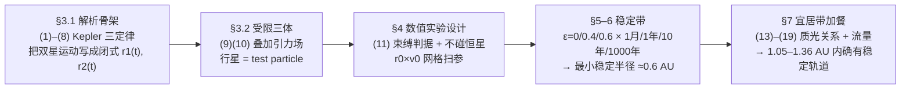

# 精读 · Circumbinary Planets（2014 题A 金牌 · 队伍 726）

> **这份精读怎么用**：左手边开论文 PDF（`03_优秀论文PDF/2014/Problem A/2014-GM-A-726.pdf`），右手边开本篇。每节按「它写了什么 → 为什么这样写 → 你要学什么」三层展开；每个公式给「物理直觉 → 完整推导 → 适用边界」，式号全部用论文原编号 (1)–(19)。论文是 LaTeX 排版、公式提取完整，本篇引文与式号可直接与 PDF 对应。

---

## 0. 一分钟看懂全文骨架

论文回答一个问题：**1 M☉ + 0.5 M☉、周期 30 天的双星周围，行星轨道在哪里还能长期稳定？**



**为什么这个骨架好？** 三体问题没有解析解，作者不去"解"它，而是把问题改造成一个**可判定的数值实验**：双星运动全部解析化（省掉耦合积分），行星当试验粒子，稳定/不稳定变成两条可编码的判据。整个 §3 都是为此服务的"基础设施"。你要学的是：**把不可解的问题变成可枚举的问题**。

---

## 1. 逐节导读

### 1.1 Abstract（第 1 页）

**它写了什么**：8 行摘要，一句方法（Kepler+Newton 定律、Mathematica 数值积分）、一个硬结论——"the shortest distance from the center of mass of the given system where orbits are still consistently stable after 1000 years is 0.6 AU"。

**为什么这样写**：摘要里放的不是"我们做了什么"，而是那条可被引用的临界半径。开放题的摘要必须有一个"别人能记住的数字"。

**你要学什么**：注意限定词"consistently stable after 1000 years"——结论和它的适用条件（积分时长）绑定出现，精确的自我约束反而是可信度的来源。

### 1.2 §1 Background + §2 Introduction（第 2 页）

**它写了什么**：先给背景（双星至少与单星一样多 [2][6]、环双星行星已被 Kepler 观测到 [8]），再钉死模型范围：平面问题（2D）、P 型轨道（绕整个双星）、1+0.5 M☉、T=30 天。

**为什么这样写**：原文一句关键的诚实声明——"A planet in a binary star system is a three body problem and analytical solutions for the general case are not possible with our present mathematical tools."。先承认不可解，下一段的数值方法就顺理成章。**方法的选择是被问题的数学性质逼出来的**，这层因果关系要写明。

**你要学什么**：范围收窄（2D、P 型）每一条都给了理由（S 型轨道在 §8.5 单独讨论）。收窄不是逃避，是分工。

### 1.3 §3.1 双星轨道解析化（第 3–4 页）

**它写了什么**：两体问题 → 等效一体问题 → Kepler 第三定律 (1) $T^2=\frac{4\pi^2a^3}{G(M_1+M_2)}$，由 T=30 天反解双星间距 (2)；质心系下两星各自做椭圆运动，半长轴按质量加权分配 (3)(4)：

$$a_1=\frac{M_2}{M_1+M_2}a,\qquad a_2=\frac{M_1}{M_1+M_2}a$$

圆轨道情形直接参数化 (5)(6)（M₂ 相位差 π）；偏心情形 (7)(8)：x 坐标加常数项 $a_i\varepsilon$ 把质心放回原点、y 分量乘 $\sqrt{1-\varepsilon^2}$ 压扁成椭圆。

**为什么这样写**：这是全文的"地基工程"。把双星运动**解析化**之后，数值积分只需处理行星一个天体——计算量从三体耦合降为单体外场。附录代码里 x1(t)、y1(t) 等直接套用 (7)(8)，一行不差。

**你要学什么**：**能解析的部分绝不数值化**。这既是提速，也是精度保障（双星位置无积分误差）。

### 1.4 §3.2 引力场与运动方程（第 4 页）

**它写了什么**：叠加原理给出双星场 (9)，行星运动方程 (10) $\ddot{\vec r}(t)=\vec E(t)$。核心假设一句话带过——"Under the assumption that the planet's field is weak compared to the field of the two stars"。

**为什么这样写**：试验粒子假设是受限三体的标准做法，但作者在 §8.1 用整节回收这笔债（能量不守恒、对气态巨行星可疑）——**假设在正文轻放、在局限章节重谈**，是干净的写法。

### 1.5 §4 Method（第 4–5 页）——数值实验设计的范本

**它写了什么**：三条决策：① 稳定判据书面化：(11) 末时刻总能量为负（束缚）+ 全程不进入任一恒星 1 个太阳半径内；② 参数窗口用解析式框定：最小半径取 R₂+10 R☉（更近"deemed too close"，且脚注声明"a posteriori"验证过）、最大 2 AU（理由：该处双星分别计算与合并为质点的场差 <3%，"It was assumed that since the system can be approximated as a two-body system, a stable configuration exists"）；初速度中心估计用 (12) $v_{estimate}=\sqrt{G(M_1+M_2)/|\vec r(0)|}$（全部质量当质点），两侧加余量构成 5.0–20.0 AU/yr；③ 网格：50 个半径（0.19 AU 起、步长 0.04）× 150 个速度（步长 0.1 AU/yr）；1000 年长模拟只保留 0.19–0.75 AU、速度步长×3——"To reduce computation time"。

**为什么这样写**：这一节把"数值实验"写成了真正的实验设计：判据、范围、网格、算力分配四要素齐全。特别值得注意的是**两级模拟策略**（10 年全扫 + 1000 年缩域）：先用便宜的实验找候选，再用贵的实验验证。

**你要学什么**：① (11) 这种"总能量正负"判据一行代码就能实现，但必须写进正文成为"稳定的定义"；② 参数窗口的每个边界都配了物理解释（3% 场差、10 R☉、a posteriori）——**边界不是拍的，是论证的**。

### 1.6 §5 Results（第 6–13 页）

**它写了什么**：先给三类典型快照（Figure 1 稳定、Figure 2 弹弓逃逸、Figure 3 撞星），再按 ε=0/0.4/0.6 三组给出 r₀–v₀ 相空间稳定图（Figure 4–12，黑格=稳定），每组内按积分时长递进（1 月/1 年/10 年/1000 年）。

**为什么这样写**：快照图先建立直觉（稳定轨道长什么样），相空间图再给统计结论——从个案到分布的呈现顺序。时长递进则形成视觉论证链：**模拟越久，稳定带越瘦**。

**你要学什么**：结果不是一堆图，是"同一张图在时间轴上的演化序列"——这个排图方式让"1000 年后只剩 0.6 AU 以上"这个结论自己长出来。

### 1.7 §6 Data analysis（第 14 页）

**它写了什么**：三条规律：① 半径越小，稳定所需速度越高、稳定带越窄；② 上边界是明确的曲线——"This curve is simply given by (11)"（逃逸能量判据的解析曲线，数值点落在理论线上）；③ 下边界在 0.3 AU 附近渐近，1000 年模拟把它推高到 0.45 AU；偏心率越大稳定带越窄，但上边界不变。

**为什么这样写**：这是全文分析力最强的一节：数值结果不是终点，**每条边界都要找到解析解释**。上边界=逃逸曲线、下边界=混沌侵蚀，数据立刻有了理论回声。

**你要学什么**：扫参图的"边界形状"是最值钱的信息；给边界找解析来源 = 给整个数值实验装上正确性校验。

### 1.8 §7 宜居带（第 14–17 页）

**它写了什么**：由文献取宜居带内外半径公式 (13)(14)（√(L/1.1)、√(L/0.53)，单位 AU），反解流量上下限 (15)(16)；质光关系 $L\propto M^4$ 给出 $L_1=L_{sol}$ (17)、$L_2=L_{sol}/16$ (18)；极坐标下逐方位算行星所受流量 (19)（两星光程差用余弦定理），图 14 画出 r–φ 相空间的紫色宜居带；最后取**最保守交集**：内半径取 φ=0 处最大值、外半径取 φ=π 处最小值，得 1.05–1.36 AU，并确认该区间落在稳定带内、所需轨道速度 5–12 AU/yr 与地球 2π≈6.28 AU/yr 相当。

**为什么这样写**：从"稳定吗"升级到"宜居可能吗"，题目立刻有了天体生物学的高度。最保守交集的取法（max 内界、min 外界）是对"行星必须全程在带内"这一物理要求的忠实翻译——**取交集的规则本身要写清楚**。

**你要学什么**：(19) 的建模细节——双星不是点光源叠加在质心，而是随时间移动的两个源，方位角 φ 决定行星轮流靠近哪颗星。把"双星宜居带"与"单星宜居带"的这个本质差异做出来，就是加分项。

### 1.9 §8 Scope and limitations + §9 Conclusion（第 18–21 页）

**它写了什么**：五条局限逐条展开：试验粒子假设违背能量守恒（8.1）；1000 年太短，且配了**反例图**——Figure 15 一条 10 年判稳的轨道在 t≈326 年撞星（8.2）；初始取向单一（8.3）；稳定轨道的形状未知（8.4）；S 型轨道未展开（8.5）。结论汇总：远离双星处更像单星、越近越窄、1000 年最小稳定半径 ≈0.6 AU、偏心率越高越糟、宜居带 1.05–1.36 AU 内确有稳定轨道。

**为什么这样写**：8.2 是全篇的良心——作者**主动展示自己的判据在什么时间尺度下会失效**，并给出量化感受（10 年稳 → 326 年亡）。这一张图比任何"我们的模型很可靠"的空话都值钱。

**你要学什么**：局限分析的高级形态不是认错清单，而是**给每个局限配上证据或扩展方案**（图 15 反例、"starting orientation as another free parameter"的扩展建议）。

---

## 2. 图表深析（每张图：为什么放、为什么这样画、怎么画）

| 图 | 位置与作用 | 为什么这样画 | 怎么画出来 |
|---|---|---|---|
| Fig 1–3 轨道快照 | §5 开头 | 先看个案建立直觉：稳定环、弹弓逃逸、撞星三种命运一眼可辨 | Mathematica 数值解 + 参数化作图（蓝线轨迹、双星与行星当前位置标点） |
| **Fig 4–12 r₀–v₀ 稳定图**（核心） | §5.1–5.3 | 二维初值平面 × 二值结局 → 天然就是黑白网格；黑格聚类即稳定带 | 双重循环扫参，稳定记 1 存入 Success 表，ListPlot/MatrixPlot |
| Fig 5/8/11 时长递进三联图 | 每组偏心率 | 同一相空间在 1 月→1 年→10 年下的"蒸发"过程，视觉化混沌侵蚀 | 同一程序改 tf 跑三次并排 |
| Fig 14 流量相空间图 | §7 | 宜居带随 φ 摆动的"花瓣"形状只有 r–φ 图能呈现 | 式 (19) 网格填色，紫带=两流量等值线之间 |
| Fig 15 反例快照 | §8.2 | 用一条具体轨迹证明"10 年稳定"≠真稳定 | 长时长积分单条轨道 |

**核心图（Fig 4 类型）的 Python 复现**——把论文附录 A 的 Mathematica 双循环改成**向量化并行积分**（所有网格点同时推进，几秒出图）：

```python
import numpy as np, matplotlib.pyplot as plt

# ── 常量（论文附录 A：AU、年单位制，G·M_sun = 4π²）──
GM = 4*np.pi**2
M1, M2 = 1.0, 0.5                      # 式(17)(18)同款质量
T  = 30/365.25                         # 双星周期（年）
a  = (GM*(M1+M2)*T**2/(4*np.pi**2))**(1/3)   # 式(2)：间距 ≈0.216 AU
a1, a2 = M2/(M1+M2)*a, M1/(M1+M2)*a    # 式(3)(4)：a/3 与 2a/3
rstar = 0.005                          # 恒星半径 ≈ 太阳半径（判据2）

r0 = np.arange(0.19, 2.0, 0.04)        # §4：50 个半径
v0 = np.arange(5.0, 20.0, 0.25)        # §4：150 个速度（此处减半演示）
R0, V0 = np.meshgrid(r0, v0, indexing='ij')
x, y   = R0.copy(), np.zeros_like(R0)  # 初值：行星在 +x 轴，速度沿 +y（式12 的网格化）
vx, vy = np.zeros_like(R0), V0.copy()
alive, bound = np.ones_like(R0, bool), np.ones_like(R0, bool)

dt, tf = 1e-3, 10.0                    # 步长<<双星周期0.082年；积分10年（论文Fig4）
for n in range(int(tf/dt)):
    t = n*dt
    x1, y1 =  a1*np.cos(2*np.pi*t/T),  a1*np.sin(2*np.pi*t/T)   # 式(5)
    x2, y2 = -a2*np.cos(2*np.pi*t/T), -a2*np.sin(2*np.pi*t/T)   # 式(6)
    for (xs, ys, M) in [(x1, y1, M1), (x2, y2, M2)]:
        d3 = np.hypot(x-xs, y-ys)**3
        vx -= GM*M*(x-xs)/d3*dt;  vy -= GM*M*(y-ys)/d3*dt       # 式(10) 叠加场
    x += vx*dt;  y += vy*dt
    hit = (np.hypot(x-x1, y-y1) < rstar) | (np.hypot(x-x2, y-y2) < rstar)
    alive &= ~hit;  bound &= np.hypot(x, y) < 5.0               # 远逃出界即非束缚
    if n % 200 == 0:                                             # 定期复核能量判据(11)
        E = 0.5*(vx**2+vy**2) - GM*M1/np.hypot(x-x1,y-y1) - GM*M2/np.hypot(x-x2,y-y2)
        bound &= (E < 0)
stable = alive & bound

fig, ax = plt.subplots(figsize=(5.2, 4.2))
ax.scatter(R0[stable], V0[stable], s=8, c='k', marker='s')       # 黑格=稳定（论文图式）
ax.set(xlabel='initial radius $r_0$ [AU]', ylabel='initial velocity $v_0$ [AU/yr]',
       title='Stable configurations in $r_0$-$v_0$ phase space, $\\varepsilon=0$, 10 yr')
plt.tight_layout(); plt.show()
```

四个绘图决策：**① 二值结局用黑格散点**（黑白分明的判据可视化，比连续色标更配 (11) 这种硬判据）；**② 上边界理论线可叠加**（v_esc(r)=√(2G·1.5M☉/r)，即式 (11) 取等号——论文 §6 明说上边界就是这条线）；**③ 图题写清 ε 与积分时长**（这两个参数决定图的语义）；**④ 复现跑 10 年、步长 1e-3 年**——远小于双星周期 0.082 年，这是外场问题对步长的隐性要求。运行后你能亲眼看到稳定带随 r₀ 减小而变窄、上边界沿逃逸曲线走——正是论文 Fig 4 与 §6 的全部结论。

---

## 3. 公式逐条精讲

### 3.1 Kepler 第三定律定间距（式 (1)(2)）

$$T^2=\frac{4\pi^2a^3}{G(M_1+M_2)}\;\Rightarrow\;a=\sqrt[3]{\frac{G(M_1+M_2)T^2}{4\pi^2}}$$

- **怎么想到**：题目给定 T=30 天而不是间距，双星几何必须从 T 反解。两体问题的等效一体化让 (M₁+M₂) 整体出现在分母——这是"双星互绕"与"行星绕单星"的唯一区别。
- **完整推导**：两体相对运动满足 μr̈ = −GM₁M₂r̂/r²（μ 为约化质量），等效为质量 M₁+M₂ 的一体问题；圆轨道条件 ω²r = G(M₁+M₂)/r²，代入 T=2π/ω 即得。
- **数值感**：AU–年单位制下 GM☉=4π²，a³=1.5×(30/365.25)²⇒a≈0.216 AU——比水星轨道（0.39 AU）还小，这决定了后文"0.19 AU 起扫"的下界与"最小稳定半径 0.6 AU ≈ 2.8a"的量级格局。

### 3.2 质心分配（式 (3)(4)）

$$a_1=\frac{M_2}{M_1+M_2}a\approx\frac{a}{3},\qquad a_2=\frac{M_1}{M_1+M_2}a\approx\frac{2a}{3}$$

- **怎么想到**：质心定义 M₁a₁=M₂a₂ 与 a₁+a₂=a 联立。注意反直觉处：**质量大的星轨道小**（1 M☉ 只离质心 a/3）。附录代码 R1=a/3、R2=2a/3 与此严格一致。
- **适用边界**：要求两椭圆同 e、反相位（正文明确写了这条约束）。

### 3.3 偏心轨道参数化（式 (7)(8)）

$$\vec r_1(t)=\big(a_1\cos\omega t+a_1\varepsilon\big)\hat x+\sqrt{1-\varepsilon^2}\,a_1\sin\omega t\,\hat y$$

- **怎么想到**：椭圆=圆的两轴缩放（y 乘 √(1−ε²)）+ 焦点平移（x 加 aε 使质心落在原点/焦点）。两行公式代替整套开普勒方程求解，数值上白赚精度。
- **你要注意**：这是"参数化技巧"而非新物理；但 ε=0.4、0.6 时双星最近距离 a(1−ε)≈0.13/0.086 AU，正是稳定带被侵蚀的元凶——参数化里藏着物理。

### 3.4 叠加场与运动方程（式 (9)(10)）

$$\vec E(t)=G\frac{M_1}{|\vec r_1-\vec r|^2}\hat{(\vec r_1-\vec r)}+G\frac{M_2}{|\vec r_2-\vec r|^2}\hat{(\vec r_2-\vec r)},\qquad \ddot{\vec r}=\vec E(t)$$

（提取文本丢失了方向单位矢量，式 (9) 的完整形式以 PDF 为准。）
- **怎么想到**：线性叠加 + 试验粒子。行星质量不反馈进双星——§8.1 承认这使系统能量不严格守恒，但行星质量 ≪ 0.5 M☉ 时误差可忽略。
- **适用边界**：行星越重（气巨）越可疑；本文行星质量设 1（AU 单位制下的无量纲小量，见附录 m:=1）。

### 3.5 稳定判据（式 (11)）

$$\tfrac12\dot r^2-\frac{GM_1}{|\vec r_1-\vec r|}-\frac{GM_2}{|\vec r_2-\vec r|}<0$$

- **怎么想到**：束缚/逃逸的最便宜判据是总比能量符号。注意两个细节：① 只在**末时刻**检验（中途甩出再回来的轨道会被误判——论文用第二条判据"远离即出界"弥补）；② 分母用的是到两星的距离而非到质心距离，与 (9) 保持一致。
- **适用边界**：时变场中能量不守恒，E<0 只是必要非充分——这正是 10 年稳、326 年亡（Fig 15）的数学根源。论文没有回避这一点。

### 3.6 初速度中心估计（式 (12)）

$$v_{estimate}=\sqrt{\frac{G(M_1+M_2)}{|\vec r(0)|}}$$

- **怎么想到**：远场近似（双星≈质点）下的圆轨道速度。扫参前先用解析式定位"大概率稳定"的邻域，再向两侧加余量——**网格要围着理论预期撒**，不是均匀乱撒。
- **数值感**：r=1 AU 处 v_est=√1.5·2π≈7.7 AU/yr；地球 6.28 AU/yr——质量多 50%，速度快 22%。

### 3.7 宜居带与流量（式 (13)–(19)）

$$\text{Flux}(r,\varphi)=\frac{L_1}{4\pi(r^2+a_1^2-2ra_1\cos\varphi)}+\frac{L_2}{4\pi(r^2+a_2^2-2ra_2\cos(\pi-\varphi)))}\tag{19}$$

- **怎么想到**：点到点源流量按实际光程（余弦定理）衰减，两星贡献相加。相比"总光度放质心"的粗暴做法，(19) 保留了 φ 依赖——宜居带随行星方位"呼吸"的现象只有这个公式能给出。
- **完整推导链**：(13)(14) 文献宜居带（单星）→ (15)(16) 反解流量阈值 L/(4πr²)=0.53~1.1 → (17)(18) 质光关系 L∝M⁴（M=0.5⇒L=1/16）→ (19) 双星几何合成 → 最保守交集 1.05–1.36 AU。
- **适用边界**：主序星假设、ε=0（宜居带计算放弃了偏心情形，正文明确"For simplicity we assume zero eccentricity"）；M^4 质光关系在 0.5 M☉ 附近近似良好。

---

## 4. 建模决策链（为什么这么建、放弃了什么）

| 决策 | 作者的选择 | 被放弃的替代 | 为什么 |
|---|---|---|---|
| 双星运动 | 解析参数化 (5)–(8) | 三体一起数值积分 | 计算量减半、双星位置零误差 |
| 行星动力学 | 试验粒子 (9)(10) | 全三体 | 行星质量≪恒星；代价（能量不守恒）在 §8.1 偿还 |
| 维度 | 2D 平面 | 3D | 双星系统角动量定向，P 型轨道近似共面；维度减半、网格翻密 |
| 稳定定义 | (11) + 不碰恒星，两条判据 | 只看"还没逃出" | 单判据各有盲区，二选一都会误判 |
| 扫参平面 | r₀×v₀ | r₀×θ₀（初方位） | 速度是"何种轨道"的第一决定量；初方位单一化的风险由 §8.3 声明 |
| 算力分配 | 10 年全扫 + 1000 年缩域 | 全网格跑 1000 年 | 缩域 4 倍、步长×3，结论强度与算力平衡 |
| 偏心率 | 0/0.4/0.6 三组对照 | 只算 ε=0 | 对照出"偏心率侵蚀稳定带"的规律，超出题目最低要求 |
| 宜居带 | 最保守交集（max 内界/min 外界） | 取平均或最大带 | 行星必须全程在带内，交集是唯一物理正确的取法 |

**总规律**：每个"偷懒"（2D、test particle、单一取向）都在正文有理由、在 §8 有回收。**简化不是罪，不被管理的简化才是**。

---

## 5. 从本篇提炼的可复用模板

**结构模板**：

```
Abstract        一句话方法 + 一个可引用的数字（0.6 AU）
1 Background    为什么这个问题真实存在（观测证据）
2 Introduction  钉死参数与范围；宣告"解析不可解"引出数值
3 Theory        能解析的全部解析化（本场：双星轨道闭式）
4 Method        判据书面化 → 理论框定窗口 → 网格与算力分配
5 Results       个案快照 → 相空间稳定图（按参数分组、按时长递进）
6 Data analysis 每条边界找解析解释
7 加餐          把"存在吗"升级为"宜居吗"（文献公式+几何合成）
8 Limitations   逐条：假设→证据（含反例图）→扩展方案
9 Conclusion    按问题的问句逐条回收
Appendix A      全部带注释代码
```

**句式库（原文摘录）**：
- "analytical solutions for the general case are not possible with our present mathematical tools"（宣告解析不可解，为数值铺路）
- "Orbits were considered stable if: 1. ... 2. ..."（把模糊概念写成编号判据）
- "This was verified by the results a posteriori."（先验选择、后验补救的诚实写法）
- "The upper bound on each plot is a well defined curve. This is because ... This curve is simply given by (11)."（数值边界挂回解析式）
- "It is likewise also possible that orbits returning stable after 1000 years are unstable in the longer run."（给自己的结论标注保质期）
- "This study can be extended to ..."（每个局限配一条扩展）

**图表配方**：初值平面扫参 → 黑白网格稳定图 + 理论边界线叠加；时长敏感性 → 同布局多联图按时间递进；个案 → 轨道快照三连（稳定/逃逸/碰撞）；双源辐照 → r–φ 相空间等值填色带。

---

*精读完这篇后，建议对照 `05_论文赏析/2014/2014-GM-A-726.md`（宏观赏析）与 `07_题目解读/2014_题A_环双星行星.md`（题目全解）形成三位一体。*
