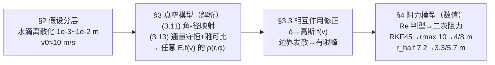

# 精读 · An Optimized Fountain Model（2014 题B 金牌 · 队伍 807）

> **这份精读怎么用**：左手边开论文 PDF（`03_优秀论文PDF/2014/Problem B/2014-GM-B-807.pdf`），右手边开本篇。每节按「它写了什么 → 为什么这样写 → 你要学什么」三层展开；每个公式给「物理直觉 → 完整推导 → 适用边界」，式号全部用论文原编号（3.1–4.9，按节编号）。论文正文与附录 MATLAB 代码都完整可读，本篇所有公式与代码可直接对照 PDF。

---

## 0. 一分钟看懂全文骨架

论文回答一个问题：**喷泉喷出的水，落在池塘任一点 (x, y) 的概率密度是多少？最概然落点在哪？把一半水量圈住的"中位圆"多大？**



**为什么这个骨架好？** 它是教科书级的"**理想 → 修正 → 再修正**"三级火箭：第一级全部闭式（连中位圆都解析），第二级只改一个函数（速度分布），第三级才请出数值方法。每一级的"修正触发条件"都写明（水滴碰撞→速度弥散；Re 范围→二次阻力），所以读者永远知道"现在在哪一层近似里"。**先一般后特例**：核心公式 (3.17)(3.18) 对任意喷射分布 E(θ,φ) 和任意速度分布 f(v) 成立，δ 函数只是最后一步代入——通用性本身就是竞争力。

---

## 1. 逐节导读

### 1.1 Abstract（第 1 页）

**它写了什么**：四句话四个层次：离散化水滴（半径 10⁻³–10⁻² m）→ 无阻力解析解 → 相互作用用"修正喷射函数 E"概括 → 阻力按 Reynolds 数定为二次形式后数值求解。

**为什么这样写**：摘要就是三级火箭的目录。特别注意它把最关键的**建模转译**放在第一句——"we first modeled the water flux as discrete small drops"。题目问"分子"，作者第一件事就是宣布"分子不算，水滴才算"，概率问题从此变成可建模的通量问题。

**你要学什么**：当题面用语在物理上不可操作（分子尺度、斯托克斯区、无碰撞假设全崩坏）时，**先重定义对象再建模**，并且把这个重定义放在摘要第一句。

### 1.2 §1 Introduction + §2 Models' Assumptions（第 2–3 页）

**它写了什么**：三阶段假设清晰分层：第一阶段无阻力、无相互作用，E(θ,φ) 与 f(v) 取任意；第二阶段假设喷流通量小、水滴只在喷射初期相互作用，宏观效果=喷射速度的高斯再分布；第三阶段水滴为 1–10 mm 球、v≈10 m/s，按 NPT 条件引入空气阻力。

**为什么这样写**：假设不是流水账，是**分阶段生效的合同**——每阶段的假设只在本阶段有效，下阶段解除哪条一目了然。"the fountain flux is small enough such that drops only interact with other drops at the beginning of ejection. Since drops diverge in the air, any water drop have less chance to reach other ones."——相互作用被几何发散自然稀释，这个论证便宜而扎实。

**你要学什么**：**假设要写"何时失效"而不只写"是什么"**；用一句物理论证代替一段多体碰撞动力学，是 48 小时里最划算的交易（§5.2 Strength 3 专门为这笔交易辩护）。

### 1.3 §3.1 Kinematic Theory（第 3–5 页）——全文数学核心

**它写了什么**：抛体方程 (3.1)(3.2)（r̈=0、z̈=−g）；利用抛物线对称性走捷径："we take a shortcut here for the benefit of the symmetry of the parabola, which is π − θ = θ′"，得飞行时间 (3.10) 与**角-径映射** (3.11) r = v₀²sin2θ/g、(3.12) φ=ϕ。然后是全文灵魂一步——**通量守恒 + 雅可比** (3.13)：

$$E(\theta,\phi)\,d\theta d\phi=\rho(r,\varphi)\,r\,dr\,d\varphi$$

配合雅可比 (3.14) 与双值反函数 (3.15)(3.16)（同一 r 对应 θ₁∈[0,π/4) 与 θ₂∈(π/4,π/2] 两支），闭式解出 ρ(r,φ)（3.17）；再对 f(v) 积分得最一般形式 (3.18)。

**为什么这样写**：作者不先代入任何具体分布，而是把"概率密度"问题改写成"测度变换"问题：喷射立体角元里的水滴数恒等于落点面元里的水滴数，密度=通量/雅可比。这一步做完，**后面所有特例都只是代公式**。

**你要学什么**：① 对称性捷径（π−θ=θ′）让升降两段共用一个初速度，省掉整段轨迹积分；② "一个 r 对应两个 θ"这个抛体运动的老常识，在这里变成 (3.17) 里 E(θ₁)+E(θ₂) 的双支求和——**几何简并要显式写进公式**，否则数值直接错一半；③ (3.13) 这类守恒式是概率题的万能入口（同类套路见连续性方程、细流管模型）。

### 1.4 §3.2 Analyses of δ-like f(v)（第 5–7 页）

**它写了什么**：取 f(v) 为 (3.19) 的高斯分布，先取 a→∞ 的 δ 极限 (3.20)；E 取 (3.21) 的台阶函数（θ≤θ₀ 内均匀）；MatLab 画出 θ₀=kπ/16（k=1..8）的 ρ–r 曲线族（Figure 3）。结论两条：ρ→∞ 于 r=0 与 r=r_max=v₀²/g（θ₀≥π/4 时）——最概然落点是**圆心和边界**；随后解析积分出落点累积分布 (3.22)(3.23) β=2arcsin(r/r_max)/π，令 β=1/2 得**中位圆** (3.24) r_half=v₀²/(√2 g)≈7.215 m。一般 θ₀ 情形分三段讨论 (3.25)–(3.27)，对应三个中位圆通解 (3.28)–(3.30)。

**为什么这样写**：θ₀ 与 π/4 的大小关系决定 (3.17) 里哪一支 E 贡献不为零——分段不是数学炫技，是双支求和的必然结果。作者把三种情形全部闭式给出，覆盖了题目隐含的一切喷射锥角。

**你要学什么**：① ρ 在 r=0 与 r=r_max 的两个发散（1/r 型与 1/√ 型）有不同物理来源：前者是圆对称的中心汇聚（E(0)≠0 所致），后者是雅可比在 sin2θ=1 处为零（映射在此"变平"，落点堆积）——**看清每个发散的来源，才知道哪个是物理、哪个是坐标**；② "半数水量圈在哪"是题目的隐藏问法，中位圆 β=1/2 的定义就是答案的操作化。

### 1.5 §3.3 Correction of ejection interaction（第 7–9 页）

**它写了什么**：相互作用→速度弥散，取 a=10 的高斯 (3.31)；(3.18) 无法解析积分，MatLab 数值得 Figure 4。对比 Figure 3：r=r_max 处的发散消失，变成有限峰——"some water drops are able to breakthrough the 'boundary' v₀²/g"。r=0 的发散保留（E(0)≠0 ⇒ ρ~1/r 不变）。中位圆由 (3.32) β̄=∫βf(v)dv 与 (3.33) r_half=β̄⁻¹(1/2) 数值定义。

**为什么这样写**：修正只动一个自由度（速度分布的宽度），就完成了从"理想"到"考虑相互作用"的升级，且新旧两个图在同一坐标系下可直接对比。§5.2 明说这是统计视角的取舍——不算每次碰撞，只算宏观后果。

**你要学什么**：**修正模型的最小改动原则**：能在已有公式框架内消化的修正（改 f(v)），绝不新开一套方程。对比图要同轴同范围，让"发散消失"这类定性变化一眼可见。

### 1.6 §4 Models with Air Resistance（第 9–12 页）

**它写了什么**：运动方程 (4.1)；**先判型后选公式**：由滴径 10⁻³–10⁻² m、v≈10 m/s、NPT 下 η=1.57×10⁻⁵、ρ_a=1.184 算出 Reynolds 数落在 1<R<10⁵，"hence, drag force has the quadratic form"（4.2）F_d=C_Dρ_aAv²/2，且 C_D≈0.5 恰在 C_D–R 曲线（Figure 5）的平台段——系数稳定。球滴的质量与截面 (4.3)(4.4)，打包参数 k=C_DAρ_a/2 后得耦合 ODE (4.5)(4.6)；两种滴径（a₁=1 mm、a₂=5 mm，对应 m、k 各差两个量级）用 **RKF45**（Runge–Kutta–Fehlberg）积分，得轨迹束（Figure 6/7）与 ρ–r 直方图（Figure 8/9）。结果触目：**r_max 从真空的 ≈10 m 缩到 8 m（5 mm）/4 m（1 mm）**；中位圆 (4.8)(4.9)：3.3024 m（1 mm）/ 5.6770 m（5 mm），由离散累积 (4.7) 近似取半。

**为什么这样写**：这一节的价值在于**量纲先行**：不是默认 F∝v 或 F∝v²，而是先算 Re 把流区钉死，顺带在 §5.2 反证线性阻力只适用于"height is around 0.02m"的迷你喷泉——"this tiny fountain is of course out of interest"，一句话堵死评委的质疑。

**你要学什么**：① 打包参数 k 与 2010-A 篇的 σ 异曲同工（**把常数组合压成一个符号**，方程、代码、扫参同时减负）；② 数值概率密度的"土办法"：均分 5000 个喷射角逐条积分，100-bin 直方图拟合密度（附录 A.2.2），再用事件函数（`value=z(2), direction=-1`）精确捕捉水面穿越——**大数定律替代了解析雅可比**；③ 同一个量（r_max、r_half）在修正前后都要报数，修正的贡献才算被"结账"。

### 1.7 §5 Discussion（第 12 页）

**它写了什么**：Weakness 两条（无闭式通解、E 均匀假设可能偏离实际）；Strength 四条（二次阻力的判型依据、参数评估完整+图示直观、相互作用的统计化处理、大数定律拟合密度）。

**为什么这样写**：注意 Strength 3 的辩护逻辑——"we give up analyzing and calculating the mechanics behind the interaction, since multi-body-interaction will make this problem so complicated that no one can get a precise solution"——**承认精确解不可能，正是统计近似的合法性来源**。

**你要学什么**：Weakness 要具体到"哪种情形会失真"，Strength 要回答"为什么这么简化是安全的"——两栏各自的功能不同，别写混。

---

## 2. 图表深析（每张图：为什么放、为什么这样画、怎么画）

| 图 | 位置与作用 | 为什么这样画 | 怎么画出来 |
|---|---|---|---|
| Fig 1 喷射示意图 | §3.1 | 一图钉死 (θ,φ)→(r,φ) 的几何与抛物线对称捷径 | 手绘矢量图 |
| Fig 2 通量面元图 | §3.1 | 可视化 (3.13)：dθdϕ 立体角元 ↦ rdrdφ 面元，雅可比的几何直觉 | 手绘微元图 |
| **Fig 3 δ 型 ρ–r 族**（核心） | §3.2 | 8 个 θ₀ 一版排开，"发散位置随 θ₀ 移动/消失"的规律可比 | 附录 A.1.1：式 (3.17) 直接代入台阶 E |
| Fig 4 高斯型 ρ–r 族 | §3.3 | 与 Fig 3 同轴对比：边界发散→有限峰，修正效果自明 | 附录 A.1.2：式 (3.18) 数值积分 |
| Fig 5 C_D–R 曲线 | §4 | 引用标准曲线证明 C_D≈0.6→0.5 平台段，系数取值的文献依据 | 引自 Wikipedia/流体力学教材 |
| Fig 6/7 轨迹束 | §4 | 抛物线束+包络线直观呈现"阻力把包络压扁"，两种滴径对照 | 附录 A.2.1：θ 扫描的 ode45 轨迹叠加 |
| Fig 8/9 阻力下 ρ–r | §4 | 频率直方图+拟合密度双联图，把"数值密度"的统计本质可视化 | 附录 A.2.2：5000 角积分+100-bin 直方图 |

**核心图（Figure 3）的 Python 复现**——δ 型速度分布下 8 个 θ₀ 的 ρ–r 曲线族：

```python
import numpy as np, matplotlib.pyplot as plt

# ── 常量（论文 §3.2：v0=10 m/s，δ 型 f(v)，E 为台阶函数 (3.21)）──
g, v0 = 9.8, 10.0
rmax  = v0**2/g                                  # (3.11)：最大射程 ≈10.2 m
r = np.linspace(0.08, rmax-0.05, 2000)           # 避开两端发散点便于作图
den = 2*r*np.sqrt(v0**4 - g**2*r**2)/g           # (3.17) 的分母（g/(2r√(...)) 的倒数）

fig, axes = plt.subplots(4, 2, figsize=(9, 10), sharex=True, sharey=True)
for k, ax in enumerate(axes.flat, 1):
    th0 = k*np.pi/16
    r0   = v0**2*np.sin(2*th0)/g                 # 该 θ₀ 的最远射程 (3.11)
    rho  = np.where(r <= r0, 1.0, 0.0)           # θ1 支：E(θ1)=1 当 r≤r0（θ0<π/4 时仅有此支）
    if th0 > np.pi/4:                            # θ2 支激活：E(θ2)=1 当 r≥r0（见(3.17)）
        rho = 1.0 + np.where(r >= r0, 1.0, 0.0)
    ax.plot(r, rho/den, 'b', lw=1.8)
    ax.set_title(r'$\theta_0=%d\pi/16$' % k); ax.grid(alpha=.3)
fig.suptitle(r'$\rho$–$r$ curves, $\delta$-like $f(v)$, $v_0$=10 m/s: '
             r'divergences at $r$=0 and $r_{max}=v_0^2/g$ (for $\theta_0\geq\pi/4$)', y=0.995)
fig.supxlabel('r (m)'); fig.supylabel(r'$\rho$')
plt.tight_layout(); plt.show()
```

三个绘图决策：**① 8 联小图共享坐标轴**（θ₀ 是唯一变量，sharex/sharey 让"发散怎么移动"可横向扫读）；**② 两端各留一点余量**（发散点不必硬画到 ∞，曲线形状已说明问题）；**③ 结论写进总图题**。运行后可验证论文的核心观察：k≤3（θ₀<π/4）时边界处 ρ 归零（E(θ₁)=0 先于 r_max 发生），k≥4 起边界发散出现，k=8 时中心与边界双发散——正是 (3.17) 双支求和的直接视觉化。

---

## 3. 公式逐条精讲

### 3.1 抛体映射（式 (3.7)–(3.12)）

$$t=\frac{2v_0\cos\theta}{g}\quad(3.10),\qquad r=v_0\sin\theta\cdot t=\frac{v_0^2\sin 2\theta}{g}\quad(3.11),\qquad \varphi=\phi\quad(3.12)$$

- **怎么想到**：抛物线轨道关于顶点对称 ⇒ 上升段与下降段镜像 ⇒ 落地速度大小=初速、倾角互补（π−θ=θ′）。于是飞行时间只需竖直方向一次积分：(3.9) v_{fz}−v_{0z}=−gt 配合 v_{fz}=−v_{0z} 立得 t=2v₀cosθ/g。
- **完整推导**：r̈=0 (3.1) 积分得 r=v_{0r}t=v₀sinθ·t（3.3），代入 (3.10) 即 (3.11)；方位角不受重力（轴对称）⇒ φ=ϕ。
- **适用边界与数值感**：sin2θ 在 θ=π/4 取极大 ⇒ r_max=v₀²/g=10.2 m（v₀=10）；θ<π/4 与 θ>π/4 是"平射/高射"两支，(3.15)(3.16) 的反函数正由此分界。

### 3.2 通量守恒与雅可比（式 (3.13)(3.14)）——全文最值得背的一步

$$E(\theta,\phi)\,d\theta d\phi=\rho(r,\varphi)\,r\,dr\,d\varphi\;\Rightarrow\;\rho=\frac{E(\theta,\phi)}{r}\Big|\frac{\partial(r,\varphi)}{\partial(\theta,\phi)}\Big|^{-1}$$

$$\Big|\frac{\partial(r,\varphi)}{\partial(\theta,\phi)}\Big|=\frac{2v_0^2\cos 2\theta}{g}=\frac{2}{g}\sqrt{v_0^4-r^2g^2}\quad(3.14)$$

- **怎么想到**：水滴既不会凭空产生也不会消失——**立体角元里的通量=落点面元里的通量**。概率密度不是"算"出来的，是坐标变换"换"出来的。
- **完整推导**（比论文更细）：雅可比矩阵三处非零：∂r/∂θ=2v₀²cos2θ/g（对 (3.11) 求导）、∂φ/∂ϕ=1（(3.12)）、r 的面元因子 r 已在 (3.13) 右侧显式写出；行列式=∂r/∂θ。把 sin2θ=rg/v₀² 代入 cos2θ=√(1−sin²2θ)=√(v₀⁴−r²g²)/v₀² 即得第二等式——**雅可比被写成纯 r 的函数**，(3.17) 才能对任意 E 直接代入。
- **物理读法**：cos2θ=0（θ=π/4）处雅可比为零——映射把无穷小的角区间压到同一 r，落点密度发散。**雅可比的零点=密度的发散点**，这是所有映射类概率问题的通用规律。

### 3.3 双支反函数与密度闭式（式 (3.15)–(3.17)）

$$\theta_1(r)=\tfrac12\arcsin(rg/v_0^2),\qquad \theta_2(r)=\tfrac\pi2-\tfrac12\arcsin(rg/v_0^2)$$
$$\rho(r,\varphi)=\frac{g\,[E(\theta_1(r),\varphi)+E(\theta_2(r),\varphi)]}{2r\sqrt{v_0^4-r^2g^2}}\quad(3.17)$$

- **怎么想到**：sin2θ 的双值性要求反函数拆两支；两支的落点贡献**相加**（都落在同一 r）。
- **适用边界**：θ=π/4（r=r_max）两支重合，公式在该点退化（发散）；r>r_max 无解（雅可比开根号变虚）。
- **两个发散的来源**：r→0 时 ρ~gE(0)/(2rv₀²)·(1+1)——**1/r 中心汇聚**，只要 E(0)≠0 就存在；r→r_max 时 √(v₀⁴−r²g²)→0——**1/√ 边界堆积**，雅可比零点所致。

### 3.4 速度分布的卷积（式 (3.18)）

$$\rho(r,\varphi)=\int\frac{g[E(\theta_1(r,v))+E(\theta_2(r,v))]}{2r\sqrt{v^4-r^2g^2}}f(v)\,dv$$

- **怎么想到**：δ 型 (3.17) 只对单一 v₀ 成立；一般 f(v) 就是按速度加权平均——每个 v 有自己的映射，密度=全速度域卷积。
- **适用边界**：积分下限受 r≤v²/g 约束（附录 A.1.2 代码里积分限正是 √(rg/sin2θ₀) 这类可达性条件）——**被积函数的支集要自己管**，这是数值实现 (3.18) 最容易错的地方。

### 3.5 中位圆（式 (3.22)–(3.24)，θ₀=π/2 情形）

$$\beta=\frac{\int_0^r 2\pi g\,dr/\sqrt{v_0^4-r^2g^2}}{\int_0^{r_{max}}2\pi g\,dr/\sqrt{v_0^4-r^2g^2}}=\frac{2\arcsin(r/r_{max})}{\pi}\quad(3.23)\;\Rightarrow\; r_{half}=\frac{r_{max}}{\sqrt2}=\frac{v_0^2}{\sqrt2 g}\approx7.215\,\text{m}\ (3.24)$$

- **怎么想到**："一半水量圈在哪"翻译成累积分布 β=1/2；分子分母同结构，积分 ∫g dr/√(v₀⁴−g²r²)=arcsin(gr/v₀²) 是初等函数，闭式立得。
- **完整推导**：令 β=1/2 ⇒ arcsin(r/r_max)=π/4 ⇒ r=r_max·sin(π/4)=r_max/√2。数值：100/(1.414×9.8)=7.215 m。
- **一般 θ₀ 的三个通解**（(3.28)–(3.30)：r_max sinθ₀、r_max sinθ₀、r_max cos(θ₀/2)）按 θ₀<π/4、θ₀∈(π/4,π/2) 内外段分别成立——**分段结论必须逐段给式**，论文一式不缺。

### 3.6 阻力判型与运动方程（式 (4.1)–(4.6)）

$$R=\frac{2a\rho_a v}{\eta}\approx 1.5\times10^3\ (a{=}1\,\text{mm})\sim1.5\times10^4\ (a{=}10\,\text{mm})\ \Rightarrow\ F_d=\frac{C_D\rho_a A v^2}{2}\ (4.2),\ C_D\approx0.5$$

$$\ddot r=-\frac{k}{m}\dot r\sqrt{\dot r^2+\dot z^2}\ (4.5),\qquad \ddot z=-g-\frac{k}{m}\dot z\sqrt{\dot r^2+\dot z^2}\ (4.6),\qquad k=\frac{C_D A\rho_a}{2}$$

- **怎么想到**：阻力形式由流区决定，流区由 Reynolds 数决定——**先算无量纲数，再选公式**，这是流体建模的第一反应。C_D–R 曲线平台段（10³–10⁵）恰好覆盖本题参数，C_D≈0.5 稳定，不需要精确解 C_D。
- **数值感**（为什么修正不可忽略）：k/m 对 1 mm 滴 = 9.3×10⁻⁷/4.19×10⁻⁶ ≈ 0.22 m⁻¹，v=10 m/s 时阻力加速度 ≈ 0.22×100 = 22 m/s² > 2g！所以 r_max 从 10.2 m 砍到 4 m 毫不意外；5 mm 滴 k/m≈0.044，砍到 8 m。**量级检查在跑数值之前就该做**——这一步能预判"修正不可忽略"，论文的数值只是确认。
- **适用边界**：二次阻力在 R~10⁵ 以上（牛顿区上限）与 R<1（斯托克斯区）都失效；论文的 1<R<10⁵ 正是两者之间的安全带。

### 3.7 数值中位圆（式 (4.7)–(4.9)）

$$\beta=\frac{\sum_{r=0}^{r_{half}}\rho\, r\,\delta r\,\delta\varphi}{\sum_{r=0}^{r_{max}}\rho\, r\,\delta r\,\delta\varphi}\approx\frac12\;\Rightarrow\; r_{half}=3.3024\,\text{m}(a_1),\ 5.6770\,\text{m}(a_2)$$

- **怎么想到**：阻力下无闭式 ρ，(3.23) 的积分改离散求和；直方图 bin 的累计频次首次过半即为中位 bin（附录 A.2.3 代码：`half>2500` 即停）。
- **与前身的对比**：7.215 m → 3.30/5.68 m，阻力把中位圆缩小 21%–54%，且**滴越小缩得越狠**（k/m∝1/a³·a²=1/a）——回到摘要"correction of r is not a ignorable quantity"的结论。

---

## 4. 建模决策链（为什么这么建、放弃了什么）

| 决策 | 作者的选择 | 被放弃的替代 | 为什么 |
|---|---|---|---|
| 建模对象 | 半径 1–10 mm 的离散水滴 | 真正的"分子"（连续介质/分子动力学） | 1–10 mm 滴的 Re 落在数据充足的阻力区；分子尺度反而是未知领域 |
| 概率方法 | 通量守恒+雅可比 (3.13) | 蒙特卡洛撒粒子（真空阶段） | 解析解对任意 E、f(v) 成立；蒙特卡洛留到阻力阶段才用 |
| E、f(v) 处理 | 全程符号形式，最后代入 δ/台阶/高斯 | 一开始就取具体分布 | 通用公式=可复用到任何喷嘴；特例只是它的一行代入 |
| 相互作用 | 高斯速度再分布（a=10） | 逐对碰撞动力学 | 多体碰撞无精确解；统计化换来 (3.18) 框架内的最小改动 |
| 阻力形式 | Re 判型 → 二次 + C_D≈0.5 | 默认线性或三次 | Re≈10³–10⁴ 明确落在二次区；线性只对 2 cm 喷泉成立 |
| 数值方法 | RKF45 + 事件函数 + 5000 角直方图 | 解析近似（如微扰） | 阻力 ODE 无闭式通解（§5.1 自认）；自适应步长+事件捕捉兼顾精度与效率 |
| 滴径选择 | 1 mm 与 5 mm 两档 | 连续滴径分布 | 两档跨一个量级的 k/m，足以展示"阻力敏感度"；完整分布是伪精度 |

**总规律**：每个阶段的模型复杂度都由**前一阶段留下的残差**驱动——解析阶段发现边界发散（理想化痕迹）→ 高斯修正抹平它；理想抛体与现实的残差 → 阻力修正量化它。复杂度从不在没有证据的地方先行。

---

## 5. 从本篇提炼的可复用模板

**结构模板**：

```
Abstract        第一句宣布对象重定义（分子→水滴）；四句四层（离散→解析→修正→数值）
1 Introduction  为什么统计结果有趣（喷射照片）
2 Assumptions   分阶段假设合同（每阶段解除哪条写明）
3 理想模型
  3.1 运动学+映射    对称捷径 → (θ,φ)→(r,φ)
  3.2 通量守恒+雅可比 任意 E、f(v) 的闭式密度；δ 特例+解析中位圆
  3.3 修正 I         相互作用→分布展宽（最小改动原则）
4 修正 II（数值）
  判型（无量纲数）→ 方程 → 打包参数 → 自适应积分+事件+直方图 → 前后数值对比
5 Discussion     Weakness（何种情形失真）/ Strength（为何简化安全）
Appendix        全部代码（δ、高斯、轨迹、直方图、中位圆五段）
```

**句式库（原文摘录）**：
- "we first modeled the water flux as discrete small drops (with radius ...)"（摘要第一句重定义对象）
- "we take a shortcut here for the benefit of the symmetry of ..."（宣布走捷径及其合法性）
- "the range of θ is uncertained for the fountain. In order to give examples, we choose ..."（自由度过多时先给示范解）
- "It's fortunate to see that C_D correspond to our R is very stable (~0.5)"（系数落在平台段的运气要写出来——它是稳健性的来源）
- "this tiny fountain is of course out of interest"（反证替代方案荒谬）
- "we give up analyzing ... since multi-body-interaction will make this problem so complicated that no one can get a precise solution"（放弃精解的正当性声明）

**图表配方**：分布族对比 → 8 联同轴小图按参数排序；修正效果 → 同轴同范围新旧曲线并置；轨迹族 → 抛物线束+包络线；数值密度 → 直方图+拟合曲线双联图；每个修正给出前后同量数值表（r_max、r_half）。

---

*精读完这篇后，建议对照 `05_论文赏析/2014/2014-GM-B-807.md`（宏观赏析）与 `07_题目解读/2014_题B_喷泉优化.md`（题目全解）形成三位一体。*
