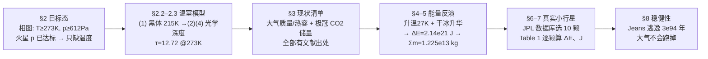

# 精读 · Establishing a Martian Greenhouse Effect Through Directed Impacts（2015 题A 金牌 · 队伍 190）

> **这份精读怎么用**：左手边开论文 PDF（`03_优秀论文PDF/2015/Problem A/2015-GM-A-190.pdf`），右手边开本篇。每节按「它写了什么 → 为什么这样写 → 你要学什么」三层展开；每个公式给「物理直觉 → 完整推导 → 适用边界」，式号全部用论文原编号 (1)–(17)。本篇全文仅 10 页、1 图 1 表、17 个编号公式——是"极简也能拿金牌"的最佳样本，重点学它的**能量因果链**与**文献参数化**两大套路。

---

## 0. 一分钟看懂全文骨架

论文回答一个问题：**用 10 次小行星定向撞击把火星改造成能有液态水，需要多大的撞击体、多大的冲量？**



**为什么这个骨架好？** 整条链是**可逆的**：从目标态（液态水）出发正向推到 τ、CO₂ 密度，再从撞击能量反向推到质量与冲量——评委可以从任何一端开始检验。每一步的输入要么是物理常数、要么是文献值，全文没有一个"拍脑袋系数"裸奔。这是开放工程题最稳的写法：**把"改造火星"翻译成一道能量守恒应用题**。

---

## 1. 逐节导读

### 1.1 Abstract（第 1 页）

**它写了什么**：4 行摘要，三个硬数字直接给出：总能量 2.14×10²¹ J（升温+升华）、撞击体总质量 1.225×10¹³ kg、冲量 10¹⁶ N·s 量级。

**为什么这样写**："摘要即答案"的极致版本。评委读完摘要就拿到了全部可引用结论，正文只是审计 trail。

**你要学什么**：数字要带量级单位（kg、J、N·s），且每个数字对应题目的一个问句（多大→质量；怎么送达→冲量）。

### 1.2 §2 Required Equilibrium Conditions（第 2 页）

**它写了什么**：先用水的三相点把"改造成功"操作化：T≥273 K 且 p≥612 Pa（相图 [5]）；然后指出火星现状 p≈636 Pa 已达标、短板只在温度——"Mars' surface temperature is another story."。

**为什么这样写**：这一步是全文最便宜的"降维"：两个成功条件查表即得，且立刻砍掉一个（气压），问题从二维变一维。**开放题的第一步永远是定义成功**。

**你要学什么**：注意句式"however, Mars' surface temperature is another story."——用一句转折完成问题的聚焦，比一段论述更有力。

### 1.3 §2.2–2.3 Blackbody Temperatures 与光学深度（第 2–3 页）

**它写了什么**：式 (1) Stefan–Boltzmann 平衡给出火星黑体温度 215 K，并类比地球（黑体 254 K vs 实际 288 K）引出温室效应的必要性；式 (2) 引入 Ramanathan 半灰模型的 τ–T 关系（β≈0.7）；式 (3)(4) 用"光学深度∝CO₂ 浓度"的线性标定，锚定在工业革命前地球（280 ppm、τ₀=1.73）；图 1 读出 273 K 需要 τ≥12.72，对应 CO₂ 数密度 5.56×10²² m⁻³（质量密度 0.0041 kg/m³）。

**为什么这样写**：辐射传输本是最难啃的部分，作者用"**文献模型 + 单点标定 + 线性外推**"三招绕开了全部硬计算：半灰模型借自 [8]、地球标定点现成、比例关系一行写完。合理性（模型来源）与局限（借地球标火星）都摆在明处。

**你要学什么**：① 先算黑体温度再谈温室，是所有行星温度题的标准开场（215 K 这个数本身就值一段文字）；② "The ratio of optical depths of different concentrations of CO2 is equal to the ratio of those concentrations"——**线性标定假设要单独成式并说明出处**，它是全文最脆弱也最省力的一环。

### 1.4 §3 The Current State of Mars（第 3–4 页）

**它写了什么**：火星"资产盘点"：大气（210 K、0.02 kg/m³、95.32% CO₂、总质量 2.5×10¹⁶ kg、标高 11.1 km，式 (5) 球壳体积 1.59×10¹⁸ m³）；极冠（北极 1100 km×1 m、南极 350 km×8 m，圆柱近似共 1.72×10¹² m³）；大气热容（按纯 CO₂ 735 J/kgK → 1.8375×10¹⁹ J/K）。

**为什么这样写**：每个数字后面都挂着文献编号 [12][9][3]——这是一张**可审计的输入参数表**。极冠尺寸这种关键输入甚至交代了季节依赖（"The exact size and shape of these caps has a dramatic seasonal dependence"），然后说明为何只取最冷时刻的储量（保守估计）。

**你要学什么**：把"现状"单独成节、逐项给数值+单位+出处，是能量预算类论文的骨架性写法；**假设的保守方向要说明**（取最冷时储量 = 可升华量下限）。

### 1.5 §4 Generation of the Greenhouse Effect（第 4–5 页）

**它写了什么**：撞击→热的效率取 60%（引 Maindl et al. 2015 的 SPH 模拟，且"weak dependence on size, strong dependence on angle"的敏感性结论一并引用）；两步能量预算：① 10 次撞击把大气升温 27 K（123 K→150 K 触发升华）；② 极冠干冰全部升华（2.75×10¹⁵ kg 入大气），新数密度 2.38×10²³ m⁻³ → τ=54.45 → 平衡温度 285–286 K（图 1 反读）。

**为什么这样写**：60% 这个效率系数是最容易被评委追问的数，作者的处理方式是**整个外包给文献**——Maindl et al. 的模拟结论连"对角度敏感"这种使用注意事项都抄了。升华温度阈值 150 K 同样有出处 [9]。**没有出处的能力，不如有出处的常数**。

**你要学什么**：正反馈回路（撞击→升温→升华→加厚温室→更暖→更多升华）在这一节被明确用来论证方案自持——"This thickening enhances the ability of the atmosphere to absorb and retain heat"，一句话把方案的动力学校验完成。

### 1.6 §5 Required Energy + §6 Asteroid Hunting（第 5–6 页）

**它写了什么**：能量两项相加：式 (6) 升温 ΔE=C×27K=4.961×10²⁰ J；式 (7) 升华 ΔE=(m_ice/M)ΔH=1.64×10²¹ J；合计 2.14×10²¹ J。式 (8) 反解质量 Σm=2ΔE/(0.6v²)，取 v=24 km/s 得 1.225×10¹³ kg。§6 定义"理想小行星"（球形、实心均质、共面圆轨道、质量 1.225×10¹² kg）作为比较基准，再以 Icarus 为原型、直径 1–2 km 为筛子，从 JPL 数据库挑出 10 颗真实候选。

**为什么这样写**：24 km/s 是"chosen arbitrarily"，但作者立刻自我辩护："but led to a very physical size estimate for the colliding bodies, and so was kept."——**用结果合理性反证参数选取**，务实且诚实。"先立理想、再挑真实"的两步走，让候选表（Table 1）的每颗小行星都有了评价基准。

**你要学什么**：① 式 (8) 里那个 2 的来历（动能 ½mv² 反解时移项）和 0.6（传热效率）都要在式内显式出现，能量账目才透明；② 小行星质量无法直接查（"it is rarely done"），用"直径相近⇒质量同量级"的替代假设并明说——**数据缺失时的代理变量法**。

### 1.7 §7 Asteroid Energies and Impulses（第 5–7 页）

**它写了什么**：Virial 定理式 (9) E=−GM☉μ/2a；式 (10) 轨道能量变化加末速项；式 (11) 冲量按动量差（标量式）J=μ(√(GM/a_Mars)−√(GM/a_ast)+v_rel)。示范算例：3 AU 处理想小行星 ΔE=1.77×10²⁰ J（≈42000 Mt TNT，对比沙皇炸弹 50 Mt）、J=3.79×10¹⁶ kg·m/s；Table 1 对 10 颗真实小行星逐一给出 ΔE 与 J。

**为什么这样写**：先给一个完整走通的算例（7.3），再放数据表（7.4）——评委已经看过一遍公式怎么用，表格只是重复劳动的展示。TNT 与沙皇炸弹的换算是给非专业读者的"翻译"，一句话让 10²⁰ J 有了体感。

**你要学什么**：式 (11) 用动量大小的变化而非矢量，作者主动写明代价："The downside to using this method is that we don't know which direction we are pushing the asteroid, only how hard."——**方法的边界跟方法一起交付**。

### 1.8 §8 Discussion + §9 Conclusion（第 7–8 页）

**它写了什么**：三条稳健性讨论：① 撞击传热有时标，若与耗散时标可比则效率下降——缓解策略（缩小撞击间隔、首击瞄准极区）；② 大气逃逸检验：式 (12)–(14) Jeans 流公式算出逃逸率 4.57×10⁻⁶¹ s⁻¹、逃空需 3.12×10⁹⁴ 年——"We won't need to worry about CO2 escaping ... any time soon."；③ 提出角动量法（式 (15)–(17)）作为更省冲量的替代方案，并坦承"We do not know how to model an orbit spiralling inwards, so this method was too difficult for us to use"。

**为什么这样写**：§8.2 是"方案会不会自我瓦解"的检验范式——升温会不会把大气弄丢？哪怕答案是 10⁹⁴ 年这种夸张大数，也要算出来堵住质疑。§8.3 则是**诚实的未完成时**：把想到但做不动的改进方向连同卡壳原因一起交出来。

**你要学什么**：结论段只有一段，但把三个关键数全部复述——结论必须能脱离正文独立存在。

---

## 2. 图表深析（每张图：为什么放、为什么这样画、怎么画）

| 图/表 | 位置与作用 | 为什么这样画 | 怎么画出来 |
|---|---|---|---|
| **Figure 1 τ–T_S 曲线**（全文唯一图，核心） | §2.3 | 把式 (2) 的隐式关系画成可反读的标尺：向上读"273 K 要多少 τ"，向下读"τ=54.45 对应多少温度"——一张图服务两个方向的查询 | 附录 Python（numpy+matplotlib，273–290 K 扫描） |
| Table 1 小行星候选表 | §7.4 | 把抽象的 Σm 落到 10 颗有编号的真实天体上，六列数据（a、e、直径、质量、ΔE、J）全部带 JPL 引用 | 式 (10)(11) 逐颗代入 JPL 轨道根数 |

**核心图（Figure 1）的 Python 复现**（论文附录原代码的整理版，常数一一对应）：

```python
import numpy as np, matplotlib.pyplot as plt

# ── 常数（论文式 (2)：Ramanathan 半灰模型，β=0.7 即 1-β=0.3；附录代码同款）──
T_bb = 215.0                                  # 式(1)：火星黑体温度
def tau(T_S):                                 # 式(2)：τ(n) = 2/3·(2T_S⁴−T_B⁴)/(T_B⁴−(1−β)T_S⁴)
    return (2/3)*((2*T_S**4 - T_bb**4)/(T_bb**4 - 0.3*T_S**4))

ts = np.linspace(273, 290, 400)
plt.figure(figsize=(6, 4.2))
plt.plot(ts, tau(ts), 'b', label='Optical depth of CO$_2$')
for T, c in [(273, 'r'), (285.8, 'g')]:       # 两个关键工作点
    plt.axvline(T, color=c, ls='--', lw=1)
    plt.plot(T, tau(T), c+'o')
    plt.annotate(f'({T:.0f} K, τ={tau(T):.1f})', (T, tau(T)),
                 textcoords='offset points', xytext=(8, 6), color=c)
plt.axhline(12.72, color='r', ls=':', lw=1)   # §2.3：液态水下限 τ=12.72
plt.axhline(54.45, color='g', ls=':', lw=1)   # §4.3：极冠全部升华后 τ=54.45
plt.xlabel('Surface Air Temperature [K]'); plt.ylabel('Optical Depth')
plt.title('τ required for surface air temperature on Mars\n'
          '(T_bb=215 K): τ=12.72 @273 K; full polar sublimation gives τ=54.45 @≈286 K')
plt.legend(); plt.grid(alpha=.3); plt.tight_layout(); plt.show()
```

三个绘图决策：**① 用水平/垂直参考线把两个关键工作点钉成十字**——这张图本质是"标尺"，评委要的不是曲线形状而是两个交点；**② 图题直接写结论**（12.72 与 54.45 都在题里）；**③ 扫描范围 273–290 K 恰好覆盖"液态水到方案终态"**——范围本身就是论证。运行后可见 τ(T) 在 285 K 附近急剧上升（分母趋零的半灰模型特性），这正是"多加 CO₂ 边际收益递增"的数学表现。

---

## 3. 公式逐条精讲

### 3.1 黑体温度（式 (1)）

$$T_{Mars}=T_{Sun}\,(1-a)^{1/4}\sqrt{\frac{R_{Sun}}{2D}}\approx 215\ \text{K}$$

- **怎么想到**：行星吸多少（截面积 πR²·(1−a)·太阳辐照）=辐射多少（4πR²·εσT⁴），联立消去行星半径。
- **完整推导**：太阳辐照在距离 D 处为 σT_Sun⁴·(R_Sun/2D)²（把太阳光度摊到球面），令其等于 σT⁴ 即得——**行星大小约掉**，温度只由 a 与 D 决定。代入 T_Sun=5778 K、a=0.17、D=2.2792×10¹¹ m 复核：215.5 K ✓。
- **适用边界**：快速旋转、导热良好的等效球；地球同法得 254 K，与实际 288 K 的差就是温室效应——论文用这个差值给下一节的 τ 模型"验明正身"。

### 3.2 半灰温室模型（式 (2)–(4)）

$$\tau(n)=\frac{2}{3}\cdot\frac{2T_S^4-T_B^4}{T_B^4-(1-\beta)T_S^4}\ (2),\qquad \tau_{CO_2}(N)=\frac{N}{N_0}\tau_{CO_2}(N_0)\ (4)$$

- **怎么想到**：辐射平衡的灰气模型给出 τ 与两层温度（表面 T_S、有效 T_B）的代数关系；β≈0.7 是"对气体不透明的辐射占比"（文献 [8]）。式 (4) 是线性光学薄假设：吸收线未饱和时 τ∝柱浓度。
- **数值感**：TS=273、TB=215 复核 τ=12.72（运行上方代码即验）；锚点 N₀=280ppm×2.7×10²⁵=7.56×10²¹ m⁻³、τ₀=1.73（工业革命前地球）。
- **适用边界**：这是全文最大的软肋——用地球标定点线性外推到火星的 31 倍浓度（τ 从 1.73 到 54.45），真实 CO₂ 在高浓度下吸收带饱和、τ 增长会次线性。作者没有讨论这一点，属于本篇可以批评的缝隙（评委也未必苛求 48 小时团队做辐射传输）。

### 3.3 大气体积（式 (5)）

$$V=\tfrac{4}{3}\pi\big[(r_{Mars}+H)^3-r_{Mars}^3\big]\approx1.59\times10^{18}\ \text{m}^3$$

- **怎么想到**："标高厚度球壳"是行星大气的标准近似（⚠ 提取文本中此式符号有乱码，正确形式以 PDF 为准——外球半径 r+H 减内球 r）。
- **数值感**：H=11.1 km ≪ r=3390 km，展开首项 4πr²H=1.60×10¹⁸ ✓——球壳公式与薄壳近似自洽，可当交叉校验。

### 3.4 能量预算（式 (6)–(8)）

$$\Delta E_1 = C_{atm}\times 27\,\text{K}=1.8375\times10^{19}\times27=4.961\times10^{20}\,\text{J}\ (6)$$
$$\Delta E_2=\frac{m_{ice}}{M}\Delta H=\frac{2.75\times10^{15}}{44\times10^{-3}}\times26.3\times10^3=1.64\times10^{21}\,\text{J}\ (7)$$
$$\sum m_i=\frac{2\Delta E}{0.6\,v^2}=\frac{2\times2.14\times10^{21}}{0.6\times(2.4\times10^4)^2}\approx1.225\times10^{13}\ \text{kg}\ (8)$$

- **怎么想到**：能量守恒的两项账（显热+潜热），再经 60% 效率与动能定义反解质量。注意升华项是**大头**（77%）——直觉上"升温"最重要，账算下来"相变"才是吞金兽。
- **完整推导链**：m_ice=1600 kg/m³×1.72×10¹² m³=2.75×10¹⁵ kg → 摩尔数 6.25×10¹⁶ → ×26.3 kJ/mol = 1.645×10²¹ J；合计 ΔE=2.14×10²¹；动能 ½Σm v²=ΔE/0.6 移项即 (8)。
- **适用边界**：v=24 km/s 任意选取（作者自辩"结果尺寸合理所以保留"）；60% 效率只对 Maindl 模拟的撞击角度范围成立。

### 3.5 轨道能量与冲量（式 (9)–(11)）

$$E=-\frac{GM_{Sun}\mu}{2a}\ (9)\;\Rightarrow\;\Delta E=-\frac{GM_{Sun}\mu}{2}\Big(\frac{1}{a_{Mars}}-\frac{1}{a_{Ast}}\Big)+\frac12\mu v_{rel}^2\ (10)$$
$$J=\mu\Big(\sqrt{\tfrac{GM}{a_{Mars}}}-\sqrt{\tfrac{GM}{a_{Ast}}}+v_{rel}\Big)\ (11)$$

- **怎么想到**：圆轨道总能量 = −动能 = 势能/2（Virial），换轨道只看半长轴变化；冲量=动量差。式 (11) 中 √(GM/a) 就是圆轨道速度，两项速度差加上末段相对速度——**不需要算相位与转移角，代价是丢失方向信息**（作者明说）。
- **数值感复核**：理想小行星（μ=1.225×10¹²、a=3 AU）：第一项 = 1.327×10²⁰/2×(1/2.28e11−1/4.5e11)×1.225×10¹² ≈ 1.76×10²⁰ J——正文中引用的 1.77×10²⁰ 即此项（v_rel 动能项 3.5×10²⁰ J 属于撞击端的账，不在"搬运成本"里）；J=(24129−17173+24000)×1.225×10¹²≈3.79×10¹⁶ kg·m/s ✓ 与 Table 1 的 Icarus 行（4.08×10²⁰、1.94×10¹⁶）同量级。
- **适用边界**：脉冲转移近似（不模拟轨迹）；Table 1 各行质量统一取 1e12 kg（Icarus 量级），是"同直径⇒同质量"代理假设的产物。

### 3.6 Jeans 逃逸检验（式 (12)–(14)）

$$\dot N=4\pi R^2\upsilon n\ (12),\qquad v_{esc}^2=\frac{2GM}{R}\ (14),\qquad t_{esc}=\frac{N}{\dot N}=3.12\times10^{94}\ \text{yr}$$

- **怎么想到**：方案把大气加热到 286 K，必须检查"加热会不会把 CO₂ 漏光"。Maxwell 尾部逃逸（effusion）是标准工具 [4]：指数因子 e^{−mv_esc²/2kT} 主导一切。
- **数值感**：v_esc≈5 km/s、m=44 amu、T=286 K ⇒ 指数 ≈ e^{−233}≈10^{−101}；乘以前置因子与 N~10⁴¹ 得 10⁻⁶¹ s⁻¹——逃逸在太阳系年龄内完全无关紧要。
- **适用边界**：只算热逃逸，不计太阳风溅射；但对本文结论（改造成功）而言此检验只需数量级，足够。

### 3.7 角动量替代方案（式 (15)–(17)，未完成）

$$L^2=GM\mu^2=\mu^2v_\theta^2r^2\ (15)\;\Rightarrow\;v_\theta^2=\frac{GM}{r}\ (16)\;\Rightarrow\;v_{rel}=v_{Mars}-\sqrt{v_r^2+GMr^{-1}}\ (17)$$

- **怎么想到**：切向减速让小行星螺旋内降，比横向推更省冲量。式 (16) 来自"圆轨道角动量守恒"。作者卡在"不会建模螺旋轨道"（We do not know how to model an orbit spiralling inwards），遂列为未来工作。
- **你要学什么**：把失败路径连同卡点写成一小节，本身就是贡献——它给后续队伍留了路标。

---

## 4. 建模决策链（为什么这么建、放弃了什么）

| 决策 | 作者的选择 | 被放弃的替代 | 为什么 |
|---|---|---|---|
| 成功标准 | 相图两点（273 K、612 Pa） | 模糊的"宜居" | 不等式可检验；且立刻砍掉气压维度 |
| 温室模型 | 半灰模型+地球单点标定+线性外推 | 自建辐射传输 | 48 小时不可能硬算；标定让模型至少对一个真实行星精确 |
| 大气成分 | 100% CO₂ | 真实 95.32%+微量 | 简化误差 ~5%，远小于 24 km/s 等其他不确定度 |
| 极冠几何 | 圆柱近似（πr²×厚度） | 真实极冠形状+季节演化 | 只需体积量级；取最冷时储量为保守下限 |
| 升华时标 | 忽略（"not of interest in this first approximation"） | 建立升华动力学 | 第一近似只问"需要多少能量"，时标留给 §8.1 讨论 |
| 撞击效率 | 60%，外包文献 | 自建撞击模型 | Maindl 的 SPH 模拟连敏感性结论一并引用 |
| 碰撞速度 | 24 km/s（任意但自辩） | 扫描速度 | 结果尺寸"very physical"即保留；务实的工程取舍 |
| 候选体 | JPL 真库筛选+质量代理假设 | 虚构"假设小行星" | Table 1 把方案落到可查证天体，工程可信度倍增 |

**总规律**：全文每个"硬算不动"的环节（辐射、撞击、螺旋轨道）都以"文献系数"或"明确放弃"处理——**没有一处假装算过**。极简论文的安全性来自诚实。

---

## 5. 从本篇提炼的可复用模板

**结构模板**：

```
Abstract        三个硬数字对应题目三问
2 目标态        相图/物性数据把"成功"写成不等式；砍掉已满足的维度
2.2–2.3 机制    文献模型 + 单点标定 + 线性外推；画一张可反读的标尺图
3 现状清单      每项：数值+单位+文献号（可审计输入表）
4 方案机制      效率系数外包文献；正反馈自持性一句话校验
5 能量反演      显热+潜热两账相加 → 反解质量
6–7 选型        理想基准 → 真实数据库筛选 → 逐候选参数表
8 稳健性        时标担忧+缓解策略；逃逸/瓦解检验（哪怕 10^94 年）；未完成方向如实交代
9 结论          复述全部关键数字
```

**句式库（原文摘录）**：
- "This was determined with the location of the triple point on the phase diagram of water"（成功标准的可追溯定义）
- "however, Mars' surface temperature is another story."（一句话聚焦问题）
- "This collision velocity was chosen arbitrarily, but led to a very physical size estimate ... and so was kept."（任意参数的自辩）
- "We won't need to worry about CO2 escaping from the Martian atmosphere any time soon."（夸张大数结论的人性化表述）
- "We do not know how to model ..., so this method was too difficult for us to use, but it could be used to find ..."（诚实交代失败路径与价值）

**图表配方**：隐式关系 → 带双十字参考线的"标尺图"（正读反读两用）；方案落地 → 数据库候选表（每行带出处编号）；量级翻译 → TNT/沙皇炸弹类比句。

---

*精读完这篇后，建议对照 `05_论文赏析/2015/2015-GM-A-190.md`（宏观赏析）与 `07_题目解读/2015_题A_改造火星定向撞击.md`（题目全解）形成三位一体。*
