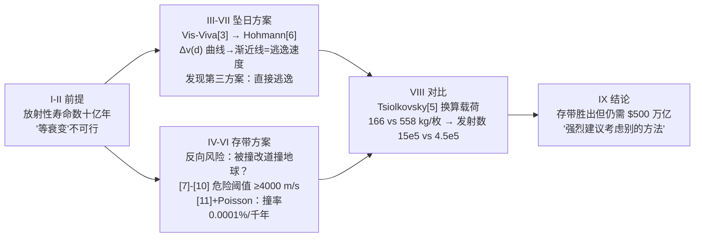

# 精读 · Analysis of Nuclear Waste Disposal into Space（2016 题A 金牌 · 队伍 331）

> **这份精读怎么用**：左手边开论文 PDF（`03_优秀论文PDF/2016/Problem A/2016-GM-A-331.pdf`），右手边开本篇。每节按「它写了什么 → 为什么这样写 → 你要学什么」三层展开；每个公式给「物理直觉 → 完整推导 → 适用边界」，式号用论文原编号 [1]–[11]（本篇是 revTeX 方括号风格）。这篇的两大看点：**用 Δv 做所有方案的统一货币**，以及**用 5 万颗真实小行星的数据回答"能安全存多久"**——读完你要能复现 Fig 1 那条"藏着一个第三方案"的曲线。

---

## 0. 一分钟看懂全文骨架

论文回答一个问题：**把地球上的核废料送进太阳还是存进小行星带，哪种更容易实现？存进去安全吗？**



**为什么这个骨架好？** 比较——度量——闭环：先立 Δv 这个统一度量（III），两条路线各自算 Δv（坠日 IV、存带 IV/VI），反向风险各自建模（坠日=容器回落烧毁；存带=碰撞改道），最后经 Tsiolkovsky 换算成发射次数与钱。**每个方案都配有自己的失败模式分析**，比较才显得公平。Fig 1 的水平渐近线（=太阳逃逸速度）顺藤摸瓜引出"直接逃逸更省"的第三方案——**从曲线形态反哺物理判断**是全文最漂亮的一笔。

---

## 1. 逐节导读

### 1.1 标题页摘要（第 1 页）

**它写了什么**：直接给出全部数字：坠日（10 AU 二次点火）Δv=14106.2 m/s；存带（2.7 AU 入轨）Δv=10977.4 m/s；千年撞率 0.0001%；处理 2.5×10⁸ kg 废料需 15×10⁵ vs 4.5×10⁵ 枚火箭；最省也要 500 万亿美元。

**为什么这样写**：摘要是一张"成绩单"——每个问句一行答案，还预埋了结论的火药味（"even the most efficient launches would still cost over $500 trillion"）。评委读完摘要已经拿到全文。

**你要学什么**：比较型论文的摘要结构：**方案 A 数字 → 方案 B 数字 → 安全性数字 → 成本数字 → 倾向性结论**。

### 1.2 §I Introduction（第 2 页）

**它写了什么**：核废料储存现状（水池+干桶、铅/水的 halving distance——铅 1 cm、水 18 cm）与两个候选方案；然后做关键的**前提手术**："if we decided that the only solution ... would be to move it off-planet, then we can also disregard the rocket failure rate as it would be a constant that we could do nothing about."——6% 的火箭失败率对所有方案一视同仁，从比较中剔除。

**为什么这样写**：先剔除对两方案等权重的因素（发射失败率），把比较收敛到"轨道效率、长期安全、清运速率"三个真正能分出高下的判据——**比较题先做变量控制**。

**你要学什么**：halving distance（半值层）一段是"顺手解题"的典范：用水多但便宜解释水池储存，一段背景介绍同时完成了一次屏蔽物理的小教学。

### 1.3 §II Radioactivity（第 2 页）

**它写了什么**：衰变定律 [1] ẋ=−kx 与解 [2] N(t)=N₀e^{−t/τ}；指出废料以贫铀为主、τ 达数十亿年——"waiting for the nuclear waste to decay is not an option."

**为什么这样写**：题目问"能安全存放多久"，答案的物理前提是**存放期限不受放射性限制**（自然衰变在工程时标上不下降），于是问题转化为轨道稳定性问题。两行公式完成问题的重新定义。

**你要学什么**：每个公式下都附"Where:"变量表（revTeX 惯例）——公式自足，读者不用回上文找符号。

### 1.4 §III Space Travel（第 3 页）——工具箱一页化

**它写了什么**：三条公式装一个工具箱：Vis-Viva [3]（轨道任意点速度）、Δv 定义 [4]（两次 Vis-Viva 之差）、Tsiolkovsky 火箭方程 [5]（Δv→质量比）。全部附变量表与常数取值（G、M☉）。

**为什么这样写**：全文后面所有计算都调用这三件工具。集中一页陈列，后文零重复——**工具箱式写法**让读者随时回查。

**你要学什么**：[4] 这个"同一点、两个半长轴"的 Δv 定义看似平凡，实为 Hohmann 变轨的紧凑表述：变轨发生在切点，速度差=轨道半长轴跳变的效果。

### 1.5 §IV Computations（第 3–4 页）——坠日方案与渐近线的发现

**它写了什么**：坠日的两段式 [6]：先把轨道远日点抬到 r，再在 r 处压低近日点到太阳表面；总 Δv 为两段 Hohmann 之和。Fig 1 画 Δv(d) 曲线："The plot has a horizontal asymptote at the escape velocity of the Sun, which is 12337.5 ms⁻¹."；并讨论 r→∞ 的极限等价于直接逃逸——"barring some lucky and extremely improbable slingshot around a distant black hole, the nuclear waste would never return. Unfortunately, this would not qualify as a sundive."

**为什么这样写**：§VII 里点破这一发现的方法论——"Using [3], it was found that as d increased, the required Δv throughout the journey decreased. Thus, it was found to be more cost-effective to first build up speed and go far away from the sun, where a small burn would allow the waste to just fall into the sun."。**反直觉结论（先飞远再坠日更省）完全由曲线形状自己说出来**。还顺带回应了两个担忧：太阳风回流（扩散+平方反比稀释）与容器回落烧毁（"a more pressing concern"）。

**你要学什么**：① "先抬远再压低"的两段 Hohmann 是坠日类问题的标准操作；② 渐近线是物理信息的富矿——本题它=逃逸速度，直接给出第三方案；③ 对每个方案写"最坏后果"段（回落大气烧毁散布）是风险对称性的要求。

### 1.6 §IV 后半 + §VI Asteroid Belt Stability（第 4–6 页）——反向风险的数据科学

**它写了什么**：存带方案的风险=被撞改道成地球交叉轨道。三步：① **危险阈值**：从 2.7 AU 圆轨道被撞入近日点 1 AU 的椭圆，用极坐标椭圆 [8]、反解角 [9]、切向夹角 [10]、矢量合成 [7]，算出改道所需 Δv 随新轨道远日点的曲线（Fig 2），下限约 4000 m/s；② **撞率**：curl 抓取 JPL 小天体数据库 5 万+ 颗小行星（附录连原始 curl 命令都附上），Python 求平均密度 3400 kg/m³、按球体补全质量（Fig 4 体积排序图）；速度按正态分布（3σ 覆盖 2.2–3.2 AU 主带一切可能轨道速度），扫掠体积模型 [11] P_coll=ΣA_kv_k/V，Poisson 外推千年撞率 0.0001%；③ **累积效果**：期望碰撞能量 5.67×10⁻⁷ J/s ⇒ 10 亿年累积 Δv=2115 m/s < 4000 m/s 阈值——"the danger to Earth from putting the container in the asteroid belt was negligible."

**为什么这样写**：这是"安全论证"的完整三段式：**要多少扰动才危险（阈值）→ 多大概率被扰动（撞率）→ 扰动会累积多少（剂量）**，最后用"2115 < 4000"的不等式闭环。数据来源真实（JPL 库）、方法可复现（全部代码）、假设自辩（偏心轨道的少数派"do not change the resulting values"）。

**你要学什么**：① [11] 的扫掠概率（单位时间扫过的体积/总体积）是稀疏碰撞问题的万能模型；② 5000 万颗级真实数据能买来的说服力，是任何解析估算给不了的；③ "expected Δv over 1 Gy"这种**剂量学视角**比"单次碰撞概率"更切题——危险来自累积偏移而非单次事件。

### 1.7 §V Designing the Container（第 4–5 页）

**它写了什么**：工人年剂量限 50 mSv；设废料近距离暴露约 5 Sv/天 → 年 1825 Sv；需衰减 36500 倍 → log₂36500≈15 个半值层 → 铅壁 15 cm，取安全余量 20 cm。

**为什么这样写**：一个对数量纲估算（几行算术）完成容器设计，且"extended to be 20cm"体现工程余量习惯。**估算题不必复杂，但每一步的物理量（剂量率、限值）要有出处**（[SOURCES] 引 Sievert 词条）。

### 1.8 §VIII Comparison + §IX Conclusion（第 7–8 页）

**它写了什么**：五种方案的 Δv 总表（直坠 26919.4 / 10AU 坠日 14106.2 / 逃逸 12337.5 / 2.7AU 入轨 10997.4 / 2.2AU 入轨 9346.67）；Saturn V（I_sp=263 s）单枚有效载荷 166 kg（坠日）vs 558 kg（存带）→ 发射数 15×10⁵ vs 4.5×10⁵ → 按 1970 年单价 $185M 通胀换算，总量超 $500T。结论：存带显著更优，但"the authors of this paper strongly urge the consideration of a different method"。

**为什么这样写**：表格把 Δv 排序一步到位；Tsiolkovsky 把物理量（Δv）翻译成工程量（载荷、发射数）再翻译成钱——**三级贯通**。结论敢下"强烈建议不做"的负结论，与 2010-A 篇的"advise against"异曲同工。

**你要学什么**：注意结论里的假设传播声明：Tsiolkovsky 简化"高估载荷、低估燃料"，但"any comparisons between the methods still behaved the same way"——**共同偏置不改变相对排序**，这是比较型论文对自身误差的正确处理。

---

## 2. 图表深析（每张图：为什么放、为什么这样画、怎么画）

| 图 | 位置与作用 | 为什么这样画 | 怎么画出来 |
|---|---|---|---|
| **Fig 1 Δv–d 曲线**（核心） | §IV | 坠日成本随二次点火距离单调降、以逃逸速度为渐近线——曲线形状本身孕育第三方案（直接逃逸） | 附录 Python：dv(d)=两段 [4] 之和，linspace(0.1,20) |
| Fig 2 改道 Δv–远日点曲线 | §IV | 给"危险阈值 ≥4000 m/s"提供来源；小 a 处无值（轨道够不着主带）自身就是信息 | [7]–[10] 链条代入扫描 |
| Fig 3/5/6 轨道示意图三连 | §VI/VII | 同构对比三种飞行计划（存带/坠日/逃逸）：实线=内行星轨道、虚线=主带边界 | 参数化椭圆叠加 |
| Fig 4 小行星体积排序图 | §VI | semilog 下 64346 颗小行星的体量分布一目了然（头几颗是异常值） | 数据清洗后 volumes.sort+semilogy |

**核心图（Fig 1）的 Python 复现**（论文附录代码的整理版，常数与式号一一对应）：

```python
import numpy as np, matplotlib.pyplot as plt

# ── 常数（论文 §III：G、太阳质量；§IV：re=ae=1 AU，太阳半径 R）──
GM   = 6.67408e-11 * 1.98855e30
au   = 1.49597871e11
sunr = 6.957e8
v    = lambda a, r: np.sqrt(GM*(2/r - 1/a))          # 式[3] Vis-Viva
dv   = lambda d: (abs(v((d+au)/2, au)  - v(au, au))  # 第一段：抬远日点到 d
                + abs(v((d+sunr)/2, d) - v((d+au)/2, d)))  # 第二段：压近日点到日面，式[6]

d = np.linspace(0.3, 15, 800)*au
v_esc_dv = np.sqrt(2*GM/au) - v(au, au)    # 渐近线 = 直接逃逸所需 Δv = 12337.5 m/s
plt.figure(figsize=(6.2, 4.3))
plt.plot(d/au, [dv(x) for x in d], 'b', lw=2, label='two-burn sundive $\\Delta v(d)$')
plt.axhline(v_esc_dv, color='r', ls='--',
            label='asymptote = direct-escape $\\Delta v$ = %.1f m/s' % v_esc_dv)
plt.scatter([10], [dv(10*au)], c='k', zorder=5)
plt.annotate('d=10 AU: $\\Delta v$=14106 m/s (paper)', (10, dv(10*au)),
             textcoords='offset points', xytext=(-130, 14))
plt.xlabel('d (AU)'); plt.ylabel('$\\Delta v$ (ms$^{-1}$)')
plt.title('Necessary $\\Delta v$ for solar deorbiting:\n'
          'farther second burn is cheaper; limit $\\to$ direct escape')
plt.legend(); plt.grid(alpha=.3); plt.tight_layout(); plt.show()
```

四个绘图决策：**① 渐近线用虚线显式画出并标注数值**（12337.5 m/s）——渐近线是这张图的全部思想，不画等于白算；**② 在论文引用点 d=10 AU 打标**（14106.2 m/s），图与文互相锚定；**③ 曲线在 d→小处陡增**（复现时从 0.3 AU 起画即可看到），对应"直坠最贵"；**④ 图题写结论**（farther is cheaper）。运行后你会亲眼看到：坠日的两段 Δv 之和随 d 单调下降、以逃逸速度为下界——"为什么不干脆逃逸"这个问题，是这条曲线自己提出来的。

---

## 3. 公式逐条精讲

### 3.1 衰变定律（式 [1][2]）

$$\dot x=-kx\;\Rightarrow\;N(t)=N_0e^{-t/\tau}$$

- **怎么想到**：一阶线性 ODE，分离变量即解；τ=1/k 是平均寿命。
- **用法**：不是用来算剂量的，是用来**宣判"等待无效"**的——贫铀 τ~10⁹ 年，工程时标上放射性强度是常数。**公式可以只为关闭一扇门而存在**。

### 3.2 Vis-Viva 方程（式 [3]）

$$v_{r,a}=\sqrt{GM\Big(\frac{2}{r}-\frac{1}{a}\Big)}$$

- **怎么想到**：能量守恒（E=−GM/2a）在轨道上任一点的表述——只要知道 r 和 a，不需要知道轨道形状细节就能算速度。
- **完整推导**：总能量 E=½v²−GM/r=−GM/(2a)（椭圆轨道能量只依赖 a），移项开方即得。
- **数值感**：r=a=1 AU 得地球速度 29.78 km/s；a→∞ 退化为逃逸速度 √(2GM/r)=42.1 km/s。**全文每一种速度都由 [3] 生成**——一件工具用到底。

### 3.3 两段 Hohmann 的 Δv（式 [4][6]）

$$\Delta v_{r,a_1,a_2}=|v(r,a_1)-v(r,a_2)|\ [4]$$
$$\Delta v_{sun,r}=\Delta v_{r_e\to\frac{a_e+r}{2}}+\Delta v_{r\to\frac{r+R}{2}}\ [6]$$

- **怎么想到**：Hohmann 变轨=切点处两次瞬时变速；每次变轨只改半长轴（切点 r 不变），所以 Δv=同 r、两个 a 的 Vis-Viva 之差——[4] 就是 [3] 的差分。坠日需要两串：① 在地球轨道把 a 从 1 AU 抬到 (1+d)/2 AU；② 在远日点 d 把 a 压到 (d+R☉)/2 AU（近日点触日）。
- **数值感复核**（d=10 AU）：Δv₁=|v(1AU,5.5AU)−v(1AU,1AU)|≈40.16−29.78=10.38 km/s；Δv₂≈|v(10AU,5.002AU)−v(10AU,5.5AU)|≈3.9 km/s；合计 ≈14.1–14.3 km/s，论文报 14106.2 m/s ✓。**注意 Δv₁ 占大头**——先把轨道"抬出去"才是贵的那一步，这也解释了为何渐近线是逃逸速度：d→∞ 时第二段趋于 0，第一段趋于逃逸 Δv。
- **适用边界**：共面圆轨道起点、脉冲变轨；d 太小时第二段火箭方程失真（近日点深入日冕）。

### 3.4 改道阈值（式 [7]–[10]）

$$\Delta v_{coll}=\sqrt{(v_f\cos\phi-v_i)^2+(v_f\sin\phi)^2}\ [7],\qquad r(\theta)=\frac{a(1-e^2)}{1+e\cos\theta}\ [8]$$
$$\theta=\cos^{-1}\frac{a(1-e^2)-r}{re}\ [9],\qquad \phi=\tan^{-1}\frac{d[r\sin\theta]}{d[\theta\cos\theta]}+\frac\pi2-\theta\ [10]$$

- **怎么想到**：小行星撞容器=给容器一个速度增量 Δv_vec；新轨道与原轨道在撞点相切与否由夹角 φ 决定。[8] 是椭圆极坐标方程；[9] 由其反解（撞点在椭圆上的极角）；[10] 是新轨道切线方向与原圆轨道切向的夹角（对 [8] 微分得切向）。[7] 就是矢量差的模。
- **推导要点**：[9] 的反解——r(1+e cosθ)=a(1−e²) ⇒ cosθ=(a(1−e²)−r)/(re)。附录代码的 θ 表达式 (a²−ad−(a−p)²)/(d(a−p)) 与此代数等价（e=(a−p)/a 代入即得），**文与码互证**。
- **数值感**：扫描新轨道远日点 2.7–10 AU，Δv_coll 下限 ≈4000 m/s（Fig 2）——这就是后文不等式"2115 < 4000"的右端。
- **适用边界**：假设新轨道近日点恰为 1 AU（地球交叉的最省改道）；撞点取在 2.7 AU 圆轨道上。

### 3.5 Tsiolkovsky 火箭方程（式 [5]）

$$\Delta v=v_e\ln\frac{m_0}{m_f}$$

- **怎么想到**：把 §III 的 Δv 翻译成质量比——火箭方程是"物理量→工程量"的汇率。
- **数值感**：Saturn V（I_sp=263 s ⇒ v_e≈2580 m/s）总 Δv≈Δv入轨+Δv任务；载荷比随 Δv 指数恶化——坠日 14106+11185=25.3 km/s 只运 166 kg，存带 10977+11185=22.2 km/s 运 558 kg：**Δv 省 12%，载荷多 236%**（指数的杠杆）。
- **适用边界**：论文自评"高估载荷、低估燃料"（忽略级间抛壳、恒定排气），但两方案被同样高估，**相对结论稳健**——误差传播的正确论述。

### 3.6 扫掠碰撞概率（式 [11]）

$$P_{coll}=\frac{\sum_k A_kv_k}{V}$$

- **怎么想到**：在容器参考系里，每颗小行星单位时间扫过体积 A_kv_k（截面×相对速度）；扫到容器=碰撞。除以主带总体积 V（2.2–3.2 AU 的球壳）=单位时间碰撞概率。
- **完整推导链**：单颗：Δt 内扫过 A_kv_kΔt ⇒ P₁=A_kv_kΔt/V；N 颗独立叠加 ⇒ P=ΣA_kv_kΔt/V；碰撞是稀有独立事件 ⇒ Poisson 过程 ⇒ t 时间内至少一次碰撞概率 P(t)=1−e^{−P_coll·t}。附录代码更进一步：v_k 不用常数而用**正态分布下的期望相对速率**（闭式 D 因子，3σ 覆盖主带速度范围 15.03–21.86 km/s 的极值由 Vis-Viva 在 2.2/3.2 AU 端点轨道算出）。
- **数值感**：千年撞率 0.0001%（=1−e^{−P·t}）；期望能量注入 5.67×10⁻⁷ J/s ⇒ 10 亿年累积 Δv=2115 m/s < 4000 m/s ⇒ 即便被撞十亿年也改不成地球交叉轨道。**不等式闭环=安全结论**。
- **适用边界**：小行星位置随机均匀假设、速度正态假设（偏心越界者占比 ~1/1000，作者论证不改变结果）；忽略引力聚焦（截面用几何截面，对 km 级天体偏差可忽略）。

---

## 4. 建模决策链（为什么这么建、放弃了什么）

| 决策 | 作者的选择 | 被放弃的替代 | 为什么 |
|---|---|---|---|
| 比较度量 | Δv（[3][4] 统一生成） | 能量、时间、直接用钱 | Δv 可加、可比、可经 [5] 换算成任何工程量 |
| 火箭失败率 | 从比较中剔除 | 计入风险模型 | 6% 对两方案是常数，剔除后比较更纯（§I 明说） |
| 坠日路线 | 先抬远再压低（两段 Hohmann） | 地球轨道直接刹车 | Fig 1 曲线显示远处二次点火更省；渐近线还送了第三方案 |
| 存带轨道 | 2.7 AU 圆轨道（也算了 2.2 AU） | 3.2 AU 外缘 | 主带中部最典型；2.2 AU 展示 Δv 对目标半径的敏感度 |
| 撞击数据 | JPL 真库 5 万+ 颗，密度 3400 补全 | 解析估算撞率 | 真实样本给出数量级可信的 ΣA_kv_k；代码全部公开 |
| 速度分布 | 正态 3σ 覆盖速度极值 | 均匀分布/实测直方图 | 正态有闭式期望速率（D 因子）；3σ 论证有正文自辩 |
| 累积效应 | 期望 Δv（剂量学）与阈值比较 | 只报单次撞率 | 危险来自累积偏移；2115<4000 才是完整的安全论证 |
| 容器屏蔽 | 半值层数=剂比对数（15 层铅） | 蒙卡辐射输运 | 量级估算足够，工程余量 20 cm 兜底 |
| 成本口径 | 1970 单价通胀换算 | 现价火箭 | 有公开单价可查；共同偏置不影响排序 |

**总规律**：全文没有一处"两个方案用不同精度算"——同一套 [3][4][5] 工具、同一种数据源、同一种误差论述。**比较的公平性是比较型论文的生命**，本文把它做成了方法论。

---

## 5. 从本篇提炼的可复用模板

**结构模板**：

```
Abstract        成绩单式：方案A数 → 方案B数 → 安全数 → 成本数 → 倾向
I Introduction  背景小教学（半值层）+ 剔除等权重因素（失败率）
II 物理前提     两行公式关闭"等待"选项（衰变太慢）
III 工具箱      Vis-Viva / Δv / 火箭方程一页陈列，每个附 Where 表
IV 方案A        两段式 + Δv(d) 曲线 + 渐近线解读（第三方案）
IV/VI 方案B     反向风险三段式：阈值([7]-[10]) → 撞率([11]+Poisson) → 累积剂量 vs 阈值
V  工程件      半值层估算（几行算术）
VIII 对比       Δv 总表 → [5]换算载荷 → 发射数 → 钱
IX Conclusion   负结论 + 替代方向（离子引擎缓降、直接逃逸）+ 假设传播声明
附录            分析代码 + 数据抓取代码 + 原始 curl 命令
```

**句式库（原文摘录）**：
- "then we can also disregard the rocket failure rate as it would be a constant that we could do nothing about"（剔除等权重因素）
- "The plot has a horizontal asymptote at the escape velocity of the Sun"（渐近线的物理指认）
- "barring some lucky and extremely improbable slingshot around a distant black hole"（极小概率的生动排除）
- "This overestimated the amount of payload ..., and underestimated the fuel needed. However, any comparisons between the methods still behaved the same way."（误差的方向+传播性论述）
- "This approach fully solved the completely infeasible problem of moving all of Earth's nuclear waste off-planet."（自嘲式总结：完整地解决了不可行的问题）
- "the authors of this paper strongly urge the consideration of a different method"（负结论的强表达）

**图表配方**：成本-参数曲线 → 必画渐近线并标注其物理身份；风险论证 → 阈值曲线（[7]-[10]）+ 剂量累积对比不等式；数据分布 → semilog 排序图；多方案对比 → Δv 总表 + 载荷/发射数两级换算。

---

*精读完这篇后，建议对照 `05_论文赏析/2016/2016-GM-A-331.md`（宏观赏析）与 `07_题目解读/2016_题A_核废料太空处置.md`（题目全解）形成三位一体。*
