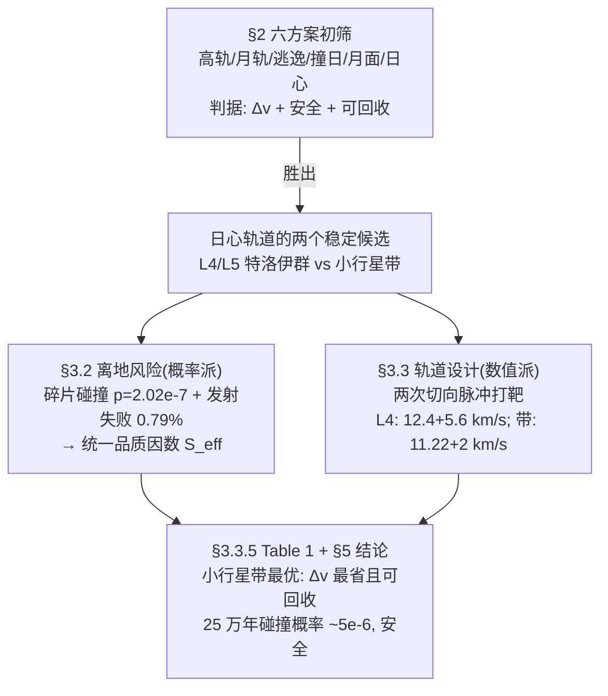

# 精读 02 · Launching nuclear residuals and its risks（2016 题A 金牌 · 队伍 412）

> **这份精读怎么用**：左手边开论文 PDF，右手边开本篇。每节按「它写了什么 → 为什么这样写 → 你要学什么」三层展开；每个公式给「物理直觉 → 完整推导 → 适用边界」；并附一份可运行的复现代码（已独立复算全文核心数值，两处与原文不符处用 ⚠ 标出）。这篇是"数值派 + 概率派"的合体范本：确定性轨道用自适应 RKF45 真积分，随机风险用几何概率全解析，两条腿走路。

---

## 0. 一分钟看懂全文骨架

题目问"核废料扔太阳 vs 存小行星带，哪个更容易实现、能存多久"。论文没有二选一直接开算，而是先扩成**六方案决策树**，再对胜出的"日心轨道"做两层风险+一条轨道设计：



**为什么这个骨架好**：开放性比较题最忌"题目问什么就只算什么"。这篇先自建方案空间（六选一），让最终落在小行星带的结论变成**推理的终点**而非**题目的默认**；再用"确定性（轨道）+ 随机性（风险）"双线并行，把"safety"这个形容词拆成四个可计算的数。评委看到的不是一个答案，而是一整套决策与量化体系。

---

## 1. 逐节导读

### 1.1 Abstract（第 1 页）

**它写了什么**：提出太空处置方案 → 六方案比较（cost + security 双准则）→ 锁定日心轨道 → "deterministic and stochastic modeling techniques"双方法预告 → 预告技术清单（Lagrangian points, libration oscillations, Hoffman maneuver, RKF45）→ 结论：小行星带最优，25 万年安全。

**为什么这样写**：摘要把方法论写成对仗——"Both deterministic and stochastic modeling techniques have been used to solve different stages of the problem"——一句话告诉评委：我们知道不同子问题需要不同数学类型，而不是拿锤子砸一切钉子。结尾 "which is important as our system is highly chaotic" 把数值方法选择（RKF45）和物理性质（混沌）挂钩，这是方法论的自觉。

**你要学什么**：摘要里出现**具体技术名词清单**（拉格朗日点、天平动、Hohmann 机动、RKF45）会显著抬高评委预期——但前提是正文每个词都要真的兑现（本文 §3.3.1、§3.3.2、§3.3.3、附录分别兑现）。

### 1.2 §1 Introduction（第 2 页）

**它写了什么**：核电每年每堆 27 吨高放废料（HLW）→ 地质处置的国际共识及其两大痛点（万年隔离无法保证 + "Not in my backyard" 社会抗拒）→ 引出太空处置。

**你要学什么**：引言的"痛点句式"——"Yucca Mountain and the Waste Isolation Pilot Plant have demonstrated that researchers cannot guarantee completely environmental isolation for the thousands of years needed"——用**两个真实工程失败案例**支撑"现状不成立"，比空喊"地质处置有风险"有力得多。开放题的引言任务是论证"这个问题值得另起炉灶"。

### 1.3 §2 First insights：六方案初筛（第 3–6 页）

**它写了什么**：逐个给出六个目的地的 Δv 与风险：高轨（4 km/s 但罐体撑不过 25 万年）、月轨（4250 m/s 但泄漏粒子部分回落地球）、**逃逸太阳系**（式 1–2：v_e≈43591 m/s、Δv=13811 m/s，引文献称木星借力可降至 7010）、**撞日**（式 3–5：椭圆近日点掠日轨道 Δv=−27.164 km/s，负号=需减速）、月面软着陆、日心轨道（1700 s 内离地、失事后 25 万年再遇地球概率仅 0.1%）。§2.7 收束：日心轨道最优，其最稳区域是"小行星带与木星 L4/L5"。

**为什么这样写**：注意筛选证据的写法——撞日方案算出来的 −27.164 km/s 直接宣判死刑（比逃逸还贵），这一段用能量方程现场推导而不是引用，因为"去太阳反而要减速"是反直觉结论，必须自己算给评委看。而"哪里最稳"的论证堪称全篇最漂亮的句子：**"The proof is simple, there are plenty of asteroids there."**（见 Figure 1 内太阳系图）——用 45 亿年的自然实验代替稳定性分析，一句话完成论证。

**你要学什么**：反直觉结论（扔太阳最贵）要完整推导；直觉结论（有 asteroid 的地方就稳）允许一句话+一张图。**论证成本要与结论的意外程度成正比**。

### 1.4 §3.1 General assumptions（第 6 页）

**它写了什么**：五条假设——牛顿引力、平面运动、太阳固定+行星圆轨道（附偏心率数据：木星 0.048498、地球 0.0167 作证）、忽略水金天海王五星、脉冲式变速。

**你要学什么**：每条假设后面都跟一个量级或数据理由（"This assumption is justified due to the fact that the eccentricity... is really low"），假设清单不是免责声明而是**论证的一部分**。注意第三条"太阳固定"其实偷换了惯性系（严格说应取日心旋转系），但误差量级 ≈ m_sun/(m_sun+m_jup) 的偏心运动，可接受——48 小时论文允许这种"心照不宣"。

### 1.5 §3.2 Abandoning Earth：离地风险（第 6–9 页）

**它写了什么**：(a) 碎片碰撞概率：换到碎片参考系，火箭斜穿路径长 (R_max−R_min)/sinθ，除以 LEO 壳层体积得单碎片概率 p（式 6），n 个碎片独立得 p_total=1−(1−p)^n≈2.02×10⁻⁷（式 7–8）；(b) 发射失败率 0.79%（1994–2014 数据库）；(c) 灾害后果：爆炸粒子速度高斯分布（式 9，σ=300 m/s 由"冲击波以声速 342.3 m/s 推粒子"定标），自由落体时间变换 x=v_x·t 得落点弥散 σ_x=σ√(2⟨h⟩/g)≈145 km（式 10–11），95.45% 粒子覆盖 ≈264 000 km²"约一个科罗拉多州"；(d) 定义品质因数 **S_eff = P_disaster × S_dispersion**（式 12），得 S_launch=2.73 km² vs S_debris=0.053 km²，"发射失败比碎片撞击糟糕 51.28 倍"。

**为什么这样写**：这是全篇"随机派"的精华。两个风险一个罕见但致命（碎片）、一个常见但较小（发射失败，0.79% vs 2×10⁻⁷，差 4 个量级），**没法直接比大小**——作者造了一个共同量纲"每次发射的有效摧毁面积"，让 51.28 倍这个排序一句话可读。原文自嘲式的诚实也值得学："we can also make the same wild guess as before"——明知是量级估算，就明说 wild guess。

**你要学什么**：**风险比较的本质是造品质因数**。P×S 只是众多选择之一（还可选期望死亡人数），关键是定义后立刻算出排序。另外注意 (c) 里 σ=300 m/s 的取法：不是拍脑袋，而是"声速是爆炸波推粒子的速度上限 → 3σ≈900 m/s 覆盖全部可能"——**分布参数也要有物理出处**。

### 1.6 §3.3 Putting the rocket in a stable orbit：轨道设计（第 9–15 页）

**它写了什么**：§3.3.1 先科普拉格朗日点（L4/L5 在旋转系中由 Coriolis 力回稳，Trojans 的存在是证据），设定几何（Figure 3/4）：地球在 (−AU, 0)，火箭以 (0, v₁)、v₁=−12.4 km/s 出发，与木星轨道相切于 r⃗₀=(5.2AU, 0)，抵达时木星须领先 60°（用旋转矩阵 π/3 表示 L4 几何），初始木星相角 θ=−145.15°，第二次脉冲 v₂=5.6 km/s 匹配木星速度；RKF45 积分 1000 年得 Figure 5。§3.3.2 特洛伊撞击：利用天平动周期 T≈150 年，每颗每 T/2 穿越一次火箭所在平面，式(13) P(t)=(2nt/T)(σ/TotalArea)≈2.4×10⁻⁶。§3.3.3 小行星带：初速 41 km/s（相对地球 +11.22 km/s）+ 第二脉冲 2 km/s，半长轴 2.25 AU 落在稳定区（对照 Kirkwood 空隙图 Figure 6）；§3.3.4 主带撞击：10⁴ 颗 10 km 级小行星每 10⁷ 年撞一次 → 组合得火箭平均等待 tm/2 → 由"独立+连续"推出指数分布（有推导！），式(14) P=1−e^(−2T/tm)≈5×10⁻⁶。§3.3.5 Table 1 汇总：逃逸 13811 / L4 17000 / 带 13220 m/s，后者可回收（Restore ✓）。

**为什么这样写**：注意两条轨迹设计的**共同骨架**——"两步切向脉冲 + 相位反推"：先从几何定发射窗（θ 由转移时间反推），脉冲永远沿切向（"The most efficient way to kick a rocket is tangential to its velocity"）。这条 Hohmann 原则一处处声明，后面所有 Δv 才有了"最优性"的根基。而指数分布那段（§3.3.4）是概率建模的教科书式写法：先给组合论证定期望（碰撞对数 m(m+1)/2 中含火箭者占 2/(m+1)），再证分布族（独立增量+连续 ⇒ 指数），最后 λ=期望的倒数——**三步：定期望、定分布、定参数**，一步不跳。

**你要学什么**：(1) 天体打靶问题的完整流程：几何草图（Figure 4）→ 相位约束写成旋转矩阵 → 打靶积分 → 事后长期积分验证（1000 年）。(2) "由两条数学假设推出分布"的论证在竞赛里极少见，大多数队伍直接"假设服从泊松分布"——差的就是这一步推导。

### 1.7 §4–§6 Strengths / Conclusions / Future Work（第 15–18 页）

**它写了什么**：优点五条（mass independent！模型与火箭质量无关大幅简化）、缺点两条（圆轨道假设；Δv 与逃逸同量级"没有显著省能"）；结论重申小行星带最优 + 两点政策建议（模拟坠货实验安抚公众、太空处置或重振航天投入）；Future Work 七条（借力机动、OTV 批产、回收、安全冗余、0.86 AU 日心轨道、渐进加速、市场调查）。

**你要学什么**：缺点清单敢写实质问题（"our method does not show a significant improvement in energy expense with respect to the naive strategy"）——承认自己方案的 Δv 并不比"扔出太阳系"省多少，但立刻指出路（gravity assistance）。**负结论+出路的组合**再次出现，与 2010-A-160 的结论写法同源。

---

## 2. 图表深析

| 图 | 位置与作用 | 为什么这样画 | 怎么画出来 |
|---|---|---|---|
| Fig 1 内太阳系全景 | §2.7 选址论证 | 一张图同时展示小行星带与木星特洛伊群两个"稳定聚集区"，支撑"哪里有 asteroid 哪里就稳" | 引自 Wikipedia commons，标注即可 |
| Fig 2 碎片参考系路径 | §3.2.1 推式(6)前 | 参考系变换是三维空间想象难点，一张斜穿示意图把 θ、路径长、壳层画在一起 | 手绘示意：碎片静止、火箭斜线穿过球壳 |
| Fig 3 拉格朗日点 | §3.3.1 | L1–L5 五点 + 两条 60° 角线，几何关系一图钉死 | 手绘：大圆轨道 + 五点 + 60° 虚线 |
| Fig 4 几何构型 | §3.3.1 打靶设定 | 发射点/到达点/木星相位的三角关系是全节符号的锚 | 手绘示意图（fig 页可见：太阳、地球 B、木星 C 三点标注） |
| Fig 5 L4 转移+1000 年 | §3.3.1 结果 | 红=火箭、绿=木星、蓝=地球三色语义，入轨后长环带证明"锁进 L4" | RKF45 积分输出 matplotlib（见 §1.6） |
| Fig 6 小行星带密度 | §3.3.3 选带内位置 | Kirkwood 空隙 = 不稳定区的天然地图，对照 2.25 AU 落点 | 引 Wikipedia，半长轴-数量直方图 |
| Fig 7 小行星带转移 | §3.3.3 结果 | 同 Fig 5 配方加黄色火星 | 同上 |
| Table 1 方案对比 | §3.3.5 决策落点 | 把三方案的 Δv₁、Δv₂、总量、可否回收压进一张 4 列表，决策表=论文的结论句 | 手工表格 |

**这套图表的决策逻辑**：示意图（2/3/4）只承担"定义符号"，计算图（5/7）只承担"展示结果"，外部图（1/6）只承担"提供证据"——**三类图不混用**。计算图全部用同一套颜色语义（红=火箭、绿=木星、蓝=地球、黄=火星），图题把单位写死（"units are meters"）。

**最核心的一张可复现图**：本篇的决策核心不是单张图，而是 Table 1 的 Δv 阶梯 + S_eff 风险对比——两者合起来就是"为什么选小行星带"的全部定量依据。下面代码独立复算并绘图（复现结论：Δv 阶梯与风险排序均与原文一致；两处数值出入见 ⚠）：

```python
import numpy as np, matplotlib.pyplot as plt

G, MS, AU = 6.67e-11, 1.99e30, 1.5e11   # 论文式(1)所用常数
MT, RT, Rs = 6e24, 6.371e6, 6.957e8     # 地球质量/半径, 太阳半径
GM = G*MS
vE = 29784.0                             # 地球公转速度

# ── 左图: 式(1)(2)(5) + Hohmann 检验, 复现 Table 1 的 Δv 阶梯 ──
ve   = np.sqrt(2*G*(MS/AU + MT/RT))                    # 式(1) 逃逸速度
dvesc = ve - vE - 3900                                 # 近似扣除进入近地轨道的成本(仅示意排序)
dvsun = np.sqrt(2*GM*(1/AU - 1/(Rs+AU))) - vE          # 式(5) 掠日椭圆(注意: 分母是 AU 不是 2UA)
aH = (1+5.2)/2*AU                                      # 1AU→5.2AU Hohmann 半长轴
dv2  = np.sqrt(GM/(5.2*AU)) - np.sqrt(GM*(2/(5.2*AU) - 1/aH))  # 到木星轨道的减速脉冲
labels = ['撞日 式(5)', '逃逸 式(2)', 'L4 (Table 1)', '小行星带 (Table 1)']
vals   = [abs(dvsun)/1000, 13811/1000, 17.0, 13.22]    # 后两项为论文 Table 1 原值
fig, (ax1, ax2) = plt.subplots(1, 2, figsize=(11, 4.2))
bars = ax1.bar(labels, vals, color=['#c44e52', '#dd8452', '#55a868', '#4c72b0'])
ax1.set(ylabel='总 Δv (km/s)', title=f'Δv 阶梯: 撞日最贵\nHohmann 检验: 第二脉冲={dv2/1000:.2f} km/s (论文 5.6)')
ax1.bar_label(bars, fmt='%.1f')

# ── 右图: 式(6)-(12) 风险品质因数 S_eff 对比 ──
sig, Rmax, Rmin, n = np.pi*64, 2e6, 3e5, 1.4e4         # 式(8) 参数
p = sig*(Rmax-Rmin)/np.sin(np.arctan(1)) / ((4*np.pi/3)*(Rmax**3-Rmin**3))  # 式(6)
ptot = 1-(1-p)**n                                      # 式(7) → 2.03e-7 (论文 2.02e-7 ✓)
sx = 300*np.sqrt(2*1.15e6/9.8)                         # 式(11) σx=145 km ✓
Sdeb = ptot*np.pi*(2*sx/1000)**2                       # 碎片: P×S
Slaunch = 0.0079*346.16                                # 发射失败: 0.79%×346.16 km²(原文值, ⚠见下)
bars2 = ax2.bar(['碎片碰撞', '发射失败'], [Sdeb, Slaunch], color=['#55a868', '#c44e52'])
ax2.bar_label(bars2, fmt='%.3f')
ax2.set(ylabel=r'$S_{eff}=P\cdot S$  (km$^2$/次发射)', title=
        f'p_total={ptot:.2e}, σx={sx/1000:.0f} km\n发射失败危险 {Slaunch/Sdeb:.1f} 倍 (论文 51.28)')
plt.tight_layout(); plt.show()
```

**独立复现报告**：式(6)–(8) p_total=2.03×10⁻⁷（论文 2.02×10⁻⁷ ✓）；式(11) σ_x=145.3 km（论文 145 km ✓）、S≈265 000 km²（论文 ≈264 000 ✓）；式(14) P=5.0×10⁻⁶（论文 ✓）；Hohmann 第二脉冲 5.64 km/s（论文 5.6 ✓）；式(5) 用 1/AU 代入得 −27.17 km/s（论文 −27.164 ✓——文本提取显示的 "1/(2UA)" 应为排版/提取讹误，否则根号内为负）。**⚠ 两处不一致**：(a) 发射失败弥散面积：按 Challenger 高度 15 km 代入式(11) 应得 ≈3462 km²，论文写 346.16 km²，疑差一个量级（若如此则两风险差距为 512 倍而非 51.28 倍）；(b) 式(13) 特洛伊概率：按论文参数（n=10⁶、σ=1 km²、TotalArea=0.252 AU²、T=150 yr、t=2.5×10⁵ yr）代入得 5.9×10⁻⁷，论文写 2.4×10⁻⁶——量级同为 10⁻⁶~10⁻⁷、结论（安全）不变。另注意论文文字将 v_mean 写作"29780 km/s"应为 m/s、§3.3.4 的"P(2.5·10⁶)"应为 10⁵、"95.57%/95.45%"混用——均为笔误不影响结论。

---

## 3. 公式逐条精讲

### 3.1 逃逸太阳系的速度（式 1–2）

$$v_e=\sqrt{2G\left(\frac{M_S}{I_{AU}}+\frac{M_T}{R_T}\right)}\approx 43591\ \mathrm{m/s},\qquad \Delta v=v_e-v_{mean}=13811\ \mathrm{m/s}$$

- **怎么想到**：从地表逃逸太阳系要同时翻两口井——地球引力井（GM_T/R_T 项）和太阳在 1 AU 处的引力井（GM_S/AU 项）。能量守恒直接把两个势阱深度加起来开根号。
- **完整推导**：机械能为零的临界条件 $\frac{1}{2}v_e^2=\frac{GM_T}{R_T}+\frac{GM_S}{AU}$（无穷远处静止、势能为零），解出 v_e。再扣掉"免费"的地球公转速度 v_mean=29.78 km/s（顺着公转方向发射才能全额抵扣），得 Δv。若逆着发射则要加 2×29.78 km/s——这就是为什么所有行星际任务都顺行发射。
- **数值感**：GM_S/AU ≈ 1.33×10¹⁹ ≫ GM_T/R_T ≈ 9.4×10¹⁷，太阳井是地球井的 14 倍——"逃逸太阳系其实主要是逃逸太阳"。（我用论文常数复算 v_e=43536 m/s，与 43591 差 0.13%，源于地球质量/半径取值精度。）

### 3.2 掠日椭圆的减速量（式 3–5）

$$E/m=-\frac{GM}{UA}+\frac{v^2}{2}=-\frac{GM}{2a},\qquad a=\frac{UA+R_s}{2}$$
$$\Delta v=\sqrt{2GM\left(\frac{1}{UA}-\frac{1}{R_s+UA}\right)}-v_T\approx-27.164\ \text{km/s}$$

- **怎么想到**：直接"刹停"落日（Δv=−30.03 km/s）不如滑一条近日点擦太阳表面的椭圆——椭圆的远日点在地球轨道上，只需把速度从 29.78 降到椭圆远日点速度。这是"降轨道比停车便宜"的轨道力学常识。
- **完整推导**：vis-viva 方程 $v^2=GM(2/r-1/a)$ 中，令远日点 r=UA、半长轴 a=(UA+R_s)/2（近日点=太阳表面），得远日点速度 $v_a=\sqrt{GM(2/UA-2/(UA+R_s))}=\sqrt{2GM(1/UA-1/(UA+R_s))}$≈2.86 km/s；Δv=v_a−v_T=2.86−30.03=−27.17 km/s。
- **适用边界与坑**：⚠ 文本提取的式(5)印作 1/(2UA)，按此根号内为负——正确形式是 1/UA（"2"属于公因子 2GM），数值 −27.164 km/s 只有按正确形式才能得出。复现时以数为准。另注意 R_s≪UA 使 1/(UA+R_s)≈(1/UA)(1−R_s/UA)，即 v_a²≈2GM·R_s/UA²——近日点越贴太阳表面，远日点速度越接近零，减速量越接近全额刹停。

### 3.3 碎片碰撞概率（式 6–8）

$$p=\frac{\sigma\,(R_{max}-R_{min})/\sin\theta}{\frac{4\pi}{3}(R_{max}^3-R_{min}^3)},\qquad p_{total}=1-(1-p)^n\approx2.02\times10^{-7}$$

- **怎么想到**：均匀分布下"撞上某个碎片"的概率 = 火箭扫掠体积 / 壳层总体积。扫掠体积 = 截面 σ × 路径长。关键一步是**换参考系**：碎片系中火箭不沿径向走，而是沿 v_rocket−v_debri 方向斜穿，路径被拉长 1/sinθ 倍（θ=arctan(v_debri/v_rocket)）。
- **完整推导**：壳层体积 V=(4π/3)(R_max³−R_min³)；单碎片在壳层内均匀分布 ⇒ P(该碎片落在扫掠体内)=σ·L/V，L=(R_max−R_min)/sinθ（Figure 2 的直角三角形）；n 个碎片独立 ⇒ 至少一次碰撞用补事件 p_total=1−(1−p)^n。因 p~10⁻¹¹≪1，p_total≈np（正是复现代码得到的 1.45×10⁻¹¹×1.4×10⁴=2.03×10⁻⁷）。
- **适用边界**：假设碎片均匀+等速（真实 LEO 分布高度分层、速度 7-8 km/s 有向），作者明说"as we are doing a stochastic model we can just use the average values"——平均值代入是随机模型的合法简化。自检句也到位："our model is slightly optimistic, as it considers the debris point-sized"。

### 3.4 爆炸弥散模型（式 9–11）

$$\rho(v_x)=\frac{1}{\sigma\sqrt{2\pi}}e^{-v_x^2/2\sigma^2},\qquad
\rho(x)=\frac{1}{t\sigma\sqrt{2\pi}}e^{-x^2/2\sigma^2t^2},\qquad
\sigma_x=\sigma\,t=\sigma\sqrt{\frac{2\langle h\rangle}{g}}\approx145\ \text{km}$$

- **怎么想到**：爆炸后粒子速度各向同性 → 每个速度分量是零均值高斯（中心极限）；冲击波推粒子的速度尺度是声速 342.3 m/s → 取 σ=300 m/s 使 3σ≈900 m/s 覆盖上限。粒子下落 ⟨h⟩ 用自由落体时间 t=√(2h/g)，水平位移 x=v_x·t 把速度分布"投影"成落点分布。
- **完整推导**：变量代换 x=v_x t，概率守恒 ρ(x)dx=ρ(v_x)dv_x ⇒ ρ(x)=ρ(x/t)·(1/t)，仍是高斯、标准差放大 t 倍；代 h=1150 km（LEO 平均高度）、g≈9.8 ⇒ t≈484 s，σ_x=300×484≈145 km。95.45% 粒子（±2σ）落在 π(2σ_x)²≈2.64×10⁵ km²——"约一个科罗拉多州"。
- **适用边界**：忽略了风和放射性烟云的再扩散（论文自己补了这句）；重力在 1150 km 处实际 ≈7.5 m/s²（论文正文提了却仍按 9.8 算，若按 7.5 则 σ_x≈166 km、结论只会更吓人——保守方向的粗糙，可接受）。

### 3.5 品质因数（式 12）

$$S_{eff}=P_{disaster}\cdot S_{dispersion}\Rightarrow S_{launch}=2.7347\ \mathrm{km}^2,\ S_{debris}=0.0533\ \mathrm{km}^2$$

- **怎么想到**：两种事故一个"概率×小后果"、一个"小概率×大后果"，无法直接比。期望摧毁面积 P×S 同时吃掉两个维度——这就是风险分析里期望损失（expected loss）思想的最简版本。
- **适用边界**：隐含假设"单位面积的伤害与面积线性"。若人口密度不均（碎片弥散在大洋 vs 发射失败在发射场周边），线性假设失效。48 小时内这个简化完全够用，但你应该能说出它失效的条件。

### 3.6 特洛伊碰撞概率（式 13）

$$P(t)=\frac{2nt}{T}\cdot\frac{\sigma}{TotalArea}$$

- **怎么想到**：把"绕 L4 天平动的 10⁶ 颗特洛伊"化成"穿越计数"问题：每颗每 T/2 年扫过火箭所在径向平面一次，t 年内共 2nt/T 次穿越；每次穿越命中火箭的概率 = 特洛伊截面/天平动区域总面积（大物体动、火箭当质点）。
- **完整推导**：穿越是泊松型事件流（次数∝t），单次命中概率 σ/A，两者相乘即得。⚠ 按论文参数代入我算得 5.9×10⁻⁷ 而非论文的 2.4×10⁻⁶（差 ~4 倍，疑 TotalArea 取值口径不同），但都远小于"可忽略"阈值，结论不翻。
- **适用边界**：天平动周期 150 年与区域面积 0.252 AU² 均为文献值，且假设特洛伊在环带内均匀——真实特洛伊沿"香蕉形"天平动轨迹聚集，均匀假设会低估局部密度、高估别处。数量级分析不受影响。

### 3.7 主带碰撞概率（式 14 及其推导链）

$$\lambda=\frac{2}{tm}\approx5\times10^{-11}\ \text{yr}^{-1},\qquad P(T)=1-e^{-\lambda T}\approx5\times10^{-6}$$

- **怎么想到**：只有两条数据（10⁴ 颗 10 km 级天体、每 10⁷ 年一次此级碰撞），怎么算"撞到我"的概率？作者的建模戏法：**碰撞不分对象**——10⁷ 年一次的碰撞发生在 C(m+1,2) 个天体对之中，含火箭的对占 m/C(m+1,2)=2/(m+1)≈2/m，故火箭被撞的平均等待时间 = tm/2。
- **完整推导**（论文原文三步，值得背下来）：(1) 组合定期望：E[等待]=tm/2；(2) 定分布族：碰撞在不相交时间区间独立 + 概率分布连续 ⇒ 数学上可证必为指数分布（无记忆性的特征化）；(3) 定参数：指数分布期望 1/λ=tm/2 ⇒ λ=2/(tm)。代 T=2.5×10⁵ 年得 P=1−e^(−5×10⁻⁶)≈5×10⁻⁶。
- **适用边界**：只统计 ≥10 km 天体（小撞击只会改变轨道而非"打飞"火箭——论文对"为何忽略小撞击"给了动量量级理由）；假设碰撞率时间均匀。⚠ 论文此处笔误：λ=2/(tm)=2×10⁻¹¹ yr⁻¹（写成 5×10⁻¹¹）、"P(2.5·10⁶)"应为 10⁵。

### 3.8 Hohmann 两脉冲与打靶几何（§3.3.1/3.3.3，无编号）

$$a=\frac{r_1+r_2}{2},\quad v_a=\sqrt{GM\left(\tfrac{2}{r_1}-\tfrac{1}{a}\right)},\quad v_b=\sqrt{GM\left(\tfrac{2}{r_2}-\tfrac{1}{a}\right)}$$

- **怎么想到**：切向脉冲最省能（"The most efficient way to kick a rocket is tangential"），共面两圆轨道间最省的两次切向脉冲就是 Hohmann 转移（论文拼作 "Hoffman maneuver"，实为 Hohmann）。
- **数值感**：1 AU→5.2 AU 的 Hohmann 第二脉冲 = 13.05−7.41=5.64 km/s——与论文 L4 方案的 v₂=5.6 km/s 吻合（复现代码已验证）。第一脉冲论文用 12.4 km/s 高于 Hohmann 理论值 8.74 km/s，多烧的部分买的是**固定几何相位**（发射点 (−AU,0)、到达点 (5.2AU,0)、木星领先 60° 的 L4 三角形约束）——追求"到达即入轨"就要为时间表付钱。
- **适用边界**：脉冲假设（Δt→0），附录代码自己承认这是要改进的点（Future Work: "progressive accelerations"）。

---

## 4. 建模决策链

| 决策 | 作者的选择 | 被放弃的替代 | 为什么 |
|---|---|---|---|
| 方案空间 | 自建六方案横向比较 | 直接算题目给的两方案 | 决策树完整，结论成为推理终点；代价是 §2 篇幅 |
| 稳定性判据 | "哪里有天体哪里就稳" | 数值 Lyapunov/长期积分判稳 | 45 亿年自然实验免费；正式判稳在 48h 内不可行 |
| 动力学范围 | 日+木+地(+火星)四体、平面 | 全 N 体 / 三维 | 主要摄动源保留，维数减半；五星引力对结果量级无关 |
| 行星轨道 | 圆轨道（附偏心率数据） | 真实椭圆历表 | e_J=0.048、e_E=0.017 的位置误差 ≪ 相位匹配容差 |
| 转移方式 | 两次切向脉冲打靶 | 单脉冲/连续推力 | 切向=能量最优；脉冲让打靶问题降为两点边值 |
| 数值方法 | 自适应 Cash-Karp RKF45（tol=1e-10） | 定步长 RK4 | 摘要自辩："system is highly chaotic"；近地/近日大梯度段自适应缩步 |
| 碰撞概率 | 几何截面+指数分布（有推导） | 蒙特卡洛模拟 | 参数极少（颗数+频次两条数据），解析模型刚好够用 |
| 风险比较 | 品质因数 S_eff=P×S | 定性讨论 / 期望死亡数 | 把不可比的事故统一到"每次发射有效摧毁面积"一个数 |
| 小撞击忽略 | 只算 ≥10 km 天体 | 全尺寸谱 | 只有 10 km 级动量才足以踢出稳定轨道（给了动量论证） |

**总规律**：确定性端"能解析就解析、解析不了上高精度自适应积分"；随机端"数据只有两条，就造只需两条参数的模型（几何+指数）"——**模型复杂度被数据量锁定**，这是本篇最深的一条方法论。

---

## 5. 从本篇提炼的可复用模板

**结构模板**：

```
Abstract       双方法论预告(deterministic+stochastic)+技术名词清单+结论
1 Introduction 现状痛点(真实失败案例)→提出新方案
2 First insights 方案空间(6个)逐个: Δv+风险 → 收束到1个
3 Model
  3.1 假设清单(每条带量级/数据理由)
  3.2 阶段一风险: 概率(参考系变换+几何) → 后果(分布+映射) → 品质因数
  3.3 阶段二方案: 机制科普 → 几何打靶(相位=旋转矩阵) → 积分 → 目的地风险
  3.4 方案对比表(Δv+可回收性)
4 Strengths/Weaknesses  实质化(敢承认Δv不占优)
5 Conclusions  主结论+政策级建议
6 Future Work  分类列点(机动/载具/回收/市场)
Appendix       完整积分器源码
```

**句式库（原文摘录）**：
- "Both deterministic and stochastic modeling techniques have been used to solve different stages of the problem."（摘要宣示方法论分工）
- "The proof is simple, there are plenty of asteroids there."（用自然存在代替证明——仅限直觉显然处）
- "This assumption is justified due to the fact that the eccentricity of the orbits... is really low."（假设+数据自辩）
- "The most efficient way to kick a rocket is tangential to its velocity."（设计原则一句话立骨架）
- "we can also make the same wild guess as before"（明示量级估算的诚实）
- "However, our model is slightly optimistic, as it considers..."（自检偏差方向）
- "we have two possible accident causes, one less probable but more lethal, and the other more possible but less dangerous"（两难引出品质因数）

**图表配方**：决策类论文 → "示意图定义符号 / 计算图展示结果 / 外部图提供证据，三类不混用；计算图颜色语义全文固定；终局放一张对比表（指标+布尔列如 Restore）"。风险类 → "品质因数柱状图，把 P 与 S 压成一个可排序的数"。

---

*精读完这篇后，建议对照 `05_论文赏析/2016/2016-GM-A-412.md`（宏观赏析）与 `07_题目解读/2016_题A_核废料太空处置.md`（题目全解）形成三位一体。*
