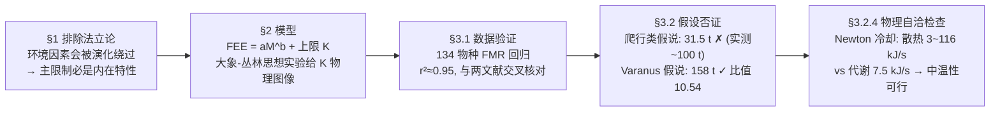

# 精读 03 · Modeling the upper limit of body size for vertebrates（2016 题B 金牌 · 队伍 441）

> **这份精读怎么用**：左手边开论文 PDF，右手边开本篇。每节按「它写了什么 → 为什么这样写 → 你要学什么」三层展开；公式给「物理直觉 → 完整推导 → 适用边界」；附一份可运行的复现代码（Table 1–4 的全部预测值均已独立复算一致，一处系数问题用 ⚠ 标出）。这一篇是**"数据驱动 + 假设否证"派**的范本：全文没有一个数值积分，却完成了 2016 年 B 题最完整的科学方法叙事。

---

## 0. 一分钟看懂全文骨架

题目问：为什么最大恐龙比最大陆地哺乳动物重一个数量级？论文的回答压缩成一行公式：**M_max=(K/a)^{1/b}**——环境给能耗封顶 K，物种内在代谢效率 a 决定同样的 K 能养活多大的身体。



**为什么这个骨架好**：它是一堂浓缩的科学方法课——先排除竞争解释（§1）、再建可测模型（§2）、先用数据自证模型有效（§3.1）、再把对立假变成可否证的数值预测（§3.2）、最后检查结论的物理合法性（§3.2.4）。每个环节都在为"结论可信"加一层保险，而这五层保险的成本只是一条幂律和两次回归。

---

## 1. 逐节导读

### 1.1 Abstract（第 1 页）

**它写了什么**：交代模型基础（resources and energy considerations）→ 预告用途（解释恐龙-哺乳动物质量差 + "reinforce or discard hypothesis about dinosaur's resources and biological nature"）→ 关键结果（Varanus 型能耗外推到大质量"successfully explains observed mass ratios of one order of magnitude"）。

**为什么这样写**：注意摘要的动词选择——"reinforce **or discard** hypothesis"。论文把自己的功能定位成**假说裁决器**而不是"解释器"，这一定位贯穿全文：§3.2.1 真的否证了流行假说（恐龙=普通爬行动物）。摘要敢写"我能淘汰假说"，正文就必须兑现否证，这是给自己立的军令状。

**你要学什么**：摘要里预告的不只是结论，还有**论文的类型**（本文=假设检验型，非优化型/预测型）。评委读完第一段就知道该用什么期待去读后文。

### 1.2 §1 Introduction + Problem approach（第 3 页）

**它写了什么**：题目五候选因素（氧含量、生育方式、代谢率、食物可得性、环境温度）中先做排除：环境类因素"could be circumvented by the evolution of the species"且两类动物长期共存于相似环境 → 差异必在**内在特性**；又用三角龙 12 t vs 犀牛 1 t、甲龙 6 t vs 巨犰狳 1 t 的"生态等价种"脚注说明这是**群级差异**而非个例 → 锁定能量视角："an animal with a given size will exist only if it is viable energetically speaking"。

**为什么这样写**：这段是"物理学家做生物题"的开场白——"From a physicist point of view"直接声明方法论身份。排除法每步都给证据（共存事实、等价种对比），不是拍脑袋。特别是"若氧含量/气温是主因，演化会绕过它"这个论证，把"环境说"的 burden of proof 推给了对方。

**你要学什么**：**开放题第一步是缩小解释空间**。题目列了五个候选因素，论文用两条论证（可绕过性 + 共存事实）删掉三个，只留代谢/能量——删得有理有据，比"我们选择研究代谢率"这种裸宣言强一个量级。等价种脚注（Triceratops vs Rhinoceros）是低成本高收益的证据：一行字就把"普遍差异"立住了。

### 1.3 §2.1.1 Field energy expenditure（第 4 页）

**它写了什么**：引入异速律 **FEE = aM^b**（式 1）：a = 质量无关系数（代谢效率），b = 异速指数；FEE 可由双标水法实测，单位 kJ/day。验证思路预告：把 (log M, log FEE) 做线性回归，若某组物种共享 (a,b)，则组内能耗差异纯由质量解释。

**你要学什么**：**选模型先看"参数可测性"**——FEE 不是理论量而是可实测的量（doubly labeled water technique），这决定了 §3.1 能用 134 个物种真实数据检验模型。竞赛里很多队伍的模型参数永远无法标定，两者结局天差地别。另注意脚注 3 的严谨性："it should be said the expected value of this magnitude over time"——把时变量操作化为时间平均，一句脚注堵住一个攻击面。

### 1.4 §2.1.2 Maximal daily field expenditure（第 4–6 页）

**它写了什么**：定义环境上限 K（maximal daily field expenditure）——承认它"paradoxically easy and tricky"：易在"环境能量有限所以必有上限"，难在上限不是"环境总能量"而由内在（移动能力、取食难度）与外在（食物数量品质、生态约束）共同决定。随后用**大象-丛林思想实验**落地：树间距 d、每树可用能 ε、觅食能耗 µ=µ₀+αMd（式 2，行走项与体重线性），平衡条件 µ=ε（式 4）给出 M_max=(ε−µ₀)/(αd)（式 5）、K=Nε（式 6）——密林（d 小）和高品质食物（ε 大）都抬高 K。

**为什么这样写**：这是全文**可读性的枢纽**。K 在数学上只是一个截距，但作者花整整两页做思想实验，因为它承担着"解释变量"的角色：后文所有结论都依赖"K_d≈K_m"这个锚定，如果读者不理解 K 是什么，整个 §3.2 的假设就悬空。两个例子（同种大象放密林 vs 疏林、放高养分 vs 低养分岛）写得像物理题的 control experiment——一次只动一个变量。

**你要学什么**：**抽象参数必须配一个 toy model**。式(2)–(6) 这五条式子对后文计算"没用"（K 最终是锚出来的，不是从 ε、d 算的），但它们让 K 从字母变成机制。这种"为理解而建的子模型"在 48 小时论文里是奢侈品，却是金牌与普通论文的分水岭之一。

### 1.5 §2.1.3 Interpretation（第 6 页）

**它写了什么**：三句话给出全文的机理核心：b 在 0.67–0.85 间近似群间不变（引 Nagy 2005），故 **a 小的物种在同 K 下能长到更大**——"the most efficient species are the ones that can achieve the largest masses"。脚注 4 顺带解释 b<1 的生物学含义（单位体重能耗随体型递减）。

**为什么这样写**：这是全文最短的一节（6 行）却最关键——它把"恐龙为什么大"翻译成"恐龙的 a 比哺乳动物小多少"。逻辑链：b≈常数 → M_max=(K/a)^{1/b} 对 a 单调 → a 是唯一自由度。一句话，主变量锁定。

**你要学什么**：**先固定不变的参数、再聚焦变化的参数**。如果 b 也各群不同，模型就有一堆自由度、解释力锐减；作者引文献把 b 钉死在窄区间，等于给自己的模型"降维"——降维后的模型才能做干净的假设检验。

### 1.6 §3.1 Verification of the model（第 7–8 页）

**它写了什么**：从 Nagy et al. (1999) 取 79 种哺乳动物 + 55 种爬行动物的实测 FMR，两边取 log₁₀ 化为线性（式 7），回归得 Table 1：哺乳类 a=4.8196、b=0.7341（r²=0.9491）、爬行类 a=0.1965、b=0.8879（r²=0.9440），p 值均 ~10⁻¹⁶；Figure 1 画 log-log 散点+回归线；"These results are in accordance with the ones obtained in [4]"与文献交叉核对。

**为什么这样写**：注意这一节验证的是**式(1) 本身**，与恐龙无关——先把工具验明正身，再拿去用。报告了 n、adjusted r²、F 检验 p 值三件套，且强调"logarithms with base 10 to be consistent with the cited literature"——连对数底数都为可比性服务。拟合结果与 Nagy、McNab 两篇文献三方一致，模型有效性不是自证而是交叉互证。

**你要学什么**：**"先用数据证明模型合法，再用模型证明结论"**的两段式。大多数队伍拿到模型直接算答案；这里先花一节回答"式(1)靠不靠谱"，之后所有预测的可信度都由这一节背书。表格里放 p 值是数学习惯的体现——r² 高不等于关系显著，p~10⁻¹⁶ 才是"绝非偶然"的统计证据。

### 1.7 §3.2 Applications（第 9–13 页）

**它写了什么**：锚定假设两连：(1) "The largest mammal ever observed was one that had approximately achieved the maximal daily field expenditure"——最重哺乳动物 Paraceratherium（15 t）恰好触及 K_m，代入式(8) 得 K_m≈8.94×10⁵ kJ/d（式 10）；(2) K_d≈K_m（恐龙时代资源量级与哺乳动物时代相当）。然后两个假说检验：
- **爬行类假说**（§3.2.1）：恐龙用爬行类参数 (a_r,b_r) → M_max≈31.51 t、比值 2.1，与 Seismosaurus halli ~100 t（比值 6.67）矛盾 → **假说被否证**："either dinosaurs are not reptiles, or the K_d is not of the same order of K_m, or both"。
- **Varanus 假说**（§3.2.2）：巨蜥是现存最大、最活跃、体温最高的蜥蜴（更像恐龙）；只取 >1.3 kg 的 6 个最重种回归（Table 2：a_v=1.3605、b_v=0.7095，r²=0.9715）→ M_max≈158.17 t、**比值 10.54**，"in the order of 10, as it was expected"，且比最大化石记录还大——"there is still a possibility that there existed heavier dinosaurs"。
- **双假说对比**（§3.2.3）：用犀牛-三角龙、长颈鹿-梁龙两对生态等价种做区间级预测（Tables 3–4）：爬行类曲线预测区间与实测区间**完全不重叠**，Varanus 曲线预测（9.6–19.67 t vs 实测 6–12 t 等）相容。

**为什么这样写**：这是全文的高潮，写法上有三个可偷师的细节。(1) **否证也写成三岔口**：爬行类假说失败后不给二元结论，而列出"非爬行类 / K 不同量级 / 两者都错"三种可能，为下一节保留搜索空间；(2) **158>100 是优点不是缺点**：预测上限高于已知最大化石，作者反过来用它激励"可能存在更大的恐龙待发现"——把模型的"过预测"转化为可检验的新预言；(3) **区间重叠性判断**：Tables 3–4 用质量区间（化石估计本来就不确定）而非点值比较，"Notice that predicted mass ranges not even overlap"——用区间的语言与数据的不确定性匹配。

**你要学什么**：**假设检验的完整闭环 = 锚定 → 代入 → 对比 → 裁决**。尤其是锚定技巧："最重已知个体 ≈ 上限"把不可测的 K 变成可计算的式(10)——这一步的隐含假设（该个体恰好顶到环境天花板）论文明明白白写出来，而不是藏在计算里。

### 1.8 §3.2.4 Possible issues of low metabolic rate（第 13–14 页）

**它写了什么**：自我质疑——Varanus 型低代谢率与"恐龙体温明显高于环境温度"的证据矛盾吗？构建热平衡检查：代谢产热（式 11 的 FEE）vs Newton 冷却散热 q=hSΔT（式 12），球体动物 S≈0.27M^{2/3}（式 13），取 h=5–20 W/m²K、ΔT=1–10 K 得 q≈(1.35~54)M^{2/3} W（式 14）；对 100 t 个体：FEE≈7.5 kJ/s vs q≈3–116 kJ/s（式 15–16）——只要 ΔT 和 h 偏小（厚皮肤隔热），两者同量级可平衡，"finds no relevant evidence to reject the varanid metabolic rate"，支持恐龙是中温动物（mesothermy，引 Grady 2014 Science）。

**为什么这样写**：这是**防御性建模**的典范——结论（低代谢）在文献里有明显的反证（恐龙生长率高、体温高），作者不回避，主动做量级检查回应。注意结论的克制措辞："no relevant evidence to reject"（不能拒绝）而非"证明成立"——量级估算的结论只能写到这个强度。还顺手补了未计因素（solar radiation）。

**你要学什么**：**每个模型结论都要过一遍"会被一票否决吗"的自查**。产热-散热是否平衡是低代谢假说的生死判据，一旦失衡整个 §3.2 白干。自查不必精确，区间参数（h、ΔT 各给范围）+ 量级结论即可。这种"物理合法性检查"是物理背景队伍在生物题里的独有武器。

### 1.9 §4–5 Conclusions / Further Investigations（第 15–16 页）

**它写了什么**：结论三条：式(1) 在类内描述 FMR 非常好；爬行类假说与数量级差矛盾、Varanus 假说与之相符；恐龙代谢介于外温内温之间、且"only possible due to their large masses"（大体型热惯性）。Further Investigations 三条：改进 K_d 的估计、扩数据、测其他假说。

**你要学什么**：结论第三条把两个结果（代谢率居中 + 质量巨大）焊成因果环——**大体型使中温性可行，中温性（低 a）又反过来允许大体型**。把独立结果连成机制闭环，是结论段提升档次的手法。

---

## 2. 图表深析

| 图表 | 位置与作用 | 为什么这样画 | 怎么画出来 |
|---|---|---|---|
| Fig 1 哺乳/爬行 FMR 散点+回归 | §3.1 模型验证 | log-log 下幂律变直线，"points clearly follow linear tendency"一眼可见；两条线平行感直观传递 b 相近、截距差 1 个数量级传递 a 差异 | 双标水数据取 log 后 matplotlib 散点+拟合线，图内直接标注 R²=0.949/0.944 |
| Fig 2 哺乳/Varanus 对比 | §3.2.2 假说支撑 | 只画两条回归线（去掉 134 个散点噪声），视觉焦点集中在"两线几乎平行、Varanus 线整体下移"——即 a 差异 | 同上配方，6 个 Varanus 样本+哺乳类回归线 |
| Table 1/2 回归参数表 | §3.1/§3.2.2 | n、a、b、adjusted r²、p 值五列，把"拟合质量"和"参数值"并列呈现——参数表自带可信度证明 | 回归软件输出+手工排版 |
| Tables 3/4 等价种预测 | §3.2.3 假说裁决 | 每行一对生态等价种，预测区间与实测区间并排，重叠与否肉眼可判 | 手工表格，区间用"低-高"格式 |

**绘图决策拆解**：Figure 1 与 Figure 2 是**同一张图的两个裁剪版**——Fig 1 裁"哺乳+爬行"服务验证，Fig 2 裁"哺乳+Varanus"服务假说。颜色语义固定（红=哺乳、绿=爬行、蓝=Varanus），哺乳类红线在两图中重复出现作为"参照系"。这就是"一图一论证"：每张图只回答一个问题。

**最核心的图**：把 Fig 1/Fig 2 与全文结论合成一张"裁决图"——三条 FEE 曲线 + K_m 水平线，交点即各假说预测的 M_max。这实际是论文 §3.2 全部计算的图形化（下面代码独立复现，Table 3/4 的预测值也一并算出核对）：

```python
import numpy as np, matplotlib.pyplot as plt

# ── 回归系数: 论文 Table 1/2 ──
a_m, b_m = 4.8196, 0.7341     # 哺乳类 (n=79, r2=0.949)
a_r, b_r = 0.1965, 0.8879     # 爬行类 (n=55, r2=0.944)
a_v, b_v = 1.3605, 0.7095     # Varanus>1.3kg (n=6, r2=0.972)
t2g = 1e6                     # 吨 → 克 (回归用 g 与 kJ/day)

# ── 式(10): 锚定 K_m — Paraceratherium 15 t 触顶 ──
M_par = 15*t2g
K = a_m*M_par**b_m            # ≈8.94e5 kJ/day ✓
print(f'K_m = {K:.3e} kJ/d (论文 8.94e5)')

# ── §3.2: 两个假说的 M_max = (K/a)^(1/b) ──
for name,(a,b) in [('爬行类',(a_r,b_r)), ('Varanus',(a_v,b_v))]:
    Mmax = (K/a)**(1/b)/t2g
    print(f'{name}假说: M_max = {Mmax:.2f} t, 比值 = {Mmax/15:.2f}')
# → 31.51 t / 2.10 ✗ ;  158.17 t / 10.54 ✓ (与论文一致)

M = np.logspace(1, 9, 300)    # 10 g – 100 t, log 轴
fig, ax = plt.subplots(figsize=(7.2, 5))
ax.loglog(M/t2g, a_m*(M)**b_m, 'r-',  lw=2, label=f'哺乳类  {a_m}·M^{b_m}')
ax.loglog(M/t2g, a_r*(M)**b_r, 'g--', lw=2, label=f'爬行类  {a_r}·M^{b_r}')
ax.loglog(M/t2g, a_v*(M)**b_v, 'b-.', lw=2, label=f'Varanus {a_v}·M^{b_v}')
ax.axhline(K, color='k', ls=':', lw=2,
           label=f'环境上限 K = {K:.2e} kJ/d (式10)')
for a, b, c, name in [(a_r,b_r,'g','31.5 t ✗'), (a_v,b_v,'b','158.2 t ✓'), (a_m,b_m,'r','15 t')]:
    Mmax = (K/a)**(1/b)/t2g
    ax.plot(Mmax, K, c+'o', ms=9, mfc='white', mew=2)
    ax.annotate(f'{name}', (Mmax, K), textcoords='offset points',
                xytext=(8, 12 if c!='r' else 8), fontsize=10, color=c)
ax.set(xlabel='体重 M (t)', ylabel='FEE (kJ/day)',
       title='同一条 K 线下三种代谢策略的体型上限\nVaranus 曲线复现"恐龙≈10×哺乳" (比值 10.54)')
ax.legend(loc='upper left'); ax.grid(alpha=.3, which='both'); plt.tight_layout(); plt.show()

# ── Table 3/4 复算: 犀牛(1-2t)→三角龙、长颈鹿(0.5-2t)→梁龙 ──
for Mm_lo, Mm_hi, dino in [(1,2,'三角龙(实测6-12t)'), (0.5,2,'梁龙(实测10-15t)')]:
    Km = a_m*(np.array([Mm_lo,Mm_hi])*t2g)**b_m
    print(f'{dino}: 爬行类预测 {(Km[0]/a_r)**(1/b_r)/t2g:.1f}-{(Km[1]/a_r)**(1/b_r)/t2g:.1f} t, '
          f'Varanus预测 {(Km[0]/a_v)**(1/b_v)/t2g:.1f}-{(Km[1]/a_v)**(1/b_v)/t2g:.1f} t')
# → 三角龙: 3.4-6.0 t ✗ / 9.5-19.7 t ✓;  梁龙: 1.9-6.0 t ✗ / 4.7-19.7 t ✓ (与 Tables 3-4 一致)
```

**独立复现报告**：K_m=8.94×10⁵ kJ/d、爬行类 31.51 t（比值 2.10）、Varanus 158.2 t（比值 10.54）、Table 3/4 全部区间值、100 t 个体的 FEE=6.45×10⁵ kJ/d（7.5 kJ/s）——**均与论文一致**。⚠ 唯一存疑处：式(13) 球体面积系数写 S=(3/16π²)^{1/3}V^{2/3}≈0.27M^{2/3} 并称肉密度"≈1 kg/m³"——严格球体推导应为 S=(36π)^{1/3}V^{2/3}≈4.84V^{2/3}（密度取 1000 kg/m³ 时系数 ≈0.048，单位 kg），论文的 0.27 比严格球体大约 5.6 倍；但其后式(14)–(16) 的 q 区间与 0.27 自洽，且细长体型真实动物面积本就大于同重球体，故量级结论（FEE 与 q 同量级、无法拒绝 Varanus 假说）不受影响。

---

## 3. 公式逐条精讲

### 3.1 异速律 FEE=aM^b（式 1）

- **怎么想到**：生物学中"量随尺寸幂律变化"（allometry）是经验规律（Kleiber 律是其著名特例：代谢率∝M^{3/4}）；本文不背 3/4，而是让数据自己说话。
- **完整推导**：无推导（经验律），但有两层理论直觉：(1) b<1 的来源——产热/耗能组织按体积（M）增长，而散热、输送按面积（M^{2/3}）增长，两者竞争使指数落在 2/3 与 1 之间；(2) a 的含义——把曲线在 log-log 图上上下平移的"效率因子"，a 越小同等体重越省能。
- **适用边界**：类内有效、跨类比较需各自回归（这正是式 8/9/11 三条曲线并存的原因）；对 6 个样本的 Varanus 组，b 的置信区间其实很宽（论文未报，是可攻击点）。

### 3.2 觅食微观模型（式 2–6）

$$\mu=\mu_0+\alpha Md,\qquad \Delta E=N(\varepsilon-\mu),\qquad \mu=\varepsilon\Rightarrow M_{max}=\frac{\varepsilon-\mu_0}{\alpha d},\qquad K=N\varepsilon$$

- **怎么想到**：给抽象的 K 一个"能算出来"的微观世界：每棵树净收益 ε−µ，日总量 N(ε−µ)；平衡时收支相抵。
- **完整推导**：一天吃 N 棵树，能量变化 ΔE=N(ε−µ)（式 3）。质量不再增长 ⇔ ΔE=0 ⇔ µ=ε（式 4）。代式(2)：µ₀+αMd=ε ⇒ d=M 的线性方程，解出 M_max=(ε−µ₀)/(αd)（式 5）。注意 µ 随 M 线性增长而 ε 固定——**体重越大觅食越贵、收益封顶**，交点即极限。K 则是"全部时间用来吃"时的日摄入上限 Nε（式 6）。
- **适用边界与数值感**：µ∝Md 假设行走能耗与体重线性（实际运输成本近似 ∝M 走平坦路，合理）；该模型是**解释性**的，参数 ε、d、α 不做实测——后文 K 由锚定假设确定（式 10），式(5) 的角色是机制图示而非计算工具。能读出：M_max∝1/d（食物越稀疏体型上限越低）、∝(ε−µ₀)（食物品质越高上限越高），两条预测都与常识相符。

### 3.3 对数线性化与回归（式 7–9、11）

$$\log \mathrm{FEE}=\log a+b\log M,\qquad a=10^A,\ b=B$$

- **怎么想到**：幂律在对数坐标下是直线，线性回归是统计学最可靠的工具——模型换坐标系"降维"到 OLS。
- **完整推导**：对式(1) 两边取 log₁₀（脚注 5：为与文献一致用十进制），得 Y=A+BX 标准形式；回归得 A、B 后反解 a=10^A、b=B。检验指标：adjusted r²（拟合优度的惩罚版，n=6 的 Varanus 组必须用调整值）+ F 检验 p 值（斜率非零的显著性）。
- **适用边界**：对数线性化的隐含假设是相对误差同方差（残差在对数空间均匀）——对跨 8 个数量级的数据这是正确选择。⚠ 但要记得：**log 空间的残差最小 ≠ 原空间最优拟合**，对小样本组（n=6）外推 8 个数量级到 158 t，指数 b 的微小误差会被 1/b 放大——论文的坦率（Further Investigations 承认要更多数据）是必要的防线。

### 3.4 上限锚定（式 10）

$$K_m=a_m M_{max}^{b_m}\approx4.82\times(15\times10^6\,\mathrm g)^{0.7341}\approx8.94\times10^5\ \mathrm{kJ/d}$$

- **怎么想到**：K 无法直接测量，但"史上最重个体"是自然选择做过的最大规模实验——它存在过，说明环境养得活它；它没被超越，说明它贴近上限。极值统计的锚定思想。
- **适用边界**：三个隐含假设要能说出来：(1) Paraceratherium 恰好顶到 K（而非被别的因素如灭绝事件截断）；(2) 15 t 的估计值本身有化石误差；(3) K_m 对"哺乳动物纲"通用（不分犀牛与长颈鹿的生态位差异）。论文在 §3.2.3 用等价种各自重锚 K，实际上部分放松了假设 (3)——这是比看起来更稳健的设计。

### 3.5 假说预测（§3.2.1/3.2.2）

$$M_{max}^{(d)}=\left(\frac{K_d}{a_i}\right)^{1/b_i},\qquad i\in\{r,v\}$$

- **怎么想到**：联立 FEE=aM^b 与 FEE=K 两条曲线，交点的横坐标即最大体重——把"恐龙的代谢类型"这一古生物学争论变成"选哪条曲线"的计算题。
- **完整推导**：a_i M^{b_i}=K ⇒ M=(K/a_i)^{1/b_i}。数值：爬行类 (8.94e5/0.1965)^{1/0.8879}=3.15×10⁷ g=31.5 t；Varanus (8.94e5/1.3605)^{1/0.7095}=1.58×10⁸ g=158.2 t（复现代码已验证）。比值的敏感度来自 1/b：Varanus 组 b=0.71 最小，故同量级的 a 差异被指数放大得最多。
- **数值感**：a_r/a_m≈1/25（爬行类比哺乳类"省能"25 倍），但因 b_r≈0.89 接近 1，M_max 只翻 ~2 倍；Varanus 的 a_v/a_m≈1/3.5 配上 b_v=0.71 才翻出 10 倍——**解释数量级差异需要"a 与 b 的正确组合"**，这正是结论必须落到具体类群（Varanus）而不能停留在"代谢率低"的原因。

### 3.6 热平衡自洽检查（式 12–16）

$$q=hS\Delta T,\qquad S=\left(\frac{3}{16\pi^2}\right)^{1/3}V^{2/3}\approx0.27M^{2/3},\qquad q\approx(1.35\sim54)M^{2/3}\ \mathrm W$$

- **怎么想到**：低代谢率最致命的反驳是"产热不够维持高于环境的体温"。稳态热平衡：代谢产热（FEE）= 对流散热（q），两边都写成 M 的幂函数就能直接比量级。
- **完整推导**：Newton 冷却定律 q=hSΔT（式 12）；动物近似球，S∝V^{2/3}∝M^{2/3}（式 13）；代 h∈[5,20]、ΔT∈[1,10] 得式(14)。对 M=10⁵ kg：FEE=1.3605×(10⁸ g)^0.7095=6.45×10⁵ kJ/d ⇒ ÷86400 s ≈ 7.5 kJ/s（式 15–16）；q=0.27×hΔT×(10⁵)^{2/3}≈2.9–116 kJ/s。产热落在散热区间的低端之内 → 取 h、ΔT 较小时可平衡。
- **适用边界**：未计太阳辐射加热（对大型日行爬行动物其实是重要补热源——加上只会更支持结论）、蒸发散热、几何非球性；⚠ 系数 0.27 的推导有瑕疵（见 §2 复现报告）。结论强度被正确地限定为"no relevant evidence to reject"——量级检查只支持"不能否证"，不支持"证明"。

---

## 4. 建模决策链

| 决策 | 作者的选择 | 被放弃的替代 | 为什么 |
|---|---|---|---|
| 解释变量 | 内在代谢效率 a | 环境因素（氧、温度） | 演化可绕过环境变化；两类动物共存过相似环境 |
| 模型形式 | 异速幂律 FEE=aM^b | 机理代谢模型（多参数） | 参数可实测（FMR 数据库），回归可检验 |
| b 的处理 | 引文献钉死在 0.67–0.85 | 各群自由拟合 b | 固定 b 才能把解释力集中到 a，避免过参数化 |
| K 的确定 | 最重化石个体锚定 | 从资源密度模型计算（式 2–5） | ε、α 无数据；锚定只需一个可靠化石质量 |
| 恐龙分类 | 假设-否证：爬行类 ✗ → Varanus ✓ | 直接假设恐龙=某类 | 可否证的预测（31.5 vs 100 t）让古生物争论变成计算题 |
| Varanus 样本 | 只取 >1.3 kg 的 6 种最重者 | 全部 Varanus 物种 | 恐龙质量段在外推方向上，回归应锚定在高质量端 |
| 预测对比 | 区间重叠性（Tables 3–4） | 点值误差百分比 | 化石质量估计本身是区间，语言要匹配不确定性 |
| 代谢率质疑 | 传热量级自查（式 12–16） | 回避/引用文献搪塞 | 结论的物理合法性必须自己验证；量级够用 |
| 数值方法 | 全解析+回归 | 数值模拟 | 数据只有 134 行，回归+幂律反解即完备；多余的机器是伪精度 |

**总规律**：**每个决策都在管理"自由度"**——固定 b、锚定 K、区间化比较，都是为了把唯一要回答的问题（a 谁小）放在证据最充分的位置。模型简单不是偷懒，是设计。

---

## 5. 从本篇提炼的可复用模板

**结构模板**：

```
Abstract       模型定位(假设裁决器)+关键结果(数量级解释成立)
1 Introduction 排除法缩小解释空间 → 锁定主变量
2 Model        核心定律(可测参数) + 抽象参数的 toy model(思想实验)
3 Method & results
  3.1 模型自证: 真实数据回归 + 文献交叉核对(n/r²/p 三件套)
  3.2 应用: 锚定不可测量 → 假说A代入(否证) → 假说B代入(通过)
           → 区间级交叉验证 → 物理合法性自查(量级)
4 Conclusions  分点 + 把结果焊成因果闭环
5 Further Investigations  弱点转研究路线
```

**句式库（原文摘录）**：
- "...that permits to reinforce or discard hypothesis about..."（摘要宣告论文=假说裁决器）
- "could be circumvented by the evolution of the species, thus this factors are not the main responsible"（排除法：可绕过的因素不是主因）
- "there must be a key among their intrinsic characteristics"（共存事实→差异内在化的必然性论证）
- "Understanding this magnitude can be paradoxically easy and tricky at the same time."（引出参数双重性的过渡句）
- "The largest mammal ever observed was one that had approximately achieved the maximal daily field expenditure"（极值锚定的假设句，先立后用）
- "either dinosaurs are not reptiles, or the K_d is not of the same order of K_m, or both"（否证后的三岔口表述，保留搜索空间）
- "Notice that predicted mass ranges not even overlap the observed mass ranges."（区间不重叠=最强形式的否证证据）
- "finds no relevant evidence to reject..."（量级检查结论的标准强度措辞）

**图表配方**：回归验证图 → "log-log 散点+拟合线+图内标 R²"；假设裁决图 → "多条幂律曲线+水平上限线，交点标注预测值与 ✓/✗"；对比表 → "实测区间与预测区间并排，布尔化裁决列"。

---

*精读完这篇后，建议对照 `05_论文赏析/2016/2016-GM-B-441.md`（宏观赏析）与 `07_题目解读/2016_题B_恐龙与哺乳动物体型上限.md`（题目全解）形成三位一体。*
