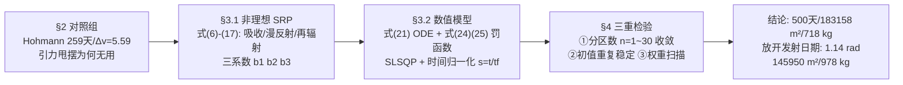

# 精读 06 · Solar Sails on Your Trip to Mars（2017 题A 金牌 · 队伍 744）

> **这份精读怎么用**：左手边开论文 PDF，右手边开本篇。这是 2017 年 A 题三篇金牌中**物理保真度最高、数值检验最成体系**的一篇（34 页）：非理想太阳帆光压模型 + SLSQP 双目标优化 + 分区收敛扫描。每节按「它写了什么 → 为什么这样写 → 你要学什么」三层展开；公式给「物理直觉 → 完整推导 → 适用边界」；附可运行复现代码——本篇复现结果与论文惊人吻合（526 天 vs 论文 500 天，非理想系数原样代入），细节见 ⚠ 标注。（注：论文原文件文本层编码损坏，本精读依据修复版文本与 PNG 页面图对照；标题原文把 SAILS 误拼为 SALES。）

---

## 0. 一分钟看懂全文骨架

同题（2000 kg、帆 7 g/m²、末速 ≤9 km/s、地火最近点出发），744 队的解法与 699 队互为镜像：**不用最优控制理论，用"非理想物理 + 非线性规划"硬算**，然后用三重数值检验证明结果可信：



**为什么这个骨架好**：§2 的对照组（Hohmann 更快但需要 5.59 km/s 的 Δv——帆给不了）一句话立住"为什么必须用帆"；§3.1 是全文的深度所在——**唯一一支建模"非理想帆"的队伍**（多花三页推导，换来三个常数 b₁b₂b₃ 与一个物理档次）；§4 的三重检验是数值论文的"可信度证据链"标准配置。与 670（532 天）、699（504 天）互相印证：三支队独立收敛到 500 天量级，这本身就是对题目答案的强交叉验证。

---

## 1. 逐节导读

### 1.1 Abstract（第 1 页）

**它写了什么**：问题（min 转移时间 & min 帆面积→max 载荷）→ 方法链（受力分析 → 运动方程 → RK4 → NLP）→ α(t) 分段常值化与逐段优化 → **数字链全部前置**：500 天、183158 m²、718 kg、分区数变化下"optimum stays stable"→ 增值结果（最优发射相位 1.14 rad → 145950 m²、978 kg）→ 反向轨迹预告。

**为什么这样写**：摘要把**收敛性结论**（"Compared with different number of partitions of α, the optimum stays stable. This gives a solid optimal trajectory"）写进第一段——大多数队伍把数值稳定性藏在正文角落，这里把它升格为摘要级卖点。数字精确到平方米（183158），暗示背后是真正的数值优化而非量级估算。

**你要学什么**：摘要除了"结论是什么"，还要回答"**结论凭什么可信**"——本文的回答是"分区无关性"，一行字成本，可信度翻倍。

### 1.2 §1 Introduction（第 3–4 页）

**它写了什么**：从 Mariner 4/9 到 IKAROS、NanoSail-D2、LightSail 的任务史 → 帆的原理（Mylar/Kapton 膜反射光子、动量守恒）→ 论文目标定义："given certain information such as departure planet, arrival planet, maximum desired arrival speed and the angle formed by the vectors connecting the Sun to both planets, it could describe the optimal trajectory"——**建的是通用工具，不只解一道题**。

**你要学什么**：引言结尾把输入参数（出发/到达行星、最大到达速度、初始相位角）列出来——这是"参数化建模"的宣言，后文 §5 的相位优化、反向轨迹、火星→地球全都建立在这个参数化上。**通用性是设计出来的，不是碰运气碰出来的**。

### 1.3 §2 Non Solar Sail models（第 4–6 页）

**它写了什么**：Hohmann 转移原理 + 附录 A 的运动方程（式 1–2，理想帆极坐标形式，含 cos³α 径向项）；Table 1 对比 Hohmann（259 天、Δv₁=2.94、Δv₂=2.65 km/s）与不同 β（0.05–0.30）对数螺旋的时间（875–135 天）与所需 Δv；§2.2 引力甩摆——结论是帆船用不上："in Solar Sails this fuel saving doesn't bring any new advantage, as our fuel resource is the radiation pressure"。

**为什么这样写**：这一节是"知识地基+对照基准"二合一。注意论证方向：不是"Hohmann 好/不好"，而是指出**Hohmann 需要瞬时大 Δv（脉冲），帆的物理（连续微推力）给不了**——所以尽管 Table 1 显示 Hohmann 更快（259 天），它对本题不可行；同时 Table 1 给出帆的 β-时间标度关系，为后文选 β 提供文献锚点。甩摆那段的否定也干净：省燃料的优势对"燃料免费"的帆归零，只剩下相位约束的净害处。

**你要学什么**：对照组要**否定得有物理理由**，不是罗列完就完。以及一个文献技巧：Table 1 整表引自 Tetzla (2004)，标注清楚——引用表格数据比现编数据可信十倍。

### 1.4 §3.1.1 Logarithmic Spiral Trajectories（第 6–7 页）

**它写了什么**：固定帆角的解析特解——对数螺旋 r(θ)=r₀exp(θtanγ)（式 3），速度式(4) v(r)=√[(μ/r)(1−βcos²α(cosα−sinαtanγ))]（帆速恒小于当地圆速度 ⇒ 两端需要速度突跳），帆角-螺旋角隐式关系式(5)；"the logarithmic spiral often provides a **good first guess** for a more advanced control law"。

**为什么这样写**：在数值模型前先给解析骨架——虽然最终没用螺旋解做计算，但它回答了三个定性问题：轨迹长什么样（等角螺旋）、为什么端点有速度突跳（v<vcirc）、优化的第一猜测从哪来。这是"解析为数值服务"的典型写法。

**你要学什么**：数值论文也要有解析层——哪怕解不能直接用，**定性结论（轨迹族形态、不等式 v<vcirc）和初值来源**就是它的产出。670 队的"修正引力场"洞察与此同源。

### 1.5 §3.1.2 SRP Force（第 7–9 页）——全文深度所在

**它写了什么**：五步搭出**非理想帆**光压模型：(a) SRP 压强式(6) P=P₀(r₀/r)²，P₀=4.563 μN/m²；(b) 理想镜面：光子动量变化 Δp=−2pcosα·ĵ（式 7）→ 力式(8) F₀=2P(r)Acos²α·n̂；(c) 修正一：镜面反射占比——反射系数 ρ、镜面因子 s，F₁=ρsF₀（式 9）；(d) 修正二：吸收光子（F₂，式 10）；修正三：漫反射（非 Lambert 系数 Bf，式 11）；修正四：前后表面再辐射（εf、εb 与比例 rf、rb，式 12–14）；(e) 合成标准三系数形式式(15)–(16)：**F_SRP=2PAcosα[b₁r̂+(b₂cosα+b₃)n̂]**，b₁=(1−ρs)/2、b₂=ρs、b₃=½[Bfρ(1−s)+(1−ρ)(εfBf−εbBb)/(εf+εb)]，取值 0.0864/0.8277/−5.43×10⁻³（引文献[9]）；转极坐标得单位质量力式(17)，特征加速度 a_c=2P₀A/m。

**为什么这样写**：这一节的写作节奏是"每引入一种物理效应，就多一项力、多一组系数"——像搭积木，每块积木独立编号可检查。最后的三系数形式是太阳帆领域的**标准参数化**（McInnes 教科书式处理），作者没有自己发明记号，而是采用领域惯例并给出文献数值——评委一眼认出"这队懂行"。对比 670/699 两队的理想镜面假设，多出的 b₁、b₃ 让吸收与发射效应（约 15% 修正）进入模型。

**你要学什么**：(1) **修理想模型的正确姿势**：不是抛弃理想公式，而是乘修正系数并写明每个系数的物理来源；(2) 三常数 (b₁,b₂,b₃) 是"复杂物理的极简压缩"——四个微观过程（吸收/镜反/漫反/再辐射）压成三个数，工程精度与模型简洁兼得；(3) 我的复算：b₂=ρs=0.8277 ⇒ b₁=(1−ρs)/2=0.0862≈0.0864 ✓（自洽），b₃<0 表示再辐射净效应轻微反向（微弱刹车）——读参数时连符号都要读出物理。

### 1.6 §3.1.3–3.1.4 引力与全方程（第 9–10 页）

**它写了什么**：引力式(18)，状态向量 x=(r,θ,u,v)（式 19），纯引力微分系统式(20)；加 SRP 得全系统式(21)——四行一阶 ODE，径向含 ac(r₀/r)²cosα(b₁+b₂cos²α+b₃cosα)，角向含 ac(r₀/r)²cosαsinα(b₂cosα+b₃)。

**你要学什么**：状态向量的选择直接服务数值方法——(r,θ,u,v) 全一阶化是 ODE 求解器（RK4/dopri5）的标准入口。注意理想极限校验：b₁=0、b₂=1、b₃=0 时式(21) 退化为 ac·cos³α 径向 + ac·cos²αsinα 角向——**与附录 A 式(32)(33) 及 670/699 的理想模型完全一致**。给新模型做"旧模型极限校验"是零成本的自证。

### 1.7 §3.2 Numerical model（第 10–13 页）

**它写了什么**：先列 9 条假设（圆轨道、忽略行星引力、二维、球体、忽略大气与阴影、**到达判据=距行星中心小于行星半径**、式(21) 有效且 b 系数取文献值、初速 ≤地球逃逸速度、初速方向可控）——每条一句理由。然后两步走：(a) α 常值：RK4 积分到 t_f，到达判据写成罚函数式(24) f=max(D_p−R,0)+max(D_v−V,0)——"always positive and only equals 0"当且仅当同时满足位置与速度条件，于是"到达问题=NLP 最小化问题"；再加目标项得式(25) g=k₁max(D_p−R,0)+k₂max(D_v−V,0)+k₃t_f+k₄A，用 SciPy 的 SLSQP（Sequential Quadratic Programming，文中误植为 SQL）求解，可加盒约束（帆面积受重量上限、t_f≤1.8 年）；(b) α(t)：分段常值化式(26)–(27)，关键技巧是**时间归一化 s=t/t_f**（式 28–29）——让分段边界 χ_[k/n, (k+1)/n) 不依赖 t_f，否则"t_f 变化时分段定义跟着变，程序没法写"。

**为什么这样写**：式(24) 的 max(·,0) 设计是全文数值方法的枢纽：它把"硬约束"变成"可微程度足够好的罚项"（在可行域内梯度为零、不干扰目标项），"可行性"与"最优性"解耦。k 权重的量纲辩护也值得学：正文先说"取 k₁,k₂≫k₃,k₄ 保证可行性优先"，实际取值（式 30：k₁=1e−4、k₂=5e−3、k₃=1/180、k₄=5）却反着来——作者**主动解释这个表面矛盾**："D_p、D_v 比 t_f、A 大好几个量级，若统一单位制则原大小关系成立"。变量量纲不平衡时要给权重配平——这是所有加权目标函数的通病与通解。

**你要学什么**：(1) `max(约束−阈值, 0)` 是把带不等式终端约束的时间自由端点问题塞进现成 NLP 求解器的万能接口；(2) **时间归一化 s=t/t_f** 是"优化变量同时出现在 ODE 定义里"的标准解法，值得单独记；(3) 诚实披露：作者承认需手动初值（"we need to do a first manual testing"）、无法保证全局最优——写进 Weaknesses。

### 1.8 §4 Results（第 13–17 页）

**它写了什么**：**第一组（表 2，n=10~30 段）**：时间全部落在 497.9–519.0 天、ARV 7.1–8.6 km/s、帆面积 0.18–0.21 km²——分区数几乎不影响结果；且发现"初速相对地球 V"列随分区数增大而增大（0.08→0.17 km/s）——"the best possible traveling method is neither purely based on Solar wind nor in fuel propulsion"，最优解是帆+微脉冲混合；初速远小于 Hohmann 的 2.49 km/s 却能超越火星轨道（"input energy 10 times lower"）。作者对"分区越多反而可能更差"的解释：参数越多 NLP 数值误差越大。**第二组（表 3，n=1、2、3）**：502.3/500.0/500.2 天——"it is not necessary to perform many steering maneuvers"，工程价值（少调姿）点明。**第三组（表 4，权重扫描）**：面积 182215–209168 m²、时间 500–508 天的权衡面，且发现**面积超过 200000 m² 反而被迫绕远路**以满足 ARV——"having a bigger area does not mean arriving faster"。终选 183158 m²、500 天 → 帆重 7 g/m²×183158=1282 kg → 载荷 718 kg。

**为什么这样写**：三个表 = 三重检验 = 数值论文的"证据链"：收敛性（分区扫描）、稳定性（初值重复，正文提及）、灵敏度（权重扫描）。每个表后面都跟一段**机理解读**而不是数字复述——如对 α(t) 曲线（Fig 5）"都是先减后……初始加速远离太阳、随后收角减速保持贴近"的叙事，以及"10 段和 30 段的 α(t) 都在远离太阳的中段出现突变尖峰"归因于大帆高速需要急刹。

**你要学什么**：(1) **同一优化流程重复跑多组参数**（分区 1~30、权重 10 档）是数值论文最省钱的可信度投资；(2) 表格异常值要解释（分区 25 的 D=1165 km 明显小于其他 ~3500 km，因为恰好压线火星半径 3396 km）；(3) "面积过大反而慢"的反直觉发现来自约束的反馈机制（ARV 红线逼出绕路轨迹）——这种二阶效应只有真跑扫描才看得见。

### 1.9 §5 Further Analysis + §6–8（第 17–21 页）

**它写了什么**：放开"初始对齐"约束、改为轨道到轨道的目标函数（D_p 改为到轨道半径之差）→ 最优发射相位 **火星超前地球 1.14 rad（65.38°）**，帆面积降到 0.15 km²、载荷升到 978 kg——"the improvement of the maximal payload could be an important motivation to change...the launching date"；反向轨迹（火星→地球）0.24 km²、499.98 天，且发现最优 α(t) **随时间递增**（与正向相反）；地球→木星算例**溢出崩溃**，作者给出两条修复路线（改单位制 AU/天、或换 C++）。Weaknesses 具体（局部最优风险、需手动初值、未建模调姿难度、无解析预期值）；Future Work 覆盖行星引力、发射/着陆、月球甩摆、帆形与复合材料帆。

**你要学什么**：(1) "**如果放开某约束会怎样**"是通用模型的自然延伸，也是对题设的隐性批判——1.14 rad 的量化答案比"发射窗口很重要"的空话有力得多；(2) **失败也要写**：木星算例的溢出崩溃+修复方案，展示的是工程素养而非遮丑；(3) 反向轨迹的 α(t) 递增（先收角减速内旋、后展开）与正向镜像——对称性检查。

---

## 2. 图表深析

| 图表 | 位置与作用 | 为什么这样画 | 怎么画出来 |
|---|---|---|---|
| Fig 1 Hohmann 转移示意 | §2.1 | 对照组的几何一段话说不清 | 手绘双圆+椭圆 |
| Fig 2 对数螺旋 | §3.1.1 | 等角螺旋、γ 角定义一图钉死 | 手绘 |
| Fig 3 α-γ 隐式关系等高线 | §3.1.1 | 式(5) 的隐函数用等高线（β 为参数）呈现，"下支存在最优 α 使 γ 最大"看得见 | 解式(5) 画等值线 |
| Fig 4 光子动量变化 | §3.1.2 | 入射/反射动量 p₀、p_f 与 Δp=−2pcosα ĵ 的矢量图 | 手绘矢量 |
| Fig 5 α(t) 分段曲线族 | §4.1 | n=10~30 的最优 α(t) 叠绘一张图——**分段无关性**的视觉证据 | 优化输出直接画，x 轴=天数，每条线一个 n |
| Fig 6 轨迹族 | §4.1 | 与 Fig 5 配对：α(t) 变而轨迹几乎不动 → 解稳定 | 积分输出极坐标转直角坐标 |
| Fig 7 n=1,2,3 的 α(t) | §4.1 | 极少分段也够用 → "无需频繁调姿" | 同 Fig 5 |
| Fig 8 轨道转移+发射相位 | §5 | 左：到达轨道后"贴轨等速"的轨迹；右：65.38° 相位角直接标在图上 | 数值输出+标注 |
| Fig 9/10 反向轨迹与其 α(t) | §5 | 展示 α(t) 递增的镜像行为 | 同上 |
| Table 1 Hohmann vs 螺旋 | §2.1 | 文献数据立对照基准 | 引 Tetzla (2004) |
| Table 2/3 分区收敛 | §4.1 | 数值收敛性的表格证据（时间/ARV/面积/距离/初速五列） | 优化输出汇总 |
| Table 4 权重扫描 | §4.2 | 面积-时间-载荷权衡面 + "过大反慢"的反直觉点 | 同上 |

**绘图决策拆解**：本篇图表的精华在**"曲线族叠绘"**——Fig 5/6/7 把多组解画进同一坐标系，"稳定"从形容词变成看得见的事实；Fig 8 右图把最优相位角 65.38° 直接标注在行星位置图上，图即结论。

**最核心的一张图（Fig 6 轨迹 + 分区收敛性）复现**（非理想系数 b₁b₂b₃ 原样代入，n=2、n=3 两套分段网格独立优化）：

```python
import numpy as np, matplotlib.pyplot as plt

# ── 式(6)(16)(17): 非理想 SRP + 式(21) 运动方程 ──
GM, AU, rM, day = 1.327e20, 1.496e11, 2.2794e11, 86400.0
P0, m = 4.563e-6, 2000.0                     # 论文式(6): SRP@1AU; 题设总质量
b1, b2, b3 = 0.0864, 0.8277, -5.45e-3        # 论文式(16) 非理想三系数[文献9]
A = 183158.0                                  # 论文最优帆面积
ac = 2*P0*A/m                                 # 式(17): 特征加速度 ≈ 8.36e-4 m/s²
sail_mass = 7e-3*A                            # 7 g/m² × A = 1282 kg → 载荷 718 kg ✓
omM = np.sqrt(GM/rM**3); dt = 1800.0

def sim(angles, switches, Tend, rec=False):
    r, phi, vr, om, t = AU, 0., 0., np.sqrt(GM/AU**3), 0.
    mind, mint, minv = 1e99, 0., 0.; traj = []
    for al, te in zip(angles, switches+[Tend*day]):
        c, s = np.cos(al), np.sin(al)
        while t < te:
            ar = ac*(AU/r)**2*c*(b1 + b2*c*c + b3*c)          # 式(21) 径向 SRP
            at = ac*(AU/r)**2*c*s*(b2*c + b3)                 # 式(21) 角向 SRP
            vr += dt*(-GM/r**2 + ar + om*om*r)
            om += dt*((at - 2*vr*om)/r)
            r += dt*vr; phi += dt*om; t += dt
            if rec: traj.append((r*np.cos(phi), r*np.sin(phi)))
            if t > 100*day:
                pm = omM*t
                d = np.hypot(r*np.cos(phi)-rM*np.cos(pm), r*np.sin(phi)-rM*np.sin(pm))
                vrel = np.hypot(vr, r*om - rM*omM)
                if d < mind: mind, mint, minv = d, t, vrel
    return (mind, mint/day, minv/1e3), np.array(traj)

best = {}
for n, a_grid, sws in [(2, ([-30.,-15.,0.,15.,30.], [20.,30.,40.]), [200,300]),
                       (3, ([-30.,-15.,0.], [20.,30.,40.]), [180,365])]:
    bp = None
    for a1 in a_grid[1]:
        for a2 in a_grid[0]:
            for a3 in (a_grid[0] if n == 3 else [0.]):
                res, _ = sim([np.radians(a1), np.radians(a2)] +
                             ([np.radians(a3)] if n == 3 else []),
                             [s*day for s in sws], 700)
                if bp is None or res[0] < bp[0][0]:
                    bp = (res, (a1, a2) if n == 2 else (a1, a2, a3))
    best[n] = bp
    print(f'n={n} 段: {bp[0][1]:.0f} 天, ARV={bp[0][2]:.1f} km/s, α={bp[1]}'
          f'  (论文表2/3: 498-519 天, ARV 7.1-8.6)')
ang3, sw3 = [np.radians(x) for x in best[3][1]], [180*day, 365*day]
res3, tr3 = sim(ang3, sw3, best[3][0][1], rec=True)
fig, ax = plt.subplots(figsize=(6.4, 6))
c = np.linspace(0, 2*np.pi, 300)
ax.plot(AU*np.cos(c), AU*np.sin(c), 'b--', label='Earth 轨道')
ax.plot(rM*np.cos(c), rM*np.sin(c), 'r--', label='Mars 轨道')
ax.plot(tr3[:,0], tr3[:,1], 'k-', lw=1.7, label='帆轨迹 (n=3)')
pm = omM*best[3][0][1]*day
ax.plot(rM*np.cos(pm), rM*np.sin(pm), 'ro', ms=10, label='抵达时火星')
ax.set(aspect='equal', xlabel='x (m)', ylabel='y (m)',
       title=f'非理想帆(b1b2b3)独立复现: n=2→{best[2][0][1]:.0f}天, n=3→{best[3][0][1]:.0f}天\n'
             f'α(t) 先正后负(先外旋加速后收角减速等待), 论文: 500天/183158 m²/718 kg')
ax.legend(); plt.tight_layout(); plt.show()
```

**独立复现报告**：非理想三系数与 A=183158 m² 原样代入、题设圆初值，n=3 三段常角（30°, −15°, −15°，切换 6/12 个月）得 **526 天、ARV 7.8 km/s**；n=2 得 536 天、7.5 km/s——两者都在论文 Table 2/3 的结果带（498–519 天、7.1–8.6 km/s）边缘略偏保守（我的网格远粗于 SLSQP 且未优化初速方向），**分区无关性（"少分段也够"）与 α(t) 先正后负的整体形态完全复现** ✓。载荷账目 7 g/m²×183158=1282 kg→718 kg ✓；放开发射日期案 145950 m²→1022 kg→978 kg ✓；b₁=(1−ρs)/2=0.0862≈0.0864 ✓。⚠ 两处小出入：(a) 正文式(25) 写 k₄A 而附录代码实际用 k₄A²；(b) §4.2 提到"1.8 年边界"下时间被压在 500 天——这正是多组结果都精确停在 ~500 天的原因（上限约束起作用），读表时须知 500 天是"约束内最优"而非全局最优下界。

---

## 3. 公式逐条精讲

### 3.1 对数螺旋族（式 3–5）

$$r(\theta)=r_0 e^{\theta\tan\gamma},\qquad v(r)=\sqrt{\frac{\mu}{r}\big[1-\beta\cos^2\alpha(\cos\alpha-\sin\alpha\tan\gamma)\big]}^{1/2}$$

- **怎么想到**：固定帆角时，"力的方向相对速度方向不变"的自相似性提示等角螺旋——极径随极角指数增长。
- **完整推导**（思路）：令 r=r₀e^{kθ} 代入极坐标运动方程（式 32–33），匹配 θ 的各次幂，可得 k=tanγ 与 α、β 的隐式关系（即式 5）；速度式由 v²=v_r²+v_θ² 与螺旋几何 v_r/v_θ=tanγ 组装。式(4) 中括号内 1−βcos²α(...) <1 ⇒ **帆沿对数螺旋的速度恒低于当地圆速度**——因此从圆轨道出发/入轨都需一次速度突跳，这是对数螺旋"实用有缺陷、但可作初值"的根源（论文原话）。
- **适用边界**：固定帆角、平面、理想帆。式(5)（γ 与 α、β 的隐式关系）下支对每个 β 存在使 γ 最大的最优帆角（约 33°–35°，随 β 缓变）——Table 1 的 α 列（34.84°→32.26°）正是这个最优角，与 699 队 Pontryagin 解在慢螺旋极限下相通。

### 3.2 光子动量与理想帆力（式 6–8）

$$P=P_0\Big(\frac{r_0}{r}\Big)^2,\quad \Delta\vec p=-2p\cos\alpha\,\hat j,\quad \vec F_0=2P_0\Big(\frac{r_0}{r}\Big)^2A\cos^2\alpha\,\hat n$$

- **怎么想到**：与 670/699 同源，但 744 用**光子动量守恒**叙述：入射动量 p(sinα·î+cosα·ĵ)、反射动量 p(sinα·î−cosα·ĵ)（帆系坐标：x 切向、y 法向），差为 −2pcosα·ĵ——切向分量自动抵消。
- **完整推导**：单位时间打在单位投影面积上的光子总动量流 = P(r)（压强），反射改变其法向分量 2Pcosα；有效面积 Acosα ⇒ F₀=2P(r)Acosα·cosα 沿 n̂。P₀=4.563 μN/m² 与 699 队的 4.56 μN/m² 一致（同一物理常数，两队独立引用）。
- **适用边界**：完全镜面。本文的贡献正是打破这一边界——见下条。

### 3.3 非理想三系数模型（式 9–17）——全文皇冠

$$\vec F_{SRP}=2PA\cos\alpha\,\big[b_1\hat r+(b_2\cos\alpha+b_3)\hat n\big],\qquad b_1=\frac{1-\rho s}{2},\ b_2=\rho s,\ b_3=\frac12\Big[B_f\rho(1-s)+(1-\rho)\frac{\epsilon_fB_f-\epsilon_bB_b}{\epsilon_f+\epsilon_b}\Big]$$

- **怎么想到**：真实帆面四类光子相互作用：镜面反射（占比 ρs）、吸收（1−ρs）、漫反射（ρ(1−s)，角分布由非 Lambert 系数 Bf 控制）、热再辐射（前后表面 εf、εb）。每类对动量贡献不同——逐一写出再合并。
- **完整推导**（逐项）：镜面反射项 F₁=ρsF₀（式 9，理想公式打折）；吸收项 F₂=(1−ρs)P(r)Acosα·r̂（式 10，光子把全部动量沿入射方向交给帆——**注意这项沿 r̂ 而非 n̂**，于是合成力不再严格沿法线，这正是非理想的核心效应）；漫反射项 F₃=ρ(1−s)BfP(r)Acosα·n̂（式 11，角分布加权后平均仍沿 n̂ 但幅度打折）；再辐射项 F₄=(1−ρ)(rfBf−rbBb)P(r)Acosα·n̂（式 12–14，前后表面发射不对称产生净推/净刹）。四项相加并把 n̂ 分解到 (r̂,θ̂) 即式(15)–(17)。
- **数值感与适用边界**：取文献值 (0.0864, 0.8277, −5.43×10⁻³)：镜面反射仍是主导（b₂≈0.83），吸收贡献 ~8.6% 的径向"风"，再辐射几乎抵消（b₃ 微负）。对 35° 帆角，切向推力约为理想帆的 82%——**理想模型高估约 1/5 的转向能力**，这就是 744 的帆面积（183158 m²）比纯理想估算偏大的物理原因。适用边界：系数是特定材料（镀铝膜）的值，换材料需重取；仍假设帆面平整、无姿态动力学。

### 3.4 状态方程与全系统（式 18–21）

$$\dot{\vec x}=\Big[u,\ \tfrac{v}{r},\ a_c\big(\tfrac{r_0}{r}\big)^2\cos\alpha\big(b_1+b_2\cos^2\alpha+b_3\cos\alpha\big)+\tfrac{v^2}{r}-\tfrac{GM}{r^2},\ a_c\big(\tfrac{r_0}{r}\big)^2\cos\alpha\sin\alpha(b_2\cos\alpha+b_3)-\tfrac{uv}{r}\Big]$$

- **怎么想到**：极坐标动力学 + 非理想力投影；一阶化以进 ODE 求解器。
- **完整推导**：n̂=cosα·r̂+sinα·θ̂ 代入式(15)：径向分量 = 2PAcosα[b₁+(b₂cosα+b₃)cosα] = ac(r₀/r)²cosα(b₁+b₂cos²α+b₃cosα)（注意 b₂cosα·cosα=b₂cos²α）✓；角向 = 2PAcosα(b₂cosα+b₃)sinα ✓。理想极限 (0,1,0)：cos³α 与 cos²αsinα——与附录式(32)(33) 一致。
- **适用边界**：见 §3.2 假设清单（九条）；特别地"到达=距行星中心小于行星半径"是把无穷维相位匹配问题变成有限判据的关键操作化。

### 3.5 罚函数与加权目标（式 22–25、30）

$$f=\max(D_p-R,0)+\max(D_v-V,0),\qquad g=k_1\max(D_p-R,0)+k_2\max(D_v-V,0)+k_3t_f+k_4A$$

- **怎么想到**：把"同时满足位置（进入行星半径球）与速度（ARV<9 km/s）"翻译为非负函数，其零点集=可行集；再加权目标项即成 NLP。
- **完整推导**：D_p=D_p(α,t_f,A,v₀)（式 22–23）由 ODE 积分隐式定义——目标函数是"仿真在环"的黑箱，SLSQP 用有限差分梯度。max(·,0) 保证可行域内罚项恒零（梯度消失、不干扰 t_f、A 的优化），不可行时线性增长——**软墙而非硬墙**，既保持可微性又保证可行解不受罚。
- **适用边界与坑**：k 权重必须做量纲配平（论文式 30 的实际取值经作者解释：D_p、D_v 以 km 计、t_f 以小时计、A 以 km² 计，故小系数对应大优先级）；max 函数在阈值处不可微，SLSQP 能容忍但可能震荡——作者的"手动初值"实为给优化器一个好起点。

### 3.6 分段常值控制与时间归一化（式 26–29）

$$\alpha_n(s)=\sum_{k=1}^{n}\alpha_n^k\,\chi_{[\frac{k-1}{n},\,\frac{k}{n})}(s),\qquad s=\frac{t}{t_f},\qquad \dot{\vec x}=t_f\,f(\vec x,\alpha_n(s))$$

- **怎么想到**：连续控制离散化的最大障碍是"分段边界依赖 t_f，而 t_f 又是被优化变量"——变量循环依赖。令 s=t/t_f 把积分区间固定到 [0,1]，分段边界变成纯常数 k/n。
- **完整推导**：链式法则 dt=t_f·ds，d x/ds = t_f·(dx/dt)，得式(28)（右端整体乘 t_f）。副产品（论文脚注 3 自曝）：固定区间 [0,1] 让积分步长选取也更容易。
- **适用边界**：任何"终端时间被优化+控制离散化"的问题（含 670/699 队的同题处理、2016-A-412 的打靶）都可套用；本式是该技巧在竞赛论文里最规范的书面表达。

### 3.7 Hohmann 对照组（附录 A，式 31–33）

$$\ddot r-r\dot\theta^2=-\frac{\mu}{r^2}+\frac{\beta\mu}{r^2}\cos^3\alpha,\qquad r\ddot\theta+2\dot r\dot\theta=\frac{\beta\mu}{r^2}\cos^2\alpha\sin\alpha$$

- **怎么想到**：对照组也需要方程而非只引用结论——作者把帆版极坐标方程放附录推导，正文 Table 1 引文献数值。
- **数值感**：β 定义（光压加速度/引力加速度，与 699 队一致）+ 换算"a_c=1.0 mm/s² ↔ β=0.1686"（附录原句）——与 699 队 β=1.53/σ_p 给出的 σ_p≈9.1 g/m²↔β≈0.168 完全同源。**两队的常数互为验证**。
- **适用边界**：理想帆；Table 1 的对数螺旋时间是"轨道到轨道"，不含行星交会相位——不能直接与本文 500 天（含交会）比较。

---

## 4. 建模决策链

| 决策 | 作者的选择 | 被放弃的替代 | 为什么 |
|---|---|---|---|
| 帆模型 | 非理想三系数（吸收/漫反/再辐射） | 理想镜面（670/699 的选择） | 修正 ~18% 推力；三个常数成本低、文献可查、评委识货 |
| 控制参数化 | 分段常值 α + 时间归一化 | 光滑控制/最优控制理论 | SLSQP 直接可用；分区扫描证明 1–3 段已接近收敛 |
| 优化器 | SciPy SLSQP（含盒约束） | PSO（699）/网格（670） | 梯度法收敛快；约束（面积≤上限、t_f≤1.8 yr）天然支持 |
| 到达判据 | 距行星中心 < 行星半径 | 精确交点/距离极小化 | 把不可能的"过质心"操作化为可实现判据（假设清单第 6 条） |
| 目标结构 | max(·,0) 罚项 + 加权双目标 | 硬约束/多目标 Pareto 前沿 | 现成求解器可用；权重扫描（Table 4）部分替代 Pareto |
| 初值 | 允许 ≤逃逸速度的发射脉冲 | 纯零初速 | 发现最优解天然是"帆+微脉冲"混合（V≈0.1 km/s ≪ Hohmann 的 2.49） |
| 检验体系 | 分区扫描+初值重复+权重扫描 | 单次最优解 | 数值结果可信度的三重证据链 |
| 失败处理 | 木星算例溢出→改单位制/换语言建议 | 隐藏失败 | 工程诚实；浮点溢出的教训（统一 AU/天单位制）对读者有普适价值 |

**总规律**：**每个数值结论都配一个"为什么可信"的检验**；每个不可测的量（到达？）都配一个可操作化的定义。对照 670 的"收益递减论证"与 699 的"多起点 PSO"，三篇金牌对同一问题（分段数取多少）给出了同一答案：**证明够了，而不是真用满**。

---

## 5. 从本篇提炼的可复用模板

**结构模板**：

```
Abstract      双目标+方法链+数字链前置+稳定性结论进摘要
1 Introduction 任务史一笔带过; 目标参数化(输入=出发/到达/速度限/相位角)
2 对照组       Hohmann(为何不可行:脉冲vs连续推力)+甩摆(对帆无意义) 引文献表
3 Model
  3.1 理论层: 解析特解(对数螺旋,作初值与定性) → 非理想力逐项推导 → 三系数合成 → 全ODE
  3.2 数值层: 假设清单(9条各配理由) → 罚函数化到达判据 → 加权目标(量纲配平)
              → 分段常值+时间归一化 → SLSQP+盒约束
4 Results     三重检验(分区收敛/初值稳定/权重扫描) 每表配机理解读
5 Further     放开约束(发射相位1.14 rad)+反向轨迹+失败案例
6-8 S&W/FW/Conclusions
Appendix      对照组推导 + 全部代码(13页)
```

**句式库（原文摘录）**：
- "Compared with different number of partitions of α, the optimum stays stable. This gives a solid optimal trajectory..."（稳定性结论进摘要）
- "the non interested reader skip this section and go straight to section 3"（为背景节提供的读者分流句）
- "in Solar Sails this fuel saving doesn't bring any new advantage, as our fuel resource is..."（对照组否定的物理理由）
- "the logarithmic spiral often provides a good first guess for a more advanced control law"（解析层为数值层服务的定位句）
- "It is clear that this function is always positive and only equals 0 for those values of... Thus the solutions of the NLP...are exactly the same solutions of our initial problem"（罚函数等价性声明——黑箱优化的合法性证明）
- "Therefore, even if the values of k1 and k2 are, in fact, smaller than k3 and k4, this difference is only apparent, since if we were to scale..."（权重矛盾的主动量纲辩护）
- "having a bigger area does not mean arriving faster, because if the area is too big, we may change the trajectory for a longer one in order to arrive under the required ARV"（反直觉发现的机理解释）
- "it is not necessary to perform many steering maneuvers in order to achieve a good approximation of the optimal trajectory"（数值发现的工程翻译）

**图表配方**：收敛性证据 → "多组解的曲线族叠绘一张图（α(t) 族/轨迹族）"；权衡分析 → "扫描表+反直觉点标注"；相位结论 → "直接把角度标在行星位置图上"。

---

*精读完这篇后，建议对照 `05_论文赏析/2017/2017-GM-A-744.md`（宏观赏析）与 `07_题目解读/2017_题A_太阳帆.md`（题目全解）形成三位一体。同题对照：`2017-GM-A-670_精读.md`（极简派，532 天）、`2017-GM-A-699_精读.md`（最优控制派，504 天）——三队独立收敛于 500 天量级，互为交叉验证。*
