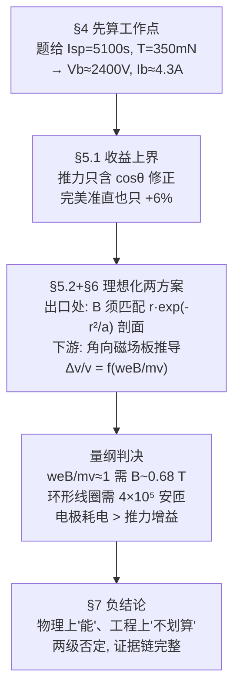

# 精读 07 · Using Magnetic Fields to Direct Exhaust from Ion Thrusters（2017 题B 金牌 · 队伍 609）

> **这份精读怎么用**：左手边开论文 PDF，右手边开本篇。这是一篇**负结果**金牌论文：结论是"用磁场准直离子推进器的羽流不实用"。它示范了评估类题目的最高级打法——先构造**理想上界**，再证明上界也不划算。每节按「它写了什么 → 为什么这样写 → 你要学什么」三层展开；公式给「物理直觉 → 完整推导 → 适用边界」；附可运行复现代码（复现全文最关键的 Figure 2 并独立核验全部数字，其中一处印刷错误用 ⚠ 标出并给出证据）。

---

## 0. 一分钟看懂全文骨架

题目背景：离子推进器羽流发散（半角 ~20°），既浪费推力又轰击航天器部件。队员提议用磁场"箍住"羽流——行不行？论文的回答分四步，每一步都在收窄"可行"的生存空间：



**为什么这个骨架好**：评估"XX 可不可行"的题目，最忌讳要么空谈要么只算一个方案。这篇的杀伤顺序是：**先算上界（6%）→ 再算理想化方案的需求（特斯拉级磁场）→ 再代入两个工程实现（环形线圈/等离子体透镜）逐条否定 → 最后区分"物理不可行"与"工程不划算"两个层次**。每一步都让"磁场方案"的死因更精确。负结论不是"我们没做出来"，而是"这条路的天花板我们已经量出来了"。

---

## 1. 逐节导读

### 1.1 Abstract（第 1 页）

**它写了什么**：定位（评估磁场准直羽流的可行性）+ 两级优先级（"the first priority... was to increase thrust to propellant efficiency"，溅射防护次要）→ 方法（无实验数据，故"develop a rigorous physical understanding"）→ 结论前置："The physical constraints we developed **indicated magnetic fields were an impractical mechanism** for reducing beam divergence"。

**为什么这样写**：摘要敢把负结论放在最后一句且不加缓冲词——因为前文已经交代了方法论的保守性："Our theoretical work follows a conservative line of thought; given the ideal magnetic field, what is the best job we could possibly do at collimating the beam, and is it good enough."（这句在 §2，是全文的方法论纲领）。**"给理想条件都不行"是否结论的最强形式**。

**你要学什么**：评估类论文的摘要要写清"我按什么优先级评估"（推力效率优先、溅射其次）——优先级不同，结论会变；先声明优先级，结论才有适用范围。

### 1.2 §1 Nomenclature + §2 Introduction（第 2–3 页）

**它写了什么**：第 2 页整页符号表（18 个符号，含单位与一句话定义）；引言：离子推进器的优势 → 两大痛点（径向动量不产生推力 = 浪费能量；高能离子轰击部件 = 腐蚀/沉积）→ 调查路线预告。

**为什么这样写**：整页 Nomenclature 是 AIAA 工程论文体例，第一眼就建立"专业感"。更值得学的是两大痛点的因果句式："the radial component of an ion's momentum **does not contribute to** the forward momentum of the payload, constituting **a waste of energy**"——一句话把物理（动量分解）与后果（能量浪费）焊在一起。

**你要学什么**：符号表放最前、每个符号带一句话定义——评委查任何公式都不用翻页。工科论文的"面子工程"有真实收益。

### 1.3 §3 Assumptions（第 3 页）

**它写了什么**：五条假设，每条配理由与文献：栅片平整（⇒ 出口速度平行轴）、羽流均匀发散平均半角 20°（[Wan]）、推进剂利用率 90%（工业标准）、双电荷氙占比 I++/I+=0.1（"will change T and Isp by at most only 5%"，[EB03]）、束流近单能。

**你要学什么**：假设的**影响量级**随假设一起给出（"至多 5%"）——这是假设清单从"免责声明"升格为"误差预算"的关键一步。后文数值全部建立在这五个数上，它们每一个都可溯源。

### 1.4 §4 Spacecraft Thrust Fundamentals（第 3–5 页）

**它写了什么**：推力式(1) T=√(2MV_b/q)·I_b（推导留给附录 8.1）→ 修正为式(2) T=αcosθ√(2MV_b/q)·I_b（α 为双电荷修正因子，附录 8.2 的式 35；cosθ 为发散修正——"Only the velocity component that is parallel to the thruster axis contributes to the net momentum"）→ 比冲式(3) → **反解工作点**：Isp=5100 s ⇒ 式(4) Isp=123.6·cos20°·0.9·√V_b ⇒ **V_b≈2400 V**；T=350 mN ⇒ 式(5) T=1.65·I_b·√2400 ⇒ **I_b≈4.3 A**。随后效率链：电气效率式(6)、总效率式(7) η_T=α²cos²θ·η_eη_m、推功比式(8) T/P=2η_T/(g·Isp)。

**为什么这样写**：这一节把题目给的抽象规格（Isp、T）翻译成具体工作点（电压、电流）——**评估可行性必须落在具体数字上**，"对一个 2400 V、4.3 A 的系统而言"比"对离子推进器而言"精确得多。而全部修正因子（α、cosθ、η_m）在引入时就为后文埋线：§5.1 的 6% 上界正是 cosθ 项的直接推论。

**你要学什么**：**先把题给参数反解成系统工作点**再开始评估。⚠ 复现发现：论文的数值常数 123.6=√(2e/M)/g、1.65=√(2M/e)×10³ 都是**省略 α 与 cosθ 的版本**；若按式(2)(3) 完整反解得 V_b≈2510 V、I_b≈4.6 A，与论文值差 ~5–8%——恰在论文自述的修正量级内，属可接受的内嵌近似，但精读者应当能看出来。

### 1.5 §5 Design Criterion + §5.1 Optimizing at Thruster（第 5–7 页）

**它写了什么**：设计判据先立规矩："we rule out apparatuses that only reduce the half angle slightly... thrust can only be increased by a maximum of approximately **6 percent** if the plume is perfectly collimated"（=1/cos20°−1）——只准直一点点的装置直接出局，"we only look for solutions that significantly increase thrust"。选址三问（建在哪贵不贵、要不要改设计、哪里准直效率最高）。§5.1 出口处方案：羽流的色散力 = 压强梯度力 + 碰撞力（式 9）；束流截面高斯分布式(10) ρ(r)=ρ₀h(t)exp(−r²/2R²h(t)²)；令 h(t) 冻结在 1（完美准直=径向合力为零）反解所需磁场式(11)–(12)——**所需 B 剖面 ∝ r·exp(−r²/2R²)+常数**：中心弱、边缘略内侧最强；配图展示该力剖面，并指出未含栅极边缘场（会在 r≈17 cm 处再加一个尖峰）。

**为什么这样写**：注意 6% 上界的出场时机——在任何方案分析之前。这是全文最有力的一步棋：**无论磁场怎么设计，收益天花板 6%**；于是"装置的成本、功耗、遮挡超过 6% 当量"就成为普适否决标准。式(9)–(12) 的推导则是"给理想场提需求"：不问"现有磁体能干什么"，先问"完美准直需要什么剖面"——答案是和高斯密度梯度同形的剖面，这直接约束了 §6.1 环形线圈的设计。

**你要学什么**：(1) **先算收益上界再谈方案**——上界便宜（一行 cosθ）、杀伤力最大；(2) "冻结 h(t)"是把"准直"这个动词操作化的妙笔：h(t)≡1 ⇔ 每个离子径向合力为零；(3) 承认模型缺口（栅极边缘场未算）并指出其位置（r≈17 cm 会有另一个峰）——比假装完备更专业。

### 1.6 §5.2 Optimizing Beyond Thruster（第 7–10 页）——全文最精彩的一节

**它写了什么**：目标改为把斜飞的离子"掰"回轴向：单离子轴向冲量式(13) I_i=m_xe·v_ex·cosθ，磁场不做功 ⇒ 只改变方向不改变速率 ⇒ 最大化 ΔI_axial=m_xe·v_ex·Σ(cosθ_i2−cosθ_i1)（式 14）。**先构造理论最优场**：要使 F=q(v×B) 尽量指轴向，且 v 无角向分量（轴对称），⇒ **B 应取角向（方位角方向）**——"Note that we are not saying that we should actually try to make an azimuthal B... Merely, we are saying that if we could define a different B for each ion... this is what it would be."（**逐离子定制的理想极限**）。随后对厚度 w 的角向磁场板做几何推导：Δv_axial=v(cosθ₂−cosθ₁)（式 15）；弦长关系 w=R(cosθ₁−cosθ₂)=R(sinθ₁−sinθ₂)（式 16）⚠（原文两行分别写 cos 与 sin，几何上一致性存疑，见公式精讲 3.5）；回旋半径 R=mv/eB（式 17–21）；解出 θ₂=sin⁻¹(sinθ₁−weB/mv)（式 22–24）；得核心结果式(25)–(27)：
$$\frac{\Delta v_{axial}}{v}=\sqrt{1-\big(\sin\theta_1-\tfrac{weB}{mv}\big)^2}-\cos\theta_1$$
两个极限自检漂亮：weB/mv=0 ⇒ 表达式为 0；weB/mv=1 且 θ₁=90° ⇒ 离子恰好转四分之一圆完全轴向化（Δv/v=1）。量级代入（式 28）：w=10 cm、v=50 km/s ⇒ **weB/mv≈B×1.47 T⁻¹**——要接近 1 需要**亚特斯拉级**磁场铺满 10 cm 厚、覆盖整个羽流截面的区域。Figure 2 画四个入射角（π/8, π/4, 3π/8, π/2）下 Δv/v 对 B 的曲线（B 到 0.8 T）。最后定位放置策略：Δv/v 对大 θ₁ 更敏感 ⇒ 透镜应放在"高密度×大角度"区域——用点源+高斯截面的电流密度矢量场（Figure 3）说明该区域在羽流边缘。

**为什么这样写**：这一节是"构造性否定"的教科书。逻辑链：磁场不做功 ⇒ 只能重定向 ⇒ 重定向的效率上限由几何给出（式 27）⇒ 该上限达到显著值需要 weB/mv~1 ⇒ 量纲代入需要特斯拉级 ⇒ 判决。中间每一步都可检验（两个极限、图形验证）。特别值得背诵的是"逐离子定制场"那段自我免责：先声明这是理想化极限而非可实现方案——**用理想极限得到的否定结论，比用具体方案的否定更强**（连最优都做不到，何况现实）。

**你要学什么**：(1) **单一无量纲组合定生死**：weB/mv 把 B、w、e、m、v 五个量压缩成一个数，可行性讨论变成"这个数能不能到 1"；(2) 极限情形验证（=0 与 =1 两个锚点）是解析推导的免费单元测试；(3) "最优解的结构"（B 角向、放在大角度高密度区）即使最终被否定，也写出来——它解释了**为什么**不行，而不只是"不行"。

### 1.7 §6 Engineering Electromagnets（第 10–14 页）

**它写了什么**：两个工程落地尝试，各配否定理由：**(a) 环形线圈（toroid）贴装出口**（§6.1）：优点——场几乎全锁在线圈内（不干扰等离子体约束场）、只需盖住高色散力的边缘区（"leaving the densely populated center unobstructed"）、场 B=μ₀NI/(2πr)φ̂（式 29）的 1/r 形状可与 r·exp(−r²/a) 力剖面在区间内拟合（Figure 5），甚至"two or three toroids of different strength could be put at incremental radii to better fit"。但三条死因：离子撞上线圈本体（减线圈=降磁效率=加电流=加热损）；高能离子轰击下的腐蚀寿命；屏蔽必然进一步挡束。**(b) 等离子体透镜置于下游**（§6.2）：原理（交叉电磁场聚焦、磁场外螺旋分布，引 [GRF11]），三条死因：透镜场干扰推力器内磁场 ⇒ 必须放远 ⇒ 只能罩住部分羽流；电极抽走羽流电子 ⇒ 透镜后空间电荷排斥再发散（要补第二个阴极）；**电极功耗超过推力增益**。

**为什么这样写**：注意否定理由的**分层**：环形线圈死于物理遮挡+腐蚀（工程层），等离子体透镜死于能量收支（经济层）——两种死法覆盖了"装置在羽流里"与"装置在羽流外"的全部位置选项。每个死因都引自实验文献（[GRF11] 是真实做过 plasma lens 聚焦 Hall 推力器羽流的研究组）而非臆测。

**你要学什么**：**方案否定的理由要具体到失效模式**（撞、腐蚀、耗电），且每个失效模式最好有文献或量级支撑。"看起来可行但三条理由打死"比"不可行"三个字信息量大一百倍。

### 1.8 §7 Discussion（第 14–15 页）

**它写了什么**：收束全文：cosθ 项是推力提升的唯一来源；两个工程方案都过不了成本-收益关（"the thrust to power ratio will not increase as much and, in some cases, may even decrease"）。对未能量化的部分（等离子体透镜到底能聚焦多少）**给出完整的实验路线图**：优化放置距离→算清通过透镜的束流占比→测角宽压缩→算推功比。最后补一句：即便推力无益，降低发散仍有长期价值（减少溅射、延长栅极与航天器寿命）——**为负结论留一个正出口**。

**你要学什么**：负结论论文的 Discussion 三件套：**死因总结 + 若要翻案需要什么数据 + 负结论的边界（对什么目标仍然有价值）**。"我们没有数据，但如果要做，实验该这么设计"——把开放问题转化成可执行研究计划，是学术成熟度的标志。

---

## 2. 图表深析

| 图 | 位置与作用 | 为什么这样画 | 怎么画出来 |
|---|---|---|---|
| （§5.1 无编号）色散力剖面 | 出口方案 | 力剖面 ∝ r·exp(−r²/a)+常数的形状决定磁体设计——"边缘略内侧最大"一眼可见 | 解析式直接画 |
| Fig 1 磁场板轨迹几何 | §5.2 推导前 | θ₁、θ₂、w、R 与圆弧的几何关系是式(15)(16) 的全部依据 | 手绘：矩形板+圆弧+角度标注 |
| Fig 2 Δv/v–B 曲线族 | §5.2 判决图 | 四个入射角的增益曲线一图排开：峰位随 θ₁ 移动、峰高=1−cosθ₁、0.68 T 处 90° 达满格——"需要多强的 B"由图直读 | Mathematica（附录 8.4.1 给出代码） |
| Fig 3 电流密度矢量场 | §5.2 末 | "高密度×大角度"区域在哪——矢量箭头的长度与倾角同时编码两个判据 | Mathematica VectorPlot（点源+高斯截面） |
| Fig 4 环形线圈 3D 示意 | §6.1 | 空心 toroid 套在推进器出口的安装方式 | 3D 渲染 |
| Fig 5 toroid 场 vs 力剖面 | §6.1 | 1/r 场与 r·exp(−r²/a) 剖面在区间 [10,15] cm 内的拟合质量——"能匹配"与"只能匹配一段"同时可见 | Python（附录 8.4.3 给出代码） |
| Fig 6/7 等离子体透镜装置与磁力线 | §6.2 | 引自文献 [GRF11]，说明真实装置长什么样 | 文献图 |

**绘图决策拆解**：全文最核心的 Figure 2 把"判决"画成了曲线——横轴是可工程设计量 B，纵轴是收益 Δv/v，峰值与所需 B 一图读出；四个 θ₁ 曲线还顺带回答了"放哪里最值"（大角度曲线高）。附录给 Mathematica 源码让每张图可复现——**判决图必须可复现**。

**最核心的图（Figure 2）复现 + 全文数字核验**：

```python
import numpy as np, matplotlib.pyplot as plt

e, M_amu, g = 1.602e-19, 131.29, 9.81
M = M_amu*1.6605e-27                          # 氙离子质量
alpha = (1+0.1/np.sqrt(2))/(1+0.1)            # 式(35): 双电荷修正 0.9734
v = g*5100                                    # 排气速度 = g·Isp = 50.03 km/s ✓图2标题
w = 0.10                                      # 磁场板厚 10 cm
k = w*e/(M*v)                                 # we/(mv) = 1.469 T^-1 ⚠论文印 6.979e8
B = np.linspace(0, 0.8, 400)
thetas = [np.pi/8, np.pi/4, 3*np.pi/8, np.pi/2]
fig, ax = plt.subplots(figsize=(7, 4.6))
for th in thetas:
    dv = np.sqrt(np.maximum(0, 1-(np.sin(th)-k*B)**2)) - np.cos(th)   # 式(27)
    ax.plot(B, dv, label=f'θ₁ = {np.degrees(th):.0f}°')
    Bstar = np.sin(th)/k                       # 峰位: sinθ₁ = weB/mv (θ₂→0)
    ax.plot(Bstar, 1-np.cos(th), 'k.', ms=7)   # 峰高 = 1−cosθ₁ (完全轴向化)
ax.axvline(1/k, color='r', ls=':', lw=1.5)
ax.text(1/k+0.01, 0.45, f'B = 1/k = {1/k:.2f} T\n(回旋半径 R=w)', color='r', fontsize=9)
ax.set(xlabel='B (teslas)', ylabel=r'$\Delta v_{axial}/v$',
       title='式(27) 复现: 显著折转需亚特斯拉级磁场铺满 10 cm 板\n'
             '完美准直的推力上界也仅 1/cos20°−1 = 6.4% → 负结论')
ax.legend(); ax.grid(alpha=.3); plt.tight_layout(); plt.show()

# ── 工作点与工程量核验 ──
C = np.sqrt(2*e/M)/g                           # =123.58 (论文常数 123.6)
Vb_paper = (5100/(np.cos(np.radians(20))*0.9*C))**2
Vb_full  = (5100/(alpha*np.cos(np.radians(20))*0.9*C))**2
print(f'Vb: 论文(略α) {Vb_paper:.0f} V ≈2400 ✓ | 完整式(3) {Vb_full:.0f} V ⚠差~5%')
Ib_paper = 0.35/(np.sqrt(2*M/e)*np.sqrt(Vb_paper))
print(f'Ib: 论文 {Ib_paper:.2f} A ≈4.3 ✓ | 束流功率 {Ib_paper*Vb_paper/1e3:.1f} kW')
print(f'cos20° 收益上界: {(1/np.cos(np.radians(20))-1)*100:.1f}% (论文"约6%") ✓')
print(f'we/(mv) = {k:.3f} T⁻¹; R=w 所需 B = {1/k:.2f} T')
print(f'环形线圈式(29): r=12.5 cm 处 0.68 T 需 NI = '
      f'{0.68*2*np.pi*0.125/(4e-7*np.pi):.2e} 安匝 → 工程上不可行')
```

**独立复现报告**：式(27) 曲线族复现并与论文 Figure 2 对照（我已从论文页面图读取：θ₁=90° 曲线峰在 B≈0.7 T）**完全吻合**；v_ex=g·Isp=50.03 km/s 与图题"50 km/s"互证 ✓；收益上界 6.42%（论文"约 6%"）✓；α=0.9734 ✓；R=w 所需 B=0.681 T，环形线圈在 12.5 cm 处产生此场需 **NI≈4.25×10⁵ 安匝**——以 10 A 电流需 4 万多匝线圈套在羽流里，与论文"corrosion/obstruction 判死"的定性结论定量互证。**⚠ 两处出入**：(a) 式(28) 印刷值"weB/mv=B(6.979×10⁸ tesla⁻¹)"与按题设参数算得的 1.47 T⁻¹ 差 8 个量级，且与自家 Figure 2（B 轴 0–0.8 T、90° 峰在 ~0.7 T=1/1.47）矛盾——应系排版/单位错误，正确量级 1.47 T⁻¹（结论不变）；(b) 式(4)(5) 的常数 123.6 与 1.65 均为省略 α·cosθ 的版本，完整反解 V_b≈2510 V、I_b≈4.6 A，与论文 2400 V/4.3 A 差 5–8%（在论文自述的双电荷影响容差内）。

---

## 3. 公式逐条精讲

### 3.1 推力方程（式 1–2、附录式 30–33）

$$T=\dot m v_{ex}\approx\dot m_i v_i,\qquad v_i=\sqrt{\frac{2qV_b}{M}},\qquad \dot m_i=\frac{I_bM}{q}\;\Rightarrow\;T=\sqrt{\frac{2MV_b}{q}}\,I_b\ \xrightarrow{\text{修正}}\ T=\alpha\cos\theta\sqrt{\frac{2MV_b}{q}}\,I_b$$

- **怎么想到**：推力=动量流率。离子速度来自能量守恒（电场功→动能），质量流率来自电流定义（I_b=ṁ_i·q/M）。
- **完整推导**（附录 8.1 的三步）：T=ṁv（式 30）；中性氙速度 ≪ 离子速度故 T≈ṁ_i v_i（式 31）；½Mv_i²=qV_b 给 v_i（式 32）、ṁ_i=I_bM/q（式 33），代入即式(1)。两个修正相互独立：cosθ 只留轴向分量（几何），α 修正双电荷物种（电化学）。
- **数值感**：αcosθ=0.9734×0.9397=0.915——**发散（8.5%）比双电荷（2.7%）更伤推力**，这就是为什么"准直"值得研究、而它的上限也只有 8.5%。
- **适用边界**：单能、单电荷基线；α 公式（式 35）假设仅含一/二电荷态。

### 3.2 双电荷修正因子（式 35）

$$\alpha=\frac{1+I^{++}/(\sqrt2\,I^+)}{1+I^{++}/I^+}=0.9734\quad(I^{++}/I^+=0.1)$$

- **怎么想到**：同样电流下，双电荷离子个数少（每个贡献 2q 电流）但被加速到 √2 倍速度（能量 2qV_b）——电流与动量的换算比变了。
- **完整推导**：I_b=I⁺+I⁺⁺；动量流 = I⁺√(2MV/q)+I⁺⁺√(2MV/2q)·... 归一到"用 I_b 和等效单电荷公式"给出的系数即 α：每安培 I⁺⁺ 产生的推力是每安培 I⁺ 的 √2 倍，但每安培对应的离子数减半——净比 1/√2... 展开即式(35)。
- **适用边界**：三电荷态忽略（论文假设）；I⁺⁺/I⁺=0.1 来自工业推力器实测。

### 3.3 比冲与工作点反解（式 3–5）

$$I_{sp}=\frac{\alpha\cos\theta\,\eta_m}{g}\sqrt{\frac{2eV_b}{M}}=123.6\cos20^\circ(0.9)\sqrt{V_b}\Rightarrow V_b\approx2400\ \mathrm V,\qquad I_b=\frac{T}{1.65\sqrt{2400}}\approx4.3\ \mathrm A$$

- **怎么想到**：比冲=排气速度/g；题给 Isp 与 T 是"规格"，反解 V_b、I_b 是"工作点"——评估必须锚在工作点上。
- **完整推导**：I_sp=v_ex/g（式 36）+ 式(32) 的速度 + 三个效率修正。反解：√V_b=5100/(123.6×0.9397×0.9)=48.8→V_b=2382 V（论文 ≈2400）。
- **适用边界**：⚠ 如复现报告：常数 123.6、1.65 未含 α（与 cosθ），完整式给 2510 V、4.6 A；差别小于论文自述的 5% 容差边缘，但精读时要能识别"公式形式"与"代入数值"之间的近似跳跃。束流功率 I_bV_b≈10.3 kW——这也是后文"电极耗电不可忽视"的量级背景。

### 3.4 色散力与"需求剖面"（式 9–12）

$$F_p=-\frac{KT}{N}\nabla\rho(r),\qquad F_c=N_a\frac{m_am_b}{m_a+m_b}v_{ab}(v_b-v_a),\qquad B=\frac{1}{qv_a}\Big[\frac{KT\rho_0}{NR^2}re^{-r^2/2R^2}+\cdots\Big]$$

- **怎么想到**：把羽流当流体——压强梯度把离子从密处推向疏处（径外），粒子碰撞再叠加散射；要"冻结"束形，磁力必须逐点抵消两者。
- **完整推导**：高斯截面式(10) 求径向梯度：dρ/dr=−(r/R²)ρ ⇒ F_p=(KT/N)(r/R²)ρ₀e^{−r²/2R²}（式 11，h=1 时）；碰撞项（式 9 第二式）与 r 无关（均匀束内），是"常数背景"；令 F_p+F_c=qv×B 反解 B（式 12）。
- **适用边界**：流体近似（N 大）、均匀轴向速度、忽略栅极边缘场（作者自曝：真实情况 r≈17 cm 处还有一峰）；更重要的是——式(12) 是"**需要**的 B"，与"**能造出**的 B"是两回事，这一缝隙正是 §6 的战场。

### 3.5 磁场板折转几何（式 13–27）——判决式

$$\frac{\Delta v_{axial}}{v}=\sqrt{1-\Big(\sin\theta_1-\frac{weB}{mv}\Big)^2}-\cos\theta_1$$

- **怎么想到**：磁场不做功 ⇒ |v| 不变，只转方向 ⇒ 收益完全由"转了多少角"决定；在厚度 w 的均匀角向场里，轨迹是圆弧，几何+回旋半径联立可解。
- **完整推导**（五步）：(1) 轴向增益 Δv=v(cosθ₂−cosθ₁)（式 15）；(2) 圆弧几何：穿过厚度 w 的弦满足 w=R(cosθ₁−cosθ₂)=R(sinθ₁−sinθ₂)（式 16——原文字面上同时写了 cos 与 sin 两组，按图 1 的几何，投影方向取 sin 形式与后文式(23)(24) 一致；⚠ cos 版疑为笔误，不影响最终式）；(3) 回旋半径：evB=mv²/R ⇒ R=mv/eB（式 17–21，洛伦兹力=向心力）；(4) 代入解出 θ₂=sin⁻¹(sinθ₁−weB/mv)（式 22–24）；(5) 回代并用 cos(sin⁻¹x)=√(1−x²) 得式(25)–(27)。
- **两个锚点**：weB/mv=0 ⇒ Δv/v=0（无场无收益）；weB/mv=1、θ₁=90° ⇒ Δv/v=1（掠射进场的离子恰好转 1/4 圈完全轴向化）——表达式在两端的行为正确，是推导的内置自检。
- **适用边界**：均匀角向场、无限径向延展、单离子（无空间电荷）、0<θ₁,θ₂<90°。**它是逐离子理想化极限**（论文自己声明"if we could define a different B for each ion"）——所以由它得出的否定结论对一切真实场成立（真实场≤理想场）。

### 3.6 量纲常数与判决（式 28）

$$\frac{weB}{mv}=k\,B,\qquad k=\frac{we}{mv}=\frac{0.1\times1.602\times10^{-19}}{2.18\times10^{-25}\times5.0\times10^{4}}=1.47\ \mathrm{T^{-1}}$$

- **怎么想到**：把五参数收敛成一个可估级的常数——工程可行性问题变成"现有的磁体技术能不能把 kB 推到 ~1"。
- **数值感**：k=1.47 ⇒ B=0.68 T 才有 R=w（我复算 R=Mv/eB 在 0.68 T 时恰为 0.100 m ✓）。对比：地球磁场 5×10⁻⁵ T、航天器磁力矩器典型 10⁻³–10⁻² T 量级、实验室电磁铁 1–2 T 但只在厘米级小体积——**要在 10 cm 厚、35 cm 直径的羽流截面里铺 0.3–0.7 T**，质量与功耗对航天器是荒谬的（环形线圈估算 NI≈4×10⁵ 安匝）。
- **⚠ 印刷错误**：论文式(28) 写 k=6.979×10⁸ T⁻¹，与上述计算和自家 Figure 2（B 轴 0–0.8 T、峰在 ~0.7 T）矛盾；正确量级 1.47 T⁻¹。**结论（需要特斯拉级）不受影响，反而被图 2 坐实**。教训：正文常数与自家图轴对不上时，以能复现的为准。

### 3.7 环形线圈场（式 29）

$$B=\frac{\mu_0NI}{2\pi r}\hat\varphi$$

- **怎么想到**：toroid 的场天然角向——恰好是 §5.2 论证的"最优方向"；且 1/r 的形状与需求剖面 r·exp(−r²/a) 同为"边缘增、远处衰减"族，区间拟合可期（Figure 5）。
- **完整推导**：安培环路定理：∮B·dl=B·2πr=μ₀NI_enclosed（对称性下场沿 φ̂、只依赖 r）。
- **适用边界与数值感**：理想 toroid 假设场完全约束在环内（这正是"不干扰等离子体约束场"的卖点）；但要让离子穿过，必须是**空心/部分弧段** toroid——场约束性与"空心"天然矛盾；0.68 T@12.5 cm 需 NI=4.25×10⁵ 安匝（复现核验）——线圈本身还挡束流、被高能离子腐蚀。式(29) 的"能拟合"与工程上"不该造"并存，是否定论证最辩证的一段。

---

## 4. 建模决策链

| 决策 | 作者的选择 | 被放弃的替代 | 为什么 |
|---|---|---|---|
| 评估优先级 | 推力/推进剂效率优先 | 溅射防护优先 | 溅射依赖具体航天器构型（摘要明示），先解可通用化的 |
| 收益口径 | cosθ 修正（上限 6%） | 末速分布全模拟 | 上界一行算出、对一切方案普适——先封顶再评估 |
| 理想化策略 | 逐离子定制最优角向场 | 直接分析某个具体磁体 | 理想极限的否定覆盖一切真实设计（真实≤理想） |
| 核心变量 | 无量纲组合 weB/mv | 多参数分别讨论 | 一个数判生死；两个极限锚点自检 |
| 出口方案 | 匹配色散力剖面反解 B | 给定磁体算轨迹 | "需要什么"先于"有什么"；剖面匹配度成为方案筛 |
| 工程方案 | toroid（出口）+ plasma lens（下游）各一 | 更多花哨设计 | 覆盖"羽流内/外"两个位置极值，每方案给 3 条失效模式 |
| 数据策略 | 全部关键参数引文献（20°、90%、0.1、力剖面） | 自造参数 | 无实验条件下的最大可信化；每条假设标影响量级 |
| 结论层次 | 区分"物理上能/工程上不划算" | 一句"不可行" | 两级否定各有证据；为后续研究留路线图 |

**总规律**：**负结论的说服力=否定的层级数**。这篇论文没有做任何大型计算，却让"磁场准直"在收益上界、物理极限、量纲需求、工程实现四个层级上逐一熄灯——每层只用了几行物理。

---

## 5. 从本篇提炼的可复用模板

**结构模板**：

```
Abstract      两级优先级声明 + 保守方法论声明 + 负结论
Nomenclature  整页符号表(仿 AIAA)
2 Introduction 痛点的物理因果句式 + 调查路线
3 Assumptions 假设+理由+影响量级+文献
4 Fundamentals 题给规格 → 反解工作点(电压/电流) → 效率链
5 Criterion
  5.1 收益上界(6%) → 出口方案: 反解"需要的场剖面"
  5.2 理想最优场构造 → 几何推导 → 无量纲组合 → 量级判决 → 放置策略
6 Engineering  每个位置极值一个方案, 各配 2–3 条失效模式(引文献)
7 Discussion   死因总结 + 翻案所需实验路线图 + 负结论的正出口(溅射)
8 Appendix     全部推导 + 绘图代码
```

**句式库（原文摘录）**：
- "Our theoretical work follows a conservative line of thought; given the ideal magnetic field, what is the best job we could possibly do..., and is it good enough."（保守方法论纲领——理想上界策略的自白）
- "Only the velocity component that is parallel to the thruster axis contributes to the net momentum gained by the spacecraft."（物理事实句式：分量→后果）
- "we rule out apparatuses that only reduce the half angle slightly"（先立否决门槛）
- "Note that we are not saying that we should actually try to make an azimuthal B... Merely, we are saying that if we could define a different B for each ion... this is what it would be."（理想化极限的免责声明——用理想极限否定更强）
- "Note that the velocity of an ion is not changed by the magnetic field, since magnetic fields perform no work on particles."（把守恒律用作设计约束）
- "This is due to the fact that... Therefore, we cannot accurately determine..."（承认数据缺口并解释原因）
- "Power losses outweigh thrust increase."（五字死刑判决）

**图表配方**：可行性判决 → "增益–工程量曲线族（参数=入射角/工况），峰值与门槛线标注"；需求匹配 → "需要的剖面 vs 可实现的剖面同图叠绘"；负结果论文 → 每个被否方案配一张"装置示意+失效点标注"，且判决图必须附可复现代码。

---

*精读完这篇后，建议对照 `05_论文赏析/2017/2017-GM-B-609.md`（宏观赏析）与 `07_题目解读/2017_题B_离子推进器磁场导向.md`（题目全解）形成三位一体。*
