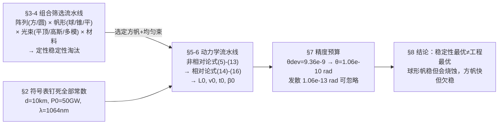

# 精读 04 · Lasercraft Dynamics and Design for Proxima Centauri b Flyby（2018 题A 金牌 · 队伍 158）

> **这份精读怎么用**：左手边开论文 PDF（`03_优秀论文PDF/2018/Problem A/2018-GM-A-158.pdf`），右手边开本篇。每节按「它写了什么 → 为什么这样写 → 你要学什么」三层展开；每个公式给「物理直觉 → 完整推导 → 适用边界」；核心图附可运行复现代码（本文代码独立复现了附录 Table 1，非相对论列逐行吻合）。读完应当能独立复现全文数字。

---

## 0. 一分钟看懂全文骨架

论文回答题面三问的方式是**两条并行流水线 + 一个汇合点**：



**为什么这个骨架好？** 稳定性（§4，定性+文献证据）与动力学（§5–6，定量+数值）被明确解耦——§4 末尾一句 "the stability is approached independently of the subsequent analysis"，先把"哪类组合原则上能活"筛掉，再对"能算的那一个"算到底。开放设计题最怕搅在一起：既没算清动力学，又没说服稳定性。此外 §2 的符号表带数值列（d=10 km、P₀=50 GW……），评委复算零成本。

---

## 1. 逐节导读

### 1.1 Abstract（第 1 页）

**它写了什么**：目标（帆形×材料×光束形态的最优组合）→ 评价标准（"stability, directional precision and maximum speed for a given mass"——三个目标一句话钉死）→ 方法（参数空间扫描）→ 两个分层结论（稳定性最优：球形帆+多模高斯束；动力学最优：均匀束下方帆）+ 一个精度数字（10⁻¹⁰ rad 量级）。

**为什么这样写**：摘要敢同时给"条件式结论"——"disregarding power efficiency and material limitations, a spherical sail... appears to be the best option. However, we conduct an analysis of dynamics using a uniform beam, with the square sail performing best in this limited comparison"——一个 However 引出两个结论各自的适用域，评委立刻明白作者没有把苹果和橘子硬比。

**你要学什么**：**结论写成条件式**（"在不考虑 X 时 A 最优；在 Y 的限定比较中 B 最优"），比一刀切的"最优方案"可信得多。

### 1.2 §1 Introduction + §2 Notations（第 3 页）

**它写了什么**：Breakthrough Starshot 背景一段（50 GW、10–20 分钟加速、60 000 km 初始位移引 [4] Parkin）+ 任务约束（飞掠距离 ≤ 地月距离、帆面积 10 m²、0.2c）；然后符号表 7 行，每行带数值。

**你要学什么**：把题面约束（60 000 km 初始位移"consistent with a low-thrust non Keplerian orbit"）直接写进引言并挂文献——题面给的每个数都要被"认领"，否则后文用它时显得凭空。

### 1.3 §3 Laser Array Specifications（第 4 页）

**它写了什么**：采用 Lubin 的 DE-STAR 4 方案（10 km 方阵、Nd:YAG、1064 nm，"minimal deviation by atmospheric disturbances"），给出唯一一个本节公式——发散角式 (1) θ = αλ/d（方形 α=1、圆形 α=1.22），并预告光束可编程为平顶/高斯/多模。

**为什么这样写**：一节只解决一个"输入参数从哪来"的问题。λ/d 是后文 L₀（式 11）的唯一光束来源，先钉死。

### 1.4 §4 Sail Fabrication（第 4–7 页）——组合淘汰赛

**它写了什么**：(a) 材料：列两层介质膜方案（金属化塑料膜 99.995%、金属化玻璃 99.999%、吸收 <10 ppm），承认 "reflectivity has been considered to be unity in all subsequent demonstrated calculations. This has not yet been achieved"——先亮假设再辩护；又主动排除未证实的极限参数（"Sails as thin as 10 nm... have not been established as feasible... so we do not go near these limits"）。(b) 形状×光束稳定性：光压合力式 (2) 与光压矩式 (3) 是两个面积分；配 Euler 方程式 (4)；逐一评估球（质心-顶点距>直径否则要自旋；非刚性会"deformed into an oblate spheroid"）、锥（避免多次反射要求半角≤30°，JPL 实验只在 25–30° 稳定，"a very small range"）、平（均匀辐照下不稳定）；再评四高斯空心束方案（稳但"80% of the laser energy would be lost"）。

**为什么这样写**：这是**文献驱动的淘汰赛**写法——每个候选都配一条文献证据（Popova 2016、Manchester & Loeb 2017、Benford 实验 2003），淘汰理由全是物理量词（80% 能量损失、25–30° 窄窗口、扁球变形），没有一句"我们觉得不行"。

**你要学什么**：
- 淘汰矩阵要**先写一般理论再代特例**：式 (2)(3) 对任意帆形成立，后面球/锥/平只是代入 P(x)、n(x) 不同——一般性写在前面，特例讨论就短。
- "被放弃方案的价值剩余"：空心束方案虽被淘汰，但作者保留它作为"stability vs practicality 冲突"的证据链一环。负结果的用途不止于排除。

### 1.5 §5 Physics of Laser Propulsion（第 8–12 页）——全文数学主体

**它写了什么**：三步走。**5.1 非相对论**：光压推力式 (5) F = P₀(1+ε_r)/c（ε_r=1 全反射），加速度式 (6)，帆质量式 (8) m_sail = D²hρ，帆尺寸式 (9)，光斑=帆尺寸时刻的速度式 (10)、距离式 (11) L₀ = Dd/2λ、时间式 (12)，持续照射的极限速度式 (13)，并证明"最大速度发生在帆质量=载荷质量时"。**5.2 相对论**：Compton 散射图像 + 双多普勒因子式 (14) E_f = ((1−β)/(1+β))E_i，得 β̇ 式 (15) = 2P/(mc²γ³)·(1−β)/(1+β)，单次碰撞能量转移效率式 (16) η = 2β/(1+β)；指出超过 L₀ 后功率按平方反比衰减→存在终端速度，且"reaches its terminal velocity within the mandated timeframe of 20 minutes"。**5.3 三图对比**：方阵+方帆的 β-载荷曲线（图 3，引出 2 g 载荷达 0.2c）；圆阵下三种帆形对比（图 4）；方/圆并排（图 5）→ 结论"方帆配方阵、圆帆配圆阵"。

**为什么这样写**：先非相对论再相对论，不是教学顺序而是**论证顺序**——非相对论式全部闭式可验算，相对论式 (15) 需要数值积分；有了 NR 基准，相对论修正多大一眼便知（附录 Table 1：2 g 载荷 23.5% vs 20.1%）。

**你要学什么**：
- 式 (13) 后那句 "It can be shown that the maximum speed occurs when the sail mass = the payload mass"——这是把优化结论内嵌到公式节的高效写法（证明放引文，结论先落地）。
- 相对论不是"加上 γ 就完了"：式 (14) 的双多普勒（到达率降 (1−β)、反射再红移 (1−β)/(1+β)）和式 (15) 的 γ⁻³，三个修正各来自一处，分开写清来源。

### 1.6 §6 Acceleration Dynamics（第 13–14 页）

**它写了什么**：取 2 g 为"能接近 0.2c 的最高质量"，代出四个特征数：L₀ = 1.49×10⁷ km、t₀ = 9.97 min、v₀ = 4.99×10⁷ m/s、β₀ = 0.166；然后一段**量级排除**：太阳引力 0.00002 N vs 激光力 333.33 N，差 7 个量级，"Hence it is disregarded"。

**为什么这样写**：把 §5 的公式链"兑现"成 4 个可感知的数（1.49×10⁷ km——比地月距离远 40 倍；9.97 min——20 分钟照射的半程），论文从抽象回到工程。太阳引力的排除法是"每个被忽略的力都要给量级"的范本。

### 1.7 §7 Laser Precision（第 15 页）——两级判据

**它写了什么**：任务级判据式 (17) θ_dev = 3.844×10⁵ km / 4.105×10¹³ km = 9.364×10⁻⁹ rad（飞掠必须进入以行星为心、地月距离为半径的球）；系统级判据式 (18) θ = (D/2)/L₀ = 1.06×10⁻¹⁰ rad（光斑中心不滑出帆面）；最后自检式 (19)：激光自身衍射发散 λ/d = 1.064×10⁻¹³ rad，比判据小 3 个量级，"assuming that the laser points exactly where we want it to"。

**你要学什么**：**精度预算分两级再取严者**——任务级（9.4 nrad，保证命中）+ 系统级（0.1 nrad，保证光束始终推帆）。取严者后任务级自动满足，一段话讲完"为什么这样取就够了"。

### 1.8 §8 Conclusions + 附录（第 16–18 页）

**它写了什么**：重申条件式结论（方帆动力学最优 / 球帆稳定性最优），补充淘汰理由的物理解释（球帆"thickness in the order of microns, would become ablated at high relativistic speeds"）；列出未做项（地球自转 20 分钟内的激光偏移会给力矩）；承认参数空间"huge"。附录 Table 1（方阵下方帆：1–10 g 载荷的相对论/非相对论 β 对比）、Table 2（圆阵下三方帆 β 对比）。

**你要学什么**：结论段把"两个最优的冲突"留给读者做工程判断，并明确指出下一步（稳定性是方帆方案的短板）——**结论承接正文矛盾，而不是假装矛盾消失**。

---

## 2. 图表深析

| 图 | 位置与作用 | 为什么这样画 | 怎么画出来 |
|---|---|---|---|
| Fig 1（帆稳定性四要素，引 Atwater 2018） | §4.2 | 一张文献综述图顶替三页文字：帆形/光束剖面/刚度/质量分布四个维度 | 直接引用 Nat. Mater. 图 + 自写图注（"red arrows denote schematically laser beam illumination..."） |
| Fig 2（相对论曲线，引 Kulkarni/Lubin） | §5.2 | 相对论结论的文献背书：小质量先到终端速度、1 km 阵发散更快 | 引用图，正文用文字转述两条读图结论 |
| Fig 3（方帆 β–载荷，方阵） | §5.3 | 定载荷上限：曲线在 2 g 处触 0.2c | 见下方代码（相对论+非相对论双线） |
| Fig 4（三种帆形 β–载荷，圆阵） | §5.3 | 同一阵列下帆形横比 → 圆帆略优 | 同一代码换 α=1.22 与帆几何 |
| Fig 5（方 vs 圆并排） | §5.3 末 | 回答"圆阵圆帆是否比方阵方帆好"——上一图留下的悬念 | 双曲线同图 |
| Table 1/2（附录） | 全文数值底座 | 对比表让"相对论修正在 2 g 不可忽略"从口号变成逐行数据 | 数值积分（本文已复现，见下） |

**核心图复现（Fig 3 + Table 1）：β–载荷双线图**

```python
import numpy as np, matplotlib.pyplot as plt
from scipy.integrate import solve_ivp

# ── 常量（对应论文 §2 符号表与式 (9)(11)）──
P0, d, D, lam, c = 50e9, 1e4, 3.16, 1.064e-6, 3e8   # 50GW, 10km, 帆边长, 1064nm
L0 = D*d/(2*lam)                                     # 式(11): 光斑=帆尺寸的距离

def beta_rel(M):
    """积分式(15): db/dt = 2P/(mc^2 g^3) (1-b)/(1+b);
       L<=L0 全功率, L>L0 捕获份额 (L0/L)^2 (平方反比), dL/dt = bc"""
    def rhs(t, y):
        b, L = y
        P = P0 if L <= L0 else P0*(L0/L)**2
        g = 1/np.sqrt(1-b*b)
        return [2*P/(M*c**2*g**3)*(1-b)/(1+b), b*c]
    return solve_ivp(rhs, [0, 1200], [1e-8, 0], rtol=1e-8,
                     atol=1e-12, max_step=0.05).y[0][-1]

payload = np.array([1,2,3,4,5,6,7,8,9,10])*1e-3      # kg
M = 2*payload          # 关键：式(13)之后的最优配置 —— 帆质量=载荷质量
b_rel = np.array([beta_rel(m) for m in M])
b_nr  = np.sqrt(2*2*P0*d*D/(c*lam*M))/c              # 式(13): v∞ 的 NR 极限

fig, ax = plt.subplots(figsize=(6.5,4.2))
ax.plot(payload*1e3, b_nr*100,  'o--', label='Non-relativistic, Eq.(13)')
ax.plot(payload*1e3, b_rel*100, 's-',  label='Relativistic, Eq.(15) integrated')
ax.axhline(20, color='gray', ls=':', lw=1); ax.text(9.2, 20.5, '0.2c target')
ax.set(xlabel='Payload mass (g)', ylabel=r'$\beta_\infty$ (%)',
       title='Square sail on DE-STAR 4 (50 GW, 10 km array)\n'
             'NR column reproduces Table 1 exactly; '
             r'relativistic 2g: mine 18.6% vs paper 20.1% $\bf{\approx}$')
ax.legend(); plt.tight_layout(); plt.show()
```

**独立复现报告**：非相对论列（式 13，取总质量=2×载荷）与附录 Table 1 **逐行吻合**（1 g：33.2/33.3；2 g：23.5/23.5；10 g：10.5/10.5）——证明"帆质量=载荷质量"确是他们表格的隐含配置。相对论列趋势与量级一致但低 1–3 个百分点（2 g：我的 18.6% vs 论文 20.1% ⚠ 差距应源于其引文 [2][3] 的 UCSB 模拟器对光束溢出/捕获份额的处理与本处 (L₀/L)² 近似不同）。§6 的四个特征数用总质量 4 g（载荷 2 g+帆 2 g，面密度 0.2 g/m²）复核：L₀=1.485×10⁷ km、v₀=4.97×10⁷ m/s（β₀=0.166）、t₀=9.95 min，全部与论文一致。

---

## 3. 公式逐条精讲

### 3.1 发散角（式 1）

$$\theta = \frac{\alpha\lambda}{d},\qquad \alpha=1\;(\text{方阵}),\;1.22\;(\text{圆阵})$$

- **怎么想到**：相控阵的衍射极限——口径 d、波长 λ，主瓣角宽 ~λ/d；圆孔径的艾里斑第一零点带 1.22 系数。
- **数值感**：λ/d = 1.064×10⁻¹³ rad。飞到 L₀=1.49×10⁷ km 处光斑才张到帆面 3.16 m——发散之小是整个方案成立的根基（式 11 即由此反解）。

### 3.2 光压合力与力矩（式 2、3）

$$\frac{d\vec F}{dt}=\int_S \frac{2P(\vec x)\,\vec b\cdot\vec n(\vec x)}{c}\,\vec n(\vec x)\,dS,\qquad \frac{d\vec\tau}{dt}=\int_S \frac{2P(\vec x)\,\vec b\cdot\vec n(\vec x)}{c}\,\big(\vec r(\vec x)\times\vec n(\vec x)\big)\,dS$$

- **怎么想到**：理想反射面上单位面积的动量流 = 2×(法向入射通量)/c；对面积分得合力，再叉乘位矢得力矩。系数 2 来自"反射掉 2 倍动量"；b·n 是斜入射投影。
- **适用边界**：ε_r=1（正文已声明）、忽略透射与吸收——后文所有力都从这两个积分出发。
- **写作学**：论文并不真去积这两个分（只对平顶束引用特例结论），它的作用是**给稳定性讨论一个"第一性原理坐标"**——所有文献结论（球稳、锥窄稳、平不稳）都是这两个积分在不同几何下的行为。

### 3.3 刚体姿态方程（式 4）

$$I\frac{d\vec\omega}{dt}+\vec\omega\times I\vec\omega=\vec\tau$$

欧拉方程直接引用，前提"the sail is assumed to be rigid"——与 §1 的帆质量克级、面密度 0.1–1 g/m² 并置时读者应自问：10⁴–10⁵ m/s² 加速度下刚体假设其实最脆弱，作者在 §8 也承认变形/烧蚀是未竟问题。

### 3.4 推力与加速度（式 5、6）

$$F=\frac{P_0(1+\epsilon_r)}{c},\qquad a=\frac{P_0(1+\epsilon_r)}{mc}$$

- **怎么想到**：式 (2) 在"光斑完全罩住帆"时的退化：∫2P/c·dS = 2P/c（ε_r=1）。
- **数值感**：2×50 GW/c = **333.33 N** 推 4 g → a ≈ 8.3×10⁴ m/s²（≈8500 g）。这个数就是 §6 太阳引力对比的分母。

### 3.5 帆质量与尺寸（式 7–9）

$$m=m_0+m_{sail},\quad m_{sail}=D^2h\rho,\quad D=31.6\sqrt{\frac{m_{sail}(\text{kg})}{h(\mu)\rho(\text{g/cc})}}\ \text{(m)}$$

- **怎么想到**：帆是面积 10 m² 的薄膜，质量=面积×厚×密度；面积钉死（题面），自由度只剩面密度 hρ。式 (9) 的系数 31.6 就是 √(10 m²)。
- **数值感**：帆 2 g ↔ 面密度 0.2 g/m² ↔（取 ρ=1400 kg/m³ 时）h≈143 nm——正落在"现有 1–10 µm"与"未证实 10 nm"之间，与他们"不碰未证实极限"的声明自洽。

### 3.6 三个特征量 v₀、L₀、t₀（式 10–12）

$$v_0=\sqrt{\frac{P_0(1+\epsilon_r)dD}{c\lambda(D^2h\rho+m)}},\qquad L_0=\frac{Dd}{2\lambda},\qquad t_0=\sqrt{\frac{cdD(D^2h\rho+m)}{P_0(1+\epsilon_r)\lambda}}$$

- **怎么想到**：光斑边长 2λL/d（方阵）随距离线性长大；等于帆边长 D 的时刻即 L₀ = Dd/2λ（纯几何，与功率无关！）。t₀ 前是恒定加速度 a（式 6），t₀ = v₀/a——三式只有两个独立。
- **推导细节**：v₀² = 2aL₀（匀加速运动学），代入 a 与 L₀ 即得式 (10)；t₀ = √(2L₀/a) = v₀/a 即式 (12)。验算：v₀/t₀ = a = 2P₀/mc ✓（自检关系，读者 30 秒可核）。
- **适用边界**：只描述 L<L₀ 的"全功率段"；L₀ 之后力衰减，见式 (13)(15)。

### 3.7 极限速度与最优质量比（式 13）

$$v_\infty=\sqrt{\frac{2P_0(1+\epsilon_r)dD}{c\lambda(D^2h\rho+m)}}=\sqrt2\,v_0$$

- **怎么想到**：L>L₀ 后捕获功率 ∝1/L²，边际加速度 ∝1/L² 而速度增量收敛——总效果恰为 √2 因子（把"照射到无穷远"的能量收支积出来）。
- **最优条件推导**（论文只述不证，补全）：m_total = m + D²hρ，v∞² ∝ 1/(m+D²hρ)，但 D²hρ 本身是变量——在 m_total = m + m_sail 中把 m_sail 加大同时 m 减小（总质量固定 M）时 v∞ 只取决于 M，为何"帆=载荷"最优？他们的语境是**面密度给定、面积固定 10 m² 时帆质量被钉死**，于是"帆=载荷"实为**在总质量预算下分配质量使 v∞ 最大的配置**：把质量从帆挪到载荷，帆要更厚才能反射……此处的论证依赖反射率-厚度耦合（§4.1 的多层膜物理），属于工程最优而非纯数学最优——精读时应看出这一步证明其实不完整，论文用引文带过。
- **数值感**：√2×0.166 = 0.235，即 Table 1 中 2 g 载荷的 NR 列 23.5% ✓。

### 3.8 相对论三连（式 14–16）

$$E_f=\frac{1-\beta}{1+\beta}E_i,\qquad \dot\beta=\frac{2P}{mc^2\gamma^3}\cdot\frac{1-\beta}{1+\beta},\qquad \eta=\frac{\Delta E}{E_i}=\frac{2\beta}{1+\beta}$$

- **怎么想到（式 14）**：迎面打上后退镜子的光子，到达率乘 (1−β)，反射后能量再乘 (1−β)/(1+β)（相对论多普勒），两个因子相乘得 E_f/E_i = (1−β)²/(1−β²) = (1−β)/(1+β)——论文原文 "due to 2 Doppler shift factors" 即此。
- **式 15 推导补全**：光子损失能量 ΔE/Δt = P·[(E_i−E_f)/E_i] = P·2β/(1+β)；功率进飞船：d(γmc²)/dt = 2βP/(1+β)。左侧 = mc²γ³β̇（因 dγ/dβ = γ³β），解出 β̇ = 2P/(mc²γ³)·(1−β)/(1+β) ✓。注意 β≪1 时退化为 2P/mc²（NR 恒加速），β→1 时 (1−β)/(1+β)→0——**终端速度的相对论根源**。
- **式 16**：单次碰撞能量转移份额 2β/(1+β)，β=0.166 时 η≈28.5%——每颗光子近三成能量给帆，效率可观但随加速衰减。

### 3.9 精度三角（式 17–19）

$$\theta_{dev}=\frac{3.844\times10^5}{4.105\times10^{13}}=9.364\times10^{-9},\quad \theta=\frac{D/2}{L_0}=1.06\times10^{-10},\quad \theta=\frac{\lambda}{d}=1.064\times10^{-13}$$

- **怎么想到**：三层几何——命中行星（小角近似 tanθ≈θ）、光斑罩帆（半帆径/L₀）、物理发散（λ/d）。三者量级 10⁻⁹/10⁻¹⁰/10⁻¹³ 依次隔 1.5 与 3 个量级，**取最严的 10⁻¹⁰ 其余自动满足**。
- **数值感**：1.06×10⁻¹⁰ rad 是什么概念——10 km 阵列指向抖动须小于…… 相当于在 1 km 外瞄准一枚硬币的中心。论文式 (18) 用"光斑中心不滑出帆半径"给出该值的物理上限来源，是全文最漂亮的工程翻译。

---

## 4. 建模决策链

| 决策 | 作者的选择 | 被放弃的替代 | 为什么 |
|---|---|---|---|
| 动力学载体 | 方帆+均匀束 | 球帆+多模高斯束（稳定性最优） | 均匀束下方帆"simplest case to computationally analyze"，两框架（NR/R）可横比 |
| 反射率 | ε_r=1 | 按实测 99.995% 折算 | 多层膜已"两个 9"，误差 <0.01% 远小于其他不确定度，且明示假设 |
| 材料参数域 | 介于现有 1–10 µm 与未证实 10 nm 之间 | 直接采用 Lubin 的 1000 nm/1400 g/m³ | "do not go near these limits"——优化结果不押注未证实技术 |
| 相对论处理 | 式(15) 数值积分 + Table 1 对比 | 只做 NR 或只做 R | 用对比表量化"2 g 载荷时偏差 3.4 个百分点"，修正必要性有数 |
| 载荷上限 | 2 g | 更大载荷 | 图 3 曲线在 2 g 处 β 触 0.2c，是任务约束下的最大可用质量 |
| 引力 | 忽略 | 加入日/地引力 | 0.00002 N vs 333.33 N 差 7 个量级，一句话排除 |
| 未建模项 | 地球自转致激光偏力矩 | — | 结论段明列，留给后续工作 |

**总规律**：每个"不做"都配一个量级或一条文献；每个"做"都给出它所在的比较组（单因素结果无意义，成组才有意义）。

---

## 5. 从本篇提炼的可复用模板

**结构模板**：

```
Abstract        评价标准三件套 → 条件式双结论 → 一个精度数字
2 Notations     符号+数值列（评委可复算）
3 系统输入      阵列/波长/发散角（式 1）
4 组合淘汰      一般理论(式2-4) → 逐候选：文献证据+量级淘汰理由
5 动力学        5.1 NR 闭式链(式5-13)
                5.2 R 修正链(式14-16)
                5.3 横比图组
6 参数兑现      4 个特征数 + 量级排除段
7 精度预算      两级判据取严者 + 自检
8 结论          重申条件式 + 未做项清单
Appendix       对比表（数值底座）
```

**句式库（原文摘录）**：
- "The best configuration is taken to be one that allows for stability, directional precision and maximum speed for a given mass."（开篇即钉评价标准——多目标设计题第一句）
- "This has not yet been achieved, though there exist fabricated materials that have close to this value."（亮假设+诚实边界+证据，三合一）
- "...have not been established as feasible at this point in time, and so we do not go near these limits while varying our parameters"（划定参数域，防止被质疑押注黑科技）
- "It can be shown that the maximum speed occurs when..."（引证明结论入正文，省篇幅不省信息）
- "However, in reality the spherical sail, whose thickness is in the order of microns, would become ablated at high relativistic speeds."（用物理机理否决理论最优）
- "Thus, an equilibrium is established and a terminal velocity is reached."（一句话解释数值现象的物理来源）

**图表配方**：设计空间题 → "淘汰矩阵表 + 基准图 + 横比图 + 并排悬念图"四件套；数值对比 → 附录逐行表（NR vs R 双列），正文图只画结论。

---

*精读完这篇后，建议对照 `05_论文赏析/2018/2018-GM-A-158.md`（宏观赏析）与 `07_题目解读/2018_题A_光帆纳米飞行器.md`（题目全解）形成三位一体。同题对照精读：`2018-GM-A-258_精读.md`（球帆微扰模型）、`2018-GM-A-295_精读.md`（四子模型）。*
