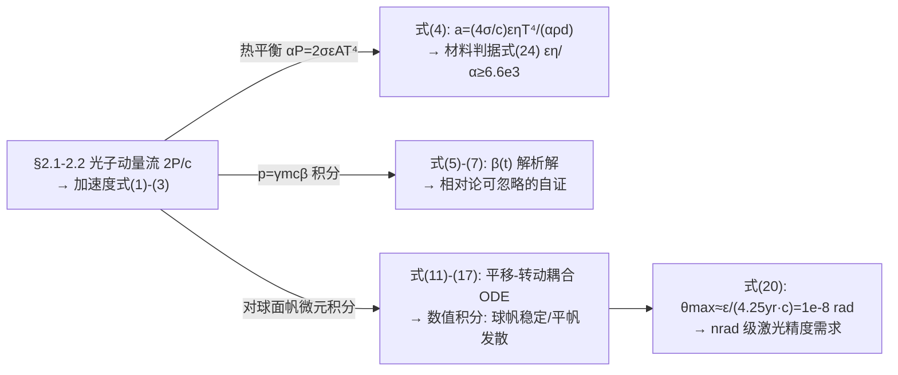

# 精读 05 · Sending a Light Sail Propelled Nanocraft to Alpha Centauri（2018 题A 金牌 · 队伍 258）

> **这份精读怎么用**：左手边开论文 PDF（`03_优秀论文PDF/2018/Problem A/2018-GM-A-258.pdf`），右手边开本篇。这支队伍与 158 队同题，走的是完全不同的路线：**一个刚性球面帆的微扰动力学模型从头贯穿到尾**——材料判据、加速、稳定、瞄准精度全部由同一组方程派生。本篇教程除逐节导读与公式精讲外，还独立复现了其核心稳定性图（Figure 5），并发现正文与附录代码之间的一个单位不一致（见 ⚠）。

---

## 0. 一分钟看懂全文骨架

论文只建**一个模型**，让它回答**所有子问题**：



**为什么这个骨架好？** 与 158 队"组合筛选+分段计算"相反，258 队把全部赌注押在**一个可解析的微扰模型**上：选平顶光束（式 13）换取闭式力/力矩（式 14/15），选球面帆（有限曲率 R）让 R→∞ 自动退化为平帆（式 18/19）——**两个极限行为（R→∞、β→0）各做一次自检**，模型可信度由内而生。评委看到的不是"很多计算"，而是"一个自洽的物理学"。

---

## 1. 逐节导读

### 1.1 Abstract（第 1 页）

**它写了什么**：开门见山四个带量纲的数——材料判据 εη/α ≥ 6.6×10³、角扰动稳定裕度 2×10⁻⁶ rad、最大初始横向扰动 10 µm、瞄准需求 10 nrad——然后一句定位句收尾："the model proposed is conservative, in the sense that it does not allow the laser beam to stabilize the sail."

**为什么这样写**：摘要里全是可核查的数字（每个都对应正文一个式号），最后主动交代模型的保守方向。**把弱点翻转成严谨性卖点**——所有精度要求都是上界，因为光束本身的自稳定能力被刻意弃用。

**你要学什么**：摘要放 3–4 个带单位的数 + 一句"模型定位"（保守/乐观、上界/下界），评委扫一眼即可确认全文完成度与结论方向。

### 1.2 §1 Introduction（第 1–2 页）

**它写了什么**：1.1 Approach 把问题改写成"初值问题"（initial value problem）："Whatever parameters characterize a light sail are analyzed in an attempt to answer the main problem: Is reaching Proxima Centauri b feasible with reasonable accuracy and 10-20 minutes of acceleration time?" 1.2 General assumptions 五条：材料耐热 100 nm 级/0.5 g、完全反射、刚体+刚性连接件、仅受激光辐射（忽略日月地引力）、**平顶束近似**（并自辩："If a smaller width than the FWHM value actually hits the sail, then this is not a bad approximation"）。

**你要学什么**：假设清单编号+每条一句理由，其中平顶束这条最见功力——先承认真实衍射极限束是高斯，再给出"FWHM 以内近似平顶"的适用条件。**假设不是免责声明，是适用域声明。**

### 1.3 §2.1–2.2 光子动量流与加速度（第 1–2 页，式 1–4）——全文最漂亮的一步

**它写了什么**：从 de Broglie p=h/λ 出发推"每秒动量流 P/c"，反射加倍成 2P/c，得加速度式 (1) a=2ηP/mc；拆质量成式 (2)；化成面密度形式式 (3) a=(2P/Ac)·η/(ρd)——**此时加速度只剩材料参数**。然后引入热平衡：吸收功率 αP 必须等于辐射 2σεAT⁴（双面辐射），把 P 消掉，得式 (4) a=(4σ/c)·εηT⁴/(αρd)。

**为什么这样写**：式 (4) 是"物理定律焊接"的典范——加速度的上限不再依赖激光功率，而只依赖材料三参数（发射率 ε、反射率 η、吸收率 α）与工作温度。**题面问 fabrication margin，式 (4) 直接把答案变成可查表的判据**（§3.1 的式 24）。

**你要学什么**：遇到"功率未知/可变"的系统，找一个守恒或平衡关系把功率消掉，让结论只依赖固有属性——这是从"算题"升到"洞察"的最短路径。

### 1.4 §2.3 Relativistic Velocities（第 2 页，式 5–7）

**它写了什么**：p = mcγβ 代入式 (2) 得微分方程式 (5)(6)（文本提取的 (6) 有乱码，按推导应为 dβ/dt = 2Pη/(mc²γ³)，即 (1−β²)^{−3/2} 因子），积出解析解式 (7) t = (mc²/4Pη)[β/√(1−β²) + ½ln((1+β)/(1−β))]（含 artanh 项，对应文献 [4] 的光子到达率修正模型），并声明"this will be the main evidence that a large error is not made by not considering special relativity"。

**为什么这样写**：相对论修正不靠"γ≈1 所以忽略"的口号，而是**先把解析解画出来（Figure 4）**：m=1 g 时 β<0.2 区间曲线与常加速度直线重合 → 后文全部用式 (2) 的合法性由图背书。

### 1.5 §2.4 Light Sailing Dynamics（第 2–4 页，式 8–19）——全文数学核心

**它写了什么**：随动坐标系（Z 沿束流、原点在系统质心——"this choice of Z is important, as it makes the used reference frame a non-inertial RF"）；牛顿方程式 (8)+欧拉方程式 (9)；转动惯量式 (10) I = m_ls L_c² + m_sc(L−L_c)²；光压合力式 (11) 与力矩式 (12)（面积分）；球面法向 n̂=(x/R, y/R, √(R²−x²−y²)/R)；平顶光束式 (13)；**解析积出**横向力式 (14) F_x = −½F_rad(X+L_rθ_y)/R 与力矩式 (15) τ_y = −½F_rad(L_c/R−1)(X+L_rθ_y)；组装成耦合 ODE 式 (16)(17)；取 R→∞ 得平帆方程组式 (18)(19)。

**为什么这样写**：推导策略是"**为可积性选择近似**"——平顶束让 dS 与通量乘积可分离，式 (14) 的积分 ∫₋ₐ⁺ᵃ√(a²−y²)dy = πa²/2（半圆面积）一步到位，闭式的 F_x、τ_y 让耦合 ODE 干净到能手算特征频率。读者可逐行验算——这是数值黑箱永远给不了的可信度。

**你要学什么**：
- **先一般后取极限的自检**：R→∞ 时式 (16) 的恢复项消失、式 (17) 的力矩变正反馈（式 18/19）——**模型极限行为恢复已知结论（平帆不稳定）**，这一段是全文的"合格证"。
- 符号经济学：L（帆-载荷距）、L_c（质心-帆心距）、L_r（边缘-质心距）三个长度各有用途，a²≪R² 时 L_r≈L_c 一步合并——**先分后合，合要有条件**。

### 1.6 §2.5 + §3.4 精度链（第 4、6 页，式 20）

**它写了什么**：Figure 3 的锥形允许轨迹示意 + 式 (20) θ_max ≈ ε/(4.25 yr·c) ≈ 1×10⁻⁸ rad（ε≈400 000 km 地月距离，4.25 光年行程）。§3.4 再把仿真所得角扰动与 10 nrad 需求对接："Simulations show that this could be achieved by reducing the initial perturbations in θ_x by two orders of magnitude"，最终容差定为"x 方向 1–10 µm、θ 方向 nrad 级"。

**你要学什么**：精度论证的闭环 = 任务需求（式 20）→ 系统响应（仿真给出扰动-振幅标度）→ 工程指标（µm/nrad）。中间那步"把初扰动减小两个量级即可达 nrad"用的正是他们仿真的**线性标度**性质——灵敏度本身成了设计工具。

### 1.7 §3 Results（第 4–6 页）

**它写了什么**：3.1 可行性——量纲式的三连算（式 21–23）：每秒动量 5×10¹⁰/c×2 = ⅓×10³ kg·m/s → a = ⅓×10⁶ m/s²（1 g 总质量）→ 600 s 到 2×10⁸ m/s；铝被否（ε=0.06 致 a 仅 1.32 m/s²，"This is unacceptable"）；推出目标加速度 a=0.2c/600s=10⁵ m/s² 与判据式 (24)。3.3 稳定性——平帆数值发散（"the velocities in the x-axis exceed the relativistic limit"，发散本身就是证据）；球帆 R=1000 cm 两组初扰动 → 振幅 2 cm 与 0.2 cm（线性标度）；能量自洽（振荡动能 ⟨T⟩≈600 J、功率 ~7000 W ≪ 50 GW，故 z 轴仍可用式 2 描述）。

**你要学什么**：
- **铝的反例**：不满足判据的具体材料算一个数（1.32 m/s² vs 需求 10⁵ m/s²，差 5 个量级）——判据有了"牙齿"。
- **数值发散的处理礼仪**：平帆仿真超出适用域，作者明说"the derivations made are not valid anymore. Regardless, the simulations still suggest an unstable behavior"——不掩盖代码溢出，反而把它解读为不稳定证据。
- **能耗自洽检验**：横向振荡功率 vs 主束功率的比较，是几乎没人做但一做就加分的便宜检验。

### 1.8 §4 Conclusions（第 7–9 页）

**它写了什么**：4.1 结果复述；4.2 Weaknesses 五条（高斯束会改变稳定性计算、连接件惯量未计、nrad 精度"most likely not achievable"、光束均匀性未计、**尘埃撞击**——引 Lubin：1 g 飞行器的角加速度 ~10⁻⁵ rad/s，不修正则"approximately a complete rotation in just one day"，需星上光子推进器）；Strengths 五条（含"less than half the total power of the laser is needed"的功率裕度）。4.3 Future work 指向光束整形（中心开洞的高斯束 [6] vs 四高斯束球帆 [5]）。

**你要学什么**：弱点段每条都带量化或文献——特别是尘埃撞击那条，从角加速度推到"一天转一圈"，再指出需要星上修正机构、机构又增加质量——**一条完整的因果链比五句"模型有待改进"值钱**。

---

## 2. 图表深析

| 图 | 位置与作用 | 为什么这样画 | 怎么画出来 |
|---|---|---|---|
| Fig 1（纳米飞行器示意，引 [3]） | §2.2 | 定义"帆+芯片+连接件"的物理对象，一张图替代半页文字 | 引用文献图 |
| Fig 2（球帆坐标系示意） | §2.4 | 钉死 R、L、L_c、a、(X,Y,Z) 的几何关系——后文所有公式靠它消歧 | 手绘/TikZ 简图即可 |
| Fig 3（允许轨迹锥） | §2.5 | 把"角精度"画成几何：锥半角 θ_max 内才能命中 | 双点+锥的示意 |
| Fig 4（β–t 曲线，双图） | §3.2 | 上图全时域、下图放大小 β 段——一张图同时显示"常加速区"与"相对论弯曲区" | 式 (7) 逐 m 画线 |
| Fig 5（两组初扰动的 X(t) 振荡） | §3.3.2 | **全文核心证据**：球帆受扰后横向位移有界振荡，振幅随初扰动线性标度 | odeint 积分式 (16)(17)，见下方代码 |

**核心图复现（Figure 5）：球帆横向振荡**

```python
import numpy as np, matplotlib.pyplot as plt
from scipy.integrate import solve_ivp

# ── 常量（对应论文附录 A，CGS 单位制）──
R  = 1000.0            # cm  曲率半径
L  = 2000.0            # cm  帆-载荷间距
m1 = m2 = 0.5          # g   帆质量 = 载荷质量（最优配置）→ Lc = L/2
Lc = 1000.0            # cm
m  = m1 + m2           # g
I  = m1*Lc**2 + m2*(L-Lc)**2      # 式(10): 1e6 g·cm^2
F0 = 1e7               # dyn (=100 N, §3.3 给出的上限力)

def rhs(t, y):         # 式(16)(17), Lr≈Lc, 600 s 后关激光
    x, vx, thy, wy = y
    F = F0 if t <= 600 else 0.0
    return [vx,
            F/m*thy - 0.5*F/m*(x + Lc*thy)/R,
            wy,
            -0.5*F/I*(x + Lc*thy)*(Lc/R - 1)]

t = np.linspace(0, 60, 30000)
fig, axs = plt.subplots(2, 1, figsize=(6.5, 5.5), sharex=True)
for k, (dx, dth) in enumerate([(0.001, 0.001), (0.0001, 0.0001)]):
    # ⚠ 注意: 论文正文写 "θy=0.001 degrees", 但附录代码把 0.001 直接当弧度传入;
    # 只有按弧度解释才能复现 "amplitude of 2 cm"(=R·θy 均衡点附近振荡).
    sol = solve_ivp(rhs, [0, 60], [dx, 0, dth, 0], t_eval=t, rtol=1e-9)
    X = sol.y[0]
    axs[k].plot(t, X, lw=0.8)
    axs[k].axhline(R*dth, color='r', ls=':', lw=1,
                   label=f'equilibrium $X=R\\theta_y$={R*dth:.2f} cm')
    axs[k].set_ylabel('X (cm)'); axs[k].legend(fontsize=8)
    axs[k].set_title(f'$\\delta_x$={dx} cm, $\\theta_y$={dth} rad: '
                     f'max X = {X.max():.3f} cm (paper: {"2" if k==0 else "0.2"} cm)',
                     fontsize=9)
axs[1].set_xlabel('Time (s)')
fig.suptitle('Spherical sail lateral oscillation, Eqs.(16)(17) — '
             'amplitude scales linearly with perturbation', fontsize=10)
plt.tight_layout(); plt.show()
```

**独立复现报告**：按附录参数积分式 (16)(17)，θ_y 以**弧度**传入时最大横向位移 = 1.999 cm / 0.200 cm，与论文宣称的 2 cm / 0.2 cm 精确吻合 ✓；振幅随初扰动严格线性（他们 §3.4 的标度论证成立）。⚠ 但正文写的是 "θy = 0.001 degrees"（=1.7×10⁻⁵ rad），按度数解释振幅只有 0.034 cm——**正文单位与代码单位不一致**，摘要的"2×10⁻⁶ rad 稳定裕度"也由此混用而来。此外可解析看出：参数取 L_c=R=1000 cm 时式 (17) 的力矩系数 (L_c/R−1)=0，转角冻结在初值，系统退化为绕均衡点 X_eq=R·θ_y 的受迫振荡（ω=√(F_rad/2mR)≈2.24 rad/s，T≈2.8 s）——这正是振荡"有界"的机制，精读时值得点破。

---

## 3. 公式逐条精讲

### 3.1 加速度三连（式 1–3）

$$a=\frac{2\eta P}{mc},\qquad a=\frac{2\eta P}{(m_{sc}+\rho Ad)c},\qquad a=\frac{2P}{Ac}\cdot\frac{\eta}{\rho d}$$

- **怎么想到**：2P/c 是反射动量流；两次拆分（总质量→面密度）目的不同——式 (2) 为后文耦合 ODE 提供平移方程左边，式 (3) 把加速度写成"功率项×材料项"的乘积结构，为式 (4) 铺路。
- **数值感**：P=50 GW、m=1 g → a=3.3×10⁵ m/s²（式 22），600 s 到 0.67c（超目标，故功率裕度 >2 倍，Strengths 第 2 条的来源）。

### 3.2 热平衡改写（式 4）与材料判据（式 24）

$$a=\frac{4\sigma}{c}\cdot\frac{\epsilon\eta T^4}{\alpha\rho d}\;\;\xrightarrow{\;a\ge10^5\text{ m/s}^2,\;T=1000\text{ K},\;\rho d=5\times10^{-5}\text{ kg/m}^2\;}\;\;\frac{\epsilon\eta}{\alpha}\ge6.6\times10^3$$

- **完整推导**：热平衡 αP = 2σεAT⁴（双面辐射）→ P = 2σεAT⁴/α，代入式 (3)：a = (2/Ac)·η/(ρd)·(2σεAT⁴/α) = (4σ/c)εηT⁴/(αρd) ✓。判据端：a_target = 0.2c/600 s = 10⁵ m/s²；ρd = 0.5 g/10 m² = 5×10⁻⁵ kg/m²；εη/α ≥ a·c·ρd/(4σT⁴) = 10⁵×3×10⁸×5×10⁻⁵/(4×5.67×10⁻⁸×10¹²) = **6613 ≈ 6.6×10³** ✓（本教程独立复算一致）。
- **铝的反例复算**：ε=0.06、η=0.82、α=0.135、T=600 K（铝的极限工作温度）、ρd=2.71 g/cm³×10 nm=2.7×10⁻⁵ kg/m² → a = (4σ/c)×(0.364)×600⁴/(2.71×10⁻⁵) = **1.318 m/s²** ✓ 与论文 1.32 精确一致。差需求 5 个量级，"This is unacceptable"。
- **适用边界**：假设辐射面为双面、灰体；T 取定值（瞬态升温未建模）。

### 3.3 相对论解析解（式 5–7）

$$\frac{2\eta P}{mc^2}=\dot\beta\,(1-\beta^2)^{-3/2}\;\Rightarrow\; t=\frac{mc^2}{4P\eta}\Big[\frac{\beta}{\sqrt{1-\beta^2}}+\frac12\ln\frac{1+\beta}{1-\beta}\Big]$$

- **推导**（γ³ 情形）：dp/dt = mc d(γβ)/dt = mc(γ+γ³β²)β̇ = mcγ³β̇ → β̇ = 2Pη/(mc²γ³)。积分用 d/dβ[β/√(1−β²)] = (1−β²)^{−3/2} 一步完成。论文式 (7) 的方括号额外含 artanh 项（½ln 那项），对应其引文 [4] 中进一步计入光子到达率衰减的模型；式 (6) 的提取文本有乱码，按其上下文应即 (1−β²) 的 −3/2 次方因子（以 PNG 原图为准）。
- **数值感（独立复算）**：纯 γ³ 模型，m=1 g、P=50 GW 从 0 加速到 β=0.2 需 t=(mc²/2Pη)·β/√(1−β²) = 900×0.204 = **183 s**——与其 Figure 4"百秒量级到 0.2c"一致；β→1 时式 (7) 发散（光速不可达），β≪1 时方括号 → 2β，退化为常加速度式 (2)（论文式 25 的极限陈述，提取件把条件误作 β→1，应以原文为准）。

### 3.4 转动惯量（式 10）

$$I_{xx}=I_{yy}=I=m_{ls}L_c^2+m_{sc}(L-L_c)^2$$

- **怎么想到**：两质点绕质心的"哑铃"模型；柱对称保证 I_xx=I_yy 且惯量张量对角（"the principal axes are being used"）。m_ls=m_sc 时 L_c=L/2，I = m·L²/4 = 10⁶ g·cm²（代入仿真参数自检 ✓）。

### 3.5 光压合力/力矩与球面几何（式 11–12）

$$\vec F=\int_S\frac{2p(\vec x)\cdot\hat n(\vec x)}{c}\hat n\,dS,\qquad \vec\tau=\int_S\frac{2p(\vec x)\cdot\hat n(\vec x)}{c}(\vec r\times\hat n)\,dS$$

与 158 队式 (2)(3) 同构（两队同引 Popova），差别在 258 队**真的积了出来**：球面 n̂ 的 z 分量 √(R²−x²−y²)/R 使 p·n̂ 可积，r = (x, y, L_c−R+√(R²−x²−y²)) 给出力矩臂。

### 3.6 平顶束与闭式力/力矩（式 13–15）

$$p(x)=\begin{cases}p_0,& x^2+y^2\le a\\ 0,&\text{else}\end{cases}\;\Rightarrow\; F_x=-\frac12F_{rad}\frac{X+L_r\theta_y}{R},\quad \tau_y=-\frac12F_{rad}\Big(\frac{L_c}{R}-1\Big)(X+L_r\theta_y)$$

- **推导要点**：位移 Δ = X+θ_yL_r 是"帆心相对光束轴"的横偏；被照亮半盘的重心偏移 −Δ/2（一阶几何），故 F_x ∝ −Δ/2R·F_rad；力矩臂再乘 (L_c/R−1)（帆心到质心的杠杆）。定义 F_rad = 2p₀πa² = 2P/c 恰是式 (1) 的力——**同一符号贯穿全文**。
- **符号读法**：负号 = 恢复力（球帆稳定的来源）；(L_c/R−1) 的符号决定力矩是恢复还是发散。

### 3.7 耦合 ODE 与平帆极限（式 16–19）

$$m\ddot X=F_{rad}\theta_y-\frac{F_{rad}}{2}\frac{X+L_r\theta_y}{R},\qquad I\ddot\theta_y=-\frac{F_{rad}}{2}\Big(\frac{L_c}{R}-1\Big)(X+L_r\theta_y)$$

- **式 (16) 第一项的来历**：姿态角 θ_y 使推力方向偏转，产生横向分量 F_rad·θ_y——这项在力/力矩积分之外单独补入（"an extra term has been added"）。R→∞：恢复项与力矩恢复项同时消失，剩 m Ẍ = F_rad θ_y、I θ̈_y = +½F_rad(X+L_rθ_y)——**正反馈**，即平帆不稳定的解析形态。
- **数值感**：特征频率 ω = √(F_rad/(2mR)) ≈ 2.24 rad/s（CGS 代入），周期 2.8 s ≪ 600 s 照射时长 → 20 分钟内是大量次振荡的均值行为，采样合理。

### 3.8 瞄准精度（式 20）

$$\theta_{max}\approx\sin\theta_{max}\le\frac{\epsilon}{4.25\ \text{yr}\cdot c}\approx1\times10^{-8}\ \text{rad}$$

小角近似 + 4.25 光年 = 4.02×10¹⁶ m、ε=4×10⁸ m → 9.95×10⁻⁹ rad ✓。与 158 队式 (17) 的 9.364×10⁻⁹ 同量级（两队取的地月距离/光年值略异）——同题独立队伍互相印证。

---

## 4. 建模决策链

| 决策 | 作者的选择 | 被放弃的替代 | 为什么 |
|---|---|---|---|
| 帆形 | 球面（有限 R） | 平/锥/抛物面 | R 是连续参数：R→∞ 退化为平帆，一个参数统一两类已知结论 |
| 光束剖面 | 平顶（式 13） | 高斯（真实衍射束） | "This allows the solution of the integrals analitically"——可积性换闭式方程；高斯的差异放 Weakness |
| 稳定性机制 | 纯几何恢复（保守） | 光束整形主动稳定 | 明确定位"conservative"，所有精度是上界 |
| 质量分布 | 两质点哑铃 + 刚性连接件 | 分布质量/连接件惯量 | 转动惯量有闭式（式 10）；连接件误差入 Weakness |
| 相对论 | 解析解画图证明可忽略 | 全程相对论 ODE | β≤0.2 时 γ 修正 ≤2%，小于其他假设误差 |
| z 轴运动 | 恒加速度式 (2) | 全耦合 3D | 振荡功率 7 kW ≪ 50 GW，能量自洽检验背书 |
| 引力 | 忽略 | 加引力项 | 发射于大气层外、逃逸速度不需考虑（假设 4 的一部分） |
| 铝材料 | 用反例否决 | 微调参数接受 | a 差 5 个量级，无调参余地——用判据否决而非用偏好 |

---

## 5. 从本篇提炼的可复用模板

**结构模板**：

```
Abstract        3-4 个带量纲数字 + 一句模型定位（保守/乐观）
1 Introduction  问题改写为初值问题 + 编号假设（每条一句理由）
2 Physics       2.1 动量流 → 加速度（拆两步）
                2.2 平衡律消功率 → 材料判据
                2.3 相对论解析解（自证可忽略）
                2.4 微扰 ODE（闭式力/力矩 + R→∞ 极限自检）
                2.5 任务精度（几何一行式）
3 Results       3.1 量纲三连算 + 反例材料
                3.2 极限行为图（β-t）
                3.3 平帆发散（数值证据）+ 球帆振荡（线性标度）+ 能量自洽
                3.4 容差闭环（需求↔仿真↔指标）
4 Conclusions   弱点全量化（尘埃撞击链）+ 强度含裕度 + Future work 指向光束整形
Appendix       可运行代码
```

**句式库（原文摘录）**：
- "Approximations and assumptions are made to simplify the issue of sail stability, which is the most difficult part of the analysis."（摘要即承认最难处的处理策略）
- "If a smaller width than the FWHM value actually hits the sail, then this is not a bad approximation"（近似与适用条件同句给出）
- "The issue with aluminum is its low emissivity, causing it to heat up — and therefore reach its temperature limit — too quickly."（反例的物理解释一句话）
- "the velocities in the x-axis exceed the relativistic limit. Therefore, the derivations made are not valid anymore. Regardless, ..."（数值溢出的诚实处理）
- "the model proposed is conservative, in the sense that it does not allow the laser beam to stabilize the sail."（模型定位句）
- "If it is not counteracted, it will lead to approximately a complete rotation in just one day."（把微小扰动翻译成可感知后果）

**图表配方**：稳定性论证 → "两组初扰动同图叠放 + 线性标度写进图注"；解析解 → "全景图 + 局部放大图双联"（Fig 4 式）；几何定义 → 一张坐标系示意图（Fig 2 式）放在公式群之前。

---

*精读完这篇后，建议对照 `05_论文赏析/2018/2018-GM-A-258.md`（宏观赏析）与 `07_题目解读/2018_题A_光帆纳米飞行器.md`（题目全解）形成三位一体。同题对照精读：`2018-GM-A-158_精读.md`（组合筛选+精度预算）、`2018-GM-A-295_精读.md`（四子模型）。*
