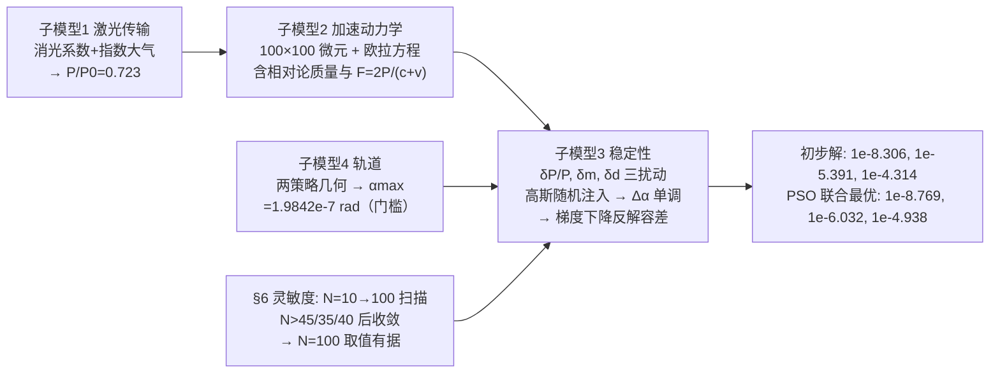

# 精读 06 · Analysis of the influencing factors during the sail acceleration（2018 题A 金牌 · 队伍 295）

> **这份精读怎么用**：左手边开论文 PDF（`03_优秀论文PDF/2018/Problem A/2018-GM-A-295.pdf`），右手边开本篇。这是六篇中唯一的中国队论文（Word 排版、MATLAB 仿真），与 158/258 队同题。它的看点是**"四子模型"架构 + 把三个模糊词操作化 + 用收敛实验给数值结果背书**。注意：该论文文本由 Word 公式对象提取，公式乱码较多，本篇以 06_论文页面图 的 PNG 渲染与上下文为准重构式子，凡不确定处均已注明。

---

## 0. 一分钟看懂全文骨架

论文把"三个误差因素要控制在什么量级"翻译成一个**反问题**：先算门槛（最大允许偏转角），再数值标定"扰动→偏转角"曲线，最后反解容差，并用 PSO 做三因素联合优化：



**为什么这个骨架好？** 四个子模型**单向依赖、各答一问**：传输模型给动力学供输入功率，轨道模型给稳定性供判定门槛，稳定性模型产出最终容差——抽象图（Figure 1/2 两张思维导图）把这张依赖图直接印在评委脑子里。**"先定门槛再反解"**是本篇的灵魂：不正向算一条轨迹，而是先算出 α_max=1.9842×10⁻⁷ rad 这个硬约束，工程容差全部由它反推——正对题面"necessary accuracy and precision"的问法。

---

## 1. 逐节导读

### 1.1 Abstract（第 1–2 页）

**它写了什么**：四子模型各一句（含式名）→ 三个初步容差（10⁻⁸·³⁰⁶、10⁻⁵·³⁹¹、10⁻⁴·³¹⁴）→ 灵敏度一句话（45×45/35×35/40×40 后稳定）→ PSO 联合最优解（10⁻⁸·⁷⁶⁹、10⁻⁶·⁰³²、10⁻⁴·⁹³⁸）。

**为什么这样写**：摘要敢用**指数记数法**写六个数字——10⁻⁸·³⁰⁶ 比 "约 5×10⁻⁹" 信息量大一档：它暴露了对数坐标下的工作方式（后文 Figure 9–11 全是对数横轴），也暗示这些数是从 lg-线性关系上读下来的。**摘要的记数法要与正文的方法论一致**，这是排版与内容的咬合。

**你要学什么**：两套结果（单因素保守解 + 联合最优解）并列出现在摘要里，先声明的"Results above considered one factor while the results caused by another two factors were ignored"一句话划清两套数的语义——**每给出一个数，都要说明它的口径**。

### 1.2 §1–2 Introduction 与 Restatement（第 3 页）

**它写了什么**：背景（4.2 光年、0.2c、50 GW）→ 把任务切成三阶段（穿过大气→光压加速→巡航）→ 点题句："finding out the relationship between drift angle and three factors becomes the key to solving the problem"。§2 最关键的一步：**把题面三个模糊名词逐一操作化**——beam accuracy → 功率偏差 δP/P；fabrication error → 质量分布不均 δm；uniformity → 激光位置偏移 δd。

**为什么这样写**："The necessary accuracy and precision of the beam... can be understood as the deviation of laser power..." 这一段是全文的地基。开放题第一风险是**答非所问**；把题面每个模糊名词翻译成带符号、带单位的物理量，后续所有计算才有靶子。

**你要学什么**：写 Restatement 时给每个题面名词配一个"可计算翻译"，这张翻译表就是你 Notations 表（Table 1）的雏形。

### 1.3 §3 Assumptions（第 4 页）

**它写了什么**：七条假设——刚性帆、大气层以上发射、地球自转 20 分钟内不改激光方向、发射点-比邻星相对距离恒定、大气颗粒垂直分布不变、相对论不改帆面积、**三因素独立且随机**。

**你要学什么**：第 7 条"三因素独立"是后面把联合优化拆成单因素实验的前提——**假设清单里要能看出每条为哪个后文步骤服务**，而不是凑数。第 3 条与 158 队结论段"地球自转致偏"形成对照：两队都意识到这个问题，一个假设掉，一个列为未做项。

### 1.4 §4.1 激光传输模型（第 5–6 页）

**它写了什么**：消光系数 = 吸收 + 散射（散射 = 分子散射 β_m + 粒子散射 β_p）；单程垂直路径 Beer 型积分 P = P₀exp(−∫(β_m+β_p)dh)；两个散射系数都取指数衰减 β(h) = k·e^{−k'h}（分子散射由 Rayleigh 散射∝空气密度 + 标准大气压强公式 p = p₀(1−Lh/T₀)^{gM/RL} 推出，h>44330.76 m 视为真空）；最终数值 P/P₀ = 0.723（代入 h=44330.76 m）。

**为什么这样写**：这是全文唯一"从物理第一性出发"的子模型——其余三个都是"框架+标定"。分子散射系数推导链（Rayleigh→理想气体→压强公式→Table 2 六个标准大气参数）展示了教科书知识调用能力，且参数全部列表（L=0.0065 K/m、T₀=288.15 K、g=9.80665、M=0.0289644、p₀=101.325 kPa、R=8.31447），可复算。

**⚠ 提取与数值提示**：文本提取的最终积分式系数串（0.00083/0.00013/0.000200/200.32）乱码严重，本篇以 PNG 图为准给出结构式 P/P₀ = exp[−(k₁/k₂)(1−e^{−k₂h}) − (k₃/k₄)(1−e^{−k₄h})]（由 ∫k e^{−k'h}dh 积出，与页面渲染一致）。另注意：0.723×50 GW = 36.2 GW，而正文写 "P = 0.723P₀ = 3.615×10⁹ W"——若 P₀=50 GW 应为 3.6×10¹⁰ W，**疑似掉了一个数量级**（或其 P₀ 另有口径），引用时需自核。

### 1.5 §4.2 加速动力学模型（第 6–8 页）

**它写了什么**：固定系 + 随体系（"Lysol"应为随体/固连系）双坐标系；帆离散为 100×100 微元，每个微元带 dA、dm、dP、r 四个属性、"each element corresponds to a transmitter"；质心 Σmᵢξᵢ/Σmᵢ；**含相对论的质量** m = m₀/√(1−v²/c²)；**含速度修正的光压** F_i = 2(P+δP)/(c+v)；总力矩 M = ∫dMᵢ = Σrᵢ×Fᵢ；动量矩定理 M = I_C·α̈ 与欧拉动力学方程（I_x ω̇_x + (I_z−I_y)ω_yω_z = M_x 等三式）解角速度，再对时间积分得偏转角。

**为什么这样写**：这是"**把稳定性问题数值化**"的标准路径——解析不可解（随机扰动+耦合欧拉方程），就把帆变成一万个质点，力矩对微元求和，姿态用欧拉方程推进。Figure 3 的欧拉角示意图（灰→红→蓝→绿四次旋转）把"fixed 系如何转到随体系"一次讲清，附录 MATLAB 里 R_X、R_Y、R_Z 矩阵与图一一对应。

**你要学什么**：
- **相对论两处都进模型**：质量随速度变（惯量张量时变），光压分母 c+v（光子追赶效应）——比"γ 修正"的泛泛而谈具体。
- 微元法配一张"力分析图"（Figure 8）：每个微元受力怎么合成总力矩，图比三段文字省力。

### 1.6 §4.3 稳定性模型 + §5.1.3 求解策略（第 8–9、14–15 页）

**它写了什么**：三扰动注入方式——Pᵢ = P+δP（强度）、dmᵢ = dm(1+δmᵢ)（质量，配 Figure 4 深浅色质量分布图）、d = √(x²+y²)（发射器位置，配 Figure 5 阵列偏移示意）；扰动建模为独立高斯 N(P(t), σ_P²) 等；发现"angle of rotation and small disturbance had a monotonic positive correlation"→ 用**梯度下降法**反解临界扰动值。

**为什么这样写**：单调性是整个求逆策略的合法性来源——先说单调，再用梯度下降找"Δα = α_max"的交点，比盲目蒙特卡洛高效且结论硬（一个交点而非一个分布）。**先证单调再二分/下降**与 2010-GM-A-160 的做法一脉相承，是数值反问题的通用礼仪。

### 1.7 §4.4 轨道模型（第 10–12 页）——门槛的由来

**它写了什么**：先用二体引力微分方程验证引力对 0.2c 直线轨迹的偏折可忽略（"the effect of gravitation on track could be overlooked"）；然后比较两种发射策略的几何（Figure 6/7）：策略一直指行星 α₁ = arctan(L_D/D_pe)；策略二指向恒星 α₂ = arcsin(L_D/D_pe) + arcsin(R_orbit/D_pe)；再论证因行星公转周期 11.2 天 ≪ 航行 21 年（T_sailing ≫ T_plant），到达时行星位置不可预知，**应取策略二**——容差球放宽了轨道半径 R_orbit 的一档。

**为什么这样写**：这一节是"**反问题的门槛**"。两个策略的区分不是炫技：α₂ 比 α₁ 大 20 倍（1.888×10⁻⁷ vs 0.97×10⁻⁸），直接决定三个容差松紧一个量级。用周期对比（11.2 天 vs 21 年）论证"行星位置等效于随机→须指向恒星"是本节最有物理味的推理。

**你要学什么**：几何容差题先问"**瞄准什么**"——目标在动（公转）时，指向其轨道中心的天体往往比指向目标本身容差更大；论证用时间尺度对比即可，不必积轨道。

### 1.8 §5–6 结果与灵敏度（第 12–19 页）

**它写了什么**：门槛 α_max = 1.9842×10⁻⁷ rad；三张"Δα–lg(因素)"曲线（Figure 9/10/11，对数横轴显线性趋势）；单因素容差 10⁻⁸·³⁰⁶ / 10⁻⁵·³⁹¹ / 10⁻⁴·³¹⁴；§6 三个收敛实验：固定 δP=100 W、δm=10⁻⁶ g、δd=10⁻⁷ m 之一，N 从 10 扫到 100，Δα 分别在 N>45、N>35、N>40 后趋稳 → "it is reasonable to assume N as 100"。

**为什么这样写**：灵敏度实验回答的是评委必问的"**你的结果依赖网格吗**"。三组实验分别对应三个因素，结论具体到数字（45/35/40），最后一句"the increase of N cannot help with the accuracy when N is larger than 50"把计算资源分配的合理性一并交代。

### 1.9 §7–9 模型改进与结论（第 19–22 页）

**它写了什么**：7.1 自曝缺陷（单因素结果实为最大误差、时间步长偏大、大气只算垂直单程）；7.2 PSO 联合优化——粒子位置向量 (δP/P, δm, δd)，适应度 = 三个 lg 之和 + 罚函数（超门槛 10⁻⁷·⁹ 即罚），给出标准 PSO 更新式与六步流程，收敛判据 |ΔGbest|<0.001；结论复述两套数值。

**你要学什么**："单因素保守解 + 联合最优解"两套并列的呈现方式——先保守后精化，既证明你会基础方法，又证明你会权衡三个约束的联合可行性（最优解三个数都比单因素解更严，因为三因素同时作用互相消耗预算）。

---

## 2. 图表深析

| 图 | 位置与作用 | 为什么这样画 | 怎么画出来 |
|---|---|---|---|
| Fig 1/2（两张思维导图） | 摘要后、模型节前 | 30 秒让评委抓住四子模型依赖关系——Word SmartArt 即可 | 流程图工具 |
| Fig 3（欧拉角变换，四色平面） | §4.2.1 | 四次旋转用四种颜色（灰初始→红绕 x→蓝绕 y→绿绕 z），与附录 R_X/R_Y/R_Z 代码一一对应 | 3D 示意，色即步骤 |
| Fig 4（质量分布深浅图） | §4.3.2 | "深色=质量大"把 δm 的含义变成一眼可读的热图 | scatter 上色 |
| Fig 5（阵列位置偏移示意） | §4.3.3 | 发射器网格+随机偏移箭头，定义 δd | 网格+扰动箭头 |
| Fig 6/7（两种偏转角几何） | §4.4.2 | 门槛 α_max 的几何来源，一张图一个策略 | 几何示意（本文代码复现） |
| Fig 8（微元受力分析） | §5.1.2 | 微元→合力矩的桥，箭头钉死 rᵢ×Fᵢ 方向 | 受力分析图 |
| Fig 9–11（Δα–因素对数曲线） | §5.2 | 对数横轴把跨 6 个量级的关系画成直线，容差即直线上一点 | MATLAB plot，semilogx |
| Fig 12–14（N 收敛曲线） | §6 | 三个实验三条曲线，收敛阈值写进正文 | 同上 |

**核心图复现（Figure 6/7 的轨道几何 + 门槛验证）**

```python
import numpy as np, matplotlib.pyplot as plt

# ── 常量（对应论文 Table 1 Notations）──
LD      = 384403.9e3      # m   地月距离
R_orbit = 7.5e6*1e3       # m   比邻星 b 轨道半径
ly      = 9.4607e15       # m
D_pe    = 4.2*ly          # m   地球-比邻星距离

a1 = np.arctan(LD/D_pe)                                  # 策略一: 直指行星
a2 = np.arcsin(LD/D_pe) + np.arcsin(R_orbit/D_pe)        # 策略二: 指向恒星+轨道半径余量
print(f'a1={a1:.4e} rad, a2={a2:.4e} rad (paper: 1.9842e-7)')
print(f'T_planet=11.2 d, T_sail={D_pe/(0.2*3e8)/3.156e7:.0f} yr -> 策略二成立')

fig, (ax1, ax2) = plt.subplots(1, 2, figsize=(10, 4))
# 左: 策略二几何示意(角度放大1e6倍才可见, 注明 not to scale)
ax1.plot([0, D_pe], [0, 0], 'k-', lw=1); ax1.plot(D_pe, 0, 'yo', ms=12)      # 恒星
orb = np.linspace(0, 2*np.pi, 200)
ax1.plot(D_pe+R_orbit*np.cos(orb), R_orbit*np.sin(orb), 'b:', lw=0.8)         # 轨道
th = np.linspace(0, 0.05, 50)                                                 # 放大的角域
ax1.fill_between(D_pe*np.cos(th)*np.ones_like(th), D_pe*np.sin(th),
                 color='red', alpha=0.15)                                     # 允许角锥(放大)
ax1.annotate('Proxima b\n(random phase)', (D_pe*0.96, R_orbit*0.9), fontsize=8)
ax1.set_title('Strategy 2: aim at star, tolerate orbit radius\n'
              r'(angles exaggerated $10^6\times$ for visibility)', fontsize=9)
ax1.set_xlabel('x (m)'); ax1.set_ylabel('y (m)')

# 右: 命中距离-指向角关系, 两策略门槛
err = np.logspace(-9.2, -6.8, 400)
ax2.loglog(err, D_pe*np.tan(err), 'k-', label=r'miss distance $\approx D_{pe}\theta$')
ax2.axhline(LD, color='gray', ls=':', label='Earth-Moon distance $L_D$')
ax2.axhline(LD+R_orbit, color='b', ls='--', label='$L_D+R_{orbit}$ (strategy 2 cap)')
ax2.axvline(a2, color='r', ls='-.',
            label=r'$\alpha_{max}$=%.3e rad' % a2)
ax2.set_xlabel(r'pointing error $\theta$ (rad)'); ax2.set_ylabel('miss distance (m)')
ax2.set_title(r'$\alpha_{max}=\arcsin(L_D/D_{pe})+\arcsin(R_{orbit}/D_{pe})$'
              '\n=%.4e rad, paper: 1.9842e-7 rad' % a2, fontsize=9)
ax2.legend(fontsize=8); plt.tight_layout(); plt.show()
```

**独立复现报告**：α₂ = 9.674×10⁻⁹ + 1.8875×10⁻⁷ = **1.9842×10⁻⁷ rad**，与论文 1.9842×10⁻⁷ **完全一致** ✓；α₁ = 9.67×10⁻⁹ rad，两策略差 20.5 倍——正是"指向恒星"策略的价值所在。T_sail = D_pe/0.2c = 21 年 ≫ 11.2 天 ✓，支撑"到达时行星相位不可知"的论证。⚠ 大气透过率的最终积分式在文本提取中乱码严重（系数 0.00083/0.00013/0.000200/200.32 的组合无法唯一复原），且 0.723×50 GW = 3.6×10¹⁰ W ≠ 正文所写 3.615×10⁹ W，数量级存疑，此处未予复现。

---

## 3. 公式逐条精讲

> 本篇公式在文本提取中大量乱码，以下按 PNG 渲染与上下文重构，编号采用论文实际结构（该论文公式多数未编号，以节号+描述定位；PSO 更新式与欧拉方程按论文原文给出）。

### 3.1 消光系数与透过率（§4.1）

$$\beta_{ext}=\alpha_{abs}+\beta_m+\beta_p,\qquad \beta_m(h)=k_1e^{-k_2h},\quad \beta_p(h)=k_3e^{-k_4h}$$
$$\frac{P}{P_0}=\exp\Big[-\int_0^h(\beta_m+\beta_p)dh'\Big]=\exp\Big[-\frac{k_1}{k_2}(1-e^{-k_2h})-\frac{k_3}{k_4}(1-e^{-k_4h})\Big]$$

- **怎么想到**：Beer–Lambert 定律 + "两个散射系数都随高度指数衰减"的唯象假设；分子散射系数那步是物理的：Rayleigh 散射 ∝ 分子数密度 ∝ 空气密度，空气密度由标准大气压强公式（对流层线性递减)推出，h>44330.76 m（=T₀/L，对流层顶）以上取零。
- **推导细节**：∫₀^h k e^{−k'h'}dh' = (k/k')(1−e^{−k'h})——指数模型的积分把"k、k′"配成比值 k/k′（总光学深度的贡献上限），这就是最终式里两对系数各自以比值出现的原因。
- **数值感**：P/P₀=0.723 对应总光学深度 τ=−ln0.723=0.324。对 1064 nm 垂直路径，Rayleigh 项 ~0.02、气溶胶项 ~0.1–0.3 量级——0.324 属偏悲观但合理的取值。
- **适用边界**：单程、垂直、无湍流相干效应；斜程发射需除以天顶角余弦。

### 3.2 相对论质量与光压（§4.2）

$$m=\frac{m_0}{\sqrt{1-v^2/c^2}},\qquad F_i=\frac{2(P+\delta P)}{c+v}$$

- **怎么想到**：光压分母 c+v 是"光子追赶以 v 退行的帆"的一阶修正——单位时间打到帆上的光子数率乘 1/(1+β)（引文献 [2] 周戊等《光子推进及其可行性分析》）。它比 258/158 队的 (1−β)/(1+β) 双多普勒弱一阶（未含反射红移的能量损失），但对 β≤0.2 的力修正 ~17%，方向正确。
- **两式合用的效果**：惯量张量 I_C 随 v 增大而增大、力矩随 v 增大而减小 → 姿态响应随加速变"钝"，这是只有把相对论放进姿态动力学才能看到的耦合。

### 3.3 微元求和与欧拉方程（§4.2.1–4.2.3）

$$\xi_C=\frac{\sum m_i\xi_i}{\sum m_i},\quad I_C=\begin{pmatrix} I_x & -I_{xy} & -I_{xz}\\ \dots\end{pmatrix},\quad \vec M=\int \vec r\times d\vec F,\quad \vec M=I_C\ddot{\vec\alpha}$$
$$I_x\dot\omega_x+(I_z-I_y)\omega_y\omega_z=M_x,\quad I_y\dot\omega_y+(I_x-I_z)\omega_z\omega_x=M_y,\quad I_z\dot\omega_z+(I_y-I_x)\omega_x\omega_y=M_z$$

- **怎么想到**：刚体姿态动力学的标准三件套（质心、惯量张量、欧拉方程）离散化——100×100 个质点求和替代积分。惯量积 I_xy 等必须保留：质量不均（δm）正是通过惯量积进入姿态方程的——**如果只保留对角项，δm 的通道就被自己剪断了**。
- **数值感**：附录 MATLAB 中 I_X = Σm(y²+z²) 等按微元直算；θ(t) 由 fa_vector（帆法向）经旋转矩阵变换后 asin(norm(fa_vector_(1:2))) 得到——即"法向偏离束流的角"，定义干净。

### 3.4 三扰动注入（§4.3）

$$P_i=P+\delta P,\qquad dm_i=dm(1+\delta m_i),\qquad d=\sqrt{x^2+y^2},\qquad (\delta P,\delta m,\delta d)\sim \text{独立高斯}$$

- **怎么想到**：把三个工程误差翻译成"微元属性随机化"——强度误差改力、质量误差改惯量与质心、位置误差改力臂。统一的高斯注入让三者可在同一框架内比较（才有 Fig 9–11 的同构曲线）。
- **适用边界**：假设 7（独立+随机）排除了系统偏置（如阵列整体倾斜）——那类误差是确定性的，容差应另算。

### 3.5 两策略最大偏转角（§4.4.2）

$$\alpha_1=\arctan\frac{L_D}{D_{pe}},\qquad \alpha_2=\arcsin\frac{L_D}{D_{pe}}+\arcsin\frac{R_{orbit}}{D_{pe}}$$

- **怎么想到**：策略一的容差球以行星为心、半径 L_D，从 4.2 光年外看张角即 arctan(L_D/D_pe)。策略二指向恒星：飞行器须落入"以恒星为心、半径 R_orbit 的球（保证看到行星）"，且与行星擦肩小于 L_D——两项张角直接相加（都 ≪1 rad，arcsin x≈x，加法合法）。
- **数值感（独立复算）**：9.67×10⁻⁹ + 1.888×10⁻⁷ = 1.9845×10⁻⁷ rad ✓。R_orbit 项是主导（占 95%）——**容差的上限由"行星绕到哪不可知"决定，而非地月距离本身**。
- **策略选择论证**：T_plant=11.2 d ≪ T_sailing=21 yr（D_pe/0.2c，独立复算 ✓），到达时相位等效随机 → 必须用策略二。

### 3.6 PSO 适应度函数与更新式（§7.2）

$$V_i^{t+1}=V_i^t+\big[c_1r_1(Pbest_i-X_i^t)+c_2r_2(Gbest-X_i^t)\big],\qquad X_i^{t+1}=X_i^t+V_i^{t+1}$$
$$Fitness(X_i)=\Big(\lg\frac{\delta P}{P}\Big)^2+\big(\lg\delta m\big)^2+\big(\lg\delta d\big)^2+\begin{cases}0,&\Delta\alpha<10^{-7.9}\\ (\text{罚}),&\Delta\alpha>10^{-7.9}\end{cases}$$

- **怎么想到**：三因素联合可行域是三维空间的一个曲面（Δα=α_max），单因素解是三个坐标轴截距；PSO 直接在曲面上找"离原点最远"（三容差同时最大=工程最易实现）的点。目标函数取三个 lg 的平方和——对数坐标下"等比例放宽"才是公平度量。
- **为什么最优解比单因素解更严**（10⁻⁸·⁷⁶⁹ < 10⁻⁸·³⁰⁶）：三因素同时扰动时偏转角叠加，每个因素的预算都被压缩——这个方向（更严）正是"单因素解是保守上限"论述的自洽体现。

---

## 4. 建模决策链

| 决策 | 作者的选择 | 被放弃的替代 | 为什么 |
|---|---|---|---|
| 帆的离散 | 100×100 微元 | 连续体/少质点 | 微元法让 δm、δd 有注入接口；N 的合理性由 §6 三实验背书 |
| 光压公式 | F=2P/(c+v)（引中文文献） | 双多普勒完整式 | 一阶修正已覆盖主要效应；文献可得、推导短 |
| 引力 | 数值验证后忽略 | 积分完整轨道 | 0.2c 直线轨迹下偏折远小于 α_max，一步排除 |
| 瞄准策略 | 指向恒星（策略二） | 直指行星 | 周期对比（11.2 d vs 21 yr）→ 相位不可知，策略二容差大 20 倍 |
| 求解策略 | 单调性+梯度下降反解 | 蒙特卡洛全扫描 | 单调已证，反解一个交点即可，省算力且结论硬 |
| 扰动统计 | 独立高斯 | 相关/系统偏置 | 假设 7；系统偏置另行处理会更完整（未做） |
| 联合优化 | PSO | 网格搜索/拉格朗日 | 三维非线性约束曲面，PSO 实现快、无需梯度 |
| 大气模型 | 垂直单程消光 | 斜程/多次散射 | 自曝于 §7.1（"multi-directional... only vertical one-way"） |

---

## 5. 从本篇提炼的可复用模板

**结构模板**：

```
Abstract        四子模型各一句 + 两套数值（单因素/联合最优）
1-2 Introduction/Restatement  三阶段分解 + 三个模糊词的可计算翻译
3 Assumptions   编号假设（每条对应后文某个步骤）
4 Model         4.1 传输模型（物理第一性：消光+标准大气）
                4.2 动力学（微元+双坐标系+欧拉方程+相对论）
                4.3 稳定性（三扰动注入，配示意小图）
                4.4 轨道（引力排除+两策略门槛）
5 Results       门槛→三条对数曲线→三个容差
6 Sensitivity   N 收敛三实验（每因素一组）
7 Improvement   自曝缺陷 + PSO 联合优化（含伪代码）
8-9 S/W + Conclusion
Appendix       MATLAB 全代码
```

**句式库（原文摘录，已修正常见 Word 提取错漏）**：
- "The necessary accuracy and precision of the beam from the laser array can be understood as the deviation of laser power..."（模糊词操作化的标准句式）
- "Therefore, finding out the relationship between drift angle and three factors becomes the key to solving the problem."（一句话把全文问题压缩成一个函数关系）
- "Through the calculation, the effect of gravitation on track could be overlooked."（数值验证后的排除声明）
- "the angle of rotation and small disturbance had a monotonic positive correlation"（反解策略的合法性前提，先证后用）
- "the increase of N cannot help with the accuracy when N is larger than 50. Consequently, it is reasonable to assume N as 100"（收敛实验收尾：给阈值+给取值）
- "However, these three factors work together to influence drift angle in the real situation. So the results are the maximum errors of the three factors."（自曝单因素解的口径，为 PSO 铺垫）

**图表配方**：多因素容差题 → "思维导图×2（总览+模型节前）+ 每因素一条对数曲线 + N 收敛三连图"；几何门槛 → "两策略各一张示意图 + 一张数值验证图"；随机扰动 → 深浅色热图（Fig 4 式）比文字定义直观。

---

*精读完这篇后，建议对照 `05_论文赏析/2018/2018-GM-A-295.md`（宏观赏析）与 `07_题目解读/2018_题A_光帆纳米飞行器.md`（题目全解）形成三位一体。同题对照精读：`2018-GM-A-158_精读.md`（组合筛选+精度预算）、`2018-GM-A-258_精读.md`（球帆微扰模型）。*
