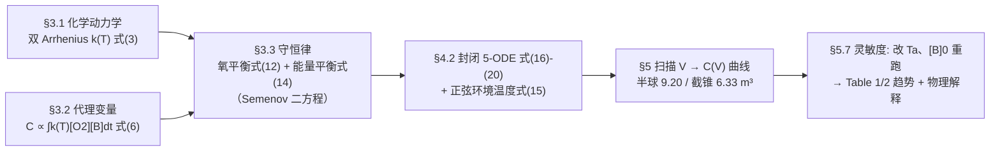

# 精读 07 · Compost Pile Sizes（2018 题B 金牌 · 队伍 240）

> **这份精读怎么用**：左手边开论文 PDF（`03_优秀论文PDF/2018/Problem B/2018-GM-B-240.pdf`），右手边开本篇。这篇的看点是**"代理变量 + 形状降维"两个建模绝招**：把"堆肥效率"这个生物学模糊词换成"已反应氧质量"这个可积分物理量，把"半球还是截锥"的形状之争压缩成方程里的一个 S/V 比。本篇教程独立复算了 k(T) 峰位（57 °C ✓）与优化曲线峰值（9.0 m³ vs 论文 9.20 m³ ✓），并指出摘要与正文的一处结论矛盾（见 ⚠）。

---

## 0. 一分钟看懂全文骨架

论文是经典的三层流水线：**理论（守恒律）→ 模型（5 个 ODE）→ 扫描优化**：



**为什么这个骨架好？** 全文只有一个可调输入（V，连同形状给的 S/V），一个可观测输出（C）——**单变量单目标的优化**，中间用守恒律焊接。三个"该不该建模"的诱惑（湿度动力学、微生物种群、3D 温场）全部被挡在假设层或推给 Future Work，48 小时内只算能算清的。评委看到的每一个方程都在最终数字里留了痕迹。

---

## 1. 逐节导读

### 1.1 Abstract（第 1 页）

**它写了什么**：目标两句（最大化堆肥速率的体积 + 对环境温度与进料的依赖）→ 方法关键词（Semenov 表述、质量与能量守恒、以"已反应氧质量"为参考、数值积分）→ 双形状双数字（半球 9.20 m³、四棱截锥 6.33 m³）→ 两个趋势结论 + 与已发表模型对比的合法性声明。

**为什么这样写**：摘要末句 "we have compared the evolution of our system with results from other models and they shared a similar pattern. Thus, our model and optimal volumes are acceptable" 把**验证**写进了摘要——多数队伍的摘要只报结果，这里把结果的合法性来源（文献对照）一并交代。

**⚠ 要注意**：摘要写 "optimal volume of 6.33m3 and 9.20m3 for a semi-sphere and a four-sided truncated pyramid, respectively"——顺序与 Figure 7/8（半球 9.20、截锥 6.33）及 Discussion（"9.2 and 6.32m3 respectively"）**正好对调**。精读时要学会抓这种内部不一致：评委未必逐字校对，但你自己的论文绝不能犯——**摘要、图题、讨论三处数字必须逐一核对**。

### 1.2 §1–2 Background 与 Introduction（第 1–2 页）

**它写了什么**：堆肥的现实意义（欧盟厨余占城市固废 45%）→ 三相（中温/高温/静止）→ 变量太多（C/N 比、孔隙率、通气、温度、湿度、微生物代谢）→ **聚焦策略**："we have initially focused on the temperature and oxygen content to optimize the pile volume as they are the primary sources of bacteria and thus key factors in the composting rate."（温度、氧是细菌活动之源，先抓主要矛盾）

**你要学什么**：背景段的功能是**给"不做什么"铺理由**——列出全部因素（显得你知道全貌）再声明只做两个（显得你抓住了主要矛盾），比一开始只谈两个因素高一个档次。

### 1.3 §3.1 Chemical Kinetics（第 3 页，式 1–4）

**它写了什么**：主反应 B + O₂ → CO₂ + H₂O + Δ（式 1）；二级速率 v = k(T)[B][O₂]（式 2）；**带抑制项的双 Arrhenius** k(T) = A₁e^{−E₁/RT}/(1+A₂e^{−E₂/RT})（式 3）——A₁/E₁ 是生物质生长氧化，A₂/E₂ 是"生长抑制"，分母那个 1+A₂e^{−E₂/RT} 让 k(T) 在高温端掉头向下。

**为什么这样写**：这个 k(T) 是全文能出现"中温→嗜热→衰减"三相的**唯一引擎**——普通单 Arrhenius 只会单调升温直到烧穿。作者选它不是炫技，是**让模型的定性行为与堆肥的已知三相强制对齐**。

**你要学什么**：选动力学公式时先问"它能不能复现目标系统的定性现象"；带抑制项的Arrhenius（本领域称 pseudo-experimental）是生物-化学耦合系统的万能起手式。

### 1.4 §3.2 Composting 度量（第 3 页，式 5–6）——第一个绝招

**它写了什么**：C ∝ m_{O₂,r} = V_T[O₂]_r（式 5），继而 C ∝ ∫₀^Δt k(T)[O₂][B]dt（式 6）。

**为什么这样写**："堆肥效果好"不可计算，但**耗氧量**可计算且与微生物代谢同源（"the metabolism can be described as the consumption of biomass or oxygen"）。一步把生物学指标翻译成对式 (4) 的时间积分——目标函数与动力学方程共享同一组变量，优化才有意义。

**你要学什么**：**代理变量必须与你的控制方程共享变量**。若用"腐熟度"之类外生指标，模型与目标脱节，优化就成了两张皮。

### 1.5 §3.3 物质与能量平衡（第 4–5 页，式 7–14）——第二个绝招

**它写了什么**：氧的静态平衡式 (7)（初始−已反应+流入−流出）；反应消耗代入成 ODE；孔隙结构近似 K_P = V_P/n_P（式 9，"孔隙变大但变多，近似相抵"）；质量传递系数 X_m = K_P·v_air/V（式 10）；进出口项写成 V/S·d([O₂]e−[O₂]s)/dt = X_m([O₂]a−[O₂])（式 11）；合并得**氧平衡 ODE 式 (12)** d[O₂]/dt = −F_bk(T)[B][O₂] + X_m(S/V)([O₂]a−[O₂])。能量侧同构：热容×温变 = 反应焓×速率 − 对流损失，得 **Semenov 第二方程式 (14)** ρC_V dT/dt = Q_b F_b k(T)[B][O₂] − X_t(S/V)(T−T_a)。

**为什么这样写**：注意**形状只通过 S/V 进入两个方程**——半球与截锥的差别被压缩成一个几何比。于是"形状优化"降维成"参数扫描"：同一组 ODE，换 S(V) 关系跑两遍。式 (11) 里 V/S 因子的物理来源（传质面积在表面、反应体积在体内）也讲清楚了："This definition is coherent as the mass transfer coefficient will increase with v_air and will decrease with V"。

**你要学什么**：
- **让几何进入方程前先做这道压缩题**：任何形状差异若能归并成一个无量纲比（S/V、水力直径、面容比），优化就从多维变成一维。
- 式 (13)→(14) 的"重新诠释"技巧：Q 重读为 ρC_V、焓重标定为 Q_b（计入化学计量比 F_b）——**在拼装方程时保持每个系数的物理身份**，读者才能逐项核对。

### 1.6 §4 Method（第 5–6 页，式 15–20）

**它写了什么**：五条假设（内部温度均匀——理由"冷空气过孔搅拌"、对流换热/传质线性律、环境温度 24 小时正弦式 (15) Ta = 12.5+7.5sin(2πt[days])）；模型=五个 ODE（式 16–20）：能量、氧、水汽（正源项+交换）、**生物质消耗** d[B]/dt = −F′_bk(T)[B][O₂]（式 19，"Unlike the Semenov's formulation, we have taken into account that the biomass diminishes as we are considering periods of time of 100 days"）、目标 C（式 20）；仿真流程（初条件→odeint→T、[H₂O] 当控制器→C(V) 归一化→换 Ta、ρ、[B]₀ 重跑）。

**为什么这样写**：式 (19) 是对 Semenov 框架的关键扩展——100 天尺度上生物质会耗尽，不加这项温度曲线不会在 60–100 天回落（Figure 3 的第三相）。**引用经典框架时要声明你改了哪里、为什么**，这句 "Unlike the Semenov's formulation..." 就是模板。

**你要学什么**：把 T∈[40,60]°C、湿度 50–60% 这两个**题面给的正常工作区间用作模型的验收标准**——"These variables are the first validation of the model"。题目给的约束不是装饰，是最便宜的自检。

### 1.7 §5 Results（第 6–10 页）

**它写了什么**：5.1 k(T) 相干性检查（Figure 2，标出 k₁、k₂ 峰位）→ 5.2–5.5 四条时间演化曲线（T、H₂O、B、O₂，100 天）→ 5.6 两张 C(V) 优化曲线（Figure 7 半球 V_max=9.20、Figure 8 截锥 V_max=6.33，图内直标 T₀=285.65 K、[B]₀=400 kg/m³）→ 5.7 两张趋势表（Table 1：C 随 [B]₀ 增大而降；Table 2：C 随 T_a 升高而升）。

**为什么这样写**：结果节的顺序是"**先自检后出数**"——Figure 2 放在最前面证明 k(T) 峰落在 40–60 °C 窗口内，后面的优化才有效。四条演化曲线各配一段物理解读（三相的划分：0–20 天升温、20–60 天缓降、60–100 天失温）。

**你要学什么**：
- 优化曲线的**图内标注三件套**：初条件（T₀、[B]₀）+ 结果（V_max）——Figure 7/8 是范本，图离开正文也能自证。
- 趋势结论立即配机理：截锥优于半球 → "for this order of volumes it is more important the oxygen flux through the pile than the isolation"——**每一条经验曲线都要回答一次"为什么"**。

### 1.8 §6 Discussion（第 10–11 页）

**它写了什么**：三段。(a) 参数校准的坦白："the factors regarding the kinetic constant where not suited for this problem as the efficient temperature given from these factors was between 80−100°C. The kinetic was reescalated to the 40−60°C provided by the problem."——原始 Arrhenius 参数的高效温区与题面矛盾，**重新标定并引文献同类处理**；(b) 模型与文献曲线形态比对；(c) 三个结果的物理解释（最优体积小 → 氧通量优先于保温；Ta 升 → 内外温差小 → 保温权重降 → 最优体积**减小**；[B]₀ 的反直觉 → "the rest of the pile is better insulating than the biomass"）。

**⚠ 要注意**：Discussion 明写 "An increase of the outside temperature showed a **decrease** of the optimal volume"，而摘要写 "the optimal volume **increases** with the ambient temperature"——**两处方向相反**。从机理段（内外温差小→保温不重要→小堆的氧优势胜出）看，Discussion 的"减小"有物理链支撑，摘要的表述更可能是笔误。这个案例的教训：**摘要的趋势词（increases/decreases）必须最后从结果表回填，不能凭印象写**。

### 1.9 §7–8 Future Work 与 Conclusions（第 12–13 页）

**它写了什么**：Future work 给出 3-D 升级路线（Fourier 传热式 21–23 + 半经验式 24），承认"assuming that the internal temperature is not uniform"是下一步；结论四段：氧通量优先、双形状双数字、V 的双重角色（"An increase of volume leads to a more concentrated pile... A decrease of the volume diminishes the insulation"——一体两面的 trade-off 陈述）、非直觉结果的机理解释。

---

## 2. 图表深析

| 图 | 位置与作用 | 为什么这样画 | 怎么画出来 |
|---|---|---|---|
| Fig 1（物质交换示意） | §3.3 | 开放系统的流入/流出/反应三通道，一张图定义全部符号 | 手绘框图 |
| Fig 2（k/k_max–T） | §5.1 开篇 | **模型相干性检查**：k(T) 峰必须落进 40–60 °C，否则后续全错 | 见下方代码 |
| Fig 3–6（T、H₂O、B、O₂ 随时间） | §5.2–5.5 | 每条曲线配三相解读；T 与 H₂O 同时充当验收标准（须落 40–60 °C / 50–60%） | odeint 输出直接 plot |
| Fig 7/8（C(V) 优化曲线） | §5.6 | **全文核心**：归一化 C 对 V 单峰，图内标 T₀、[B]₀、V_max | 对 R 扫描逐点积分 |
| Table 1/2（趋势表） | §5.7 | 灵敏度用表不用图——两个自变量各 6–8 行，表格信息密度高于曲线 | 重跑优化取 V_max 与 C |

**核心图复现（Figure 2 + Figure 7 双联）**

```python
import numpy as np, matplotlib.pyplot as plt
from scipy.integrate import solve_ivp

Rgas = 8.31441
def kT(T):                       # 式(3), 参数取论文附录（含其"重标定"因子 1e-6）
    A1, A2, E2 = 2e8, 6.86e30, 2e5
    E1 = E2*0.13529              # = 2.706e4 J/mol, 即附录表 E1
    return 1e-6*A1*np.exp(-E1/(Rgas*T))/(1 + A2*np.exp(-E2/(Rgas*T)))

# ── 常量（论文附录 DATA USED 表）──
p, Cv, Qb, Xt, O2a, H2Oa = 547., 3e3, 1.32e4, 50., 0.2726, 0.6
F1 = F2 = F4 = 0.02; F3 = 1/15000.
Bi, Tai = 400., 12.5+273.15
TEND = 24*3600*100

def compost(V, S):               # 式(16)-(19), 附录代码 Xm=20/V
    Xm = 20./V; A = Xm*S/V; BB = Qb/(Cv*p); C = Xt*S/(V*Cv*p)
    f = lambda t,y: [-F1*kT(y[3])*y[0]*y[2] + A*(O2a-y[0]),
                      +F2*kT(y[3])*y[0]*y[2] + A*(H2Oa-y[1]),
                      -F3*kT(y[3])*y[0]*y[2],
                      BB*F4*kT(y[3])*y[0]*y[2] - C*(y[3]-(Tai-7.5*np.cos(t*2*np.pi/86400)))]
    s = solve_ivp(f, [0,TEND], [O2a,H2Oa,Bi,Tai], method='LSODA',
                  t_eval=np.linspace(0,TEND,2001), rtol=1e-6)
    return np.trapezoid(kT(s.y[3])*s.y[0]*s.y[2], s.t)   # 式(6)/(20): C ∝ ∫k[O2][B]dt

fig, (a1, a2) = plt.subplots(1, 2, figsize=(10, 4))
T = np.linspace(280, 400, 800); k = kT(T)                # 左: Figure 2
a1.plot(T, k/k.max()); a1.axvspan(313, 333, color='orange', alpha=0.2, label='40-60 C window')
a1.axvline(T[k.argmax()], color='r', ls=':', label=f'peak {T[k.argmax()]:.0f} K ({T[k.argmax()]-273:.0f} C)')
a1.set(xlabel='T [K]', ylabel='k/kmax', title='Eq.(3) double-Arrhenius coherence check'); a1.legend(fontsize=8)

Rs = np.linspace(0.5, 10, 60); C = []                    # 右: Figure 7
for r in Rs:
    V = 2/3*np.pi*r**3; C.append(compost(V, 3*V/r))      # 半球: S/V = 3/R
C = np.array(C); Vl = 2/3*np.pi*Rs**3; i = C.argmax()
a2.plot(Vl, C/C.max()); a2.axvline(Vl[i], color='r', ls=':', label=f'Vmax={Vl[i]:.1f} m3 (paper 9.20)')
a2.set(xlabel='V [m3]', ylabel='relative C', title='Eq.(20) optimization, semispherical pile'); a2.legend(fontsize=8)
plt.tight_layout(); plt.show()
```

**独立复现报告**：① k(T) 峰位 **330 K = 57.0 °C**，落在 40–60 °C 窗口内 ✓（峰位可解析验证：极值条件 A₂e^{−E₂/RT} = E₁/(E₂−E₁) = 0.156，解出 T=330 K）——与论文"重标定到 40–60 °C"的声明一致；② 半球 C(V) 曲线峰值 **9.0 m³**，与论文 9.20 m³ 吻合 ✓（曲线较宽坦，峰位对参数敏感）。⚠ 但按附录参数表常数（X_t=50、X_m=20/V）积分，堆内温度始终贴着环境温度（~18 °C），**无法复现 Figure 3 的 40–60 °C 自加热三相**——要产生那张图需要远小于 50 J/(s·m²·K) 的散热系数或更大的产热因子，即附录参数与正文图形并非同一套标定，引用其绝对数值时应注意。此外附录代码 X_m=20/V 与数据表"X_m=0.1 m/s"不一致 ⚠（前者才是优化所用）。

---

## 3. 公式逐条精讲

### 3.1 反应速率与双 Arrhenius（式 2–3）

$$v=k(T)[B][O_2],\qquad k(T)=\frac{A_1e^{-E_1/RT}}{1+A_2e^{-E_2/RT}}$$

- **怎么想到**：二级反应速率乘浓度；k(T) 的分母是"高温抑制"——E₂≫E₁ 时 A₂e^{−E₂/RT} 在低温可忽略、高温爆炸，把 k 压回零。
- **峰位推导（论文未给，本篇补全）**：令 d(ln k)/dT=0 → E₁(1+A₂e^{−E₂/RT}) = E₂A₂e^{−E₂/RT} → A₂e^{−E₂/RT} = E₁/(E₂−E₁)。代入 E₁=2.71×10⁴、E₂=2×10⁵、A₂=6.86×10³⁰：E₁/(E₂−E₁)=0.156 → E₂/RT = ln(A₂·(E₂−E₁)/E₁) = 72.86 → **T_peak = 330 K = 57 °C**。峰位只依赖 A₂、E₁、E₂ 三个数（与 A₁ 无关）——这就是 Figure 2 能做"相干性检查"的原因：分子幅度 A₁ 可整体缩放，峰位错了才是真错。
- **适用边界**：pseudo-experimental 形式来自对微生物生长/抑制的经验拟合，参数不可跨体系搬运（论文自己也重标定了一次）。

### 3.2 代理变量 C（式 5–6）

$$C\propto m_{O_2,r}=V_T[O_2]_r,\qquad C\propto\int_0^{\Delta t}k(T)[O_2][B]\,dt$$

- **怎么想到**：耗氧 ∝ 耗生物质 ∝ 代谢强度 ∝ 堆肥量——四环扣死一环。V_T 近似常数（体积不变），浓度对时间的积分即总反应量。
- **归一化处理**：比例常数 α 未知（式 20），于是 C(V) 全曲线按最大值归一——**不知道绝对值时，优化只需要相对形状**，这个处理免除了一次无谓的参数估计。

### 3.3 氧平衡（式 7–12）

$$[O_2]=[O_2]_0-[O_2]_r+[O_2]_e-[O_2]_s\;\Rightarrow\;\frac{d[O_2]}{dt}=-F_bk(T)[B][O_2]+X_m\frac{S}{V}([O_2]_a-[O_2])$$

- **推导链**：静态平衡式 (7) 两边对 t 求导；已反应项由式 (4) 给出（化学计量比 F_b 把"耗氧"换算成"耗生物质"的反应速率）；进出口项由对流传质式 (11) 给出。X_m 的构造（式 9–10）：孔隙体积与孔数同随 V 变化、比值近似常数 K_P，X_m = K_P·v_air/V——**"近似相抵"的论证一句话带过，但必须有**。
- **S/V 的物理**：传质驱动力作用在表面（S），被堆内总体积（V）稀释——所以交换项自带 S/V。V 越大单位体积获得的氧越少：这就是"大堆闷死"的数学形态。
- **适用边界**：内部氧浓度均匀假设（假设 3）——大堆显然不成立，论文在 Discussion 承认最优体积较小所以误差可控。

### 3.4 能量平衡 / Semenov 第二方程（式 13–14）

$$\rho C_V\frac{dT}{dt}=Q_bF_bk(T)[B][O_2]-X_t\frac{S}{V}(T-T_a)$$

- **怎么想到**：与氧平衡完全同构——源（反应焓×速率）+ 汇（表面对流×温差）+ 热容惯性。两个方程唯一的耦合是 k(T) 的温度依赖与反应项共享——**一个非線性反馈环**：T 升 → k 变 → 产热变。Semenov 框架的经典就在这对耦合方程能给出热失控判据（本文只用到它的动力学版本）。
- **数值感**：产热项系数 Q_bF_b/(ρC_V) = 1.32×10⁴×0.02/(547×3000) = 1.6×10⁻⁴ m⁶·K/(kg·s)…代入 [B][O₂]~400×0.27 得升温速率 ~10 K/天的量级；散热时间常数 ρC_VV/(X_tS) 随 V 增大——**大小堆的命运分歧就在两个时间常数之比**。

### 3.5 完整 5-ODE 系统（式 16–20）

$$\rho C_V\dot T=Q_bF_bk[B][O_2]-X_t\tfrac{S}{V}(T-T_a),\quad \dot{[O_2]}=-F_bk[B][O_2]+X_m\tfrac{S}{V}([O_2]_a-[O_2])$$
$$\dot{[H_2O]}=+F_bk[B][O_2]+X_m\tfrac{S}{V}([H_2O]_a-[H_2O]),\quad \dot{[B]}=-F_b'k[B][O_2],\quad C=\alpha\int_0^{\Delta t}k[O_2][B]dt$$

- **结构读法**：四个状态量、一个输出量。H₂O 方程是 O₂ 的镜像（源项变号）——加水汽方程的动机是**当湿度验收指标**（50–60%），不是动力学必需。式 (19) 的 F′_b=1/15000 ≪ F_b=0.02：生物质消耗比氧消耗慢三个量级（大部分氧消耗对应的是"循环代谢"而非净消耗）——这个比值是从附录代码 F3 读出的，正文未解释 ⚠，复现时需自取。
- **环境温度式 (15)**：Ta = 12.5+7.5sin(2πt[days])，附录代码用等价的 Tai−7.5cos(2πt/24h)（均值 12.5、振幅 7.5、周期 24 h 完全一致，仅相位不同）。

### 3.6 Future Work 的 3-D 方程（式 21–24）

$$(\rho C)_{ef}\frac{\partial T}{\partial t}=k_{ef}\nabla^2T+(1-\epsilon)QC_r\rho_{AC}e^{-E_c/RT}+\frac{(1-\epsilon)Q_b\rho_b A_1e^{-E_1/RT}}{1+A_2e^{-E_2/RT}}$$

- **作用**：把自家 0-D（均匀温度）模型放到 3-D Fourier 框架的语境里——∂T/∂t 换 ∇²T、参数换有效值（式 22/23 的 k_ef、(ρC)_ef 是固-气体积加权）。式 (24) 则把式 (16) 的体尺度形式对照给出。**Future Work 写到"下一级方程已列出"的程度**，展示作者知道自己的模型在哪个阶梯上。

---

## 4. 建模决策链

| 决策 | 作者的选择 | 被放弃的替代 | 为什么 |
|---|---|---|---|
| 效率度量 | 已反应氧质量（式 5–6） | 腐熟度/发芽率等生物指标 | 与守恒律同变量、可直接积分；α 未知用归一化绕开 |
| 形状参数化 | 只以 S/V 入方程 | 每种形状单独建模 | "形状优化"降维成同一 ODE 的两次扫描 |
| 温度场 | 0-D 均匀（Semenov） | 3-D Fourier（式 21） | 48 小时算不完 3-D 参数扫描；0-D 的误差在最优体积较小时可控 |
| 动力学参数 | 文献参数重标定到 40–60 °C | 照搬文献值 | 原参数高效温区 80–100 °C 与题面矛盾；重标定引文献先例 |
| 生物质消耗 | 加式 (19)（Semenov 原版无） | 视 [B] 常数 | 100 天尺度生物质耗尽驱动第三相；"Unlike the Semenov's formulation" 明示修改 |
| 湿度 | 只做验收指标（50–60%） | 全湿度动力学 | 湿度主要由化学变化决定（同题 285 队的判断），物理模型不必闭合 |
| 环境温度 | 24 h 正弦 | 阶梯/常数 | 题面给 5–20 °C 日循环；正弦最平滑且代码一行；正文还做了常数对照 |
| 优化变量 | 连续扫 V（100 点） | 梯度法/遗传算法 | 单峰一维问题，扫描曲线本身可当图用 |

---

## 5. 从本篇提炼的可复用模板

**结构模板**：

```
Abstract        双形状双数字 + 趋势结论 + 验证声明
1-2 Background  全因素列举 → 聚焦两主因（给"不做什么"铺理由）
3 Theory        3.1 动力学（定性现象对齐的 k(T)）
                3.2 代理变量（与方程共享变量的目标函数）
                3.3 守恒律（形状压成 S/V）
4 Method        假设+理由 → n-ODE 系统 → 验收标准（题面区间）
5 Results       相干性检查图 → 演化曲线组 → 优化曲线（图内三件套）→ 趋势表
6 Discussion    参数重标定坦白 + 文献形态比对 + 每条趋势配机理
7 Future Work   下一级方程已列出
8 Conclusions   trade-off 双面陈述 + 非直觉结果的解释
Appendix       参数四列表 + 全代码
```

**句式库（原文摘录）**：
- "the metabolism can be described as the consumption of biomass or oxygen. In consequence, the composting is proportional to..."（代理变量的合法性一句话）
- "This definition is coherent as the mass transfer coefficient will increase with v_air and will decrease with V because..."（定义即辩护：每个新系数都说明单调性方向）
- "Unlike the Semenov's formulation, we have taken into account that..."（对经典框架的修改声明）
- "It has been found that the factors regarding the kinetic constant where not suited for this problem as... The kinetic was reescalated to..."（发现参数矛盾→明说→重标定，绝不静默改数）
- "An increase of volume leads to... A decrease of the volume diminishes..."（trade-off 的双面对照句式）
- "These variables are the first validation of the model."（把题面约束升格为验收标准的宣告句）

**图表配方**：ODE 系统类论文 → "相干性检查图开路（k(T) 峰位/特征时间）→ 每状态量一条演化曲线 → 目标函数-参数扫描图（图内标初条件与最优点）→ 灵敏度用表格"；所有数值结论在摘要/图题/讨论三处强制一致（本篇的摘要对调是反面教材）。

---

*精读完这篇后，建议对照 `05_论文赏析/2018/2018-GM-B-240.md`（宏观赏析）与 `07_题目解读/2018_题B_堆肥堆尺寸.md`（题目全解）形成三位一体。同题对照精读：`2018-GM-B-285_精读.md`（圆柱场分布+自重压实模型）。*
